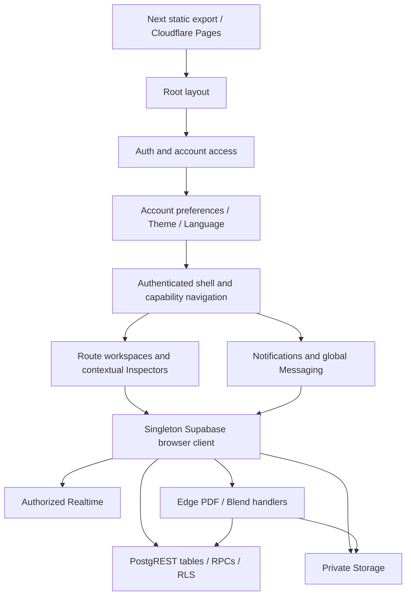

# TenOps comprehensive architecture, performance and repository audit

**Advisory handoff · October 19, 2026 · No implementation or release authorized**

Audited source: `da21615ad6f06727e4f18a75c65331a7266d2404` on local `dev`; local `main`, `origin/main` and `origin/dev` resolve to the same commit. TenDev is the development deployment of TenOps, not a separate product. This document is a source-based architecture reference and prioritized investigation/optimization proposal, not a Product Acceptance Contract or certification of hosted security.

## Contents

1. [Executive summary](#1-executive-summary)
2. [Scope, evidence and limitations](#2-scope-evidence-and-limitations)
3. [Repository and Git state](#3-repository-and-git-state)
4. [Application architecture](#4-application-architecture)
5. [Database schema and relationships](#5-database-schema-and-relationships)
6. [Authentication and authorization](#6-authentication-and-authorization)
7. [Performance findings by module](#7-performance-findings-by-module)
8. [Global performance](#8-global-performance)
9. [Technical debt and Sample Matcher inventory](#9-technical-debt-and-sample-matcher-inventory)
10. [Established contracts](#10-established-contracts)
11. [Prioritized roadmap](#11-prioritized-roadmap)
12. [Risks and preservation](#12-risks-and-preservation)
13. [Unknowns and advisory questions](#13-unknowns-and-advisory-questions)
14. [Evidence and verification](#14-evidence-and-verification)

## 1. Executive summary

TenOps has a coherent operational center: canonical Production Jobs, related planning/labor/material facts, snapshot-based documents, and separate participant-private My Work/Messaging. Its client-heavy static-export architecture places much of retrieval, enrichment, filtering and presentation on the browser; Supabase tables, RPCs, Storage, Auth and Realtime supply the backend.

The next useful performance work is targeted, rather than an application rewrite. Important earlier improvements are already in current source: complete pagination, scoped Production enrichment, early selected-period Manpower analytics, message keyset pages, account-owned recent-thread caching, lazy Messaging, and bounded PDF preview caches. Commit `1d34f18` is an ancestor of the audited checkpoint; its database-retrieval work must not be proposed as an unimplemented candidate merely because its report still says “local.”

Highest priorities:

- **Correctness before speed:** complete or explicitly bounded list contracts for Proposals, Purchase Orders, Material Usage, Production update summaries and container-size suggestions. These have uneven pagination/completeness protections. Static inspection identifies the risk; actual cap exceedance is not measured in this audit.
- **Sample list payload:** `list_samples` embeds blend rows, working-version snapshots and issued-document metadata for every returned Sample. Move toward summary/detail separation under a separately approved behavior-preserving contract. History must remain accessible and issued content immutable.
- **Messaging refresh ownership:** shell and dialog independently retrieve summary/unread/recipient information. Coalesce account-owned reads without weakening private participant authorization or incremental message reconciliation.
- **Manpower history:** selected-period analytics can become ready early, but the editor still retrieves and hydrates complete history afterward. Any on-demand history/search design needs explicit completeness and editing acceptance criteria.
- **Production supporting data:** core Jobs become visible independently, but attachment counts and update summaries read more broadly than the visible Job scope. Scope supporting reads and verify complete aggregates.
- **Security corroboration:** historical evidence of anonymous Manpower/Rework access must be reconciled with current hosted grants/policies. Hardening migrations are present in Git; application in hosted environments is not established by that fact.

No Sample Matcher route, component, service, hook, asset, script, dependency or flag was found in the current tracked `main`/`dev` application trees. Experimental implementations remain on historical branches and prunable worktree registrations. Preserve them as research until Chris approves any archive/cleanup boundary. Shared Sample catalogs, geometry, formulation and PDF code are active business functionality and are not Matcher leftovers.

Local main/dev alignment is confirmed. Fresh anonymous GETs of both public root HTML documents match the October 19 release receipt SHA-256 hashes exactly. This corroborates that release at those roots, not every currently served asset, live backend object, session behavior or custom domain. No authenticated hosted performance measurements were made.

## 2. Scope, evidence and limitations

Authorized actions were repository/Git/source/migration/document inspection, safe diagnostics and persistent local reporting. No app source was changed; no dependency was installed; no build, migration, test business record, authenticated login, push, merge, deployment or hosted configuration change was performed. No iTenify repository or configuration was inspected or modified.

This is documentation-only validation; implementation risk tiers do not authorize work here. Any later frontend behavior batch is normally Tier 2 / Testing Level 2. Reporting semantics, persistence, snapshots, PDF contracts, authorization or schema changes require Tier 3 / focused Testing Level 3. Documentation-only work requires report/path/evidence inspection, not an application build.

Evidence labels used below:

| Label | Meaning |
|---|---|
| **M** | Measured observation, with environment/date and limitations stated. Historical measurements are identified explicitly. |
| **C** | Strong concern directly supported by current source; impact or frequency remains unmeasured. |
| **H** | Plausible optimization hypothesis needing a trace, profiler or database plan. |
| **U** | Insufficient current evidence; do not treat as a confirmed defect. |

Severity is operational priority, not measured latency. Confidence is confidence in the described code behavior, not in an invented speedup. Repository SQL is a declaration history, not an effective schema dump. The supporting SQL index includes superseded/dropped objects and must not be executed as a migration plan.

Coverage: source architecture and query shapes across all primary modules; complete lexical indexes of tracked source query call sites and migration declarations; focused detailed inspection of highest-risk paths. This is not a line-by-line proof of all 307 source files, exhaustive dead-code analysis, dependency vulnerability scan or adversarial live penetration test. No React render count, heap profile, authenticated HAR, production percentile or actual SQL execution plan was collected.

## 3. Repository and Git state

### 3.1 Current boundary

| Item | Observation |
|---|---|
| HEAD / main / dev / local origin refs | `da21615ad6f06727e4f18a75c65331a7266d2404` |
| Recent authentication history | `a79e13d` explicit access resolution; `f9230b9` same-session refresh; `da21615` continuing-session refocus |
| Tracked repository | 1,094 files; 307 under `src`; 145 migration files; 315 tracked scripts |
| Initial dirty state | Four untracked October 19 release reports/JSON receipts; preserved unchanged |
| New audit state | Only this handoff directory added; nothing staged or committed |
| Remote freshness | Local remote-tracking refs inspected; no fetch/remote branch-tip verification performed |

The four pre-existing files are `docs/project-memory/2026-10-19-auth-tab-refocus-release.md`, `2026-10-19-samples-loading-loop-dual-release.md` and their corresponding JSON receipts under `docs/project-memory/evidence/`.

Full local branch and worktree snapshots accompany the report. Many worktrees are marked **prunable**; that means Git's registration path is unavailable, not that their commits or research are dispensable. Persistent non-prunable branches include the project-assets archive, sample Job Update recovery and post/spotlight work. Some branch tips are ancestors of HEAD, while others contain divergent candidate work. A branch name or age does not prove obsolescence, approval or deployability. No branch/worktree was removed.

Notable preserved boundaries include `archive/tenarten-project-assets-20261016` (`13c4e26`), `feature/sample-job-updates-recovered` (`56ef9e4`), `feature/sample-matcher-ux` (`97bc487`), `release/sample-match-tendev` (`950dd71`), and `feature/sample-match-assistant` (`a32a4b3`). Local snapshots provide exact remaining tips. Do not promote all of any branch merely because it contains one useful change.

### 3.2 Layout, toolchain and dependencies

| Area | Role |
|---|---|
| `src/app` | App Router pages, route capability wrappers, shared layout/shell, global CSS, manifests, install targets, legacy API source |
| `src/modules` | Domain workspaces, query helpers, calculations, editors, Inspector panels and shared domain navigation |
| `src/components`, `src/lib` | Account/shell controls, document viewer, activity UI, Auth/RBAC, preferences, complete readers, draft/cache helpers |
| `supabase/migrations` | Forward schema/security/RPC evolution; not proof of application |
| `supabase/functions` | PDF generation, shared business calculations/models, Production Blend handler, messaging-draft cleanup |
| `supabase/inspection`, `operations`, `config-changes`, `rollback` | Operational SQL/resources; filenames do not guarantee read-only behavior |
| `docs/project`, `project-memory`, `schemas`, `workflows`, `security` | Product intent, operational contracts, historical evidence and schema references |
| `scripts`, `tests`, `auth-qa` | Extensive focused verifiers, local fixtures, Playwright support and disposable auth QA |
| `.tmp-*`, `output`, `out`, `.next`, `tmp`, `backups` | Local candidates, exports, results and recovery materials; do not indiscriminately scan/package or delete |

`package.json:1` declares Next 16.2.2, React/React DOM 19.2.4, Supabase JS `^2.101.1`, Tailwind 4, TypeScript 5 and ESLint 9. A lockfile exists; manifest ranges are not exact installed versions. Playwright, tsx and start-server-and-test are development tools. `papaparse` supports the retained Sample corpus verifier (`scripts/verify-sample-v4-corpus.mts:3`); it is not proven redundant just because app UI has no import. `pdfjs-dist` supports document text extraction, `pdf-lib` supports active PDFs/labels, and `tus-js-client` supports resumable Messaging transfers. Do not remove any of these based on the retirement of Matcher.

`npm run dev` uses webpack; `build` is `next build`. Existing evidence uses isolated webpack exports where needed. Broad test commands can build/start servers or reset local databases; they were not run. `tsconfig.json` includes broad TypeScript patterns and excludes Supabase Edge functions, so passing frontend TypeScript would not typecheck every Edge handler.

### 3.3 Hosting and configuration

`next.config.ts:4` specifies `output: 'export'` and unoptimized images. Cloudflare Pages serves static output; authenticated browser code uses Supabase directly. This deployment is not a general Next server runtime. `src/app/api/delete-transaction/route.ts:1` and `src/lib/server-auth.ts:1` therefore require a separately demonstrated runtime before being considered deployed functionality. Static Pages alone does not establish that the POST endpoint executes. No current caller was found in the searched Activity/Transactions pages; classify as uncertain legacy/server-target code, not as a newly confirmed hosted vulnerability.

Branding is compile-time environment-derived through `src/lib/branding-environment.mjs` and `src/lib/dev-branding.mjs`; release evidence says both exports use the Production Supabase configuration. **TenDev branding does not imply an isolated database or safe test tenant.** Avoid writable hosted performance exercises. Public Supabase URL/key configuration belongs in the browser; service-role material belongs only in controlled backend environments. This report contains no environment values or credentials.

Production deploys from the approved `main` boundary; dev can intentionally differ in future. Current evidence records separate manual artifacts, skipped automatic builds, and independent branding verification. Git alignment alone does not verify Pages configuration. Fresh root hashes match the release receipt; full served-asset and backend verification were reused only as historical evidence.

## 4. Application architecture

### 4.1 Routing and module map

| Route | Workspace / responsibility |
|---|---|
| `/`, `/production` | `ProductionWorkspace`; Overview, Table, Timeline, focused Job/Inspector, scheduling, Rework and reporting links |
| `/pre-production` | `BidWorkspace`; Intake list, detail, activity, lazy updates/files and projected Planning |
| `/samples` | `SampleWorkspace`; drafts, formulation, catalog components, working history, issuance, labels and contextual posting |
| `/inventory` | Large page coordinating stock, lot adjustments, reservations, Pending Receivals, receive/undo |
| `/purchasing` | `PurchasingWorkspace`, PO editor, vendors, allocation and document lifecycle |
| `/catalog`, `/activity` | Catalog maintenance/search and Inventory transaction history |
| `/manpower-reporting` | `ManpowerWorkspace`, selected-period analytics and complete editable history |
| `/material-usage` | `MaterialUsageWorkspace`, summaries/detail/editor and Job context |
| `/proposals`, `/transmittals` | Independent document workspaces, also accessible contextually from Jobs/Bids |
| `/my-work` | `MyWorkPage`; private/shared tasks, groups, workload and attachments |
| `/settings` | Account/admin controls and supporting tools |
| `/transactions` | Retained legacy transaction route, outside the principal operational navigation |
| `/install/*`, manifest routes | Installed-app entry targets and manifests; assess current source rather than older blanket PWA retirement statements |

Route source inventory is included in `evidence/routes-and-size.md`. Module directory boundaries are useful, but not fully independent: Samples depend on Intake/Production/vendor catalogs; Production Inspector hosts document/planning/update components; My Work references canonical Jobs; shell owns global notifications and Messaging. These are legitimate relationships. Complexity comes when list loading eagerly acquires detail/reference/history that is not yet needed.

### 4.2 State, fetching and invalidation

`src/app/layout.tsx:65` composes Auth → account preferences → Theme → Language → client shell. Most workflow state is local React state/ref/memo rather than a central normalized application store. `src/lib/supabase.ts:6` creates one session-persisting, automatically refreshing client. No React Query/SWR dependency is declared. Calls mix typed helpers, RPC wrappers and page-local Supabase queries.

`src/lib/complete-rows.ts:4` is important shared infrastructure: deterministic ordering plus exact counts, requested pages of 500, actual returned offset, duplicate/count drift/incomplete-read rejection. This avoids silent row-cap totals. It is not a transactional snapshot: same-count edits or changes between separate queries can still occur. Repeated exact counts and sequential offsets may grow expensive; measure plans before replacing them. Narrow projections and scoped reads already exist in Production/Planning/Manpower.

Mutation workflows commonly reload authoritative lists. This improves reconciliation but can overfetch and reset loading presentation. Existing request generations/live flags protect several paths; coverage is not uniform. For example, Production has keyed in-flight loading and generation guards, whereas the Sample initialization/reload effect shown at `SampleWorkspace.tsx:188–239` does not show an equivalent effect cleanup. An obsolete response overwriting a newer draft/context is a concern requiring a focused navigation race test, not a demonstrated user incident.

There is no universal cross-route response cache. PDF previews use a bounded Map (`src/lib/pdf-preview-cache.ts:91`); recent Messaging threads use an owner-resetting Map (`src/modules/my-work/messaging/recentThreads.ts:6`). Text draft helpers are separate persistence, not server-cache substitutes. Any new shared reference/summary cache must have identity, capability and environment boundaries, invalidation after relevant writes, and stale-response rejection. Never reuse private results across accounts merely because a request URL matches.

### 4.3 Inspectors, loading and errors

The Inspector is a shared interaction pattern, not one universal generic component. Production has a substantial Inspector with contextual planning, attachments, updates, forms and cross-module panels; Bid and Sample workspaces implement domain-specific detail surfaces. `src/components/inspector/ActivityHistory.tsx` and `src/components/documents/DocumentViewer.tsx` provide reusable pieces. Domain-specific dirty-state and document-history rules justify some distinct implementations; a generic configurable Inspector rewrite is not supported by this audit.

Core Production Jobs publish before supporting enrichment completes. Labor/material status represents loading/unavailable distinctly instead of asserting zero. Bid files/updates load on selected tabs. Messaging has a presentation error boundary and lazy dialog. These are conventions to retain. Other paths combine independent reference reads under `Promise.all`, potentially suppressing all reference publication if one fails. Error UI is generally local messages/alerts; some awareness reads intentionally swallow failure, e.g. the global unread badge. That can show stale awareness without explaining it, but should not be “fixed” with a blocking full-shell error.

### 4.4 Realtime and resource lifetime

Global Messaging listens for recipient INSERT/UPDATE events with a 100 ms debounce; Inbox uses private participant topics, message-ID reconciliation and a separate system-message subscription. Account Notifications subscribes to user-filtered inserts and refreshes on focus/custom events. Reviewed effects call `removeChannel`, clear timers and remove listeners. A universal leak is not supported by source inspection. Reconnect/reopen traces should quantify simultaneous channels and redundant summary requests. DocumentViewer revokes its object URL; bounded caches already exist. Large PDF/image parsing and rendering remain profiling candidates rather than confirmed memory leaks.

## 5. Database schema and relationships

### 5.1 Model and evidence status

The following is a repository-contract summary. Table/FK declarations and query implementations support it; the full lexical table/function/index/trigger/policy/reference history is included in `evidence/sql-declarations.md`. Baseline Inventory/Catalog objects predate some migration coverage. No current generated `database.types`/`supabase.types` file or complete authoritative hosted schema dump was located in the tracked file-name search. Application types are mostly domain-local, casts and hand-normalization, so drift is a maintenance risk.

| Domain | Major entities and responsibilities | Representative migration / source |
|---|---|---|
| Identity | `app_users`, `app_role_capabilities`; role/active/account restrictions; account preferences and notifications | `20260818_001_rbac_identity_infrastructure.sql`; `20260818_004_final_compatibility_support.sql`; `20260821_002_friday_welcome_and_job_update_seen.sql` |
| Production | `jobs`, `job_activity`, `job_attachments`, schedule idempotency ledgers | `20260713_002_production_mvp_jobs.sql:15`; `_003_job_attachments`; `20260716_002_atomic_production_schedule_batch.sql` |
| Rework | `production_rework_cycles` and its schedule ledger, related labor | `20260817_003_production_rework_cycles.sql`; `20260824_002_manpower_rework_attribution.sql` |
| Planning | `planning_phases`, `planning_items`, phase/item libraries, atomic Production/Planning schedule ledger | `20260731_003_planning_phases_items.sql`; `20260803_001_planning_library_colors_and_phase_cap.sql`; `_003_atomic_production_planning_schedule.sql` |
| Customers/contacts | `production_companies`, `production_contacts`, protected `production_job_contacts`, Job snapshots | `20261014190000_production_contact_configuration.sql`; `20261014220000_protected_job_contacts.sql`; later detachment/archive corrections |
| Inventory | `inventory_items`, `inventory_transactions`, `pending_receivals`, receipt batches; canonical/temporary reservation and undo lineage | `docs/schemas/INVENTORY.md`; `20260923160200_partial_pending_receipts.sql`; inventory page queries |
| Catalog/vendors | `vendor_catalog`, `vendor_catalog_v2`, `vendors`, `vendor_contacts`; identity, classification, packaging and pricing | `20260722_002_purchasing_phase1.sql`; `_005_purchasing_vendor_configuration.sql`; `src/modules/purchasing/catalog-records.ts` |
| Purchasing | `purchase_orders`, `purchase_order_lines`, chip details, line allocations, issuances, PDF documents, number sequence | `20260723_001_purchase_order_issuance.sql`; `_004_purchase_order_pdf_documents.sql`; `20260923160100_po_reservation_allocations.sql` |
| Labor | `manpower_entries`, workers, tasks, reporting groups, product categories; optional Job/Rework or temporary work identity | `20260714_001_manpower_reporting_mvp.sql`; `_002_manpower_reporting_groups_and_import_correction.sql`; `20260921_001_manpower_product_categories.sql` |
| Materials | `material_usage_reports`, `material_usage_lines`; Job/temporary identity and historical display snapshots | `20260720_001_material_usage_reporting.sql:10` |
| Intake | `bids`, `bid_activity`, `bid_updates`, `bid_proposal_relationships`; file relationships to `canonical_files` | `20260901_001_preproduction_bids.sql`; `_002_bid_operational_context.sql`; `_003_bid_files.sql`; `20260902_002_bid_proposal_relationships.sql` |
| Samples | `samples`, `sample_blend_rows`, `sample_issued_documents`, `sample_working_versions`, formulation defaults/profiles, operational profiles, recent values and color-plate counters | `20260901_005_sample_color_plate_generator.sql`; `20260917_001_sample_formulation_foundation.sql`; `20260918_003_sample_formula_volumetric_profiles.sql`; `20261006190000_sample_color_plate_allocation.sql` |
| Production Blend | `production_blend_plans`; source capture, inputs, calculated model, revision and issued state | `20261005150000_production_blend_plans.sql:5`; `20261005170000_production_blend_capability.sql` |
| Proposals | `proposals`, lines, estimates, versioned estimating defaults, document/PDF records, historical access registry | `20260827_004_proposal_generator_v1.sql`; `20260908_004_proposal_generator_v2.sql` |
| Transmittals | `job_transmittals`, shared document numbering/sequence records; nullable standalone Job context | `20260728_001_job_transmittals.sql`; `_002_job_transmittal_hardening.sql`; `20260908_001_job_transmittal_linkage_semantics.sql` |
| My Work | `work_tasks`, preferences, personal task groups/memberships, attachments and deletion audit | `20260827_012_my_work_mvp.sql`; `20260902_004_my_work_task_groups.sql`; `20260831_015_my_work_task_attachments.sql` |
| Messaging | `my_work_messages`, attachments, message versions/deletion audit, preview metadata, draft lifecycle | `20260831_016_my_work_inbox.sql`; `_017_my_work_inbox_attachments.sql`; `_020_my_work_lifecycle_admin_cleanup.sql`; `20260925200000_messaging_v11.sql` |
| Collaboration/audit | `job_updates`, mentions, per-user seen state, release communications, canonical deletion audit | `20260727_001_production_job_updates.sql`; `20260819_001_job_update_account_collaboration.sql`; `20260901_004_admin_canonical_cleanup.sql`; `20261015230000_rich_release_communications.sql` |

### 5.2 Relationship diagram

Solid relationships below are supported by repository foreign-key declarations; optionality is simplified. The dashed Blend provenance edge is deliberately **not** a database FK. Job context in `work_tasks.context_type/context_id` is polymorphic/application-resolved and not an ordinary Job FK.

```mermaid
erDiagram
  jobs ||--o{ production_rework_cycles : job_id
  jobs ||--o{ planning_phases : job_id
  planning_phases ||--o{ planning_items : phase_id
  jobs ||--o{ manpower_entries : job_id
  production_rework_cycles o|--o{ manpower_entries : rework_cycle_id
  manpower_workers ||--o{ manpower_entries : worker_id
  manpower_tasks ||--o{ manpower_entries : task_id
  manpower_reporting_groups o|--o{ manpower_entries : reporting_group_id
  jobs o|--o{ material_usage_reports : job_id
  material_usage_reports ||--o{ material_usage_lines : report_id
  jobs ||--o{ job_attachments : job_id
  jobs ||--o{ job_updates : job_id
  jobs o|--o{ pending_receivals : production_job_id
  jobs o|--o{ inventory_items : production_job_id
  vendors o|--o{ purchase_orders : vendor_id
  purchase_orders ||--o{ purchase_order_lines : purchase_order_id
  purchase_orders ||--o{ purchase_order_issuances : purchase_order_id
  purchase_order_lines ||--o{ purchase_order_line_allocations : purchase_order_line_id
  bids ||--o{ bid_proposal_relationships : bid_id
  proposals ||--o{ bid_proposal_relationships : proposal_id
  bids o|--o{ samples : bid_id
  jobs o|--o{ samples : job_id
  samples ||--o{ sample_blend_rows : sample_id
  samples ||--o{ sample_working_versions : sample_id
  samples ||--o{ sample_issued_documents : sample_id
  samples ||..o{ production_blend_plans : provenance_only
  jobs o|--o{ proposals : job_id
  proposals ||--o{ proposal_lines : proposal_id
  proposals ||--o{ proposal_estimates : proposal_id
  jobs o|--o{ job_transmittals : job_id
  work_tasks ||--o{ work_task_attachments : task_id
  my_work_messages ||--o{ my_work_message_attachments : message_id
```

Canonical `jobs.id` anchors operational relationships; names/numbers are presentation, not joins. Bid conversion is a gate-driven relationship to one Job, not permission to create pseudo Jobs before Production. `production_blend_plans.sample_id` and `source_document_id` intentionally preserve provenance without FK lifetime coupling (`20261005150000_production_blend_plans.sql:3`); self-contained captured models must survive source cleanup. Not every UUID-shaped column implies enforced referential integrity.

### 5.3 RPCs, triggers, indexes and views

Important command/read boundaries:

- `save_production_schedule_batch`, mixed Rework and Production/Planning schedule batch RPCs: atomic multi-row schedule saves, concurrency checks and idempotency. Do not replace with independent browser updates.
- `receive_pending_receival_with_reservation` and later receipt/undo contracts: canonical/temporary reservation lineage and auditable correction.
- `list_bids`, Bid activity/update/file RPCs and guarded conversion: capability checks and context projection.
- `list_samples`, `create_sample_with_formulation`, `save_sample_draft`, working-version save/restore and `issue_sample_form`: mutable working state separated from immutable issuance.
- PO/Proposal/Transmittal issuance and numbering RPCs: historical snapshots and canonical allocation; PDF generation is a retryable artifact step.
- `list_my_work_tasks`, group RPCs, `list_my_work_conversations_v11`, `list_my_work_message_page_v11`, recipient and mark-read RPCs: participant/user-specific results.
- `get_my_app_access`, `has_app_capability`, `require_app_capability`: account and backend capability decisions.
- `prepare_*` / finalize cleanup RPCs: guarded lifecycle boundaries around external Storage work; they must remain retry/recovery aware.

Triggers enforce update timestamps, identity/snapshot consistency, immutable issued data, activity/notification behavior and participant broadcast events. For example, `protect_issued_production_blend` forbids changing issued plans or source capture; `broadcast_my_work_message_v11` broadcasts IDs/kinds on authorized private topics. Trigger work can affect write latency but was not measured here.

Repository indexes include Manpower work-date, Job/date and worker/date (`20260714_001_manpower_reporting_mvp.sql:65`), Sample Bid/updated and child Sample lookup indexes, Production Blend Sample/created, message/preview lookup indexes, number uniqueness and domain foreign-key support. These declarations do not prove an index exists or is used hosted. A proposed `(job_id, id)` or date/order composite index must follow actual role-aware query plans; no index is authorized or prescribed blindly.

No line-anchored `CREATE [OR REPLACE] VIEW` declaration was found in the migration search. This does not establish that no hosted or baseline views exist: older objects and dynamic SQL may be outside this history. Inventory/Catalog baseline definitions and archive-schema objects require separate hosted catalog corroboration. The SQL appendix is useful for navigation, not a net-schema reconstruction.

### 5.4 Retention and evolution

Migrations progress from July Jobs/Inventory/labor/planning/documents through August Auth/Rework/private tasks, September Intake/Samples/Messaging and October formulation authority/Blend/contacts/publishing. Files are append-only and include forward replacements. Later definitions win only if actually applied; lexical sorting alone is not an application ledger.

Issued document snapshots, working versions, historical labor/material facts, inactive references, receipt lineage, deletion audit, protected contact snapshots and research archives have different retention requirements. Speed work must not silently omit them from a result promised to be complete, rewrite historical context, or cascade-delete evidence. `20260818_002_rbac_final_enforcement_DO_NOT_APPLY.sql` is superseded and must never be applied wholesale. SQL files under `inspection` include purge/cleanup names; no blanket execution of inspection scripts is safe.

## 6. Authentication and authorization

`src/lib/auth.tsx:99` retrieves `get_my_app_access`, rejects a mismatched profile identity, checks active status and resolves explicit pending/allowed/denied/failed states. Request generations and current-session identity prevent stale profile publication. Bootstrap uses `getSession`; auth callbacks defer profile RPCs with `setTimeout` to avoid the SDK token lock. Account setup/recovery is a distinct flow.

Continuing `SIGNED_IN`/`TOKEN_REFRESHED` events preserve an already verified continuing session while revalidating access (`auth.tsx:165–179`). Different sessions/accounts, failures, revoked/inactive access and recovery must still gate correctly. **Returning to a loaded tab must not replay startup/restoration solely because a continuing auth event occurred.** This is an accepted release contract, not a loading animation optimization opportunity. Reuse `scripts/verify-samples-access-refresh.mjs` and the October 19 scenario evidence for any future auth-adjacent work.

The source sets allowed access before awaiting `ensure_my_welcome_notification` (`auth.tsx:114–118`). The older October 14 statement that startup awaits welcome must not be interpreted as proof the current shell remains blocked on it. Writable access can still invoke that RPC and trigger notification refreshes, including during profile revalidation. Do not log in solely to obtain read-only audit timings: the login lifecycle can write notifications.

Client capability mappings live in `src/lib/rbac.ts`, including account read-only restrictions and specific Messaging/Blend/label permissions. `NEXT_PUBLIC_RBAC_MODE` defaults to compatibility unless explicitly enforced. This is a client behavior switch, not proof of hosted permissions. Route/navigation checks improve UX; actual table RLS, grants, security-definer RPC checks, Storage and private Realtime authorization remain authoritative.

Edge authorization is handled through `_shared/rbac.ts` and handler-specific caller validation. A service client may persist validated backend results; it must not replace caller authorization. Security-definer functions require reviewed caller checks, controlled search paths, exact grants and participant predicates. Existing code illustrates these defenses but does not establish universal least privilege.

Historical high-priority security evidence: `2026-09-24-manpower-anonymous-hardening.md` reported anonymous access to core labor/reference tables and connected Rework endpoints and prepared narrow hardening. Current repository contains `20260924210000_manpower_anonymous_access.sql` and `20260924210100_production_rework_anonymous_access.sql`, introduced by `a76f4f8`. **Current hosted closure is U, not confirmed fixed or confirmed still exposed.** Verify effective table/column/inherited/PUBLIC privileges, policies, function grants, Storage and Realtime with a separately reviewed read-only catalog check. Do not test private record contents or mutate data. No new credentials are requested by this audit.

My Work and Inbox remain participant-private. Administrative cleanup authority is not blanket permission to read private content or create unrestricted server aggregates. Any shared summary/cache must retain `auth.uid()` ownership, capability revocation and account-switch invalidation. Intake financial visibility remains an explicit Product question; hiding a field client-side is not field-level data authorization.

## 7. Performance findings by module

Each row includes the operational implication and a focused next action. “High” confidence concerns identify code behavior; they are not a production timing claim.

| ID / module | Evidence and classification | Impact / severity / confidence | Targeted recommendation and cleanup/change risk |
|---|---|---|---|
| P1 Production summaries | **C** `production/jobs.ts:285` reads all visible `job_updates` without a page/count contract, then client-reduces; `:601` pages all attachment identities. Workspace `:269` loads these alongside scoped integration. | High: summary completeness and supporting-read growth; high confidence. Core list already publishes independently. | Scope to visible Job IDs; preserve complete counts/unseen semantics. Tier 3 if changing aggregation contracts; do not cap history and call it complete. |
| P2 Production labor/material | **C**, already optimized: `jobs.ts:317` deduplicated scopes, batches ≤200, complete fact pages. | Medium remaining scaling cost; high confidence. Lifetime labor is intentionally not date-limited. | Profile before server aggregation; preserve Rework/lifetime totals, empty-scope no-read and unavailable state. SQL aggregate changes need authorization. |
| P3 Production detail/Timeline | **H** Large Gantt/Inspector/Table, eager import graph; Inspector `:378` parallel panel initialization. | Medium potential interaction/JS cost; medium confidence on benefit. No render or long-task measurement. | Trace default Overview, first Inspector and Timeline switch. Split only costly inactive panels; preserve staged dates, keyboard/drag behavior and dirty state. |
| M1 Manpower history | **C** `ManpowerWorkspace.tsx:681` retrieves/hydrates all facts after selected report settles; UI filters/groups all loaded history. | High growth concern; high confidence. Early report readiness is already implemented. | Define on-demand historical editor/search with complete result semantics. Avoid applying a date cutoff to lifetime Production labor. Requires Product acceptance for search/edit behavior. |
| M2 Manpower period/counts | **C/H** `manpower.ts:53–68` period + two boundary reads, followed by all history; exact counts/pages. | Medium: extra total-session transfer; high confidence in shape, unmeasured current SQL cost. | Measure end-to-end readiness and total bytes separately. Plans for count/order/date predicates before new indexes; retain integer-hundredths aggregation and boundaries. |
| I1 Messaging summaries | **C**, historical **M** duplicate calls: `GlobalMessaging.tsx:53–58`; `InboxDialog.tsx:55`; October 14 empty-Inbox trace counted two summaries/two recipients. | High frequent cross-module awareness cost; high confidence duplicate ownership exists. Current populated-thread magnitude U. | One account-owned coalesced summary/recipient owner; dialog subscribes/invalidates. Keep selected-thread keyset pages and per-ID reconciliation. Race/privacy/reconnect tests required. |
| I2 Messaging SQL | **C/H** `20260925200000_messaging_v11.sql:224–238` ranks every visible ready message per peer and window-counts unread. | High potential history-dependent summary work; high confidence in query, unmeasured plan. | Obtain authorized-role EXPLAIN on sanitized staging; compare targeted latest/unread strategies. SQL/index/materialized summary change requires separate DB/security review. |
| I3 Messaging history/media | Existing good boundary: 40-row keyset RPC pages, owner-reset recent-thread cache, lazy previews and dynamic TUS import. | Medium regression risk; high confidence. Not an all-history browser loader. | Measure populated switching/reconnect/attachment preview memory before changes. Retain limits, read semantics, draft recovery and private topic checks. |
| S1 Sample list/history | **C** `samples/queries.ts:15`; `20260917_001_sample_formulation_foundation.sql:119` embeds all blend rows, all working-version snapshots, issued-document metadata per Sample. | High payload/parse/heap growth; high confidence. Nested correlated aggregates are server work, not demonstrated browser N+1 requests. | Summary list plus selected Sample detail/history pages with exact completeness/error behavior; explicit RPC/result contract review, immutable history preserved. |
| S2 Sample initialization | **C** `SampleWorkspace.tsx:211–239`: list reload plus Bids, archived-inclusive Jobs and vendors/contacts. References publish together via Promise.all; effect depends on display name/context. | Medium initial fetch/refresh/race concern; high confidence in source shape. | Load choices on demand or coalesce stable reference reads; independent errors; stale-generation guard. Preserve initial open/new and current accepted auth behavior. |
| S3 Catalog/formulation | **C** `samples/catalog.ts:29` allows short/blank searches; purchasing search pages both catalogs, sorts/combines client-side. Debounce exists in Sample effect; no claim of per-render request. | Medium broad-search transfer; high confidence. Calculation CPU benefit H. | Measure empty/short queries and typing; server classification/search projection or explicit paged selector if needed. Never alter percentage/batch/quantity authority as a speed shortcut. |
| B1 Intake/Bids | **C** complete paged list; owners in parallel; selected activity complete-read; files/updates lazy (`BidWorkspace.tsx:75–81`). | Medium broad-list/activity growth; high confidence. No list-wide Sample/Proposal N+1 proven. | Preserve good lazy behavior. Measure selected Bid activity/history and linkable document selectors before adding server filtering. Lifecycle implementation still requires scoped Product authority. |
| V1 Inventory | **C** `inventory/page.tsx:534–584`: complete stock and pending/partially-received/received rows at mount; 3,798-line coordinator. | High historical-receival growth concern; high confidence; file size alone not a defect. | Separate current outstanding view readiness from complete receipt-history access; preserve selection, partial receipts and undo lineage. Product defines history navigation if changed. |
| V2 Catalog options | **C** `purchasing/catalog.ts:25–26` limits two container-size reference sources to 1,000, client filters, does not check source errors before options assembly. | High correctness concern if catalog exceeds cap or one read fails; high confidence in limit/error shape, actual omission U. | Complete deterministic reads or authoritative distinct options; reject/label partial failure. Preserve packaging and preferred-vendor normalization. |
| V3 Catalog search | Already complete `catalog.ts:68–105`: parallel sources, 250-row pages, exact count/drift checks, escaped query grammar. | Medium potential expensive broad ILIKE/exact counts; high confidence in shape. | Plans/payload trace before search indexes; no arbitrary top-N cut that silently drops offers or changes pricing choice. |
| O1 Purchasing lists | **C** `purchasing/queries.ts:35` unpaged PO summaries include all line IDs; `:12` vendor query embeds contacts; `:46` selected detail is appropriately separate. | High potential capped list/search and avoidable list payload; high confidence in source. | Explicit complete or server-paged list contract, count instead of line identities if equivalent; details on selection. Preserve issuance/receiving/allocation semantics. |
| D1 Proposals | **C** `proposals/queries.ts:54–57`: unpaged select-star lists, full list + relationship set to calculate linkable documents. | High list completeness/payload risk; high confidence. | Narrow summary projection and complete/paged linkability contract; retain generic/Job/Bid associations and issued snapshots. |
| D2 Transmittals/PDFs | **H/U** `transmittals/queries.ts:5` delegates to list RPC; viewer/cache reuse exists. No current timing or proven excessive payload. | Medium follow-up; medium confidence. | Trace selected Job/standalone list, generation vs preview vs signed URL. Do not conflate Edge generation time with browser rendering. |
| R1 Material Usage | **C** `material-usage/actions.ts:23–44` unpaged historical summary query, detail fetch includes lines only on selection. | High completeness risk at cap; high confidence in source. | Complete/paged summaries and server period/search predicates with completeness UX; preserve historical snapshots and separate labor/material facts. |
| W1 My Work | **C** `my-work/queries.ts:9` loads tasks/groups/memberships; `:17` pages all authorized attachment identities to count locally. `MyWorkPage.tsx:191–236` separates choices/counts. | Medium result/attachment growth; high confidence. Task JSON RPC transport cap behavior needs explicit contract review. | Participant-safe summary counts and scoped detail; coalesce recipients with Messaging only under same authorization. Do not introduce Admin read bypass. |
| N1 Notifications | **C** `AccountNotifications.tsx:145–167` focus + custom-event + insert refresh; auth welcome RPC can dispatch refresh. | Medium repeated awareness work; high confidence. No measured storm. | Debounce/coalesce overlapping read refreshes with generation/owner guards. Keep arrival onboarding and real unread semantics; no startup remount. |
| A1 Activity/legacy | **C** `activity/page.tsx:146` explicit 500-row history limit; `/transactions` retained. | Medium: potential incomplete historical view, high confidence. Whether recent-only is intended U. | Product confirms recent-window label vs complete paged audit search. Do not delete or truncate history to reduce load. |

### 7.1 Query patterns and completeness

A complete business result and a bounded interface are compatible if the UI supports paging/search/export clearly. They are not compatible if a transport cap is silently treated as all records. A query without `.range` is not proven to truncate today; severity reflects growth and correctness exposure. JSON-returning RPCs can have large single payloads even when row-based caps do not apply. Table-returning RPCs and embedded relation shapes require explicit tests, not blanket assumptions.

No demonstrated browser list-wide N+1 was found in the principal Production loader: it uses batched scoped enrichment. Sample list SQL uses per-Sample correlated child aggregation, which may have N-dependent server work; actual execution depends on indexes and plans. Bid selected activity is a detail request, not automatically an N+1 defect. Inspector requests may safely run in parallel only where their permission/context/data dependencies are independent.

Client joins are appropriate for small already-authorized dictionaries and visible scope. Repeated full-history joins/filters, transferring all attachment IDs only for counts, and rebuilding full document-linkability sets deserve targeted measurement. New server aggregations must preserve authorized result sets, exact historical semantics, failure states and account isolation.

### 7.2 Reused measurements, with their real limits

October 14 retrieval evidence used a fixed synthetic 12,001-entry dataset and 20 ms fetch delay. Before/after selected-report prerequisites were 25 requests / 12,001 rows / 8,630,544 JSON bytes / 813 ms versus 5 / 1,203 / 845,147 / 100 ms. Production enrichment was 26 / 13,001 / 1,577,151 / 652 ms versus 6 / 2,402 / 295,452 / 97 ms. These are historical fixture samples, exclude real SQL/Auth/rendering, and the baseline material result was truncated. They demonstrate the intent and deterministic coverage of already integrated work, not current production speedups.

That same report records total labor transfer across both phases increasing to 9,475,691 bytes because complete editor history still follows the early report. This distinction matters: earlier usable analytics did not remove the all-history cost. Historical hosted privileged HEAD counts/latencies bypassed user RLS; a non-ANALYZE EXPLAIN attempt failed `406 / PGRST107`. No valid production SQL execution timing or index plan resulted.

Sources: `docs/project-memory/2026-10-14-database-retrieval-candidate.md`, its `evidence/2026-10-14-retrieval-{before,after,hosted-readonly,browser-validation,validation}.json`. Earlier September performance/Messaging reports remain useful background but are not treated as current source truth.

## 8. Global performance

### 8.1 Startup, bundle and navigation

The root page directly imports ProductionWorkspace (`src/app/page.tsx:1`), which imports substantial Table/Gantt/Inspector functionality. Current release receipt records the Production page chunk at **390,265 raw bytes**, layout chunk **71,869**, Sample page **160,825**, and My Work page **74,318** for TenOps. These are historical individual emitted-file sizes from the accepted release, not compressed wire transfer, exclusive route cost, total JS, parse time or first usable-page time. Shared chunks are separate and caching/prefetch changes actual network behavior. No new build was needed to reuse this evidence.

Dynamic boundaries already exist for InboxDialog, Intake Planning, Bid Planning card, Sample label editor and resumable transfer library. Additional splitting should follow a route waterfall/CPU trace. Production Timeline and heavy import/document-extraction paths are candidates, but static import existence alone does not prove every dependency is loaded on startup: bundler tree shaking and split graphs must be checked.

The shell uses Next Link for principal navigation (`client-layout-shell.tsx:204,236,260`), so do not assume every navigation is a full document reload. Full-page/direct navigation still reinitializes route/auth state; client navigation may remount workspaces while retaining providers. Profile object updates can propagate context renders even if the page stays mounted. Use React Profiler and request traces to distinguish rerenders, remounts, refetches and deliberate startup gating.

### 8.2 Render, CPU and memory hypotheses

| Concern | Evidence strength | Appropriate next evidence |
|---|---|---|
| Large table/Gantt/editor transforms | H; many client-derived views, no profiler | Representative dataset, keystroke/scroll/Inspector long tasks, React commits; optimize only identified expensive derived work |
| Context updates | H; root Auth/preferences/theme/language composition | Measure consumer commits during refresh and user actions before splitting providers |
| Broad Sample/history payload heap | C for data shape; U for retained heap | Response bytes, JSON parse duration, heap after repeated select/close/navigation |
| PDF/image work | H; active extraction/generation/preview, URLs/caches have cleanup | First vs repeat preview, object URL/blob lifetime, worker/long-task trace |
| Subscription leak | U; reviewed cleanup is present | Channel count across open/close/reconnect/account-switch; do not assert a leak from multiple legitimate subscriptions |
| Exact count + offset pages | C for query shape; H for query cost | Authorized role plans and increasing-history fixtures; evaluate keyset/count alternatives without losing completeness |

No production improvement percentage is predicted. Perceived readiness, total session bytes, historical completeness and interaction responsiveness are separate acceptance metrics.

## 9. Technical debt and Sample Matcher inventory

### 9.1 Cleanup classifications

A = active functionality; B = shared required code; C = obsolete app code; D = preserved research/history; E = generated/local artifacts; F = dependency/intent uncertain. No deletion is authorized.

| Item | Class / severity / confidence | Operational impact, dependency and cleanup risk | Suggested disposition |
|---|---|---|---|
| Current Sample/Formulation/Blend/labels and Sample catalog | A/B; high preservation; high | Active documents/calculations; shares catalogs, geometry, PDFs, Job links | Preserve; not Matcher code |
| Matcher experiment branches | D; low runtime severity; high | Retained algorithms, UI, mobile/coin/chip research and tests; potential future reference | Keep immutable/recoverable; separate archive decision if desired |
| Historical Matcher worktree registrations | D/E; low; high | Several prunable paths; commits still branch-reachable | Inventory/recovery first; do not prune by default |
| Current-tree obsolete Matcher implementation | C category has **no identified member**; high confidence within tracked tree | No matching current runtime files/text/dependency found | No current-source Matcher removal batch justified |
| Legacy `/transactions` and API/server-auth source | A/F; medium; medium | User reachability and static-host runtime are unresolved; historical transaction integrity sensitive | Determine consumers/runtime before deprecation; no direct delete authorization |
| 315 scripts and historical evidence | A/D/F; medium maintenance; high count | Mix current deterministic contract gates, one-off fixtures and release utilities; many can mutate | Annotate purpose/input/mutation class; do not bulk run or delete |
| `.tmp-*`, `.next`, `out`, `output`, test results/backups | E/D/F; medium disk/accidental build risk; high presence | Some directories hold worktrees, bundles, recovery or sensitive captures | Owner/retention inventory; preserve accepted artifacts; never include wholesale in handoff |
| Oversized coordinators | A; medium maintenance; high | Inventory 3,798 lines; PO editor 1,572; Samples 1,553; Inspector 1,524; Gantt 1,452 | Extract narrow domain seams only when needed for a validated batch; no volume-driven rewrite |
| Dense/minified hand-authored lines | A; medium review risk; high | Some large logic fits on one line; line count understates complexity | Behavior-neutral formatting in separately bounded cleanup; avoid mixing into semantic diffs |
| Hand-written database types/casts | B/F; medium; high | Contract drift can hide until runtime; frontend tsc excludes Edge | Consider generated schema types from sanitized authoritative schema, then incremental adoption |
| Repeated complete-reader variants | B; low/medium; high | Catalog has custom 250-row/error behavior; shared reader says “Planning” for other modules | Share only verified common invariants, preserve caller errors/page contracts; cosmetic messages separate |
| Repeated Job selectors | B; low/medium; high | Shared Production Job options already exist; some domain-specific adapters remain | Adopt established helper where equivalent; do not generalize unrelated identities |
| Stale architecture/candidate documentation | D/F; high decision risk; high | September CURRENT_STATE/manifest say generic Samples planned; October14 candidate prose says local although integrated | Add reviewed status pointers, distinguish intent vs source; retain historical evidence without rewriting history |
| Dependency cleanup | B/F; low; medium | All nonframework libraries have a located app/Edge/tooling use; no redundant package proved | Inspect lock/import reachability before changing dev/runtime classification |

### 9.2 Matcher assessment in detail

Current `main` and `dev` have identical tracked trees and no case-insensitive `sample.match`/`matcher` path hits. Current `src`, package/config and searched script/assets text had no Matcher references. `ToolboxLauncher` has no active Matcher entry. No current dedicated Matcher dependency or flag was located. Therefore there is no identified current-source cleanup to improve the shipped bundle by “removing Matcher.” Ignored old exports/worktrees may still contain historical generated copies; these are not current source or proof of active deployment.

`feature/sample-matcher-ux` (`97bc487`) retains:

- `src/app/toolbox/sample-match/page.tsx`.
- `src/lib/sample-match/{access,chip-detection,color-analysis,engine,geometry,nickel,report}.ts`.
- `src/modules/sample-match/{ChipResults,PhotoWorkspace,SampleMatchWorkspace}.tsx` and `sample-matcher.css`.
- Review launchers and `verify-sample-match*` / `verify-sample-matcher*` scripts.
- October 13 research/review documents for assistant, chips, nickel scale, touch handling and UX.

Related historical tips include `a32a4b3`, `950dd71`, `e1c2a88`, `cc0c716` and `97bc487`; all-branch history contains those experiments. `git worktree list` marks Matcher-related temporary registrations prunable. This is intentionally retained history for audit purposes; whether every historical file was explicitly designated permanent research remains a Product/owner retention decision. No historical algorithm, asset or experiment was copied into this package or iTenify.

Orphaned assets and dead exports outside Matcher remain **F**: filename searches and lexical call indexes cannot prove dynamic/CSS/runtime reachability. Do not label all unimported files obsolete. No exhaustive unused-export analyzer or dependency installation was performed.

## 10. Established contracts

Recorded Product rationale comes from `docs/project/PROJECT_MANIFEST.md`, `docs/project-memory/BLUEPRINT.md`, root `AGENTS.md`, workflow documentation and scoped later decisions. The canonical external Product/Architecture thread was not supplied, so this report does not claim to have reconciled its complete history.

- **Operator-first density:** familiar tables, inline/contextual actions, stable language, compact interfaces and progressive disclosure. Product aim is operational clarity, not feature count or a generic ERP. Avoid replacing these with a broad card-based redesign to achieve performance work.
- **Canonical identity:** `public.jobs` is the one Production Job model; UUID relationships survive renamed projects/job numbers. Reporting groups, Bid line items and temporary work labels are not Jobs.
- **Contextual Inspector:** allow review/editing in the current operational context, preserve drafts and dirty-state decisions, and load heavier related panels when useful. Similar visual patterns do not require one universal implementation.
- **Staged scheduling:** planned dates are reviewed/staged, conflict-aware and saved atomically, never silently save-on-blur through ordinary fields. Rework and Planning coordination retain their own validated boundaries.
- **Historical documents:** independent/generic Proposal/Sample/Transmittal contexts can exist; later links do not rewrite issued history. Working formulation state, captured versions, issuance and generated PDF are distinct states.
- **Historical completeness:** reference values deactivate instead of deleting history; labor totals use unchanged integer-hundredths semantics; reservations/receipts preserve identity and undo lineage. Search and reporting must not silently operate on transport-capped subsets.
- **Capabilities and privacy:** client affordances are not backend authority; account restrictions remain restrictions, never extra visibility grants. Admin cleanup does not imply private Inbox/My Work reading rights.
- **Environment/release:** TenDev is development deployment branding; safe data isolation must be demonstrated separately. Promote an approved file/commit boundary; no dev-wholesale merge or migration-ledger assumptions.
- **Current refocus acceptance:** continuing verified sessions retain loaded workspaces while access is revalidated. Startup animation is not replayed for routine tab return.

Inference from current code: the product increasingly favors early core-list readiness, lazy contextual detail and authoritative post-write reconciliation. This inference is consistent with operator-first principles but is not a new requirement to cache every query or avoid all reloads.

Documentation conflicts are explicit: generic Samples, Intake and some PWA/install behavior have current implementations despite older “planned/abandoned” statements. Their presence does not authorize new lifecycle work; `OPEN_QUESTIONS.md` records both unresolved decisions and scoped later approvals. Chris must resolve material policy/UX changes, particularly Bid conversion, financial visibility and history/search behavior.

## 11. Prioritized roadmap

These are proposals for advisory review. Effort is relative (small/medium/large), not a schedule commitment. No implementation, migration or release preparation is authorized by this report.

### Batch 0 — Establish a safe measurement and security baseline

**Category:** prerequisite / DB-security follow-up. **Effort:** small to medium. **Scope:** reconcile hosted hardening status by narrowly reviewed catalog reads; reuse release receipts and representative read-only fixture data; choose workflows and metrics. Obtain current request/byte/readiness traces from safe authorized sessions only where startup writes are blocked or expressly approved.

**Benefit/evidence:** prevents optimizing stale candidates and identifies actual user delays; historical plans are missing and security closure unknown. **Risks:** privileged timings misrepresent user RLS, login can write notifications, TenDev shares backend. **Acceptance:** each measurement records exact SHA/environment/role/data size/cache state and separates usable list, detail and history readiness; anonymous privilege closure explicitly verified or left open. **Validation:** no-record-content catalog inspection, safe fixture traces, no migrations. **Release:** none. A security finding goes to a separate authorization boundary, not a performance release.

### Batch 1 — Complete list/summary contracts

**Category:** quick/moderate correctness work. **Effort:** medium. **Scope:** P1/O1/D1/R1/V2; explicitly define complete lists vs server-paged recent views. First fix error/partial-state handling and deterministic completeness, then narrow projections and visible-Job summary scope.

**Benefit/evidence:** avoids silent historical omission and reduces avoidable payloads; current unpaged select-star/list patterns and explicit container cap support it. **Risks:** more requests when old behavior silently truncated; permission differences; count drift; changing linkability/search results. **Acceptance:** provider caps below requested page size, >1,000 records, duplicate/count drift, failed second page, empty authorized result, cross-account transition and archived/focused Job cases all produce complete results or explicit unavailable states. Attachment/update counts match complete authorized reference data. **Validation:** focused Tier 3 data-contract fixtures plus adjacent browser/TypeScript/ESLint/diff/build; no unrelated suites. **Release:** reviewed client-only boundary where existing APIs suffice; any new RPC/index requires separate DB approval and compatible sequencing.

### Batch 2 — Messaging and notification read coalescing

**Category:** quick/moderate shared improvement. **Effort:** medium. **Scope:** I1/N1 only; account-owned in-flight coalescing/summary state and recipient reuse; debounce overlapping awareness invalidations. Preserve I2 SQL unchanged initially.

**Benefit/evidence:** removes known duplicate ownership affecting every route; prior empty-Inbox trace provides a baseline shape. **Risks:** stale unread state, dropped updates, account leakage, late-response overwrite, reopen/reconnect drift. **Acceptance:** one coalesced summary/recipient request per concurrent invalidation epoch, correct unread/latest state after receive/read/edit/delete/reconnect; no former-account results after switch/revocation; no startup replay. **Validation:** controlled populated thread fixture, concurrent open/menu/notification/focus traces, race and denial cases, existing participant/privacy/reconnect verifiers chosen for delta. Normally Tier 2, escalate to Tier 3 for persistent cache/privacy-contract changes. **Release:** bounded client-only rollout after exact candidate review; no broad global-store rewrite.

### Batch 3 — Sample summary/detail separation

**Category:** structural retrieval improvement / DB contract. **Effort:** medium to large. **Scope:** S1 plus S2: summaries for list, selected Sample detail, explicit working-version/document access, stable choices on demand. Retain existing issuance/calculation semantics.

**Benefit/evidence:** removes nested snapshot history from initial list payload. **Risks:** dirty drafts, stale selection, missing version/document controls, numbering/permissions, backwards client compatibility. **Acceptance:** list usable without history payload; detail matches existing Sample; all versions and issued documents remain reachable; slow old requests cannot overwrite selected draft; working/formal/posted artifacts preserve snapshots and account scope. Record bytes/readiness at small and large histories without an invented target percentage. **Validation:** Tier 3 lifecycle/compatibility/database and focused browser/PDF gates. **Release:** Product acceptance of loading/search behavior, narrow additive RPC migration review, staged compatible client adoption, no applied-migration edits.

### Batch 4 — Historical Manpower and Inventory readiness

**Category:** structural/Product decision. **Effort:** medium to large. **Scope:** M1/M2/V1: on-demand complete history search/editor, current outstanding receivals independent from received history; preserve cross-history results and correction paths.

**Benefit/evidence:** removes remaining all-history initialization rather than redoing early-period analytics. **Risks:** hidden old labor/receipts, incorrect totals, bulk operations/search on partial sets, undo lineage. **Acceptance:** selected-period analytics and lifetime Job labor equal existing reference; global history search finds old rows; historical edit/bulk selection/undo remains complete and explicit; partial pages never produce complete-looking totals. Measure total session bytes separately from early readiness. **Validation:** Tier 3 integrity/history/date-boundary/Rework/receipt fixtures plus exact browser workflows. **Release:** Product defines history UX first; any RPC/index independently reviewed. No blanket date cutoffs.

### Batch 5 — Plans and targeted server aggregation/search

**Category:** DB/security authorization. **Effort:** medium. **Scope:** I2 and measured bottlenecks in Production counts, catalog ILIKE/exact counts, labor/date queries. Evaluate plans under real caller predicates against sanitized staging.

**Benefit/evidence:** may reduce history-dependent scans/transfer; current source establishes shapes, not SQL time. **Risks:** security-definer widening, write amplification, stale aggregates, unsupported assumptions about deployed indexes. **Acceptance:** same authorized result sets and histories, explicit execution-plan comparison and payload/readiness measurements; mutation/reconnect invalidation remains correct. **Validation:** Tier 3 role/participant denial and data-equivalence plus plan evidence; indexes not chosen by intuition. **Release:** narrow append-only migrations approved by Chris, compatible function signatures, exact hosted object verification; no wholesale RBAC enforcement.

### Batch 6 — Measured bundle/render improvements

**Category:** targeted frontend optimization. **Effort:** small to medium per measured seam. **Scope:** P3/global trace results: deferred inactive Timeline/Inspector/heavy extraction, memoization only for expensive actual transforms.

**Benefit/evidence:** reduce default-route JS/CPU if traces demonstrate it; current emitted chunks warrant investigation. **Risks:** suspense/loading changes, lost staged dates, first-open delay, dirty state and focus. **Acceptance:** compare unique initial JS compressed/raw totals, parse/long tasks and usable readiness under fixed conditions; Table/Timeline/Inspector preserve stage/draft/keyboard behavior, direct links and repeat navigation work; refocus test unchanged. **Validation:** Testing Level 2 focused browser/profiler plus TypeScript/ESLint/diff/build; PDF/semantics touched escalates to Level 3. **Release:** small client boundary; no framework migration or dependency addition needed by default.

### Batch 7 — Repository/document cleanup

**Category:** repository cleanup / quick wins. **Effort:** small then incremental. **Scope:** reviewed current-status pointers, verifier manifest with mutation classes, candidate/worktree retention map; only later remove proven dead code/assets under explicit scope.

**Benefit/evidence:** stale “local/planned” descriptions and many preserved artifacts increase decision/release risk. **Risks:** losing research, bundles/recovery or historical evidence; confusing source references with deployed state. **Acceptance:** every retained/deprecated item has owner/purpose/evidence, current docs link to actual source checkpoint, all candidate commits remain recoverable; no application behavior change. **Validation:** documentation paths/links/diff and reachability checks. **Release:** documentation-only; branch deletion, destructive cleanup, commit/push remain separately authorized. No Matcher runtime-removal batch is justified at current HEAD.

## 12. Risks and preservation

1. Preserve the tab-refocus fix and distinguish routine continuing-session revalidation from genuine account change, revocation or recovery. Never hide an access-verification failure behind cached permission state.
2. Keep canonical Production identity and approved Bid gate semantics. No pseudo Jobs or reused mutable names as relationship keys.
3. Preserve complete historical labor/material/audit results. Transport caps are not business retention policy. Do not convert “loading/unavailable” to zero.
4. Preserve immutable issued documents, captured source models, protected contact snapshots, working history and independent/generic document contexts.
5. Keep staged atomic schedule saves, concurrency/idempotency and receipt/undo lineage. Do not parallelize dependent mutations as a performance shortcut.
6. Preserve private My Work/Inbox participant access at table/RPC/Storage/Realtime/cache boundaries. Admin lifecycle authority does not confer routine private read access.
7. Treat hosted state and local declaration history separately; the migration ledger is not sufficient. Never apply the superseded enforcement migration or edit applied history.
8. TenDev can share Production data. Synthetic read-only adapters, safe isolated databases or expressly approved accounts are required for meaningful behavioral measurement.
9. Preserve unrelated dirty files, archives, candidate commits, worktree recovery and research. No branch, export or backup is deleted under audit authorization.
10. Future manual review uses the actual application at `http://localhost:3000` after checking process ownership; no app server/process was started or replaced for this report.

## 13. Unknowns and advisory questions

**Evidence gaps:** current effective hosted indexes/RLS/grants/functions/Storage/Realtime; anonymous-hardening closure; authenticated production latency and query plans; populated Messaging summary cost; Sample/version payload distributions; actual list sizes vs provider cap; render/heap/long-task baselines; remote branch tips beyond local refs; custom-domain/full-asset freshness; operational consumers of legacy server/transaction code; exhaustive asset/export reachability. These gaps are explicitly U and do not justify speculative rewrites.

**Product decisions before behavior changes:**

- Which history/search surfaces promise all-history results versus an explicit recent window? How must global search, bulk actions and export work when history is paged?
- What exact Sample list/detail/version-loading experience is acceptable without changing formulation, numbering, approval or document semantics?
- Which Bid conversion/financial visibility and Sample lifecycle questions in `OPEN_QUESTIONS.md` have an accepted scoped contract beyond the recorded Early Access approvals?
- Does the 500-row Activity view intentionally mean recent activity, or must it support complete historical search?
- Which experiment/candidate artifacts have mandatory long-term retention, and who owns approval of eventual destructive cleanup?

**Engineering questions resolvable without new Product policy:** identify actual route request owners and duplication; inspect role-aware plans; measure payload/CPU; consolidate in-flight identical reads; add narrow completeness guards; document current status and preservation. These should proceed only after a separately authorized implementation boundary, not through this audit.

The canonical external Product/Architecture conversation was unavailable. No new business rules are inferred from older docs where current decisions are unresolved. Stop here for Product/Architecture advisory review.

## 14. Evidence and verification

### 14.1 Supporting package

- [Repository facts and fresh root hashes](evidence/repository-facts.json)
- [Local branch tips/tracking descriptions](evidence/git-branches.txt)
- [Worktree registrations and preservation map](evidence/worktrees.txt)
- [Initial four untracked files](evidence/initial-status.txt)
- [Route inventory and source concentrations](evidence/routes-and-size.md)
- [Source query/RPC/channel call sites](evidence/query-call-sites.md)
- [SQL declaration history: tables, functions, indexes, triggers, policies and references](evidence/sql-declarations.md)
- [Historical evidence excerpts and provenance](evidence/reused-evidence.md)
- [Sample Matcher branch path comparisons](evidence/sample-matcher-branches.json)
- [Integrated retrieval ancestry](evidence/retrieval-ancestry.json)
- [Audit validation receipt](evidence/validation.json)

All `path:line` references in prose refer to audited source at `da21615`, unless explicitly identifying a different historical branch. Supporting indexes provide exact line navigation for additional declarations. Historical reports can be stale; source comparisons above override their old release-status prose.

### 14.2 Primary durable references

`AGENTS.md`; `docs/project/PROJECT_MANIFEST.md`; `docs/project/ENGINEERING_EXECUTION_STANDARD.md`; `docs/project-memory/{BLUEPRINT,CURRENT_STATE,OPEN_QUESTIONS}.md`; `docs/schemas/{JOBS,INVENTORY,PURCHASING,OPERATIONAL_REPORTING,ATTACHMENTS}.md`; `docs/workflows/PLANNING.md`.

Current release evidence: `docs/project-memory/2026-10-19-auth-tab-refocus-release.md`, `2026-10-19-samples-loading-loop-dual-release.md`, their JSON receipts, `2026-10-19-auth-tab-refocus.md`, and `2026-10-19-samples-access-refresh-loop.md`. These include accepted fixture/served-bundle scenarios and physical tab-switch acceptance as reported by the release, not new testing here.

Performance history: September 22/25/28 platform/performance/Messaging reports and JSON evidence; October 14 database-retrieval report and five linked measurements/validation receipts. Security: September 24 anonymous-hardening report and the two narrow hardening migrations. Product-specific later contracts: Sample batch-first/working-pour, Production Blend, Intake reconciliation/Early Access and protected contacts reports under project-memory.

### 14.3 Checks actually performed

- Read root guidance, Product principles, current/open-question docs, recent release/performance/security reports; inspected relevant current source and SQL.
- Inspected Git HEAD/main/dev/local origin refs, history, branch tips and worktree registrations; verified retrieval optimization ancestry.
- Searched current tracked main/dev paths and runtime/tooling text for Sample Matcher, compared historical experiment branch file inventory; no deletion or checkout.
- Generated lexical query and SQL declaration indexes and current source size/route inventory; these are navigation aids, not static-analysis proofs.
- Anonymous public HTTPS GET of `https://tenops.pages.dev/` and `https://tendev.pages.dev/`; resulting HTML hashes matched the corresponding October 19 receipt. No authenticated API or private business data read was required.
- Validated local report links/source paths, JSON parseability, archive contents, final Git boundary and diff whitespace. No application build, suite, browser session, DB introspection or security mutation test was run.

**Completion state:** advisory reference package produced. Recommendations are not implemented, no release is prepared, and all deployment/schema/security changes remain subject to Chris's separate authorization.
