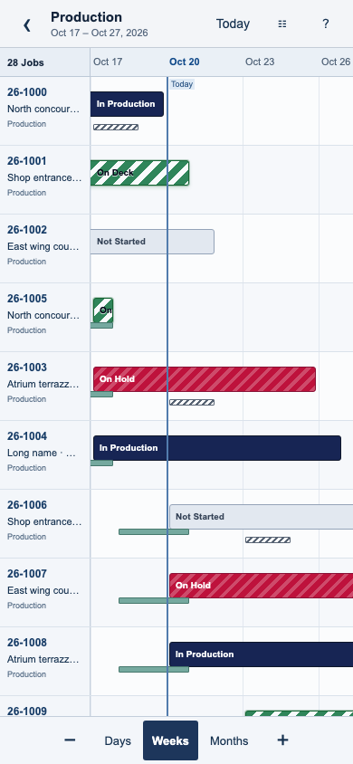
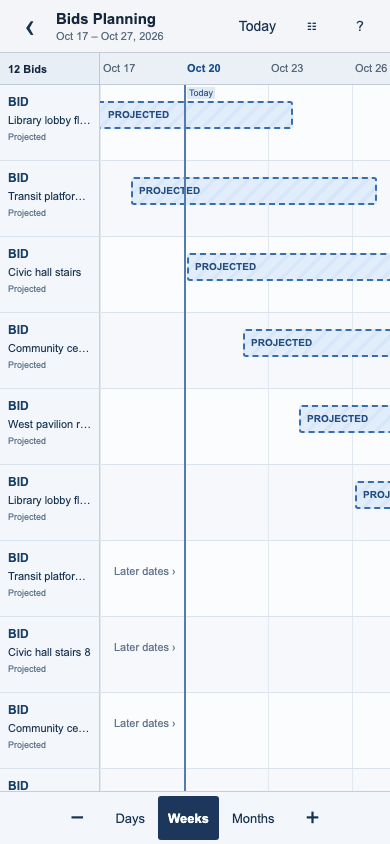
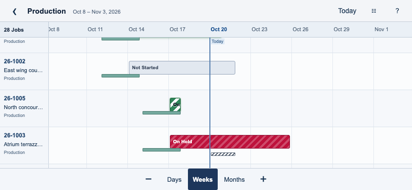
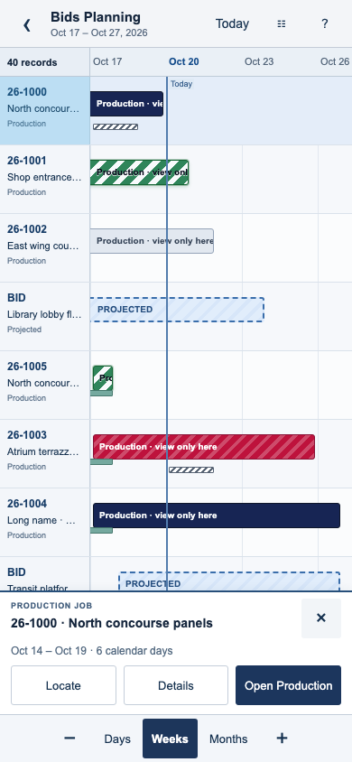
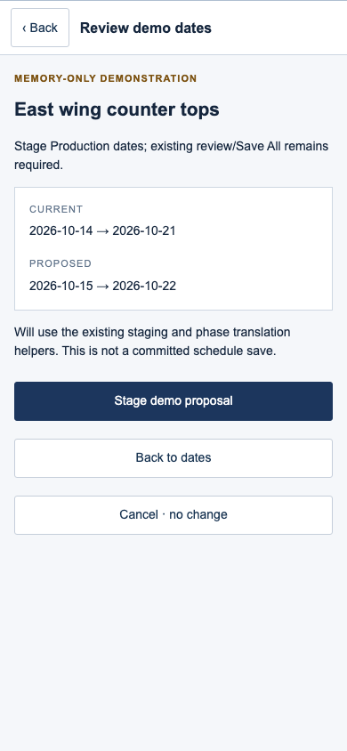

# TenOps — full-screen mobile Timeline feasibility

**Product/Architecture review · October 20, 2026 · Isolated research prototype · Production and Bids Planning**

## 1. Recommendation

**Advance Option A to an operator and physical-iPhone pilot, using one mobile presentation layer for both Production and Bids Planning.** The prototype demonstrates a practical full-screen surface, shared two-dimensional panning, focal pinch zoom, visible scale alternatives, persistent row identification, selection, detail return and explicit editing entry points. No observed architectural blocker requires Option C. This establishes technical feasibility, not final operator usability or Safari acceptance.

Share the viewport, gestures, navigation, selection and surface lifecycle. **Keep module-specific loaders, eligibility, edit authorization, schedule staging, projection saves and conversion rules outside that layer.** Bids projections remain tentative Bids; Production-reference rows in Bids remain view-only there. A common mobile view must not turn projected windows into committed schedules or invent a universal save command.

The existing desktop implementations remain untouched. The new surface uses existing pure scheduling helpers and a real shared `JobTag`; an optional reference page mounts both original Timeline components, unmodified, using offline shims. The prototype is not a second TenOps application and has no backend.

## 2. Review URL and short walkthrough

The local server is running at **[http://localhost:3018](http://localhost:3018)**.

- [Production](http://localhost:3018/production)
- [Bids Planning](http://localhost:3018/bids)
- [Bids Combined](http://localhost:3018/bids?source=combined)
- [Read-only Production](http://localhost:3018/production?readonly=1) / [read-only Bids](http://localhost:3018/bids?readonly=1)
- [Original renderer references](http://localhost:3018/reference.html)

Use a narrow phone viewport first, then rotate to landscape. The review date is deliberately fixed at **October 20, 2026**. All names, dates and relationships are synthetic.

1. Drag from blank space **or a bar** horizontally, vertically or diagonally. No schedule changes.
2. Pinch around a date; that date stays under the gesture midpoint. Use **−/+**, **Days / Weeks / Months**, or **Today** without learning gestures.
3. Tap a row/bar, or hold briefly, to select. Full identity and dates appear in the selection tray. **Locate** returns to its row and date interval; **Details → Back** retains the viewport.
4. In Production, **Edit dates → Review date change → Stage demo proposal** uses the existing staging and phase-translation helpers. It cannot execute real Save All.
5. In Bids, **Edit projection → Review → Apply demo projection** changes only the synthetic window in memory. It does not reserve capacity, convert a Bid or create a Job.
6. In Bids Combined, select a solid Production row. It offers **Open Production**, not Edit projection. Browser Back returns to the previous Bids context/selection.
7. Use the filter control for search, sources and Overview. Use `?readonly=1` or the launcher persona switch to compare disabled editing.

Exit returns to the isolated research launcher, not to an actual authenticated TenOps workspace. Date edits and Production proposals are memory-only and reset on reload. There is no real login, permission lookup, read receipt, persistence, conversion, document generation or hosted request.

**Port exception:** port 3000 was occupied by the preserved Node review process. It was neither replaced nor stopped. Port 3018 is the explicitly isolated prototype, not an application candidate masquerading as the canonical TenOps review.

## 3. Baseline and authorization

Inspected local `dev`, `main`, `origin/main` and `origin/dev` resolve to **`01e5e839fdba0256023077cf1d85c2d4dd15212c`**. The new Performance release receipt records Waves 1–4 and the Manpower refinement as released to TenDev and TenOps. This supersedes the pending-release wording in the earlier mobile audit. That release status was read from its receipt; this task did not revalidate hosted deployments or contact the backend.

Neither Timeline renderer changed between earlier baseline `da21615` and current `01e5e83`. Current source and working-tree state are authoritative for this investigation. See [source/boundary evidence](evidence/source-boundary.json) and [capability index](evidence/source-capabilities.md).

Scope: local source investigation, isolated interactive prototype, focused validation, screenshots and documentation only. No application source, desktop renderer, migration, policy, role grant, hosted data, release branch or iTenify content was modified. No commit, merge, push or deployment occurred. Existing untracked work was preserved.

Risk classification: **Tier 2 isolated interactive research**. Validation is focused prototype behavior, imported-helper compatibility, bundle isolation, artifact checks and visual inspection. This is not an application release or a claim that every mandatory Level 2/3 application gate passed. The isolated artifacts were bundled; no Production Next build or broad suite was needed. Any later persistence/security/lifecycle implementation requires its applicable Tier 3 gates and separate authorization.

## 4. Existing capability assessment

### Production Timeline

Primary sources: `ProductionGantt.tsx`, `ProductionWorkspace.tsx`, `timeline-preferences.ts`, Production/Planning staging helpers, Planning schedule/timeline models and `globals.css`.

| Area | Current implementation |
|---|---|
| Scales | **Days, Weeks, Months, Year**; defaults 64/42/20/10 px per day; respective clamp ranges 32–96, 20–64, 8–32, 4–18. Per-scale width adjustments, Fit, Today, row density and resizable desktop rail. These are date presentation scales, not different scheduling calendars. |
| Date domain | Generated from Production start/end and requested delivery, Today, minimum span/padding and near-edge domain extension. Fit centers participating rendered Production bars at the current scale; it does not perform resource optimization or auto-reschedule Jobs. |
| Rows / identity | Chronological scheduling arrangement, historical complete/cancelled records below ordinary work. Job name, number/customer, schedule, lifecycle/Rework information and planning expansion. Parent workspace supplies filtered Jobs. |
| Production bars | Inclusive-calendar-day Production intervals, status visual/pattern, staged markers, original/proposed geometry, labor-intensity labels where applicable and requested-delivery markers. |
| Planning | Overlay/pause phases, collapsed fill/summary rendering, expandable phase rows, progress from Planning items, dependency connectors/warnings and phase inspection. Dated `planning_only` phases are excluded from this Timeline chart. |
| Editing | Pointer move and start/end resize; one-day arrow-key adjustment; thresholds distinguish dragging/tapping. Phase move/finish may cascade dependency descendants; start resize has different cascade behavior. Proposed dates are **staged**, with original versions retained; Production start changes translate appropriate Planning dates. Review/approval/Save All and conflict handling belong to the parent controller/backend. Rework uses its existing lifecycle-aware path. |
| Navigation | Blank-canvas/middle-button/Space-assisted pan, scroll container, Shift-wheel horizontal movement, navigator track/thumb and continuous-pan buttons. Row/bar selection opens Job/phase inspection. No two-finger date pinch implementation was found. |
| Filters / grouping | Parent search across Job identifiers/details, status and scheduling filters. Parent Overview sort is not the Timeline row order; Timeline uses its own chronological arrangement. Expanded Planning rows are not a resource/staffing grouping system. |
| Mobile | `mobileReadOnly` applies at ≤767px, coarse pointer ≤1023px, or constrained landscape ≤1023px/≤600px. Rail is 176px portrait and 220px landscape; drag/resize is disabled and handles hidden through responsive behavior. The render remains embedded beneath surrounding workspace chrome. |
| Scrolling / virtualization | One inner two-axis native scroll area, sticky calendar/rail and page-level surrounding scrolling. All supplied Job rows and generated day cells are rendered; there is no row/date-window virtualization in this renderer. Responsive rules and Fit attempt to reclaim vertical room. |

There is substantial reusable domain/presentation work here; there is not a ready-made phone map viewport that can simply be switched on.

### Bids / Intake Planning Timeline

Primary sources: `IntakePlanning.tsx`, `IntakePlanningTimeline.tsx`, `planning-model.ts`, `planning-viewport.ts`, `planning.ts`, `planning-data.ts` and `BidPlanningCard.tsx`.

| Area | Current implementation |
|---|---|
| Sources | **Projected Intake, Production, Combined**. Production/Planning reads are deferred until those sources are requested. Production fixtures/visibility are filtered through existing role-aware logic. |
| Projection eligibility | `normalizePlanning` joins Bids with their planning rows; lost Bids and converted Bids with `production_job_id` are excluded from projected work. Eligible Bids may have no dates. These are Bids, without fabricated Production Job identifiers. |
| Production reference | Active Production schedule/lifecycle projections; complete, shipped and cancelled Jobs are excluded by this module's normalizer. Committed rows open Production; they are not edited in Bids Planning. |
| Ordering | Chronological start, then Production before Intake for equal starts, then end/title/key. Source keys remain typed (`intake:…` versus Production lifecycle keys). This is not the Production renderer's exact ordering policy. |
| Scale / range | Continuous 2–48 px/day, initially 20; +/- ×1.5, Reset, Today, Fit and compact/comfortable rows. Calendar spans 7,301 days around a month anchor, about ten years in either direction. Tick density changes with scale. |
| Fit | Uses dated rows and Production phases; caps useful framing at one year, uses a median-center strategy for extreme spans, keeps a 2px/day minimum and explicitly reports limits. Outliers remain reachable. Different from Production Fit. |
| Bars / relationships | Dashed/hatched **PROJECTED** windows are tentative and reserve no capacity. Solid Production reference bars and dated phase bars are displayed. This renderer can display dated `planning_only` Production-reference phases with their label; it does not expose Production's dependency-editing/cascade machinery. |
| Editing | For users satisfying its existing Intake edit check, projected blocks support move and edge resize. On release, a changed projection calls `saveBidProjectedWindow` directly, followed by refresh. This is **not** Production's staged batch workflow. `adjustProjectedWindow` returns null for invalid crossed edges, unlike Production's clamping adjustment helper. |
| Version / conversion | Projection save passes `p_expected_updated_at`. BidPlanningCard also offers explicit date entry, both-dates-or-neither validation, clearing and conversion. Conversion is separate: saved Won + deposit, existing create-Job capability, additional scheduling authority when committed dates are carried/new, and one canonical Job. |
| Selection / touch | Row opens Bid; committed row opens Production. Blank-space custom pan explicitly skips touch, leaving native scrolling there. Editable projected blocks use `touch-none` and pointer capture, without the Production renderer's mobile-read-only breakpoint. Thus a touch beginning on a projected bar can enter the edit path in source; this is a source-supported conflict risk, not a physical-device failure measured here. |
| Scrolling / virtualization | Sticky 240px rail, a `max-h-[65dvh]` inner two-axis scroll area inside the page; Fit measures surrounding shell/controls to frame it. All supplied records and ticks are mounted; no row-window virtualization. Tick generation is sparse rather than one DOM cell per day per row. |

### Authorization preservation

The Intake route checks active identity plus `viewIntake` before mounting loaders. Its editors use active identity plus `accessIntake`; generic business controls add their existing write restriction. Production-reference inclusion retains its existing role visibility. Server-side authorization remains authoritative regardless of what the UI displays.

Production scheduling has its existing write/approval/controller and server capability boundaries. A mobile view must call that existing command path, including lifecycle-aware Rework handling, rather than infer authorization from touch capability or a shared Edit button. Bid conversion additionally retains its explicit create-Job/scheduling/Won/deposit and optimistic-concurrency rules. Repository migration/function declarations corroborate these contracts; this audit did **not** verify effective hosted RLS, grants or function bodies.

The prototype's read-only switch is an **interaction scenario**, not a live RBAC test or substitute for those policies.

## 5. Shared presentation and module ownership

| Share in mobile presentation | Keep owned by each module |
|---|---|
| Full-screen bounds, safe-area layout and viewport resize | Authenticated loaders, authorized record/field visibility and stale-account handling |
| Date-to-pixel camera, one pan owner, pinch focal math, wheel/keyboard alternatives | Allowed date horizon, existing Fit participation/outlier policies and preference compatibility |
| Pinned compact labels, selected-row highlight, offscreen indication | Job versus Bid identity, lifecycle keys, converted/lost/shipped/historical eligibility and row arrangement |
| Tap/hold selection, Locate, child-detail return and Exit origin | Which record/phase opens and which domain controller owns editing |
| Shared filter/detail surface mechanics and accessible target sizes | Source choices, filter vocabulary and whether dated planning-only phases appear |
| Explicit edit entry and review surface styling | Production stage/review/approval/batch/conflict rules versus direct optimistic Bid projection save |
| Inclusive interval geometry and shared calendar helpers | Dependency evaluation/cascade, phase translation, Rework attribution and conversion gates |

Do not combine both renderers into a huge conditional desktop/mobile component. Add a **presentation-only `MobileTimelineSurface`** accepting authorized row descriptors, camera state and callbacks. Its selection is a typed identity (`source`, record/lifecycle ID, optional phase ID), not an unqualified `jobId`. It emits `select`, `open`, `requestEdit`, `navigateDate` and `changeViewport`; it does not import a query client or persist dates.

Suggested ownership:

```text
Existing Production controller ── Production adapter ──┐
  Jobs, phases, stages, approval, conflicts             │
                                                     ├─ MobileTimelineSurface
Existing Intake controller ───── Intake adapter ──────┘    camera / gestures / rows
  Bids, projections, source mode, version checks            selection / surfaces
                                  │
                                  └─ Production references open Production
```

Camera state is disposable and scoped by **account + module + source mode**. Draft and staged schedule state stays with its existing controller; orientation does not remount it. When role/account/visibility changes, clear inaccessible selection and restore only authorized rows. Do not cache a Bids financial/private record inside a globally shared timeline singleton. Existing desktop controllers/renderers remain the presentation at desktop sizes.

## 6. Demonstrated full-screen design

The prototype has one compact top bar: Exit, context, visible date range, Today, Filters and Help. A bottom row exposes −/+, Days/Weeks/Months. There is no permanent full desktop toolbar, global app navigation or nested scroll container in the map. Details/filters/editing temporarily own a single scrollable child surface.

The drawing surface uses camera translation instead of an enormous nested scrollable table. Rows are windowed with small overscan; ticks and interval clipping are limited to the viewport. Dates are never changed by camera movement. A 100px pinned identity strip (86px at 320px width) leaves substantially more time space than either current rail. On selection, a full-width compact tray shows identity, dates and available actions; in landscape it becomes an optional floating side tray. Clear selection restores all map space.

### Observed screen utilization

Measured in Chromium mobile emulation; fractions include the calendar ruler and pinned identity strip, **not solely the time grid**. Safe-area insets are zero in this environment. This is a layout measurement, not a Production performance benchmark.

| Viewport / state | Map height | Fraction of viewport height | Unpinned date-grid width |
|---|---:|---:|---:|
| 390×844, Production or Bids, no selection | 738px | 87.4% | 290px / 74.4% |
| 390×844, selected tray | 601px | 71.2% | 290px / 74.4% |
| 844×390 landscape, no selection | 300px | 76.9% | 744px / 88.2% |
| 320×568, no selection | 462px | 81.3% | 234px / 73.1% |
| 430×932, no selection | 826px | 88.6% | 330px / 76.7% |

The landscape selected tray overlays part of the map; its covered area is not subtracted from the map-height metric. The current original renderers were mounted separately, but not under the complete TenOps shell, so those reference screenshots are **not** a controlled full-app before/after utilization benchmark. The earlier audit contains full-app context.







## 7. Gestures, identity and navigation findings

| Interaction | Demonstrated result | Limitation / implementation implication |
|---|---|---|
| One finger | Pan across dates and between rows, including starting on a bar; an 8px movement threshold prevents tap selection during movement. No date edits. | Custom pan deliberately has no momentum/inertia yet. Operator and device tests must establish whether this feels comfortable. |
| Two fingers | Pinch changes date scale around the midpoint; test preserved the focal date within 0.2 calendar day. Releasing one finger does not turn the remainder into a tap/edit. | Low-level Chromium touch injection, not physical iPhone validation. No screen-wide browser zoom lock is set, but custom date pinch owns the map region. |
| Direction | Diagonal test changes both date position and vertical row position. Header/labels stay aligned. | No direction-lock required in the prototype. Fine control on a moving shop floor remains untested. |
| Tap | Selects a row/bar; selected identity/dates appear. Keyboard activation of row buttons also selects. | Thin bars and tiny phase indicators are not separate touch targets; the entire 76px row is selectable. Phase-specific touch interaction remains future work. |
| Hold | After 500ms, selects only; no hidden reschedule or action menu. | Optional convenience. All essential actions are visible without it. Native long-press/callout behavior needs Safari testing. |
| Visible controls | Today and scale presets/+/− work independently of gestures. Filter surface provides search, source changes and Overview. | Prototype scale is 4–80px/day; presets are exploratory and do not reproduce both modules' existing zoom preferences exactly. Overview is a proposed limited camera fit, not scheduling logic or exact current Fit parity. |
| Identification | Compact pinned number/name for Jobs; **BID + project name**, never a fake Job number. Selected highlight and tray remain while panning; Locate returns to the row/interval. Details contains complete identity. | Similar/long Bid names truncate. Operators must judge whether selection reveal is sufficient; a temporary wider-label mode may be worth testing before adding permanent width. |
| Back / Exit | Details returns to the same camera. Browser Back restores context after Bids→Production navigation. Unsaved edit Back can be cancelled. Exit returns to launcher. | Not a complete application router/deep-link implementation; refreshing on a selected record does not restore its selection. Real integration must preserve origin, account and record authorization. |
| Browser edge | Handler declines gesture capture in the outer 12px. Essential Back is always visible. | This does not prove Safari's edge-navigation gesture wins; `touch-action` and OS navigation vary. Do not promise suppression or force browser navigation off. |
| Orientation | Date center is retained across tested width changes; map height resizes with `100dvh`. No root scroll growth or nested map scroller. | No physical dynamic chrome, notch or keyboard was tested. A date-entry child scrolls as a form, not as another map. |

`touch-action: none` is scoped to the map, not the entire application; controls/forms retain ordinary input behavior. Pointer capture and cancellation handling distinguish navigation from selection. These mechanisms follow [W3C Pointer Events](https://www.w3.org/TR/pointerevents3/#the-touch-action-css-property), which also calls for non-pointer alternatives. Safari dynamic sizing and safe-area support are grounded in [WebKit viewport-unit guidance](https://webkit.org/blog/12445/new-webkit-features-in-safari-15-4/) and [safe-area guidance](https://webkit.org/blog/7929/designing-websites-for-iphone-x/); those sources are not proof that this prototype works on hardware.

## 8. Editing safety across both contexts

### Production

The gesture surface never enters a drag/resize edit mode. Selection → Edit dates opens an explicit form; a one-day move or native date inputs changes only that draft. Review shows old/new dates. **Stage demo proposal** calls existing `stageSchedule`, `productionStartDelta`, `translateJobPlanningSchedules` and schedule evaluation helpers, retaining original versions and incremental phase translation. A repeated-stage/revert check confirms phase changes do not compound incorrectly.

No real batch request, approval, Save All, audit record, conflict recovery, Rework reschedule or phase-specific edit is executed. The future mobile command must be the existing lifecycle-aware controller command, not this prototype orchestration copied into production. Server authorization and approval remain necessary even if the mobile form is visible.

### Bids Planning

Selection → Edit projection opens the same presentation family but retains Bid terminology and semantics. Both dates must be ordered, or both may be cleared. The explicit review step is a proposed mobile safeguard replacing release-to-save touch behavior. **Apply demo projection** changes only an in-memory fixture row. In application implementation the existing `set_bid_projected_window` path retains `p_expected_updated_at`, authorization, converted-Bid rejection, validation and refresh/error semantics.

This is not a Production staging queue. A Won/deposit Bid is still only a Bid until the existing explicit conversion gate is completed. Conversion is intentionally absent from the map prototype; no gesture, review button, date selection or proximity to a solid bar performs it.

### Bids Combined

Source identity controls meaning and available actions. Dashed projected Bid windows can enter the projection form when allowed; solid Production references can only open their authoritative Production context. Their dated Planning-only reference phases remain a module-specific presentation choice. Shared selection must never reinterpret a Production reference as a Bid or grant Intake users additional Production authority.

Read-only prototype personas disable edit actions in both contexts. This verifies the surface can consume a denied edit descriptor; it is not a fresh RBAC or backend authorization test.





## 9. Reuse and implementation feasibility

**Already reused in the prototype:** Production calendar functions and inclusive day math; Production chronological arrangement/status definitions; original status CSS rules; Planning interval geometry, schedule staging/translation/evaluation; Bid normalization/source filtering/eligibility; projected-window shift behavior; and the actual shared JobTag. [Bundle inputs](evidence/bundle-inputs.json) enumerate dependencies.

**Actual components retained as references:** `ProductionGantt` and `IntakePlanningTimeline` mount without source edits at `/reference.html`. Auth/preferences, Bid save and Production navigation are replaced there with explicit offline shims; no real permission or data client is imported. These reference mounts verify rendering reuse is possible, but their embedded rails/toolbars, local scroll ownership, edit handlers and differing date cameras make them unsuitable as the mobile surface without extraction.

**Recommended extraction boundary:** a small shared viewport controller/renderer; module adapters compose existing controller output into row/interval descriptors. Prefer extracting reusable pure render primitives from the existing code during a separately approved implementation, keeping desktop output stable. Do not replace either domain model with a universal schedule table, duplicate query/mutation hooks, or merge desktop drag handlers into phone pan handlers.

Module adapters must retain: typed identity/lifecycle key; source/status semantics; permitted details and editing; visible phase policy; phase/Production relationships; actual version token; source-mode completeness; and current original/staged comparison. Production's delivery milestones, dependency connectors, progress labels, merged pauses, phase expansion, fit participation, row-density/preferences and Rework behavior are **not all reproduced by this prototype**. Their preservation is an implementation acceptance requirement, not a hidden claim of parity.

The prototype's camera clamps to an exploratory ±3,650-day range and minimum 4px/day. Existing modules have different horizons/Fit behavior. A real shared surface should accept these as module-owned camera policies rather than silently change them. Row windowing is presentation-only: it must never truncate authorized retrieval/search, hide a stale load as empty data, or alter totals/calculations.

## 10. Option A versus Option C

| Criterion | A — full-screen interactive Timeline | C — agenda plus optional Timeline |
|---|---|---|
| Relative overlap / longer horizon | Direct spatial comparison; demonstrated panning/zoom and context selection | Would require switching to Timeline for many comparisons |
| Small-screen use | Measured useful area; compact rail and full identity on selection | Agenda could expose longer names and precise daily entries more immediately |
| Editing safety | Explicit form/review avoids gesture edits; module rules remain separate | Could use the same explicit forms, but does not inherently solve authorization/persistence |
| Complexity | Requires robust camera, pointer cancellation, browser-edge and device testing; shared once across modules | Adds a second projection/view and synchronization cost if both are built |
| Evidence now | Working prototype and focused automated tests; operator/Safari acceptance pending | No second agenda implemented or tested; advantages are design hypotheses |

**Keep A as the preferred direction. Do not build both now.** Consider C only if operator trials show persistent Job/Bid identification failures, essential timeline work is mostly date-by-date entry rather than spatial comparison, or real-device pan/zoom proves unreliable despite bounded corrections. The current evidence does not establish any of those conditions. An optional textual list inside record details is not a second agenda application.

## 11. Validation, limits and risks

The final [browser receipt](evidence/browser.json) records **17 passing focused groups**, including both contexts' native Chromium touch panning/pinch, visible controls, Today, selection/hold, details/back, local reviewed edit, Combined context boundaries, read-only presentation, unsaved-back cancellation, empty-filter recovery, narrow/rotated layout, original component mounting and network isolation. [Adapter checks](evidence/adapters.json) record **6 passing groups**, covering module-specific phase policy, Bid eligibility/identity, Combined edit boundaries, repeated Production stage/phase translation/revert, calendar shifts across a month/DST boundary and immutable fixture inputs.

The browser generated only local GETs. A separate intentional POST probe to a fake business endpoint was rejected with 403 by the local static server. CSP sets `connect-src 'none'`, and mobile/reference bundles contain no Supabase/auth/query implementation or hosted configuration. No browser exception or unexpected external request occurred in the final run. **This is not a database/security certification.**

Earlier checks caught a test selecting an overscanned offscreen row, a resize measurement race, and a prototype date-grid containment defect. The selector/measurement were corrected and the grid was fixed before the final captures. Focused adapter review also corrected repeated phase-translation composition and added a regression check; these were isolated prototype issues. No application correction was made.

Not verified: physical iPhone Safari/Home Screen; browser-edge swipe; actual pinch feel, momentum and sustained scroll smoothness; real safe-area/chrome behavior; on-screen date keyboard/pickers; accessibility with VoiceOver; real authenticated loading/denial/account switch; interrupted saves or stale-version conflicts; all Planning dependencies/lifecycles; high-volume stress, heap/GPU/battery or latency percentiles. DOM counts are small in this fixture, but no hardware performance claim follows. There was no operator usability study.

Priority risks before implementation acceptance:

1. Truncated Bid names and similar Jobs may make the compact rail ambiguous; test uncoached identification and return-to-context.
2. `touch-action`/pointer cancellation and browser edge gestures can differ on iPhone. Preserve visible alternatives and a reliable Exit; evaluate inertia only with device feedback.
3. One shared surface can accidentally flatten source permissions or phase visibility. Keep typed descriptors and module-owned commands; test Combined as a boundary case.
4. Staged state, optimistic projection versions and account transitions must remain with existing controllers. Avoid dual mounted editors or gesture-triggered mutations.
5. Virtualization needs keyboard/focus and selected-row restoration; do not confuse offscreen rows with missing authorized records.
6. Desktop parity and historical/lifecycle behavior require focused regression evidence during implementation, even though desktop source stayed unchanged here.

## 12. Recommended first implementation increment and review decisions

**First increment: a read-only full-screen mobile Timeline surface shared by Production and Bids Planning**, behind an approved presentation flag/boundary. Include the common camera, compact labels, selection/Locate/details, Today/scale alternatives, source-aware filters, explicit origin Back and read-only Production references in Bids Combined. Use the existing authorized loaders and controllers. Keep all scheduling edits in the existing authoritative detail/form workflow initially. This proves the new interaction architecture without changing persistence, phase translation, approval or conversion semantics.

Acceptance for that increment:

- One surface handles both contexts and Combined without duplicating scheduling logic or permission checks.
- Pan/pinch/tap/hold never changes dates; operator can identify the selected Job/Bid and distinguish tentative from committed work.
- Routine navigation is usable at 320/390/430px portrait and short landscape; no nested map scrollbars or hidden essential controls.
- Details and browser Back restore viewport/source/filter/selection; direct-link fallback and account switch remain authorized.
- Desktop Timeline, historical dates, phase display policies, dependency/rework behavior and existing edit paths remain unchanged.
- Uncoached operator tasks and physical Safari/Home Screen checks pass before declaring A accepted. Set task-time/error targets after the first observed pilot, not from synthetic tap counts.

A later separately approved increment can adopt explicit phone date forms that delegate to **existing** Production stage/review/approval commands and Bid projection save/version checks. No new lifecycle rules, universal Save, conversion shortcut or migration belongs in this presentation project. Bid/Sample lifecycle implementation remains subject to the existing Product Acceptance Contract restriction; this research does not resolve it.

Product decisions requested: confirm A for a limited pilot; choose operator participants and representative schedules; accept or revise compact identity reveal and landscape tray; confirm explicit forms instead of bar-drag editing on phones; choose minimum supported iPhone/browser; and approve the bounded first increment separately. **Stop for Product/Architecture review.**
