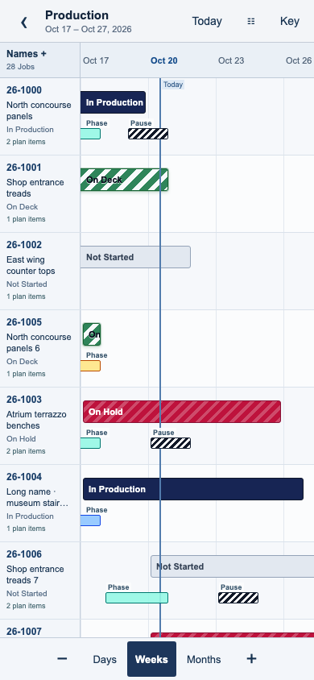
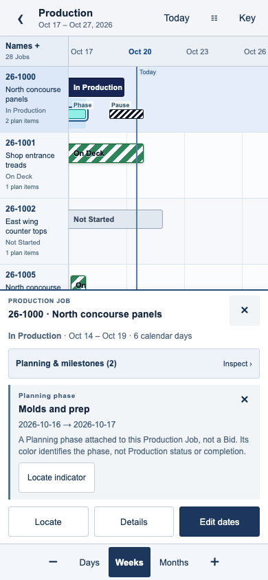
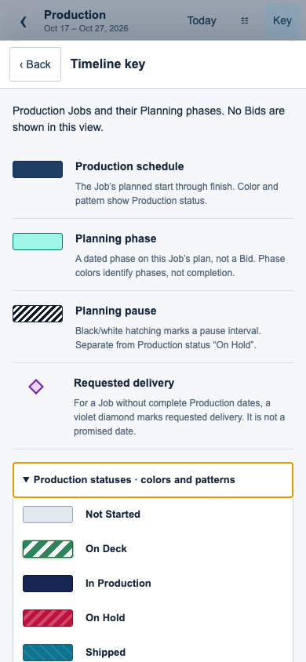
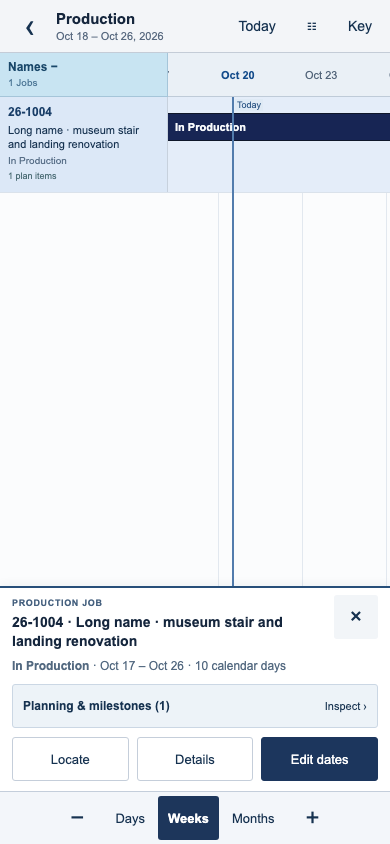
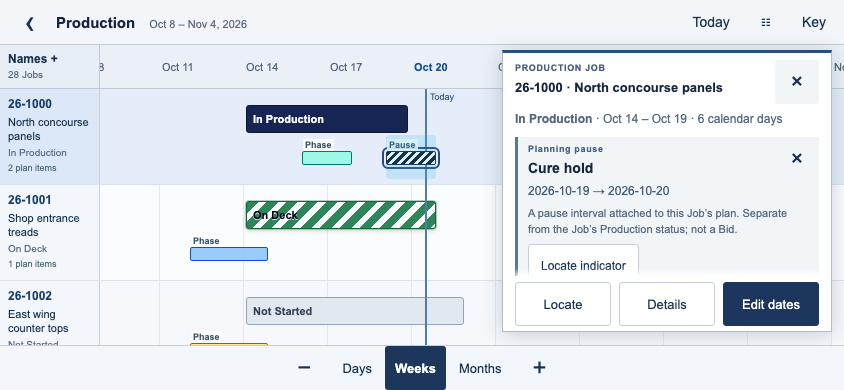

# TenOps mobile Timeline visual semantics refinement

**October 20, 2026 · Product and Architecture review · Isolated prototype only**

## Recommendation and review

Continue with **Option A**, the shared full-screen Production/Bids Timeline. The ambiguous secondary indicators now have source-based styling, visible labels and touch inspection. Full selected identities remain on the Timeline, and pinned names can be widened temporarily. Product acceptance still requires an operator review and physical Safari testing; this refinement is not authorization to implement the application overhaul.

**Refresh [http://localhost:3018](http://localhost:3018).** Use [Production](http://localhost:3018/production), [Bids Planning](http://localhost:3018/bids) and [Combined](http://localhost:3018/bids?source=combined). The existing static review server remains on 3018; port 3000 was not replaced. All data is synthetic and the review date remains October 20, 2026.

Suggested focused review:

1. In Production, tap **Key**. Compare Planning phase, Planning pause, Production statuses, requested delivery and selection.
2. Select **26-1000**, or tap its labeled **Phase** or **Pause** indicator. The tray shows the full Job identity, its Production status/span and the selected indicator’s separate title, dates and explanation.
3. Tap **Names +** to widen pinned names, then **Names −** to reclaim date width. Pan without losing row identity; **Locate** brings a selected row back.
4. Search **26-1026** in Filters to review the unscheduled synthetic Job’s **Requested delivery** diamond. Scheduled Jobs do not acquire this marker.
5. In Combined, inspect a Production row’s **Planning & milestones** list. Planning-only references retain their distinct meaning; **Open Production** remains the edit-context transfer.
6. Inspect a projected Bid and its Key. Dashed blue denotes a tentative window, not a Job or capacity reservation. Explicit edit/review stays separate from all gestures.

The initial [feasibility report](../REPORT.md), screenshots and receipts remain available. A complete untouched snapshot is in [revisions/01-initial](../revisions/01-initial/README.md); [preservation hashes](evidence/preserved-initial.json) identify all 50 archived files. Current refinement evidence is kept separately under this directory. The earlier handoff ZIP remains unchanged.

## What the indicators actually mean

The thin green bars in the original prototype were **Planning phases linked to Production Jobs**, not Bids. The small diagonal black/white markers were **Planning pauses**. The prototype had flattened every ordinary phase into one generic muted-green style and made those narrow marks difficult to inspect. That presentation obscured existing concepts; it did not reveal a new Bid relationship.

The meanings below come from the released source at `01e5e839fdba0256023077cf1d85c2d4dd15212c`. [Numbered source evidence](evidence/visual-semantics-source.md) records the relevant definitions and render conditions. No hosted schema or policy verification was performed.

| Indicator | Existing application meaning | Shared mobile treatment and module boundary |
|---|---|---|
| Main Production bar | Inclusive planned-start through planned-finish interval. Color/pattern reflects `production_status`; it is not material readiness or a progress bar. | Retains the imported Production status definitions and CSS, with a readable status on the pinned row and selected identity. In Bids Combined it remains a Production reference, view-only there. |
| Planning overlay / secondary colored span | Dated Planning phase belonging to that Job. Color is assigned by `timeline_color` or the existing ordered palette fallback. Production supports collapsed fill/strip and expanded phase rows. | Uses `overlayVisualForPhase`, a separate labeled **Phase** interval and inspection. The narrow mobile lane is a presentation proposal, not an identical reproduction of desktop collapsed layering. |
| Black/white diagonal hatching | `timeline_behavior='pause'`. Production may merge overlapping pause ranges in collapsed display and distinguish pauses outside the Production interval. It is not the Job status On Hold. | Uses the actual `PLANNING_PAUSE_HATCH`, labels **Pause**, and exposes the named pause’s dates. Individual phase inspection does not change or extend the Job schedule. Desktop pause merging remains untouched. |
| Dated Planning-only span | `timeline_behavior='planning_only'`. The Production chart omits it; Bids’ Production-reference chart can show it with a Planning-only label. | Preserves that module policy. Combined’s indicator list explains the reference; it is not a projected Bid or an editable Production interval in Intake. |
| Dashed/hatched blue projected bar | Eligible Bid’s tentative projected Production window. Lost/converted Bids are excluded by the existing normalizer. It reserves no capacity and has no invented Job number. | Only Bids source modes show these windows. Active/Won appears as Bid status; this does not commit work or perform conversion. |
| Violet diamond | Requested delivery milestone **only when a Production Job lacks a complete planned-start/finish pair**. It is not a promised date or an ordinary scheduled Job finish marker. Bids reference rendering does not include it. | The adapter enforces that same condition. The synthetic unscheduled Job 26-1026 demonstrates the marker; its inspection shows Requested delivery separately from the missing schedule. |
| Today line | Current calendar date in the application; source renderers use slightly different cell alignment. | Blue vertical line at the fixed synthetic review date, aligned to the date cell center. It is not a deadline, approval or capacity boundary. |
| Grey dashed original/ghost interval | Last saved Production/phase dates when proposed staged dates differ. Separate from a dashed blue Bid projection. | Not newly rendered in this prototype. Existing desktop behavior and historical/staging contracts remain preservation requirements; the refinement does not label a Bid projection as a ghost interval. |
| Amber outline / Unsaved or Proposed | Staged Production/Planning change, not committed persistence. | Amber is reserved for the memory-only staged-date demonstration. Selecting an indicator uses **blue**, avoiding a false edited-date signal. |
| Phase progress fill and percentage | In expanded Production phases, darker fill/percent comes from completed estimated item hours divided by total estimated item hours; it is not phase color or interval length. | No synthetic completion fill is invented here. The Key explains that phase color alone does not encode completion. |
| Dependency connector / warning marker | Planning phase dependencies; existing evaluation controls warning/error coloring and detail. Not a Bid conversion arrow or an automatic capacity score. | Not introduced into the small shared map in this refinement. Existing dependency logic and desktop presentation remain unchanged. |
| Selected row or indicator | A UI inspection state; original source also has drag/phase/dependency highlights. | Blue row tint and blue indicator outline are prototype navigation affordances. They do not imply approval, a persisted change or an assignment. |

### Production status colors and patterns

The main bar and expanded Key use the existing source definitions; no new states were created.

| Production status | Existing light appearance |
|---|---|
| Not Started | Light slate/grey |
| On Deck | Green with white diagonal stripes |
| In Production | Dark navy |
| On Hold | Rose/red with subtle diagonal highlighting |
| Shipped | Teal/cyan with subtle diagonal highlighting |
| Complete | Violet with white diagonal stripes |
| Cancelled | Muted red |

Green/white **On Deck** striping on a main bar, a colored **Planning phase**, and black/white **Planning pause** hatching have different meanings. Their labels, separate lanes and Key now make that distinction explicit. Colors are not used as the sole explanation.

## Refined presentation

### Compact Key

A visible **Key** button opens a dismissible panel; there is no permanent oversized legend. Its entries follow the current context:

- Production: Job schedule, phase, pause, requested delivery, all seven Production statuses, Today, selection and demo staging.
- Projected Bids: tentative window, Active/Won status explanation, Today and selection. It does not imply that Job phases or Production staging are present.
- Bids Production/Combined: Production-reference and phase semantics, including Planning-only; Combined additionally explains projected Bids. It does not offer Intake editing for committed dates.

Status colors and gesture instructions are expandable inside that panel. Back returns to the unchanged camera/selection. The open Key owns one vertical scroller; closing it restores the full map.

### Contextual indicator inspection

Secondary spans are labeled **Phase**, **Pause** or **Plan only**. Their displayed date geometry still uses the existing inclusive interval helper. A minimum 44px pointer target surrounds a potentially short visual interval; the visual bar itself is not stretched to fabricate a longer duration. Pan and pinch can still start on these targets. A stationary tap or hold selects and explains the indicator; it never reschedules it.

The selected tray keeps the parent Job identity and main Production status/span visible, followed by the indicator’s name, exact dates and plain-language meaning. **Locate indicator** navigates to its date. **Planning & milestones** lists offscreen or overlapping indicators, so inspection does not depend on hitting a tiny mark or memorizing a gesture. Milestones use a diamond and Requested delivery label rather than another duration bar.

Selection uses blue; amber remains reserved for demo staged changes. If a selected row is panned out of view, the tray says so and retains Locate. In landscape, the contextual tray can scroll independently when necessary, and its main actions stay visible; it is not a nested map scrollbar.

### Job and Bid identification

Pinned names now wrap over two lines instead of a single cut-off line, alongside the Job number or **BID**, current status and Planning-item count where relevant. **Names +** temporarily widens the strip from 100 to 168px, or from 86 to 148px at a 320px viewport. It preserves the visible date center and can immediately collapse again.

The selected name wraps completely without the old two-line tray clamp. Long Job and Bid identities were tested without leaving the Timeline. No synthetic Bid number, renamed Job or new Bid-to-Production relationship was introduced. Converted Bids remain excluded from projected windows; Production references retain contextual navigation to Production.

The tradeoff is explicit: rows are now 96px rather than 76px to accommodate wrapped names and a labeled secondary lane. Fewer rows fit, but the meanings and identities are more visible. Product should judge this against a compact-density option before implementation; a new compact version was not built in parallel.

## Screenshots for Product review

Additional captures: [requested delivery](screenshots/production-delivery-inspection.png), [Bids identity](screenshots/bids-selected-identity.png), [Bids Key](screenshots/bids-projection-legend.png), [Combined Key](screenshots/bids-combined-legend.png) and [Planning-only inspection](screenshots/bids-planning-only-inspection.png).

## Shared behavior and validation

One shared gesture/rendering surface serves both contexts. The new `semantics.mjs` maps existing phase/status definitions to labels, explanations and source-aware indicator descriptors. `adapters.mjs` retains module eligibility, milestones and edit ownership. Existing date/staging helpers remain shared imports; no scheduling algorithm, query client, auth implementation or universal Save path was added.

The final [browser receipt](evidence/browser.json) records **26 passing groups**: the original 17 focused workflow groups plus nine refinement groups covering legend access, marker inspection, full identities/expandable names, source-specific references, navigation from markers, viewport changes and safe-area insets. The [adapter receipt](evidence/adapters.json) records **eight passing groups**, including the original six compatibility groups plus source palette/indicator mapping and module-specific milestone/display rules.

Verified in Chromium touch emulation:

- Portrait 390×844, narrow 320×568, larger 430×932, landscape 844×390 and a shortened 390×620 viewport.
- Horizontal/vertical/diagonal pan, focal two-finger pinch, tap/hold selection, Today and visible date-scale controls.
- Pan beginning on a phase/pause target does not inspect or edit it; stationary inspection leaves staged schedules and Bid windows unchanged.
- Full-name reveal and rail expansion preserve the date center; details/Key Back preserve the camera. Selected identity survives panning and Locate restores row visibility.
- Production date changes still require explicit form/review and only stage a memory proposal. Bids only changes a synthetic projection; Combined Production references retain Open Production. Read-only scenarios remain denied editing.
- No map native scrollbar or root-size growth. A child Key/inspection surface has its own bounded scroll, without nesting map scrollers.
- CDP safe-area overrides of 24px top/20px bottom in portrait and 40px left/right/20px bottom in landscape. Top/bottom controls and the legend remained within those emulated bounds.
- Zero browser exceptions or unexpected external requests. Page requests were local GETs only; the deliberate local business-POST probe returned 403. CSP still blocks all API connections.

The map remains 738px high (87.4% of 844px) with no selection, and 300px high (76.9% of 390px) in landscape with zero insets. Selected identity/indicator inspection deliberately consumes temporary space: the phase-inspection capture leaves 368px of map height (43.6%). These are layout measurements including ruler/rail, not benchmarks or evidence that operators can read more work at once. Landscape tray coverage is not subtracted from the map-height figure.

**Physical Safari remains pending.** Emulated safe-area overrides do not certify a notch, browser chrome, Home Screen mode, OS edge gestures, VoiceOver, camera/date picker, touch feel or real keyboard. No operator study or authenticated backend/RBAC verification occurred. The existing read-only persona is a surface scenario, not a grant test.

## Preservation and implementation readiness

This is a **Tier 2 isolated prototype refinement**, with focused behavior, compatibility, source-boundary and visual verification. Only the disposable research source/build artifacts, new screenshots and documentation changed. The released application remains at `01e5e83`, with no tracked application diff, canonical-branch change, database operation, hosted record mutation, deployment or iTenify work. An isolated bundle build was used; no application Production build or broad suite was run.

The original audit and feasibility evidence are preserved rather than treated as current screenshots. [Source/boundary receipt](evidence/source-boundary.json), [preservation hashes](evidence/preserved-initial.json) and [artifact validation](evidence/validation.json) support review. The new handoff package is separate from the initial ZIP.

**Ready for another focused Product review, not final mobile implementation acceptance.** Option A remains technically feasible; the feedback has been addressed without introducing a second Timeline or an agenda fallback.

Remaining Product decisions:

1. Do the labeled phase/pause lane and Key make the meanings clear without coaching? Confirm the distinction between phase color, main status and projected Bid windows.
2. Is the 96px row density worth the clearer identity and indicators, or should a later compact setting retain the same explanations?
3. Are temporary wider names plus complete selected identity sufficient for similar/long Bid names?
4. Is the temporary portrait/landscape inspection space acceptable, particularly on short phones? The map returns to full size when selection/inspection closes.
5. Complete an operator/physical-iPhone pilot before accepting gestures and safe-area behavior. Explicit editing remains a separate integration acceptance boundary.

If Product accepts this refinement, retain the previously recommended first increment: shared **read-only** mobile presentation wired to existing authorized controllers, preserving desktop and all module contracts. Any later mobile edit adoption must delegate to the existing Production staging/approval and Bid projection/version paths. Bid conversion, canonical Job creation, lifecycle rules and privacy remain outside this research authorization.

**Stop for Product and Architecture review.** No implementation, push, merge, deployment or hosted mutation is authorized by this handoff.
