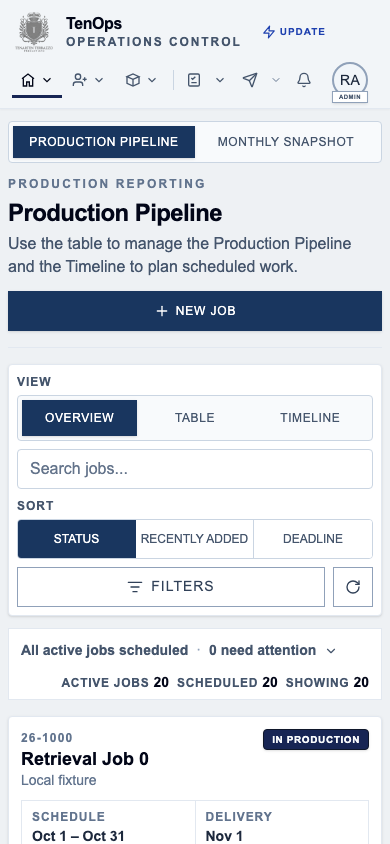
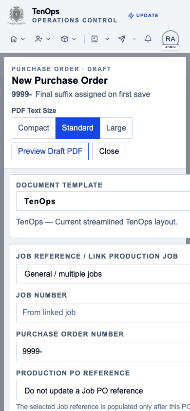
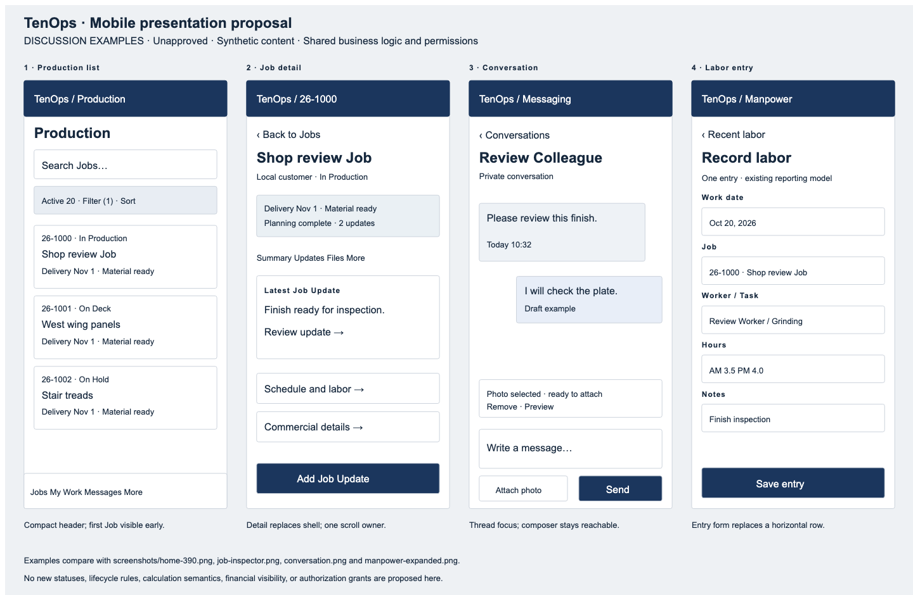

# TenOps — comprehensive mobile UX/UI audit

**Product/Architecture handoff · October 20, 2026 · Research only · Stop for Product review**

## 1. Executive assessment

TenOps needs a coordinated mobile presentation architecture. It does not need a frontend rewrite. Existing mobile Production cards, full-height Messaging, large Sample inputs, native label dialogs, focus handling and safe-area work provide useful foundations. The experience is uneven because each workspace decides independently how to compress navigation, present details, retain the shell, expose actions and scroll.

The strongest observed problems are operational:

- The global navigation hides labels on phones and divides some destinations into adjacent small targets. At 320px the account control disappears beyond the visible header row.
- Production devotes most of the initial phone screen to branding, explanatory text, creation and view/filter controls. At 390×844 the first Job starts around y=717. In the 844×390 landscape capture, the Timeline itself is below the initial viewport.
- The PO editor has actual internal horizontal overflow: a 390px overlay reports 459px of content. Global page clipping conceals this from a simple document-width check.
- Manpower still presents an editable desktop grid: expanding one synthetic reporting group produces a 1,480px table in a 364px scroll area. Following a row from identity through hours and notes demands repeated sideways navigation.
- A Job detail Inspector retains shell-dependent positioning, multiple dense tabs, substantial history/explanation and editing controls. Browser Back leaves the Production route rather than closing the Inspector.
- Sample actions occupy a large part of the first screen before formulation content. Several competing operations—save, issue, post, labels and Production Blend—need a clearer hierarchy while preserving their distinct contracts.

**Recommendation:** approve a shared mobile shell and navigation model, a common detail-screen/overlay contract, compact operational list patterns and focused entry forms. Pilot these on Production and My Work/Messaging, then adapt Samples, Manpower and commercial documents. Keep desktop views and all existing business/query/security/calculation contracts shared. No design in this report is approved implementation scope.

## 2. Baseline, method and evidence limits

Canonical local `dev`, `main`, `origin/main` and `origin/dev` resolve to `da21615ad6f06727e4f18a75c65331a7266d2404` at inspection. These are local refs, not a fresh remote or hosted deployment certification. The existing clean `.tmp-auth-refocus/source` worktree has the same HEAD; its previously built local-API export was reused. No new build was run. See [repository receipt](evidence/repository-boundary.json).

Performance integration is separate: supplied checkpoint `e902bf3` remains in branch history; current `perf/waves1-4-integration` is `01e5e83`, adding the recent-records Manpower refinement. Neither branch nor candidate was changed. Port 3000 was occupied by a Node listener and responded as a review transport; its owning candidate was not independently identified. No process there was stopped. **Port 3017 was an internal audit exception, not a replacement manual-review candidate.**

The isolated adapter serves the existing actual application export. It changes only the localhost API port in served JS from 3000 to 3017 and supplies established synthetic identities/data. This is a local fixture session, not a hosted login or authentication bypass. The adapter has no hosted forwarding or credentials; browser contexts reject destinations outside localhost:3017. Business mutations and document-generation endpoints are denied. Draft text, photo selection and synthetic RPC responses exist only locally. No hosted business records, private participant content or privileged account data were read.

Evidence labels:

| Label | Meaning |
|---|---|
| **B** | Browser interaction/geometry observed in this local synthetic actual-app session |
| **S** | Canonical source observation; operational effect may need further evaluation |
| **P** | Proposed behavior for Product approval |
| **U** | Unverified, blocked or outside this audit |

Browser coverage: Chromium touch/mobile context at **390×844**, Production at **320×568**, **430×932**, Timeline at **844×390**, Messaging at **390×500**. The last is a short-viewport probe, not a real keyboard simulation. All major routes were visited; selected multi-step workflows were exercised. Viewport coverage is representative, not an exhaustive module×size matrix. WebKit launch failed because its binary is not installed. No browser download was needed for this bounded audit. **Safari, Home Screen operation, physical touch, camera picker, real keyboard, notch insets, interrupted network and memory pressure remain unverified.**

Initial fixtures lacked exact-count headers for empty Bid reads; that caused artificial Intake/Sample initialization errors. The adapter was corrected and baseline captures repeated. These are not Product bugs. Sample Production Blend Edge requests and Proposal creation remain deliberately blocked; visible errors on those particular captures reflect fixture boundaries. The Job fixture also opens with two normalized unsaved fields; this is not evidence of a real-data dirty-state defect.

This is low-risk documentation/artifact work, with focused browser and source verification. Implementation risk tiers do not authorize changes here. A later mobile behavior wave is normally Tier 2 / Testing Level 2; authorization, lifecycle, persistence, issuance, calculations or historical data changes require Tier 3 / focused Testing Level 3. Builds, TypeScript and application suites were not run because application source was unchanged.

## 3. Significant screenshots and findings

All screenshots use synthetic data. Images are viewport captures unless stated otherwise. Raw geometry, visible text and actions are in [baseline evidence](evidence/baseline-browser.json), [workflow evidence](evidence/workflows.json), [responsive evidence](evidence/responsive.json) and [interaction evidence](evidence/interactions.json).

| ID / priority | Evidence | Finding and consequence | Recommended response |
|---|---|---|---|
| M01 / high | B/S · [390px Home](screenshots/home-390.png), [320px Home](screenshots/home-320.png) | Icon-only destinations require learned meaning. Many header targets are 36px high; My Work tools is 28×36 and Messaging menu is 20×36. Account falls outside the visible row at 320px. | Labeled, stable mobile destinations and one consolidated More surface; minimum 44px interaction areas as a project target. |
| M02 / high | B · [Production](screenshots/production-390.png), [landscape](screenshots/timeline-landscape.png) | Above-list controls consume the initial screen. Landscape loses much of its small height before reaching the chart. | Compact screen title/search/filter row; secondary view/sort options behind a deliberate control; landscape chart mode. |
| M03 / high | B/S · [PO editor](screenshots/po-editor.png), `po-overflow-metrics` | Overlay 390px; content 459px. First template/link fields extend beyond the phone boundary. Document width remains 390px because outer clipping hides the issue. | Constrain grid children with explicit shrink behavior; design single-column sections and an item-detail screen, not merely smaller fields. |
| M04 / high | B/S · [expanded Manpower](screenshots/manpower-expanded.png) | 1,480px grid in 364px container. Identity, hours and actions cannot be reviewed together. Expanded synthetic group raises whole-document DOM to about 10,356 elements. | Recent-entry cards plus focused edit form; retain desktop bulk grid and existing group identity rules. |
| M05 / high | B/S · [Job Inspector](screenshots/job-inspector.png), [Updates](screenshots/job-updates-tab.png) | Details compete with persistent shell and dense section controls. Browser Back after opening Job and Files returned to `/samples`, the preceding route. | Detail owns the phone viewport and one Back behavior; route/history carries Job and section state. |
| M06 / medium | B/S · [Sample](screenshots/sample-formulation.png) | Creation/header/actions precede the formula, which is below the initial viewport. Screenshot's Edge error is synthetic, but action density is real. | Identity + working/issued status + one primary action; secondary operations grouped in Documents/More. |
| M07 / medium | B · [task entry](screenshots/task-compose-expanded.png), [task details](screenshots/task-details.png) | My Work already has useful quick entry and 44px controls. Tabs, workload, grouping and sorting add complexity around that task. | Retain quick entry; prioritize title and due date, reveal optional assignment/context/effort progressively. |
| M08 / medium | B/S · [conversation](screenshots/conversation.png), [short viewport](screenshots/message-short-viewport.png) | Conversation switching, local draft and file queuing work. At 500px height, recipient/header, attachment, helper text and composer leave little message history visible. | Compact thread header; flexible composer with bounded expansion; shorter attachment help; preserve transfer safeguards. |
| M09 / medium | B/S · [notifications](screenshots/notifications.png) | Notifications use an anchored panel while Messaging and record details use other presentation families. Empty notification state is readable. Populated notification deep-link behavior was not exercised. | Full-width mobile notification destination with explicit Back; preserve availability/authorization checks. |
| M10 / medium | S · [source index](evidence/source-index.md) | Width checks vary across `sm`/640, 768, 1024, orientation and height queries. Sample CSS depends on section position and `nth-child`; overlay stacks use several independent z-index bands. | Shared surface types and documented layout breakpoints; replace structural CSS selectors when each surface is migrated. |

These are observed layout/usability issues, not measured operator error rates. No participant study, completion-time benchmark or formal accessibility certification was performed.

## 4. Module-by-module coverage

| Module | Current evidence and strengths | Main recommendation / remaining gap |
|---|---|---|
| Home / shell | B/S. Root is Production, not a separate generic dashboard. Header compacts with scroll and uses a live height variable. | Keep operational landing. Reduce repeated branding/category/title/explanation on phones; do not introduce decorative dashboard tiles. |
| Navigation | B/S. Domain menus, My Work split control, Messaging, Notifications, account; Toolbox offers generators and Catalog. Menu opened. | One mobile navigation taxonomy, labels and access-filtered More list. Preserve direct links and capability checks. |
| Intake / Bids | B/S. Pipeline/Planning and status filters; empty synthetic library. Canonical source has Bid Inspector and Planning. No populated Bid/conversion was exercised. | Compact pursuit list and full-screen Bid detail, retaining financial visibility and lifecycle semantics. Lifecycle implementation remains gated by Product Acceptance Contract. |
| Production / Job Queue | B/S. Real 20 active synthetic Jobs; cards, search, sort, filters, detail, Updates and Files tested. | Evolve current cards, do not replace them wholesale. Show identity, production/material state, next relevant date and outstanding follow-up. Keep full details reachable. |
| Planning / Scheduling | B/S. Production Timeline selected; portrait/landscape captured. Existing mobile CSS disables drag/resize handles and retains Job opening. | Phone agenda/phase list as default planning read view; deliberate full-screen Timeline option. Any phone scheduling edit is a separate Product decision; preserve staged approval/Save All. No drag behavior certified. |
| Inventory | B/S. Empty stock search, refresh and Record Stock entry route inspected. Populated lot/reservation workflow not browser-tested. | Search-first result cards with quantity/unit/location and explicit reserved/general stock. Lot detail owns adjustments. Do not combine reservations into available stock. |
| Inventory Activity / stock movements | B/S. Activity filters and movement form visited. Movement supports single/multiple, identity, reservation and correction guidance. | Single movement flow with clear direction, identity, amount/unit and confirmation. Keep ledger corrections append-only; no hidden update shortcuts. |
| Catalog | B/S. Search-on-demand and Standard/System tabs already avoid loading all rows. Empty state explains searching. | Reuse searchable material picker with item identity and package/unit context; retain manual fallback where allowed. Populated results unverified. |
| Purchasing | B/S. Library empty; New PO opens a local unsaved editor. Link Job, template, vendor, line and totals source inspected. | Constrain mobile editor; summary → line list → focused line detail → review. Draft save and issue remain distinct. Existing issued PO/PDF not opened in this fixture. |
| Manpower | B/S. Synthetic 12,001-entry source; actual groups expanded and horizontal grid measured. | Operator entry/list separate from analytics/bulk editing. Rebase future work on recent-records refinement, preserving partial/complete group restrictions. |
| Material Usage | B/S. Many synthetic history rows visibly rendered; body initially about 38,162px tall and 4,406 DOM elements. Incomplete fixture relation data produces generic Job labels; not a real identity bug. | Date/Job-scoped cards, explicit history loading and focused report form; coordinate with Wave 4 completeness. No calculation change. |
| Samples / draft formulation | B/S. Library opened into existing synthetic formula; calculation controls inspected. Large inputs and shop-preparation quantities are useful. | Prioritize formula/working state. Separate context, recipe, preparation, documents and advanced settings without duplicating formula state. Preserve unsaved-change guard. |
| Sample Form / Color Plate generators | B/S. Labels dialog actually opened; [capture](screenshots/color-label-dialog.png). Generation actions exist but were not executed. | Mobile configure → preview → explicit output flow. Retain document numbering, working/issued distinction, neutral plate suffixes, historical snapshots and physical label output. |
| Production Blend / Material Readiness | S + limited B. Sample has explicit Blend entry, requirement/source/readiness code. Synthetic Edge requests denied; no populated plan certified. | Read requirement/batch/source summary first, then configure/generate deliberately. Preserve captured source identity, shortage units and issued semantics. No authoritative capacity prediction. |
| My Work | B/S. Synthetic private task opened and quick-entry draft typed; groups/filter controls inspected. No save/complete/delete performed. | Keep quick entry and detail form; reduce optional controls before the task list. Preserve participant privacy and personal color/group behavior. |
| Messaging | B/S. Synthetic conversation opened, draft typed, photo selected, short viewport and Back-to-list tested. No send/upload occurred. | Retain single-thread mobile model and transfer state machine; integrate consistent navigation and safe composer layout. Physical camera picker and transfer recovery unverified. |
| Notifications | B/S. Empty panel, Unread/All visible. Source has Job/task/conversation destinations and source-availability behavior. | Consistent destination hierarchy; safe route after login; unavailable/private source state. Populated click/read receipt not exercised. |
| Proposals / Estimates | B/S. Library/history and create affordance visited. Creation denied locally, so form/browser preview not evaluated. Source contains commercial editor/estimate calculations. | Focused sections and line editing, persistent totals/review. Preserve estimates, rounding, discounts/tax and issued history. Do not treat adapter denial as Product defect. |
| Transmittals | B/S. Job-linked versus standalone choice and Job selector exercised at entry; no document issued. | Explicit context choice, recipient/document review, then preview/output. Never invent Job numbers for standalone documents. |
| Rework | S. Entry, lifecycle, Inspector integration and high-z-index creation dialog inspected; no eligible synthetic Rework lifecycle tested. | Job-scoped detail flow with explicit current lifecycle and origin. Preserve labor attribution and destructive restrictions. |
| Account / settings | B/S. Account, theme, density, language and operational-owner guidance visited. | Full-screen account/preferences on phone. Test Large text and Spanish layout before release; no hosted preference write performed here. |
| Additional discovered surfaces | S. Customer/contact Inspector, vendor/contact management, phase creation/library, schedule review, file/document viewer, formulation profiles, monthly snapshot and disabled Daily Production affordance. | Include these in shared-surface migration inventory. Do not turn disabled features into new scope. These were source-inspected, not exhaustively browser-tested. |

## 5. Operator workflow friction

Counts below are observed taps/clicks from a loaded route to the stated boundary, excluding typing, scroll gestures, loading and the browser address-bar setup. They are **not** complete end-to-end task counts or operator timings. Finding a specific record may need search/scroll beyond these counts.

| Workflow | Observed path / count | Friction and proposed target |
|---|---|---|
| Find Job and status | Production → tap visible Job = **1**; search text can narrow first | Card already carries status. Proposed: first record visible earlier; preserve query and list position on return. |
| Review/respond to Job Update | Job → Updates = **2** from Production; composer reachable, list empty | Actual response/save not tested. Proposed: direct unresolved-update link enters its detail, optional reply stays with Job. |
| Sample formulation | `/samples` → synthetic Sample = **1** | Formula begins after large header/actions. Proposed: visible identity + preparation/recipe without passing generation controls. |
| Create task draft | My Work → focus/type title = **1** focus interaction; optional fields expand | Add is a separate explicit action; not performed. Proposed title-first quick add with optional details one action away. |
| Edit task | My Work → synthetic task = **1** | Details work; no persistence tested. Proposed same one-tap detail with explicit Save and return restoration. |
| Message + photograph | Messaging → colleague → Attach/file selection = **3** app actions plus system picker | Draft and local attachment queued; no send. Proposed ≤3 app actions retained; camera/library choice evaluated on hardware. |
| Notifications | Header bell = **1** | Empty state only. Proposed destination + notification → source = two app actions when source remains authorized. |
| Inventory item | Search field reached on route; no populated result | Completion count unknown. Proposed search → item = one result tap after query. |
| Manpower review | Manpower → expand synthetic group = **1** plus vertical/horizontal scroll | Reviewing complete row requires substantial lateral motion. Proposed recent entry → detail = one tap without sideways scroll. |
| Purchase Order | Purchasing → New PO = **1**, draft editor opened | Existing PO opening not tested. Proposed existing PO → detail = one result tap; line edit separate focused screen. |
| Locate Proposal / Bid | Routes and empty libraries visited | No populated-record completion count. Proposed consistent search/results/detail contract; validate with realistic synthetic history. |

A usability pilot should ask shop operators unfamiliar with the redesign to perform these tasks without coaching. Record successful completion, wrong destinations, backtracking, accidental actions and recovery—not only speed. Suggested acceptance: no horizontal scrolling to complete routine single-record tasks, no lost unsaved draft on a harmless navigation action, and clear recovery from denied/unavailable data. Product should set completion-time targets after observing a baseline.

## 6. Shared root causes

**Navigation and task priority.** Desktop domain menus become icon-only while retaining multiple entry mechanisms. Creation, view configuration and help often outrank the record list spatially. Compactness has been achieved partly through small typography/controls rather than a clear phone task hierarchy.

**Surface ownership.** Job/Task Inspectors sit below the shell using `--tenops-shell-header-height`; Messaging owns a full-height portal; Notifications is anchored; labels use native `<dialog>`; Rework uses another high overlay. These patterns each solve local problems but lack one shared policy for Back, focus return, scroll locking and nesting. Production already has focus cycling; preserve that work instead of claiming every Inspector lacks it.

**Containment versus clipping.** `globals.css` clips horizontal overflow on phone roots. That prevents page-width expansion but does not prove descendants fit. PO and header measurements demonstrate why module-level bounding rectangles and scroll containers must be inspected.

**Desktop editing assumptions.** Manpower field widths and long line-item editors retain row-based information architecture. A vertical stack alone can also become excessively long. Mobile needs focused entry/detail transitions while retaining a compact overview.

**Maintenance coupling.** Global Sample `nth-child` layout rules assume section/field order; separate breakpoint and landscape exceptions accumulate. Large workspaces mix loading, permissions, calculation state, document actions and presentation. See [source index](evidence/source-index.md); it is selected lexical evidence, not an exhaustive code-quality proof.

## 7. Proposed navigation and detail architecture

### Mobile shell — proposal for discussion

Use a compact identity/title bar and a bottom navigation row with **Jobs, My Work, Messages, More**. Notifications stays a labeled, sufficiently large top action with an unread indicator. More is a full-screen categorized list: Intake; Planning; Inventory/Activity; Reporting; Documents/Tools; Account. Exact destinations and order need operator validation; these are not new permission grants. A role denied a module must not see or open it through a new entry point.

A four-destination row offers labels and thumb access without placing every module in the header. Alternative: labeled Menu + module title, retaining top navigation and avoiding persistent bottom height. Product should compare both on short phones; prefer the four destinations only if frequent-task evidence supports them. Do not default to role-specific home pages or personalized hidden navigation without a separate decision.

Preserve canonical URLs and notification links. No cross-module search service is needed for the first wave. Search remains scoped and predictable; More can filter destination names locally. Filters show an applied count and Reset; apply multi-field filters once rather than changing the list behind an unfinished sheet. Preserve list scroll/query when returning.

### Detail / dialog contract

On phones a record Inspector becomes an opaque full-screen detail surface with compact identity, explicit **Back to [source]**, one content scroller and an optional contextual action footer. Hide the global bottom navigation while editing or in a conversation if needed to preserve height. The desktop Inspector remains beside its originating workspace.

History state must distinguish list, record, section and nested preview. Browser Back closes the top detail/preview or returns to the prior route predictably; direct links with no in-app origin use a safe parent fallback. Unsaved changes invoke the existing Save/Discard/Keep Editing contract before state is lost. Do not add history entries for every input change. Preserve account-switch cleanup and authorization revalidation.

Use three mobile surface types: full-screen detail for records and long forms; bounded bottom sheet for short filters/actions; centered alert dialog for concise confirmation. Document preview is a full-screen child with explicit return. Prefer one active modal owner; a child temporarily suspends the parent's focus/inert state and restores it on close. Define focus trap, accessible name, Escape, backdrop policy, scroll lock and focus restoration centrally. Destructive confirmation must not be dismissed accidentally by a routine background gesture.

Do not require swipe gestures to operate. Edge gestures must remain available to Safari; do not introduce swipe-to-delete. Avoid nested vertical scroll areas inside a form. A narrow table may remain an intentional horizontal scroller for advanced comparison, with visible affordance and row identity retained; routine entry should have a phone form.

## 8. Interaction and visual language

[Open the comparative proposal board](proposals/mobile-patterns.svg). It shows four unapproved examples: Production list, Job detail, conversation and labor entry. Compare against current screenshots M02/M05/M08/M04. It is a disposable vector illustration, not a second functional application.

Preserve navy/slate operational branding, restrained borders, compact status badges and plain action language. Suggested mobile tokens: 16px form input text, 14–16px body text, 12px supporting metadata, 20–24px title, 12–16px outer gutter, 8px grouping gaps and at least 44×44px action areas. These are proposed project standards, not a claim of WCAG certification. Keep status text alongside color. Use increased spacing between destructive and routine operations, rather than red decoration everywhere.

Job cards should answer identity, status, material readiness, next date and follow-up. Move explanatory history and financial/admin fields into deliberate sections. A single main action is contextual: review/update in a record, Save in an edited form, Send in a conversation. Do not use one global plus button that creates ambiguous record types.

Long forms use labeled sections with a small progress/section index when useful. Do not force every simple task into a wizard. PO line editing, labor entry and material movement benefit from a focused subform; formula percentages/quantities benefit from adjacent inputs and results. Preserve unit labels, precision, warnings and editable-versus-derived distinctions. A sticky Save/footer must reserve real layout space so it cannot conceal the last field or validation message.

Use native date input on phones where its semantics fit; preserve ISO/local calendar meaning and timezone rules. Complex schedule approval needs its own read/review screen. Search pickers should show selected identity, allow clearing and keep the keyboard from hiding results. Do not shrink inputs to fit multiple columns at the expense of legibility.

Loading should identify the scoped operation; retain valid visible content during refresh. A denied read is not an empty collection. Error recovery should preserve drafts and offer explicit retry, not retry loops. Empty lists should explain context/filter state and provide a permitted next action. Attachments need a visible queued/uploading/failed/complete distinction; do not imply delivery from local file selection.

## 9. Feasibility and code reuse

This is feasible as incremental presentation work. Keep queries/RPCs, calculation helpers, document rendering, mutation/issuance contracts, auth/capabilities and domain types shared. Extract stateful controllers only where a second presentation needs them; do not reorganize the whole frontend first.

Suggested component responsibilities (illustrative names): `MobileShell` owns navigation and safe-area layout; `RecordSurface` chooses desktop Inspector versus phone detail; `SurfaceStack` owns focus/Back/scroll lifecycle; `OperationalList` and domain cards own summary presentation; `FilterSheet` owns apply/reset; `EntryForm` owns accessible field/action layout. Each controller remains account-scoped and can supply both mobile and desktop presentations.

Do not render two complete hidden editors. Share one draft/controller and mount the appropriate presentation. Resizing/orientation must not reset unsaved state, refetch history unnecessarily or create two concurrent mutation owners. Keep mobile breakpoint decisions in a documented presentation policy; distinguish small-screen layout from pointer capabilities and chart height constraints. Replace positional CSS with explicit section attributes as each component is migrated, not in an unrelated cleanup sweep.

Existing anchors include `client-layout-shell.tsx`, global shell offset CSS, `ProductionWorkspace`/`ProductionQueue`, `ProductionJobInspector`, `MyWorkPage`, `InboxDialog`, `SampleWorkspace`, `PurchaseOrderEditor` and the shared `DocumentViewer`. Dynamic Messaging and label-editor loading already exist. No API, schema or RBAC changes are required merely to adopt these surfaces. If implementation discovers a need for summary/detail data contracts, split it into a separately approved boundary coordinated with Performance.

## 10. Mobile performance and coordination

**Measured here:** synthetic DOM/geometry only, not Production latency. Baseline Production body is about 6,329px tall for 20 active cards and about 2,038 DOM nodes. Material Usage initial capture is about 38,162px tall/4,406 nodes. Expanded Manpower group produces about 10,356 document nodes. These are single-session workload observations; hydration timing affects snapshots. They support focused profiling, not invented speedup percentages or an automatic virtualization mandate.

**Source-supported concerns:** large mounted lists/forms can increase render and layout cost; document viewers fetch PDF blobs and retain object URLs until cleanup; opening heavy editors may require appreciable JavaScript. There was no CPU-throttled trace, heap profile, scroll-frame recording, network-percentile study or React render-count measurement. Touch latency, battery and memory pressure remain hypotheses to test.

Avoid duplicate optimizations already in the separate candidate:

| Existing workstream | Future mobile integration requirement |
|---|---|
| Wave 1 Messaging/Notifications | Reuse account-owned summaries, recipient/unread reuse, bounded page loading and private response ownership. Wave 1 UX acceptance remains outstanding in its handoff. |
| Wave 2 Lists/Production | Retain complete Proposal/PO libraries and scoped supporting Job reads. Mobile cards must not silently operate on a truncated result subset. |
| Wave 3 Samples | Preserve parallel initialization and stale-response/account guards. Do not add redundant mobile loads or duplicate form state. |
| Wave 4 Manpower/Inventory | Preserve explicit history access, inventory quantity/reservation completeness and receival/history behavior. |
| `01e5e83` Manpower refinement | Recent editable records populate automatically for the selected period; full history is explicit. Whole-group identity/new-line operations require complete history. Phone forms must obey those gates and retain matching/all-dates labels. |

These candidate behaviors are based on current branch source and its handoff evidence, not revalidated or released by this audit. Existing integration evidence reports local synthetic timings, not authenticated Production improvements. Future mobile work should branch from the approved integration boundary after Product chooses it, then profile representative operator tasks with realistic phone data volumes. Do not merge the candidate wholesale as an audit action.

## 11. iPhone / Home Screen readiness

Current source has `viewport-fit: cover`, root safe-area padding, standalone manifest display, root scope/start URL, icons and persistent/auto-refresh Supabase sessions. Manifest identity is `/my-work` while launch is `/`; this is deliberate existing configuration to preserve pending review, not a reason to change identity during UI work. Separate install-target routes exist. No active `serviceWorker`/`PushManager` integration was found in the inspected `src` search; install metadata alone does not prove offline readiness or push delivery.

WebKit documents dynamic viewport units and safe-area inset handling. These support the proposed layout but do not replace device testing: [Safari viewport units](https://webkit.org/blog/12445/new-webkit-features-in-safari-15-4/), [safe-area guidance](https://webkit.org/blog/7929/designing-websites-for-iphone-x/). Apple documents Web Push for Home Screen web apps on iOS/iPadOS 16.4 or later; permission/subscription and account-bound delivery remain future scope: [Apple Web Push documentation](https://developer.apple.com/documentation/usernotifications/sending-web-push-notifications-in-web-apps-and-browsers). No push implementation is proposed in this audit.

Required device checks before acceptance: portrait/landscape Safari with expanded/collapsed chrome; Home Screen launch/session refresh; notch/home-indicator padding; actual keyboard and picker; field scrolling and Save/Send visibility; camera/library file selection; app suspend/resume during attachment transfer; session expiry/relogin and authorized notification destination restoration; account switch clearing private content; unavailable source deep links; Large text and Spanish; low-memory PDF/image opening and return. Do not assume Safari tab and installed-app session persistence behave identically. Handle offline state explicitly; do not queue business writes without a separate approved persistence contract. QR installation guidance remains low priority.

## 12. Coordinated implementation roadmap

Each wave is a proposed approval unit, not implementation authorization. Make Product acceptance of interaction patterns the gate before broad migration.

| Wave | Modules / problem / proposed behavior | Benefit and dependencies | Risk / acceptance / validation |
|---|---|---|---|
| **A — navigation and viewport foundation** | Shell, More, account, notification entry, shared layout. Replace crowded icon-only row; compact titles; consistent safe-area/footer tokens. Include PO containment correction in this approved foundation boundary. | Destinations remain visible and first operational content appears earlier. Depends on Product choosing navigation and supported phone sizes. | Tier 2 / Level 2. At 320/390/430px all permitted global destinations reachable; no clipped controls; 44px primary tap areas; no footer occlusion. Browser visual/behavior checks, TypeScript, targeted ESLint, diff check, Production build; physical Safari chrome/keyboard checks. |
| **B — shared detail and return model** | Job/Task Inspectors, notification source navigation, filters, document preview. Implement phone full-screen record surfaces and controlled child stack; desktop retains Inspector. | Predictable Back/focus/scroll and less lost context. Depends on A tokens and approved history/unsaved-change policy. | Tier 2 / Level 2; escalate to Tier 3 if auth/deep-link ownership changes. Direct link, browser Back, nested preview, unsaved Save/Discard/Keep Editing, focus return and orientation preserve state. Test account switch/denial on affected surfaces; desktop regression. |
| **C — daily operator workflows** | Production cards/search, Job Updates, My Work, Messaging and attachment selection. Bring records/actions forward; retain single-thread model and quick task entry. | Highest-frequency tasks use fewer transitions and less scrolling. Depends on B and approved Performance boundary, especially Wave 1. | Tier 2 / Level 2, focused privacy/transfer gates at Level 3 where touched. Operator task trials; draft retention; complete search; Job linkage; photo queue/cancel/failure; authorized navigation; no accidental sending. No new message transport semantics. |
| **D — focused entry and documents** | Manpower, Samples/formulation/labels, Blend/Readiness, Inventory movement, PO/Proposal/LoT forms, Rework entry. Use recent-entry/line cards and focused subforms; document output remains explicit. | Eliminates desktop grid dependence for routine entry. Depends on accepted recent-records refinement, controllers, source-unit and snapshot contracts. | Bounded presentation may be Tier 2; persistence/calculation/PDF/issuance/lifecycle changes are Tier 3 / Level 3. Verify unchanged totals/units/rounding, complete versus partial history, drafts and issued snapshots, reservations, retries and historical edits. Realistic document and device preview checks. Bid/Sample lifecycle semantics still require Product Acceptance Contract. |
| **E — consistency and advanced review** | Timeline/agenda, complex reporting, reference management, advanced filters, density/language, error/loading/empty polish. | Consistent full application after core patterns stabilize. Depends on A–D and operator feedback, not cosmetic patch volume. | Tier 2 / Level 2; escalate for scheduling semantics. Validate chart reading/scroll gestures, explicit read-only mobile planning, Large text, Spanish, contrast/focus, empty/denied/retry, and desktop behavior. Profile only identified bottlenecks. |

No estimate is credible until Product approves navigation/detail patterns and selects the first operator pilot. Prefer a small complete workflow slice through A+B+C over sweeping every route into unfinished new chrome.

## 13. Preservation requirements and risks

- `public.jobs` remains the only canonical Production Job. Phone convenience must not create pseudo Jobs or bypass approved Bid conversion/deposit/capability gates.
- Proposals/Samples may exist independently of Jobs; issued snapshots, numbering, historical context and neutral Color Plate suffixes remain unchanged.
- My Work/Inbox stay participant-private. Navigation visibility is not permission; admin lifecycle authority is not routine private-content access. Cache, deep-link and draft state must remain account-owned.
- Do not change role grants, financial visibility or deletion authority in a UI wave. Respect read-only users on every alternate presentation.
- Preserve draft save versus issue versus post-to-Job, staging versus approved schedule, manual versus derived quantity and pending versus completed attachment delivery.
- Avoid making compact phone forms appear to show complete historical group identities when only recent records are loaded. Preserve complete authorized list retrieval and search semantics.
- Existing focus handling, transfer retries/recovery, stale-read guards, refocus fixes and desktop workflows must survive presentation changes.
- No migrations are needed for this proposal. Never apply the superseded RBAC migration wholesale. No application source, candidate branch, hosted configuration or iTenify content was modified.

Main architectural risks are state duplication, inconsistent browser history, portal/stack focus conflicts, safe-area double padding, keyboard occlusion, hidden horizontal overflow and regression in output/history semantics. Mitigate with one surface contract and shared controllers, then migrate by workflow rather than by CSS file.

## 14. Product decisions and review gate

1. Approve bottom **Jobs / My Work / Messages / More**, or choose labeled top-menu alternative. Confirm whether Notifications deserves a persistent destination and whether Samples needs a faster entry for shop users.
2. Confirm mobile landing remains Production; choose the first operator group and three pilot tasks. Role-specific homes are a separate decision.
3. Approve full-screen phone details and browser Back/unsaved-change behavior, including direct-link fallback and nested preview return.
4. Confirm phone Planning is review-first and whether any scheduling edits belong in this overhaul. Do not infer drag editing from desktop parity.
5. Choose primary actions for Job, Sample and commercial document screens. Preserve draft/issue/post distinctions; decide which metadata may collapse without changing visibility rules.
6. Confirm recent Manpower entry/review versus bulk editing priorities and the approved `01e5e83` integration/release boundary. Its existing partial-history restrictions are not optional UI details.
7. Set supported minimum screen/device/browser range and sign off physical iPhone Safari/Home Screen testing. Decide how Large density and Spanish affect acceptance.
8. Resolve the existing Bid/Sample lifecycle Product Acceptance Contract before any related semantic implementation. This audit supplies presentation proposals, not lifecycle authority.

**Stop here for Product/Architecture review.** No implementation, commit, merge, push, deployment, migration or hosted mutation was performed. Remaining browser/device gaps are listed above; they are follow-up validation scope, not silently passed gates.
