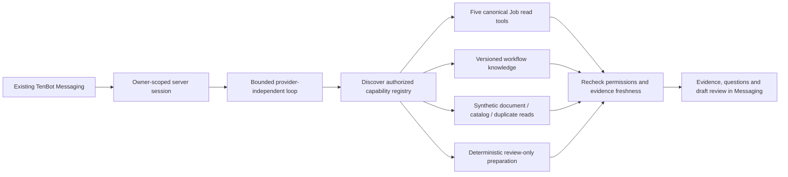

# TenBot optional OpenAI agent proof of concept — October 28, 2026

**Latest follow-up:** [Final static conversation-history correction](#final-static-conversation-history-correction--october-29-2026) addresses independent QA's remaining capability-answer persistence defect on `eabac4c`. Completed static guidance/capability explanations can be restored through authenticated, no-inference history; live Job evidence remains outside the display cache. **Local candidate pending Product acceptance; real-write HOLD remains.** Earlier quantity and help results retain their original evidence and boundaries.

**Status: implemented locally; awaiting Product acceptance.** Chris's explicit **TENBOT — OPENAI AGENTIC PROOF OF CONCEPT** request accepts the October 28 benchmark recommendation and authorizes this focused local implementation and local commit. It does not authorize paid calls, hosted changes, a push or deployment. The separate Advisory & Implementation conversation was unavailable; the current explicit request governs. Base: `dev` at `d3f42a7`; candidate: the commit containing this record. No branch/worktree was created.

The candidate provides a provider-independent investigation loop and an optional OpenAI Responses transport within existing TenBot Messaging. It demonstrates authorized multi-tool reads and synthetic invoice drafts. **It does not establish OpenAI reasoning quality:** neither a server API credential nor explicit paid-call authorization was available. All new model transport tests use mocks; the browser demonstration uses an explicitly selected scripted transport. Production remains on Qwen3, with its hosted constructor unchanged.

## Review the local demonstration

Open [localhost:3000/my-work?tenbotExperiment=1](http://localhost:3000/my-work?tenbotExperiment=1), then **Messaging → TenBot → Local agent experiment**. The existing safe `.local` review session is required. No new chatbot or Messaging system was added.

1. Select **Job investigation** and ask: “Investigate Job TB-2801: summarize its recorded status, saved schedule and labor, and explain what remains unknown.” Inspect the summary, planning and deterministic labor evidence.
2. Clear the assistant conversation. Select **Invoice preparation**, attach the supplied synthetic text invoice, and ask: “Here's the synthetic invoice. Create pending receivals for the materials listed.” Inspect the missing order details and held entries.
3. Enter **Synthetic Employee**, order date **2026-10-26**, destination **Denton** in the experiment controls. Ask to prepare the same invoice again for review. The invoice date remains distinct from the employee-supplied order date.
4. Inspect **Experiment evidence and measurements**. Every response is labeled scripted, review-only, with completed database actions **none**. There is no approve/execute action. Scenario selection controls the test double; it is not evidence that a model understood those questions.

The reviewed result is two material drafts: **Alaska White #1: 2 × 50 LB Bag** from 100 LB; **Clear Resin Part A: 1 × 5 GAL Pail** from 5 GAL. Blue Coal is held for a potential existing receival, CC Green for two catalog offers, and Unlisted Violet for no match. Freight is excluded. An order count such as “3 Bag” does not assert a three-pound package size. Real measured package conflicts remain held.

The original app process on port 3000 and existing adapters on 55593/55594 were preserved. The task owns the loopback adapter on **55595**, started with `npx tsx scripts/start-tenbot-agent-review.mts`. Its current PID/mode/source hashes are in `/private/tmp/tenops-tenbot-agent-poc/server.json`. The app uses the existing optimized review export and existing disposable Job database. The synthetic catalog/invoice are fixed local fixtures. The adapter is intentionally unsigned fixture Auth, not hosted authentication.

## Implementation and reusable boundaries

| Component | Candidate behavior / reuse |
| --- | --- |
| Existing interface and handler | Retains Messaging, account-scoped controller and input/privacy checks. A small optional handler dependency selects the experiment; default handler behavior is preserved. The hosted Edge entrypoint never constructs it. |
| `tenbot-agent.ts` | Provider-independent strict tool definitions, discover/load registry, bounded model/tool loop, evidence IDs and host-owned proposals. No framework dependency. |
| `tenbot-openai.ts` | Server-only Responses API for allowlisted `gpt-6.1-sol` / `gpt-6.1-terra`; strict function/final schemas, low reasoning, encrypted continuation replay, `store:false`, bounded requests, timeout, reservation/usage accounting. No browser key. Actual account entitlement remains unverified. |
| `tenbot-agent-operations.ts` | Reuses all five existing caller-authorized Job tools: `find_jobs`, `get_job_summary`, `get_job_planning`, `get_job_labor_summary`, `get_production_overview`. Reuses deterministic calculations, projections, RLS and unknown/truncation contracts. Adds permission-filtered search of existing versioned workflow knowledge. |
| `tenbot-agent-session.ts` | Owner-bound, concurrent-request lock, one-hour expiry, maximum 100 in-memory sessions. Retains only the last three employee questions, canonical lookup seeds and explicit attachment/order metadata. Previous operational answers, tool results and native provider history do not cross turns. Rereads evidence and permissions before publication. |
| `tenbot-invoice.ts` | Read/prepare registry for synthetic document reading, catalog search, duplicate checks and draft preparation. Reuses purchasing catalog combination, supplier matching and package parsing contracts. Decimal package conversion is deterministic. No mutation tool. |
| Review adapter and fixtures | Explicit scripted provider for infrastructure verification; optional real provider only after server key, spending opt-in and separately authorized budget. No business setup/reseed/migrations at startup. |



Registry discovery loads only selected schemas; tool results and schemas still consume inference tokens. The runtime permits at most 16 rounds, 14 tool attempts, four calls per round, three tool errors, 24 KB per result, 160 KB session context, 90 seconds, 3,000 output tokens per step and $0.25 accounted per request. OpenAI requests disable parallel tool calls; tools execute sequentially. One retryable provider retry is allowed and accounted. Conservative byte-based reservations can stop a task before its measured token cost would reach the cap; live testing must assess completion under these limits.

Caller identity, read/prepare grants, argument validation and final publication decisions remain outside the model. Preparation requires existing `writeBusinessData` plus `adjustInventory`; unauthorized callers cannot discover that capability. Every Job operation still uses its original caller tools. Repeated reads retain the first baseline and latch inconsistencies, preventing a later read from blessing an earlier stale fact/draft. Changes, revocation, failed refresh, limits and provider failure suppress the candidate evidence/proposals and model candidate prose. Freshness is best effort across reads, not an atomic database snapshot.

No arbitrary SQL, shell, filesystem, web request, private Messaging, personal Task or financial-data capability is registered. No credentials or privileged client enter model context. The local invoice caller adapter fixes tables/projections and fails on incomplete reads; it has contract tests but was not exercised against hosted Inventory RLS. Local real-PostgreSQL authorization testing covers the existing Job tools separately.

## Actual comparison and architectural findings

| Dimension | Existing Qwen path | Optional OpenAI path |
| --- | --- | --- |
| Actual model evidence | Recent released Qwen results preserved in the [QA reconciliation](2026-10-28-tenbot-qa-reconciliation.md). No fresh Qwen request was made in this task. | **Zero live Sol/Terra requests.** Mocked Responses transport and scripted orchestration only. No measured model win, latency or task cost. |
| Compound Job investigation | Current deterministic router chooses one detail tool by lexical precedence. A current pure-code probe sends schedule + labor + material questions to labor alone. This is an architecture constraint, not proof of Qwen inability. | Registry and loop can combine the same authorized tools. Browser script exercised summary + planning + labor after lookup. Autonomous selection remains untested. |
| Multi-turn context | Existing released owner-scoped Job context and conservative response path remain unchanged. | Tested owner-bound question/ID seeds, explicit order metadata and fresh rereads; scripted provider uses these contracts. Novel natural-language follow-ups still need live evaluation. |
| Qualitative answers | Current validator requires complete fact vocabulary, numeric order, anchors and semantic modifiers, and restricts connective/risk/recommendation prose. | Experimental structured observations/inferences/recommendations/questions replace the lexical prose gate. Host validates schemas, evidence IDs and proposals. Semantic entailment of free prose remains unproved. |
| Invoice / cross-module work | Existing release has no attachment-to-receival preparation capability. This is a missing tool/workflow boundary, not a measured model defect. | Synthetic text → catalog → duplicates → preparation exercised. Photo/PDF interpretation, general upload handling and live Inventory access are absent. |
| Error recovery | Existing deterministic fallback remains intact. | Offline invalid-tool-argument recovery and provider timeout/retry/refusal/malformed output/cost-limit paths tested. No live model recovery result. |

[Current routing/prose probe](evidence/2026-10-28-tenbot-agent-poc/routing-comparison.json) also demonstrates that “Total labor: 18 hours.” passes the current validator while the equivalent synthetic “Recorded labor totals 18 hours.” fails. A null live route can still lead to verified workflow guidance; it must not be counted as a model failure. Existing deterministic fallback remains valuable for provider unavailability and known facts. Specialized one-tool routing and lexical prose equivalence are reasonable candidates for simplification only after live evidence supports it.

Recent **actual Qwen**, for context only: the QA reconciliation recorded 18 dispatches, 16,426 input / 1,975 output tokens and 136.169 token-estimated Neurons, including superseded attempts. The later accepted release window recorded 13 actor requests, 11 completed / two failed attempts, 9,737 input / 1,500 output tokens and 90.754 estimated Neurons, with $0 incremental Workers Free cost. Those workloads, provider windows and failures differ from this experiment; they are not a head-to-head score. [Recorded Qwen answers](evidence/2026-10-28-tenbot-qa-reconciliation/actual-answers.json) preserve the actual outputs.

The browser's local scripted elapsed times were 4.281 s for the Job investigation and 3.137 / 3.026 s for invoice preparation/follow-up. They measure registry, capability, fixture-query, freshness and UI overhead, **not inference latency**. The Job used four scripted provider steps/five tool attempts; each invoice request used seven steps/nine attempts. All inference token counters and paid spend were zero. Exact outputs and tool arguments are in the [browser trace](evidence/2026-10-28-tenbot-agent-poc/browser-report.json).

## Official capability and cost basis

Official OpenAI documentation checked October 28 lists [Sol](https://developers.openai.com/api/docs/models/gpt-6.1-sol) and [Terra](https://developers.openai.com/api/docs/models/gpt-6.1-terra), image input, structured outputs and function calling. Their tool calls require Responses. [Function calling](https://developers.openai.com/api/docs/guides/function-calling) supports this controlled application-run loop; no hosted agent framework or Production shell is required. Public documentation does not establish this account's model availability or access. ChatGPT subscription access is not an API credential/spending grant.

| USD / million tokens, Standard short context | Input | Cached read | Default 30-minute cache write | Output, including billed reasoning |
| --- | ---: | ---: | ---: | ---: |
| GPT-6.1 Sol | 2.00 | 0.10 | 2.50 | 10.00 |
| GPT-6.1 Terra | 1.00 | 0.05 | 1.25 | 5.00 |

Cache writes use their total write rate, not an additional full input charge; see [prompt caching](https://developers.openai.com/api/docs/guides/prompt-caching). Estimates below conservatively price all input as default cache writes, assume no cache hits, sum repeated context/tool data over **every** step and include reasoning/tool arguments in output. They supersede the earlier research estimate's ordinary-input-only assumption. No paid hosted tools, storage, tax or TenOps infrastructure are included. These are forecasts, not observed consumption.

| Assumed completed task profile | Total input / billed output across steps | Sol | Terra |
| --- | --- | ---: | ---: |
| Read investigation, roughly three steps | 9,000 / 1,500 | $0.0375 | $0.01875 |
| Document draft, roughly six steps | 45,000 / 6,000 | $0.1725 | $0.08625 |
| Complex document, roughly ten steps | 100,000 / 15,000 | $0.4000 | $0.20000 |

The complex Sol example exceeds this PoC's $0.25 request cap and would stop rather than guarantee completion. Real invoice tasks may require more steps than these examples. For a 70% read / 30% draft mix and 30% contingency: **300 tasks/month ≈ $30.42 Sol / $15.21 Terra; 500 ≈ $50.70 / $25.35**. Doubling billed output raises Sol to about **$41.54 / $69.23**. Employee demand, live tokenization, retries, document complexity and cache reuse are unknown. **Actual OpenAI cost per completed operational task is unavailable.**

Paid mode defaults off. Future local activation requires a server-only key, `TENBOT_OPENAI_SPEND_AUTHORIZED=true`, `--openai`, an allowlisted `--model=...` and `--authorized-budget-usd=...` (maximum $5). These flags are mechanisms, not authorization to set them. The server reserves before network access; unknown/timeout attempts retain their reservation. A local durable journal survives restarts and cannot be reset casually. It is atomic only within the one adapter process and is **not** a distributed Production budget ledger. Production would require shared atomic task/account/month quotas, usage reconciliation, reviewed pricing and per-task completion metrics.

## Receival execution and document boundaries

The prototype deliberately has no database execution service. Its review schema contains source references, catalog IDs and decimal strings and is **not** a `pending_receivals` insert payload. Supplier is distinct from manufacturer; invoice date is not order date; missing order details remain unknown. A catalog result never licenses guessing between ambiguous offers. Existing receivals do not have a general invoice-reference uniqueness contract; duplicate detection is conservative supplier/material/size matching, not proven invoice idempotency. Unclassified document source lines and extraction limitations remain visible in evidence; employee comparison with the original is required.

Canonical source inspection found two different existing paths:

- Ordinary manual creation is still `handleCreatePendingReceival` in [Inventory](../../src/app/inventory/page.tsx), with permission checks, validation, row mapping and sequential inserts (current lines 1766–1924). There is **no general transactional invoice creation service** to call safely today.
- Genuine PO-backed creation uses [createPendingReceivalsFromPurchaseOrder](../../src/modules/purchasing/mutations.ts) and the allocation-aware [canonical RPC](../../supabase/migrations/20260923160100_po_reservation_allocations.sql). It requires real immutable issuance/source-line IDs and preserves allocation/retry behavior. A future PO tool must reuse it; never fabricate an issuance. Partial receiving RPCs mutate existing receivals and are not creation services.

A future ordinary invoice executor needs a separately approved server contract that reuses the manual business rules and Inventory identity/package conventions, with a transaction, idempotency, duplicate reconciliation, audit and approval binding. Approval must bind owner, exact immutable draft hash, canonical identities/quantities, source evidence and expiry; execute must reauthorize and revalidate current records. An “approved” sentence cannot grant authority. None of that execution work is implemented or implied accepted here.

Only synthetic **text** attachment intake is implemented. No real photo/PDF upload, malware/type/size/storage policy, vision/OCR, retention or scanned-document extraction is claimed. Future approved attachment intake should be owner-authorized and bounded, preserve page/line evidence, and send only the necessary document to a multimodal provider. Treat attachment instructions as untrusted content. Structured extraction still needs deterministic units, catalog checks and human review; model confidence is not a permission or completeness check.

## General operational-agent direction

The loop does not choose tools with per-question patterns. The scripted test double does, intentionally, use explicit demonstration scenarios; real OpenAI mode ignores that scenario when reasoning. Whether Sol or Terra can handle novel requests through this registry remains the central live acceptance question.

Keep three context sources separate: (1) release-pinned, role-appropriate application/workflow knowledge; (2) current caller-authorized operational tools; (3) explicit reviewed Tenarten operating decisions. The PoC exposes the existing knowledge export, not arbitrary repository access. Its corpus remains pinned to the prior verified release and retains the known Bid Preparation help-breadcrumb follow-up; no corpus or Product Canon was silently rewritten. Repository source inspection by developers is separate from employee record access.

Externalize useful institutional knowledge through selected, reviewed decision/workflow documents with owner, effective date, source pin, verification date and supersession links in the existing repository documentation. Include only approved role-appropriate excerpts in the release export. Do not ingest private Product history indiscriminately or depend on a personal ChatGPT session. No conversation import was performed. Capability descriptions should state permissions, input/output schema, scope, source freshness, completeness and side effects. Additional cross-module work should add real authorized capabilities, not a new question router. Missing purchasing issues, private Tasks or absent invoice execution remain unavailable until deliberately approved tools exist.

## Validation and evidence

Risk: **Tier 3 / focused Testing Level 3**, because the delta adds external-provider and multi-module preparation boundaries. No migration, grants, hosted Auth/configuration or business database writes were introduced. Disposable test infrastructure setup by existing verifiers is distinct from operational writes.

| Command / check | Actual result |
| --- | --- |
| `npx tsx scripts/verify-tenbot-agent.mts` | Initial 28 offline runtime/transport groups pass; [receipt](evidence/2026-10-28-tenbot-agent-poc/runtime-validation.json). After the cache-write pricing correction, `--cache-accounting-only` passes nine focused groups (five new, four adjacent); [receipt](evidence/2026-10-28-tenbot-agent-poc/cache-accounting-validation.json). Unaffected groups were not repeated. Native API responses are mocked. |
| `npx tsx scripts/verify-tenbot-invoice.mts` | 20 deterministic groups pass, including raw package-count regression, real package conflicts, fractional conversions, ambiguous/duplicate/unmatched holds, source-span/argument and read-projection guards. [Receipt](evidence/2026-10-28-tenbot-agent-poc/invoice-validation.json). |
| `npx tsx scripts/verify-tenbot-agent-session.mts` | 16 groups pass: owner/expiry/concurrency, forged history, no execution, revocation, stale and repeated-key evidence, final-read revocation and output redaction. [Receipt](evidence/2026-10-28-tenbot-agent-poc/session.json). |
| `npx tsx scripts/verify-tenbot-agent-database.mts` | Nine groups / **93 actual authenticated PostgreSQL SELECT queries**, all five existing tools, hidden-Job RLS, inactive/read-only roles, strict args and freshness. Zero mutations/external calls; protected records unchanged. [Receipt](evidence/2026-10-28-tenbot-agent-poc/database.json). |
| `node scripts/verify-tenbot-agent-browser.mjs --scripted-local` | Six groups / three scripted questions pass in actual localhost Messaging; desktop/mobile, quantities/holds, follow-up, route persistence, blur invalidation. No Auth injection or interception; zero Qwen/OpenAI calls. [Trace](evidence/2026-10-28-tenbot-agent-poc/browser-report.json), [desktop](evidence/2026-10-28-tenbot-agent-poc/desktop-invoice-reviewed.png), [mobile](evidence/2026-10-28-tenbot-agent-poc/mobile-invoice.png). |
| `node scripts/verify-tenbot-agent-http.mjs --scripted-local` | 11 failure-only groups pass: identity/origin, invalid body/action, browser provider opt-in, forged history/conversation, body/method bounds. [Receipt](evidence/2026-10-28-tenbot-agent-poc/http.json). |
| Existing `npx tsx scripts/verify-tenbot.mts` | Pass: 16 chunks / 113 retrieval examples and existing local core/handler/meter/feedback checks. |
| Existing `npx tsx scripts/verify-tenbot-privacy.mts --policy-only` | Six groups / three exact QA cases pass, no model/database calls. |
| Existing full `verify-tenbot-privacy.mts` | **Stops at line 164:** old verifier expects an exception for an invalid model source ID; both base HEAD and candidate reject it and return the identical safe guide fallback. Independent exact-source and isolated mocked reproduction confirm pre-existing expectation drift. Original verifier not changed. No full-suite pass claimed. [Evidence](evidence/2026-10-28-tenbot-agent-poc/baseline-privacy-fallback.json). |
| TypeScript, targeted ESLint including shared modules with `--no-ignore`, `git diff --check`, optimized review export | Pass. Production build mode was used locally; no deployment. |
| Independent EM/security review + parent desktop/mobile visual review | Local prepare-only boundary passes, no outstanding blocker. [Review and exact source hashes](evidence/2026-10-28-tenbot-agent-poc/security-review.json). Not a hosted Auth or live model certification. |

The previously failing/stopped browser checkpoints remain in task scratch; selected final synthetic evidence is checked in. No credential, bearer token, encrypted reasoning continuation or private history is included. Unrelated dirty `CURRENT_STATE.md`, historical QA/untracked receipts and existing worktrees were preserved.

## Product acceptance and next experiment

Accept or refine this **local architecture/prepare-only candidate** first. Retain Qwen as Production provider; do not choose a primary model from mock success. The smallest next experiment is explicit API spending authorization and a server project key for a **maximum $5 total**, with the same fixtures, schemas and scorecard on Sol and Terra. This candidate supplies the transport and measured tool/result/usage trace; it does not authorize running it.

Use the same evidence for: natural Job investigation; multi-Job comparison; a novel Job + catalog question whose missing linkage must remain explicit; multi-turn follow-up; invoice extraction/draft; ambiguous SKU/package and duplicate variants; tool error and provider failure. Include a small regression subset from the existing QA. Score observed-vs-inferred separation, missing information, valid selected tools/args, exact host quantities/holds, completion, all-step latency/tokens/cache writes/cost, and absence of unauthorized access/execution. Preserve raw returned structured outputs, not hidden reasoning. Current offline results do not substitute for those live cases.

Recommend a small Production **read/prepare pilot only after** live results justify the model, real caller-JWT/Inventory RLS and signed-in browser privacy gates pass, attachment policies are approved, shared accounting exists and Chris explicitly authorizes deployment/participants. Keep writes unavailable. No primary migration, broad agent framework, unrestricted source/SQL access or hypothetical business workflow is required to evaluate that step.

**Stop: Product acceptance.** No push, deployment, hosted configuration, paid inference, migrations, Production data, credentials or permissions changed.

## API project configuration — October 29, 2026

Chris authorizes project configuration/documentation and one minimal authentication request within the previously approved **$5 total experiment budget**. The full benchmark and receivals implementation remain stopped until configuration is confirmed. Current checkout: `dev` at `f5b1ce8`, preserving candidate `0bb928e` and unrelated dirty Manpower/Current State/execution-standard work. Separate Advisory context remains unavailable. Tier 3 credential/spending boundary; source and TenOps hosted state are unchanged. No commit/push/deployment or database action performed in this configuration pass.

### Verified Platform settings and remaining controls

Read/saved through the authenticated Chrome accessibility interface after browser automation reported no available browser. No screenshots were taken; UI bindings were reset before any secret was generated. No data-sharing, payment-method, recharge or credit-purchase action was taken.

| Setting | Actual October 29 state |
| --- | --- |
| Project | **TenBot**, `proj_e3Qoebc2IckUzl282v3ys6Yl`; project-scoped settings and key form verified. |
| Billing organization | `org-VLsIrIEaVXJmdUSMqpWRQktO`, identified by its billing link; billing explicitly reports the ChatGPT **Personal account** subscription linked. Organization General separately denies `organization.read`; no role was changed. |
| Credits | Billing shows **$7.00 available**. Credit Grants: received October 29, **$7.00 / $7.00**, Available, expires **October 31, 2026** (no exact expiration time shown). Usage dashboard: zero requests/tokens and $0.00 October spend for TenBot at inspection. |
| Processing tier | Standard was already default. Saved and revisited: **Standard only**; Flex/Fast/Ultrafast disabled for this project. The existing server adapter inherits the project tier; no adapter/source change needed. |
| Model policy | Saved **Allow only selected models**: `gpt-6.1-sol`, `gpt-6.1-terra`. All other current/future models blocked. This verifies settings, not successful API entitlement. |
| Per-model rate overrides | Saved/revisited for each model: **30 RPM, 100,000 TPM, 10 IPM**, reduced from inherited 5,000 RPM / 1,000,000 TPM / 50,000 IPM. Rate limits are not a dollar cap. |
| Key lifetime | Existing project maximum **one day** retained and verified in the creation form. No key was created. |
| Platform spend cap / alerts | **Not configured.** Accessible project Limits exposes only model/rate controls; organization Limits exposes tier/rate controls with no Spend/alert section. General settings deny `organization.read`. No permission expansion or Admin key was attempted. |
| Authentication / inference | **Not run; $0.00 usage in this pass.** Neither supported API-key environment variable is configured; `.env.tenbot.local` does not exist. No secure key-entry tool is connected. |

An API-organization owner should open TenBot **Project settings → Limits → Spend → Edit spend limit**, if that control is available to their role, set **$5 monthly** and **Enforce a hard limit**, then add notifications at **$2.50, $4 and $5**. If Spend remains absent, resolve its availability with OpenAI Support; do not buy credits or add a payment method to solve a missing control. Keep changes project-scoped. Do not alter other projects or organization-wide spend. [Official spend-limit guidance](https://developers.openai.com/api/docs/guides/spend-limits) distinguishes alerts from enforcement and warns that propagation can permit slight overshoot. A monthly reset also does not reset Chris's lifetime $5 authorization for this experiment.

The existing local adapter's durable reservation journal remains the experiment control: one process, maximum authorized total $5, reservations before fetch, failed/unknown attempts retained, per-request $0.25 cap. Never delete/reset `/private/tmp/tenops-tenbot-agent-poc/openai-budget.json` to gain headroom. It does not control requests made outside that adapter, and is not a distributed Production ledger. A minimal authentication request must also be charged against the same $5 total. See the earlier cost table: roughly $0.0375 Sol / $0.01875 Terra per assumed investigation and $0.1725 / $0.08625 per assumed document draft, including conservative cache writes. Actual completed-task costs remain unmeasured.

### Secure credential handoff

The **unsubmitted** API Keys form is prepared in Chrome: owner **You**, name **TenBot local evaluation 2026-10-29**, project **TenBot**, expiration **1 day**, **Restricted → Model capabilities → Responses (/v1/responses): Write**, all other resources None. The UI reports two selected permissions with that setting. No List models, Files, hosted Agents, administration or other model-endpoint access is needed by the existing adapter. Verify this selection before submitting. The official [scoped-response example](https://developers.openai.com/api/docs/guides/terraform/service-accounts) uses `api.responses.write`; key restrictions cannot grant authority beyond the owner's project role.

The official **OpenAI Developers** plugin was offered as a secure alternative, but remains unconnected; no secure provisioning tool was available in this session. Either enable that connection and verify its secure local destination, or perform the following steps yourself. **Never paste the key into chat.**

1. At [API Keys](https://platform.openai.com/api-keys), verify the prepared project/permissions/expiration and click **Create secret key** yourself. Copy the one-time secret privately. Do not share a screenshot or create an Admin API key.
2. In your own local **zsh Terminal**, run this from the repository. Paste the secret only at the hidden prompt. The script refuses an existing file/symlink and creates an owner-only dedicated server environment file without touching `.env.local`.

```zsh
cd /Users/chrisngo/source/repos/tenarten-inventory-ui
(
  set +x
  if [[ -e .env.tenbot.local || -L .env.tenbot.local ]]; then
    printf 'File already exists; use the rotation procedure.\n' >&2
    exit 1
  fi
  tenbot_local_key=''
  read -rs 'tenbot_local_key?Paste the TenBot project key (hidden): ' || exit 1
  printf '\n'
  [[ -n "$tenbot_local_key" && "$tenbot_local_key" != *[[:space:]]* ]] || exit 1
  umask 077
  set -o noclobber
  printf 'TENBOT_OPENAI_API_KEY=%s\nTENBOT_OPENAI_SPEND_AUTHORIZED=false\n' "$tenbot_local_key" > .env.tenbot.local
  unset tenbot_local_key
)
```

3. Verify only metadata/presence. `.gitignore:40` excludes `.env*`; `git check-ignore -v .env.local .env.tenbot.local` was verified for both paths. Do not `cat` the environment file or put a secret in a command argument, shell history, source, `NEXT_PUBLIC_*`, `next.config`'s `env`, browser storage or a client bundle. Clear the copied secret from your clipboard after entry.

```sh
git check-ignore -v .env.local .env.tenbot.local
env -u TENBOT_OPENAI_API_KEY -u OPENAI_API_KEY -u TENBOT_OPENAI_SPEND_AUTHORIZED node --env-file=.env.tenbot.local -e 'const k=process.env.TENBOT_OPENAI_API_KEY; console.log({keyConfigured:typeof k==="string"&&k.length>=16&&!/\s/.test(k),spendingAuthorized:process.env.TENBOT_OPENAI_SPEND_AUTHORIZED==="true"})'
```

Expected booleans: `keyConfigured:true`, `spendingAuthorized:false`. This check does not authenticate, start a server or make a network request. The standalone runner reads `process.env` at startup; Next's automatic `.env.local` loading does **not** load credentials into it. Future approved runner startup must explicitly use Node `--env-file=.env.tenbot.local --import tsx`, after checking port 55595 ownership. Do not start it with a spending flag during entry/configuration.

4. Report only that local entry is complete. The agent can then perform the already authorized single minimal **Responses** request, with Standard processing, no tools/files/business data, a small output cap and a conservative reservation within the remaining $5. Record model, result, returned token/cache usage, cost and latency; retain failed attempts. A successful boolean presence check or Playground session is not API authentication. A GET-models request would require an extra permission and is unnecessary. Stop after that request for Product review; no full benchmark yet.

### Rotation, monitoring, revocation and Production

- **Rotate/expire:** this experimental key expires after at most one day. Create a new equally restricted project key privately, stop only the task-owned adapter, replace the dedicated file through a local editor with mode `600`, restart with explicit environment loading and the same preserved spending journal, authenticate minimally, then revoke the prior key. Do not retain backup copies containing the secret or force-overwrite unrelated `.env.local`.
- **Monitor:** [Billing overview](https://platform.openai.com/settings/organization/billing/overview) and **Credit grants** show balance/expiration; [Usage](https://platform.openai.com/usage) filtered to TenBot/key shows token/request/cost records and can be grouped by service tier. Reconcile delayed Platform telemetry with local reservations. The [subscription-credit guide](https://developers.openai.com/api/docs/guides/chatgpt-api-credits) confirms linked promotional credits can fund API usage without adding a payment method; expired/exhausted credits do not authorize purchasing or recharge.
- **Revoke:** select the named key in API Keys and revoke it; stop the local adapter and remove its dedicated local secret file securely. Revocation should be verified with one controlled request if separately authorized; merely deleting a local file does not revoke the remote key. Never add management permissions to the application key for revocation.
- **Production remains Qwen.** Any eventual OpenAI deployment requires separate Product acceptance/release authorization, a reviewed dedicated Production project/service identity and server secret store, required privacy/retention and attachment policies, caller-JWT/RBAC/RLS validation, shared atomic spending controls and measured live model results. This key, local unsigned fixture Auth and single-process journal are not Production configuration.

Validation in this pass: actual Platform settings save/revisit; billing/grant/usage inspection; Git-ignore/presence-only local checks; documentation/link/diff review. No application build or broad suite is needed for documentation-only repository changes. **Remaining blockers:** secure project-key entry and actual API authentication; Platform spend/alert controls unavailable in this UI. No claim that the live benchmark or receivals workflow succeeded.

## Authorized live evaluation — October 29, 2026

**Status: partially evaluated live; operational benchmark blocked; stopped for Product review.** Chris's explicit **TENBOT — AUTHORIZE LIVE OPENAI EVALUATION** authorizes inference within the existing **$5 cumulative** experiment cap. This supersedes the earlier credential/authentication blockers and prohibition on live calls, without accepting the candidate for Production. Separate Advisory context remains unavailable. Source: shared `dev` at `f5b1ce8`, containing accepted experimental `0bb928e`; no application source was changed. Risk is Tier 3 for credentials, spending and authorization; focused Level 3 evidence below is partial, not a completed operational/security certification.

### Actual model results

All four calls used the existing server-only `createOpenAIProvider` Responses integration, real API responses and Standard (`service_tier: default`). First Sol authenticated successfully, then Terra. Each returned the requested strict structured output. There were no retries, cached/cache-write tokens or reported reasoning tokens. Costs use **actual returned token usage** and the verified Standard prices above; these are not a reconciled Platform billing statement.

| Model | Actual test | Input / output tokens | Wall time | Token-based cost |
| --- | --- | ---: | ---: | ---: |
| Sol | Minimal authenticated structured response | 61 / 16 | 2.971 s | $0.000282 |
| Terra | Minimal authenticated structured response | 61 / 16 | 1.802 s | $0.000141 |
| Sol | Synthetic invoice PNG transcription | 989 / 213 | 3.696 s | $0.004108 |
| Terra | Same invoice PNG transcription | 990 / 213 | 4.186 s | $0.002055 |

Both models transcribed **18/18 lines exactly**, including all five material rows, supplier, invoice reference/date and separate $85 freight. The unfamiliar locally generated image is 768 × 920 pixels, 66,968 bytes, SHA-256 `98ee71810a8df51640c0105f09c8690f9bcb5c8946ff9a15733bf379c7e8f4f2`. The extraction prompt received the actual `input_image` and output schema, **no offline OCR, gold transcription or scripted response**. Independent evidence review recomputed both scores and costs. This is one clean synthetic PNG per model; no PDF, real phone photo, handwriting, adversarial document or robustness distribution was tested.

The image harness adds bounded image input to the existing transport for this isolated experiment. It does not implement attachment upload/vision in TenBot Messaging. The models only transcribed visible information; they were not asked to infer catalog matches or order metadata in this call.

### Operational benchmark blocker and root cause

The first Sol Job investigation stopped in the **existing local fixture permission preflight**, before provider import, any inference reservation or tool-directed model step. `docker exec` did not return; an independent `docker ps` also exceeded a ten-second wall-clock timeout. The fixture helper's synchronous subprocess has no wall-clock timeout ([source](../../scripts/support/sample-batch-database.mjs:7)); PostgreSQL's statement timeout cannot bound an unresponsive Docker transport. This is an infrastructure failure, not evidence of a model, argument-selection or RLS failure.

Only the identified stalled benchmark and its Docker child/probe were terminated. Docker was not restarted, the existing database was not recreated/reseeded, no authorization was mocked, and no tool result was replayed as live evidence. Original review servers were preserved. Terra's database-independent image call then completed normally.

**Not tested live:** autonomous Job tool selection/sequencing, multi-step Job investigation, multi-turn contextual reasoning, novel Job/catalog questions, catalog matching, ambiguity/duplicate handling, missing-information questions, pending-receival preparation and tool/provider failure recovery. There are **zero live model-directed tool calls** and no completed operational task. No new Qwen inference was performed; historical Qwen QA remains contextual evidence, not a comparable head-to-head run. Neither model can yet be selected as TenBot's primary provider on this evidence.

### Spending, privacy and evidence

The shared reservation ledger records **4 attempts, 4 settled, $0.006586 total**; **$4.993414** remains within the original authorization. It was never reset. Sequential server-side reservations occur before fetch, with a single-writer lock, atomic durable updates, a hard cumulative $5 check, unknown attempts retained and actual-usage settlement. The image path additionally reserves a conservative 100,000 input tokens; the agent runtime's separate $0.25 turn limit was not exercised by these standalone image calls. HTTP authorization/model-access and accounting failures stop further calls. Platform alerts are not the enforcement mechanism.

Focused harness review corrected an empty-existing-ledger reset edge case to fail closed and latched HTTP failures before response parsing. No application provider or runtime source correction was made. These local controls are not a distributed Production budget ledger.

At stop, `TENBOT_OPENAI_SPEND_AUTHORIZED` was returned to **false**. `.env.tenbot.local` remains an owned, regular mode-`600`, Git-ignored/untracked file; only metadata/presence was reported. The existing provider loaded the credential and [rejected a disabled-spending step before reservation or fetch](evidence/2026-10-29-tenbot-live-openai/stop-gate-check.json), with zero network attempts. No credential or encrypted continuation is in the evidence. All submitted document data was synthetic; no employee/customer operational content was sent, no operational writes occurred, and existing JWT/RBAC/RLS, hosted Qwen and confidentiality boundaries were unchanged. Actual hosted authorization was not re-certified by this partial run.

[Measured summary](evidence/2026-10-29-tenbot-live-openai/summary.json), [final ledger snapshot](evidence/2026-10-29-tenbot-live-openai/budget-ledger-final.json), [artifact hashes](evidence/2026-10-29-tenbot-live-openai/manifest.json), [synthetic image](evidence/2026-10-29-tenbot-live-openai/invoice-fixture.png), [Sol actual output](evidence/2026-10-29-tenbot-live-openai/gpt-6.1-sol-image-extraction.json) and [Terra actual output](evidence/2026-10-29-tenbot-live-openai/gpt-6.1-terra-image-extraction.json) preserve the receipts, scores and exact structured responses. The same directory archives the isolated harnesses and scoring-only gold. Original task scratch is `/private/tmp/tenops-tenbot-live-2026-10-29`; the authoritative cumulative ledger remains `/private/tmp/tenops-tenbot-agent-poc/openai-budget.json`. Archived harnesses retain explicit scratch paths and are not application entrypoints. Do not run them without checking authorization, credential expiry, fixture health and the preserved ledger.

Focused validation: actual HTTP 200/model identity/usage receipts, image SHA and exact field comparisons, independent spending/evidence review, narrow strict harness type checks, secret-safe file metadata, ledger reconciliation and documentation/link/diff inspection. No application build, mobile/UI validation or full lifecycle suite was run because application source/UI did not change. Operational gates remain incomplete.

### Recommendation and next review boundary

**Retain Qwen as Production provider.** Terra achieved the same narrow extraction at half Sol's token cost; Sol was about half a second faster on this one image. Neither observation establishes agentic superiority. Restore Docker/the existing isolated fixture and add a wall-clock bound to the local fixture subprocess before resuming the same cases. Preserve the ledger and recheck the one-day key/credit expiry. Full cost per completed operational task remains unknown; do not extrapolate the $0.002055–$0.004108 transcription cost into a receivals-task price.

The first proposed approved-write workflow remains **invoice → extract → catalog/duplicate checks → editable pending-receival draft → explicit approval → authorized server execution**. Approval must bind the caller, immutable draft hash, source, canonical catalog/Job identities, quantities and expiry; execution must reauthorize/revalidate, transact, enforce idempotency and audit. Hold ambiguous/unmatched/duplicate lines for review. Create pending entries only, with no on-hand increase or silent catalog creation. Reuse the existing Inventory rules; ordinary invoice creation still needs the separately reviewed transactional service described above. Use the existing PO creation service only for genuine PO issuance/source lines. No executor or approval UI was implemented, and partial extraction success does not authorize it.

**Stop: Product/Architecture review.** No commit, push, deployment, hosted configuration, migration, Production mutation, billing/recharge or personal-context integration was performed in this evaluation.

## Docker timeout investigation and bounded preflight — October 29, 2026

Chris explicitly requests diagnosis before any operational benchmark resumes, distinguishing Codex approval/review, Docker availability and fixture startup. This is a **Tier 2 local tooling correction** with focused script validation; the application, hosted systems and inference policy are unchanged. Separate Advisory context remains unavailable. Shared `dev` remains at `f5b1ce8`; prior dirty work and historical receipts are preserved.

| Boundary | Actual evidence | Conclusion |
| --- | --- | --- |
| Codex approval/review | Approved commands executed and produced measured child-process results. Approval wait precedes process execution; no approval rejection or timeout occurred in this investigation. | The measured Docker timeout was not a Codex approval timeout. A future approval timeout before execution would provide no Docker-health result. |
| Sandbox socket access | Client 27.4.0 and `desktop-linux` context were readable. Initial sandboxed `docker info` printed socket `operation not permitted`, despite exit status zero. | Access restriction is separate from daemon health. A successful exit code alone is insufficient. The read-only health probe was then approved outside the sandbox. |
| Docker daemon/API | Approved `docker info` timed out after **5.008 s**. The existing Unix socket accepted a connection immediately; `/_ping` returned no response within **3.001 s**. Docker Desktop/backend processes are present. | Docker is installed and listening but its API is **unresponsive**. The underlying internal Docker/VM cause is unverified. |
| Fixture startup/readiness | Daemon preflight failed first. No container startup, recreation, reseed or migration was attempted. | Fixture state remains unknown; this is not an established PostgreSQL startup timeout. |

The corrected read-only command, **`node scripts/check-tenbot-fixture.mjs`**, exited **2** after **5.009 s** with code **`docker-unresponsive`**, phase **`daemon-info`**, zero inference calls and zero database mutations. It stopped before fixture inspection, PostgreSQL or caller authorization. [Diagnostic receipt](evidence/2026-10-29-tenbot-live-openai/docker-timeout-investigation.json) and [correction validation](evidence/2026-10-29-tenbot-live-openai/docker-timeout-fix-validation.json) retain the exact boundaries.

The small [TenBot-only helper](../../scripts/support/tenbot-fixture-health.mjs) gives every invoked Docker CLI a **five-second OS subprocess timeout**, using `SIGKILL` only on its own spawned CLI. Preflight checks daemon version, existing container state and `pg_isready -t 3`, sequentially; only after success does the checker run a read-only authenticated `readOperationalData` check. No automatic fixture creation/start/reseed fallback exists. Stable redacted error codes distinguish missing CLI, denied Docker access, unavailable daemon connection, unresponsive command, missing/stopped fixture, PostgreSQL not-ready/startup timeout and SQL failures. PostgreSQL permission errors remain SQL failures, not Docker-access errors. Approval decisions occur outside this subprocess helper and are not inferred from its timeouts.

The Job caller, future agent-review startup and the two isolated benchmark harnesses now use the bounded helper; benchmark health checks run before provider import. Existing shared Sample/Blend/Intake helper defaults are unchanged. Already running review servers were not replaced. These are per-subprocess bounds; synchronous execution still does not establish a strict aggregate agent deadline. No application or Production runtime source changed.

Validation: **22 offline process-error/readiness groups pass**, syntax and targeted ESLint pass, narrow strict TypeScript over the agent adapter and both benchmark harnesses passes, independent review passes, and `git diff --check` passes. The actual approved CLI's bounded failure was observed. Full fixture authorization/five-tool/RLS validation remains blocked; no browser, build or operational benchmark success is claimed for this tooling-only change.

**Remaining blocker:** restore Docker Desktop API responsiveness, then rerun the same read-only checker with permitted socket access. A controlled Docker Desktop restart may be needed, but none was performed against the shared fixtures. Once readiness and caller permission pass, use the existing read-only agent database verifier before considering live model calls. Do not run fixture initialization to compensate for a failed health check.

The credential file was untouched and remains owned/mode `600`/Git-ignored, spending remains **false**, and the preserved $5 ledger remains **four settled attempts / $0.006586**. No additional paid inference, global Codex permission/configuration edit, Docker configuration change, commit, push, deployment or database mutation occurred. **Stop: fixture recovery and Product review.**

### Recheck after reported Docker Desktop restart — October 29, 2026

Chris reports restarting Docker Desktop and authorizes benchmark resumption **only if the existing bounded fixture preflight passes**, without repeating successful image tests. Two approved executions of `node scripts/check-tenbot-fixture.mjs`, separated by read-only diagnostics, both exit **2** at **`daemon-info` / `docker-unresponsive`**, after **5.007 s** and **5.006 s**. These are completed subprocess timeouts, not Codex approval/review timeouts.

The selected context remains `desktop-linux` at `unix:///Users/chrisngo/.docker/run/docker.sock`; there is no `DOCKER_HOST` or `DOCKER_CONTEXT` override and the socket exists. The read-only **`docker desktop status`** command also exceeds its three-second bound. The same Desktop/backend processes remain present with October 20 start dates; that observation does not establish whether the internal engine/VM restarted. Limited log inspection found backend/dockerd log modification times of 14:46/14:51 UTC; no raw logs or operational records were copied. [Actual recheck receipt](evidence/2026-10-29-tenbot-live-openai/docker-restart-recheck.json) preserves the diagnostics.

**Specific blocker:** Docker's engine API and Desktop engine-status path remain unresponsive from this session. The check cannot retrieve a server version, so container inspection, PostgreSQL startup/readiness, caller authorization and the read-only agent database verifier are **not reached**. No fixture-level or RLS failure is established. Internal Docker recovery is still required; no destructive cleanup, restart by the agent, configuration change, initialization or reseeding was attempted.

No operational benchmark or image test was run. Spending remains **false**, the credential remains untouched/owner-only/Git-ignored, and the existing $5 ledger is unchanged at **four settled calls / $0.006586**. No additional inference, Production change or deployment occurred. Before a future invoice run, also verify the existing caller's Inventory grants and ensure an authorization/freshness denial creates a fatal benchmark stop latch; those review findings remain unexercised and no permissions were altered. **Stopped before inference: fixture preflight has not passed.**

## Docker-independent live agent and database validation — October 29, 2026

**Implemented locally; awaiting Product review. Not accepted or deployed.** Chris's explicit **UNBLOCK AGENTIC DEVELOPMENT WITHOUT DOCKER** and **UNBLOCK DATABASE VALIDATION** authorize genuine Sol/Terra inference against clearly labeled synthetic records, the real attachment/review UI and investigation of existing isolated infrastructure. They supersede the preceding requirement to wait for Docker. Separate Advisory context remains unavailable; current explicit Product instructions govern. Shared `dev` remains at `f5b1ce8`, including experimental `0bb928e`. Unrelated Manpower/Current State changes are preserved. Risk: **Tier 3 / focused Level 3**, with actual database gates explicitly incomplete.

### Actual inference versus simulated records

| Layer | Evidence and boundary |
| --- | --- |
| Model responses | Actual authenticated Sol and Terra Responses API calls, strict outputs and model-directed tool calls. No scripted response substitutes. |
| First comparison document | Reuses each model's previously successful actual PNG transcription; those successful image calls were not repeated. |
| New UI document | Unfamiliar raster-only one-page PDF is rendered locally by existing PDF.js to a bounded JPEG, then submitted as actual OpenAI `input_image`. No offline OCR, supplied gold text or native PDF API claim. |
| Catalog, duplicate records, Job records and permissions | Explicit, synthetic in-memory fixtures. No live business records are read. Existing five Job capability schemas remain available; this run establishes invoice-tool sequencing, not a live Job investigation. |
| Review and approval | Real localhost UI and server validation against simulated records. Changes bind owner, source, revision/hash and expiry. Approval creates simulated pending rows only. |
| Auth/RLS and persistence | Unsigned local fixture sessions are not real authentication. No database-backed permission, RLS, durable audit or transaction claim. |

### Side-by-side live comparison

Each model completed two real turns: investigate an invoice missing order metadata, then reconsider it after employee clarification. Each independently selected nine tools per turn: discovery, invoice reading, five catalog searches, duplicate checking and deterministic receival preparation. Ten inference steps per turn include the final synthesis. Inputs, schemas, synthetic records and scoring criteria were identical, except each model used its own actual image transcription.

| Model | Two-turn outcome | Turn latency | Actual API steps | Input / cached / output tokens, both turns | Measured reasoning cost |
| --- | --- | --- | ---: | ---: | ---: |
| Sol | All structured checks pass | 37.055 s / 30.504 s | 20 | 87,400 / 74,522 / 2,288 | $0.06249720 |
| Terra | All structured checks pass | 31.304 s / 28.873 s | 20 | 87,499 / 74,594 / 1,966 | $0.02967595 |

Both prepared **150 LB Alaska White → 3 × 50 LB Bag** and **10 GAL resin → 2 × 5 GAL Pail** through deterministic host calculations. Both held Blue Coal as a potential duplicate, CC Green for ambiguous package offers and Violet for no catalog match, excluded freight, asked for missing order details and kept invoice date separate from order date. Both accepted supplied order metadata on the next turn. Neither claimed completed writes. Sol's prose was more detailed; Terra asked an unnecessary confirmation of a known supplier alias. One invoice/two turns per model is insufficient to establish broad reasoning superiority or a Production primary-provider migration.

The narrower existing image comparison remains 18/18 exact lines for each model. No new Qwen inference was run, so historical QA is not presented as a controlled head-to-head. Multi-step live Job/database reasoning and recovery from real hosted tool failures remain untested.

### Real PDF → editable draft → explicit simulated approval

The new [synthetic PDF fixture](../../scripts/fixtures/tenbot-invoice-live-demo.pdf) contains different invoice metadata, quantities and freight from the earlier image. Its SHA-256 is `e1cf5a9c958e61923fa30fb45afa19eeac525d2adeca7ad46f4aabcb3e7845b4`; it contains a raster image, no selectable invoice text. The actual browser-rendered JPEG was 83,910 bytes / 1,024 × 960, SHA-256 `228e6b29e03168fe05b6278ef46396d2ded476d4a13c740f05c810b4fd736515`.

Terra correctly transcribed supplier, reference/date, five material lines and $55 freight in **4.514 s**, using **1,278 input / 183 output tokens**, costing **$0.00251175**. Its subsequent autonomous investigation took **32.541 s**, ten API steps, **46,399 input / 37,947 cached / 1,103 output tokens**, costing **$0.01796985**. The complete extraction-and-draft task used **11 actual calls / $0.02048160**. These are usage-derived Standard costs, including reported cache-write charges, rather than a reconciled Platform invoice. Cache warmth and small synthetic records limit extrapolation.

The model proposed **250 LB → 5 Bag** and **15 GAL → 3 Pail**, held the same three uncertain lines and excluded freight. Through existing Messaging, the employee supplied order details, excluded held lines, deliberately changed Alaska White to **6 Bag** and associated synthetic canonical Job TB-2801. That six-bag quantity is a human correction, not a model conversion result. An incompatible resin-unit edit was rejected server-side and prevented approval. Saving the corrected units produced a current review hash; another edit cleared the checkbox. Explicit approval of the reviewed revision created exactly two **simulated** pending rows, each with received quantity zero. Replaying the same approval returned the same rows and created zero more. No on-hand balance changed.

Actual desktop and 390 × 844 browser checks passed, including PDF worker loading at the exact localhost origin, draft editing, approval invalidation and idempotent replay. Two earlier pre-inference fixture-wiring failures are retained: `.local-only` versus `.local` test-token mismatch, then a malformed UUID regex. Both failed before model calls. Corrections apply only to the explicitly enabled local fixture. Four subsequent HTTP checks verify missing/malformed fixture sessions and a wrong origin are denied; these are not RLS tests.

### Small reusable implementation

- Existing TenBot Messaging gains local PNG/JPEG/one-page PDF upload, preview and editable receival review. A local-only flag, exact origin and fixture session gate the adapter. The hosted Qwen constructor and Production provider remain unchanged.
- The provider-independent bounded runtime discovers capabilities and sequences tools. The document preprocessor provides provenance-labeled actual vision transcription; the model then selects catalog and duplicate tools. There is no new invoice-format intent router or agent framework.
- Existing catalog normalization, supplier/package matching and deterministic conversion remain authoritative. Employees can choose existing materials, quantities, units, exclusions and canonical Job associations. No unmatched catalog item is silently created.
- `src/modules/inventory/pending-receival-contract.ts` extracts the existing manual Inventory row construction/defaults for shared use. Both existing Inventory creation and the simulator use it. The manual Inventory insertion path remains unchanged; this extraction is **not** a new transactional Production execution service. The existing PO-specific creation service applies only to genuine PO source lines.
- Local approval rechecks grants, source/catalog/duplicate conditions and expiry, binds owner/revision/hash, prevents unreviewed changes and provides in-memory idempotent receipts/audit. The model has no execution tool, SQL, shell, credentials or unrestricted network authority. The host handles explicit simulated approval separately.
- All real calls use a shared single-writer server reservation ledger, reserve before fetch, retain unknown reservations, fail closed on access/accounting failures and honor the local spend flag again before each step/fetch. A persistent failure latch stops subsequent inference. This remains a single-process experiment control, not distributed Production accounting.

### Existing isolated database: exact blocker

The existing `tenops-permission-review` configuration and eight complete synthetic-role credential records were found; the credential file is mode `600` and no values were printed. Loopback listeners accept connections at **127.0.0.1:55481** (API) and **55482** (PostgreSQL), but actual Auth health timed out after **4.006 s**, REST/schema after **4.003 s**, and the PostgreSQL protocol handshake after **4.004 s**, before credentials or SQL. This confirms an unresponsive existing service, not a missing-password or model failure. No Docker commands, restart, cleanup, provisioning, migrations, grants or writes were attempted in this workstream.

Alternative existing Auth-QA ports refused connections. The configured shared hosted Supabase project is the released Production/TenDev target and was excluded. No usable existing isolated hosted target was discoverable through configured credentials/tools; that does not establish that no other project exists in the organization. No browser screen access, personal ChatGPT history, new services or billing arrangements were used.

**Mandatory release gates:** restore a responsive existing isolated environment (or Product explicitly designates an existing test project), verify current pending-receival schema and canonical execution contract, then run real caller JWT/RBAC/RLS and cross-account/revocation checks. Before any Production executor, validate a durable approval record bound to exact payload/source/caller/expiry; all-or-none canonical writes; concurrency-safe duplicate prevention and idempotency; durable audit; rollback/failure recovery; received quantity zero and unchanged on-hand inventory. Hosted attachment privacy/retention, cost controls and signed-in mobile validation also require review. Local simulated checks do not satisfy these gates.

### Spending, evidence and manual review

The preserved authoritative journal `/private/tmp/tenops-tenbot-agent-poc/openai-budget.json` records **55 attempts / 55 settled / $0.11924075**; **$4.88075925** remains of the original $5 authorization. This is four earlier smoke/image calls, twenty Sol reasoning calls, twenty Terra reasoning calls and eleven new PDF/demo calls. It was never reset. No unknown holds or fatal stop receipt remain. `.env.tenbot.local` stays owner-owned/mode `600`, Git-ignored/untracked and server-only. Spending is **true** solely for the authorized local experiment; no new billing or hosted settings were enabled. Stop or revoke local spending before unrelated work; preserve the same ledger for any continuation.

Review at [http://localhost:3000/my-work?tenbotExperiment=1](http://localhost:3000/my-work?tenbotExperiment=1), **Messaging → TenBot**, using the existing synthetic review session. The adapter on loopback **55595** explicitly displays **actual OpenAI reasoning / simulated local records / no Production writes**. Attach `scripts/fixtures/tenbot-invoice-live-demo.pdf` and ask “Create pending receivals for the materials listed.” Review held lines, supply employee/order date/location, correct or exclude lines, save the review, then explicitly approve only the simulated entries. Further manual inference consumes the same remaining cap; key/credit expiry can stop it. Current task-owned process metadata is `/private/tmp/tenops-tenbot-agent-poc/server.json`.

The completed browser receipts and two simulated rows were archived before replacing only the task-owned adapter with fresh in-memory state for manual review. Spending was disabled during that transition; all 55 attempts were settled, the journal hash stayed identical and only the old empty owned writer-lock directory was retired after its process stopped. The fresh adapter and app return HTTP 200, simulated pending count is zero, and readiness checks used no inference. No real database was reset. The restarted adapter also closes its budget lock after current requests drain on SIGTERM/SIGINT.

[Docker-independent evidence](evidence/2026-10-29-tenbot-live-openai/docker-independent/manifest.json) preserves actual responses, usage/tool traces, latency, browser/security receipts, screenshots, infrastructure diagnosis, source hashes and the final ledger snapshot. Offline backend (18 groups) and UI lifecycle (eight groups), four actual simulated HTTP checks, six actual browser groups, whole-app TypeScript, targeted ESLint, diff checks and optimized Production-mode local export passed. Focused independent security/evidence review passed. No real database end-to-end authorization or transactional test passed; none is claimed.

**Recommendation:** retain Qwen Production. Use Terra as the optional local receival-preparation candidate: it matched Sol on these limited structured cases for about half the inference cost. Keep Sol available for further difficult-document/reasoning comparison. The smallest next approved-write experiment is this same UI/runtime against a responsive disposable database through reviewed canonical, transactional services, with the mandatory gates above. Do not migrate primary inference or connect this simulator to Production based on these results. No push, deployment, hosted mutation, migration or Production data write occurred. **Stop for Product review.**

## Product-accepted demonstration and authenticated receival candidate — October 29, 2026

Chris's **TENBOT — PRODUCT ACCEPTANCE & REAL RECEIVAL EXECUTION** accepts the preceding demonstration as proof of agentic capability. **Terra is the preferred experimental model, Sol remains the optional challenger, and Qwen remains Production.** This authorization covers the focused local authenticated receival integration and local commit; it does not accept the new database candidate, authorize migration application, activation, hosted operational writes, push or deployment. Separate Advisory context remains unavailable. Base shared dev `f5b1ce8`; unrelated work is preserved. Risk remains **Tier 3 / focused Level 3**, with actual database gates incomplete.

### Infrastructure finding, without retrying stalled services

The existing isolated environment is Docker-backed, not an independent native Supabase installation. PID 3105, `/Applications/Docker.app/Contents/MacOS/com.docker.backend`, owns its API/PostgreSQL forwarding listeners on **55481/55482**. This explains why TCP can connect while Auth, REST and PostgreSQL protocol responses time out. The earlier measured four-second timeouts remain the actual service evidence; no new Docker commands or Supabase endpoint probes were run in this phase. This is a backend service/protocol failure, not an observed credential rejection or Codex approval timeout. The exact internal Docker/VM defect is unverified and maintenance remains deferred.

No native `postgres`, `pg_ctl` or `psql` was found in PATH or standard installed locations, and no usable alternative existing isolated target was discovered. No new service, installation, cost, credential or environment was provisioned. The released shared hosted project remains excluded. A configured listener and eight synthetic credential records do not establish working authentication or RLS.

### Local integration and durable database contract

- `scripts/support/tenbot-receival-agent.mts` uses the existing bounded agent/session runtime, five canonical Job tools and `createCallerInvoiceReader`. Catalog and duplicate reads use fixed, price-free projections through the current employee's client. Request clients/JWTs are not retained between requests. Capabilities `readOperationalData`, `writeBusinessData` and `adjustInventory` are checked before preparation and again before publication.
- `scripts/start-tenbot-receival-review.mts` accepts only the existing reviewed loopback Supabase target and its public anon key. It verifies `getUser` on every request with a four-second network deadline. Unsigned simulation sessions are rejected before any database request. No service-role or Chris-specific client is constructed. It is a local adapter; the hosted Qwen entrypoint is unchanged.
- Existing Messaging supports a separate authenticated review path, with no fallback to the accepted simulation or ordinary Qwen. PDF/photo handling remains the accepted one-page PDF/PNG/JPEG path. Content is untrusted evidence and never approval. The persisted SHA identifies the **submitted bounded/rendered image**, not the original PDF byte stream. Source bytes remain ephemeral; attachment retention/privacy policy is still a release gate.
- `src/modules/inventory/invoice-receival-service.ts` exposes fixed caller-scoped **prepare / get / approve / execute** RPCs. Saving a reviewed edit creates a new immutable database draft. The UI binds both its exact current revision/hash and the normalized durable draft ID/hash; edits clear the approval checkbox. Approval is a separate explicit host action with a fixed confirmation value, not model-generated text or a model capability.
- The narrow, forward-only **unapplied** migration `20261029210000_invoice_pending_receival_approval.sql` defines immutable owner-scoped drafts, approvals, execution receipts, document claims and audit records. Drafts expire after 30 minutes and approvals after at most ten minutes. Preparation and commit revalidate canonical catalog identity/supplier/unit/quantity/Job links and potential pending duplicates. Canonical supplier/reference plus image identity prevent document reuse across callers; another caller's conflicting claim yields a generic failure without exposing their draft/record IDs.
- Execution rechecks current employee permissions after waiting, locks relevant resources, validates all lines before insertion, inserts all pending rows in one transaction, and records actual IDs/provenance. Received quantity is zero; no receiving RPC, on-hand table or Inventory transaction is written. Concurrent retries serialize; exact completed receipts reconcile idempotently, even after expiry, while new expired approvals/executions are rejected. Completed reconciliation does not create records, extend expiry or skip current permission checks.
- A dedicated `NOLOGIN` / `NOBYPASSRLS` role inherits existing authenticated policy membership and owns only the fixed RPCs. Source reads/writes remain subject to existing RLS. Two private no-argument helpers provide bounded membership/resource locks; they cannot return records, accept identities or execute arbitrary SQL. Employee roles are not granted the executor role. New approval/audit tables are not raw client-writable. This role/grant design has static review, **not real database certification**.
- Canonical manual Inventory row construction/defaults, Purchasing catalog/package/vendor rules and pending-only semantics are reused. There is no existing generic atomic invoice creator to call: the ordinary form inserts sequentially, while the PO creator requires issued PO lineage. The new narrow invoice transaction is necessary; no PO identity is fabricated and no parallel Inventory/on-hand engine is introduced. Bare Bag/Bags and quote/call package fallback were corrected to match Purchasing. Unknown units and measured packages without a container fail closed.

**Execution is off at two boundaries:** the local controller has a literal disabled gate before any approval/execution RPC, and the new database control defaults false with no application mutator. The future result branch rereads returned IDs through the caller and compares every line's expected quantity, received zero, status, vendor, material, size, unit and Job before displaying a verified result. This branch is implemented but unexecuted; no real created IDs are claimed. The SQL has not been applied or parsed by a real database in this session.

### Local review and actual validation

Open [authenticated candidate](http://localhost:3000/my-work?tenbotExperiment=1&tenbotReceivals=1) → **Messaging → TenBot**. Port **55596** is the authenticated adapter; the current synthetic browser session is deliberately rejected, and the interface displays **Authenticated database unavailable; writes disabled**. This state is expected until the existing isolated database and real session are available. It cannot be made writable with a query parameter, model response or request field. The accepted [simulated demonstration](http://localhost:3000/my-work?tenbotExperiment=1) remains separately labeled on **55595**. Port **3000** remains the actual app review origin; only its confirmed task-owned preview was restarted to load the candidate/CSP.

Focused evidence: 13 offline/static canonical-service groups; 11 offline controller/attachment wiring groups; 11 offline UI lifecycle groups; 20 existing invoice and 16 session/privacy regressions; six actual localhost HTTP/browser groups including desktop/390 × 844 containment, rejected unsigned sessions, disabled attachment actions after consent and no provider/simulation fallback. Scripted extraction/database replies in unit tests are labeled test doubles. They are not model or database-security results. Whole-app types, targeted lint, optimized Production-mode local export and diff checks pass; independent static security review found no outstanding blocker after focused corrections. A first browser assertion looked in the wrong region and was corrected without an application change; a transient build type error in the new verifier was corrected before the final successful build.

**Mandatory gates before real execution:** responsive existing disposable Supabase; separately approved migration application; actual role/grant/trigger/RLS compatibility; real JWT identity and owner/cross-account isolation; permission revocation during waits/commit; catalog/Job changes and expiry; multi-line rollback and on-hand invariants; concurrent/repeated/manual insert and hidden-owner document conflicts; approval/receipt replay including expired completed requests; actual returned-ID reconciliation. Current general receivals lack historical invoice identity, so legacy duplicate coverage and conservative material holds require fixture-backed review. Hosted retention, signed-in/mobile behavior and environment activation require separate acceptance. Neither static SQL inspection nor mocked RPC success satisfies these gates.

### Measured latency and spending

The offline profiler reads the prior actual five agent turns without repeating inference. Each turn made ten serial provider calls: discovery, invoice read, five separate catalog searches, duplicate read, preparation and final synthesis. Provider wall time is **99.91–99.97%** of agent runtime; simulated tool execution totals **6–23 ms**. The Terra PDF reasoning turn is **32.541 s**, including **32.524 s** in provider calls and **10 ms** in simulated tools. These measurements do not establish real database latency.

The existing 2.5-second request-start spacing creates a **22.5-second minimum before the tenth request**; it does not add 2.5 seconds to every call. Final structured-answer steps measured **5.768–11.141 s** for 347–700 output tokens. Repeated schema/history input totals about 43k–46k tokens per turn, with 81.8–88.5% cached. Existing receipts combine pacing, transport/API, body parsing and accounting, so exact API processing time cannot be recovered. New non-secret timing counters separately record pacing wait, fetch-to-headers and metadata parsing for a later authorized run. No rate controls, model behavior or tool orchestration were optimized; batch lookup remains a possible later focused change, not an implemented speedup. The existing Responses tool loop remains consistent with [official function-calling guidance](https://developers.openai.com/api/docs/guides/function-calling).

**No new paid calls:** cumulative journal remains **55 settled / $0.11924075 / $5 cap**, with **$4.88075925** remaining. Credential values and the journal are preserved; server-side reservations, failure latch and explicit spend flag remain in force. No credentials, personal ChatGPT context or unrelated private records were exposed. [Authenticated-candidate evidence](evidence/2026-10-29-tenbot-live-openai/authenticated-receivals/manifest.json) contains the diagnosis, latency profile, focused validation, browser screenshots, source pins and unchanged ledger snapshot.

**Implemented locally, real writes disabled; stop for Product review.** No migration application, hosted operational write/configuration change, provisioned service, push or deployment occurred. The prior demonstration is accepted; this new service/SQL candidate still needs acceptance and the database gates above.

## Conversational assistant acceptance follow-up — October 29, 2026

Chris's additional **TENBOT — CONVERSATIONAL ASSISTANT REQUIREMENT** applies to the same local candidate. Ordinary employee help remains the primary Messaging interaction; invoice upload and review are optional controls. Terra remains experimental, Sol optional and Qwen Production. Separate Advisory context is unavailable; the current explicit Product instruction governs. Tier 3 / focused Level 3 continues because the candidate contains the gated persistence contract; this follow-up does not complete its database gates.

### Grounding and contextual conversation

The experimental knowledge capability previously searched only sixteen broad generated module summaries. It now searches those summaries together with the existing precise, published workflow registry, deduplicated and bounded to four permission-filtered results. This exposes already verified UI labels, routes and save/confirmation details without adding new knowledge, an intent router or a broad knowledge audit. The model may synthesize a direct answer or, when requested, provide the next walkthrough step and adapt to employee-reported progress. Guidance is explicitly separate from performed actions.

Server-owned context retains up to three knowledge-only assistant answers, each at most 2,400 characters, within the existing owner-bound one-hour session. It retains no operational answer/tool payload or native provider history across turns. Current permissions and knowledge fingerprints are rechecked before each model step and publication. Transitive source proofs invalidate dependent context after a source change or revocation; the twelve-source bound clears context rather than silently dropping dependencies. Attachments, operational tool attempts, failures and non-knowledge evidence clear retained guidance prose. Caller-replayed history remains rejected. These are deterministic checks; grounding validation was not disabled.

The shared runtime prompt distinguishes direct questions from requested walkthroughs, preserves explicit confirmation steps and forbids claims of unperformed actions. Ordinary help is available to read-authorized employees without requiring Inventory mutation permissions. The main answer stays prominent; repeated structured claims are collapsed under **Sources and evidence**. No attachment is required for help, and the interface does not claim image interpretation when none occurred. Clear removes both visible conversation and underlying server session.

### Actual Terra help evaluation

Seven actual Terra turns used the same bounded runtime and existing published knowledge, with synthetic employee grants and no operational database access. Independent semantic review found **6 PASS / 1 PARTIAL / 0 FAIL**. Structured checks all passed; semantic review caught a detail they did not establish.

| Conversation / turn | Observed result | Wall time | Usage-derived cost |
| --- | --- | ---: | ---: |
| Direct pending-versus-on-hand question | Immediate No, concise verified stock navigation; no forced walkthrough | 11.811 s | $0.00750440 |
| Begin manual Pending Receival walkthrough | One step: expand Pending Receivals | 9.913 s | $0.00444060 |
| Employee has expanded it | Advances to + Pending Receival | 7.172 s | $0.00307575 |
| Employee asks about the open form | Contextual required-field answer and pending/on-hand distinction | 8.931 s | $0.00397025 |
| Begin Production rescheduling walkthrough | Switches workflow; opens the Job as next step | 7.007 s | $0.00311660 |
| Employee asks whether dragging saved | Direct No; staged dates and Review changes | 7.798 s | $0.00344550 |
| Employee has reviewed changes | Correct Save all changes label, but omits remaining employee confirmation: **PARTIAL** | 7.568 s | $0.00351590 |

The seven turns made **23 actual API calls / $0.02906900**. The model selected knowledge discovery/search tools itself; no scripted answers were supplied. It did not attempt operational tools, propose a write, invent UI labels, claim completed actions or unnecessarily request clarification. This small allowed-role set does not establish general missing-information/error recovery, denied-role conversational behavior or whole-helpdesk quality.

A focused generic prompt correction preserves documented confirmation when explaining a final save step. Actual Messaging then answered: “Choose Save all changes. You’ll still need to confirm the save when prompted; opening the confirmation does not save the dates. I haven’t saved anything for you.” The first correction used three real calls / **$0.00595020** and rendered correctly at desktop/mobile sizes, but its browser-side cleanup transport stalled. That whole-test failure is preserved, not relabeled a pass. After replacing that verifier transport with bounded requests, the separate retry passed: three real calls / **$0.00101660**, **7.540 s** agent time, Clear HTTP 200 and cleared-session replay HTTP 403 before further inference. The original seven-turn partial remains unchanged.

The retry's provider measurements separate pacing waits (0 / 731 / 635 ms), fetch-to-headers (1,764 / 1,853 / 2,527 ms) and metadata parsing (2 / 3 / 2 ms). This one warm-cache turn does not justify general latency estimates. Final evidence-collapse/optional-upload presentation was checked at desktop and 390 × 844 using the recorded actual response: **five UI checks, zero new inference**. This validates rendering, not another model run.

### Qualified comparison with Qwen

No fresh Qwen head-to-head was run. The archived comparison preserves both older October 28 failures and the later reconciled runtime. Older pending/on-hand uncertainty and immediate-drag-save claims are historical defects, not claims about current Production. In reconciled evidence, Q07's actual Qwen answer is largely a whole-guide excerpt; Q08 is already a correct deterministic No in **365 ms**, faster than these Terra turns. Q32's raw Qwen reply omits necessary receiving labels/bounds, so the verified-guide fallback is protective even though its granularity is broad. It was not freshly retested here.

Terra demonstrates adaptive direct answers and next-step conversation in this limited set. Retrieval coverage, specialized routing and validator granularity also explain prior behavior; these results do not isolate model limitations, justify removing grounding/fallback globally or establish a Production primary-provider change. Keep the experimental natural synthesis path and focused evidence checks; retain current Qwen Production behavior.

### Validation, cost and review boundary

Session/privacy verification passes **25 groups**, bounded runtime/provider checks **33**, controller wiring **12**, canonical contract **13**, UI lifecycle **11** and existing invoice regression **20**, with the previously accepted simulation checks reused. Actual localhost blocked-state HTTP/browser checks pass six groups without inference or database calls. Whole-app types, targeted ESLint, diff checks, optimized Production-mode local export, desktop/mobile presentation and independent static security/evidence review pass. These checks do not establish real authentication, RLS, role compatibility, SQL execution or transaction integrity.

The final preserved cumulative journal is **84 attempts / 84 settled / $0.15527655 of $5**, leaving **$4.84472345**. This conversation phase adds 29 calls / $0.03603580 to the earlier 55-call phase. No successful invoice image/PDF test was repeated. Costs are derived from returned usage and configured Standard pricing, not a reconciled Platform invoice. Server-side reservations and fail-closed accounting remain active; credentials remain owner-only, Git-ignored and server-only. No journal reset, new billing, hosted settings or private ChatGPT context integration occurred.

[Conversation evidence](evidence/2026-10-29-tenbot-live-openai/conversational-help/manifest.json) preserves actual answers/tool traces/usage, independent semantic assessment, the qualified Qwen subset, both correction receipts, desktop/mobile images, source pins and the final ledger. Original execution pins and later presentation-source pins are deliberately separate. Review conversational help at [localhost:3000/my-work?tenbotExperiment=1](http://localhost:3000/my-work?tenbotExperiment=1), **Messaging → TenBot**. Port 55595 uses real Terra with simulated records; additional manual questions consume the same cap. The authenticated path adds `&tenbotReceivals=1`, uses port 55596 and deliberately rejects the synthetic session with its database blocker. Both adapters and the app are retained for review.

**Implemented locally; pending Product acceptance.** The authenticated receival migration remains unapplied and real execution disabled. The mandatory database-backed JWT/RLS, revocation, transaction/rollback, duplicate/concurrency, replay, audit/actual-ID and on-hand gates above remain open. No Docker/Supabase retries, hosted writes/configuration changes, push or deployment occurred. Stop for Product review.

## Composer attachment and presentation correction — October 29, 2026

Chris's **MISSING ATTACHMENT CONTROL**, **MINIMAL AI PRIVACY DISCLOSURE** and **EXPERIMENT UI POLISH** requests refine local candidate `d4e3132`. The upload existed inside collapsed experimental settings, while the Messaging composer excluded its ordinary attachment control for TenBot. This is a bounded **Tier 2 / focused Level 2** UI correction; separate Advisory context is unavailable.

The composer now has a compact paperclip with a native single-file PDF/JPG/PNG picker, selected filename and removal. Selection stays local until Send; the existing approved-synthetic-data confirmation and preparation permission still gate upload. Send uses the returned attachment ID for the existing invoice path. Browser decoding, one-page PDF rendering, size limits, caller checks and failure handling are preserved. Text-only conversation requires no attachment or confirmation. Removing an already submitted attachment uses the existing clear-conversation operation.

A small **About TenBot AI** info icon in the conversation header opens Product's exact disclosure, with additional privacy details in the same popup. It supports keyboard operation, Escape, outside dismissal and mobile containment. Persistent composer privacy text is removed. Local settings and answer diagnostics remain collapsed on neutral surfaces; a quiet **Local experiment** label distinguishes the candidate. Attachment preview, relevant editable drafts, loading, errors and approval controls remain available without expanding advanced settings. No inference configuration, backend, permission, approval or business-rule changes were made.

Focused localhost checks pass **14 groups**, covering desktop/mobile presentation, the privacy popup, native selection and browser preparation of all three formats, text-only chat and guarded upload wiring. Agent transport uses intercepted/saved responses: **zero new inference, database calls or operational writes**, with the cumulative ledger unchanged. Six actual localhost blocked-state checks also pass before any database access. Types, targeted lint, diff check, optimized local export and independent diff/evidence review pass. The initial browser assertion exposed duplicate accessible names for the hidden input and paperclip; the hidden input now has a distinct name and is removed from the tab order. The sandbox browser-launch restriction was handled through the normal scoped tool approval.

[Focused UI evidence](evidence/2026-10-29-tenbot-live-openai/composer-ui/manifest.json) records the boundary, source hashes, screenshots and checks. Refresh [localhost:3000/my-work?tenbotExperiment=1](http://localhost:3000/my-work?tenbotExperiment=1), then **Messaging → TenBot**. Existing app/adapter processes are preserved. Real receival execution remains disabled and all preceding database release gates remain open. **Implemented locally; pending Product review. No push, hosted changes or deployment.**

## Receival review and header refinement — October 29, 2026

Chris's **RECEIVAL REVIEW UX CORRECTIONS** and **HEADER DISCLOSURE REFINEMENT** requests extend local candidate `ee222c7`. Separate Advisory context remains unavailable. **Tier 2 / focused Level 2:** only local proposed details, review presentation/validation and the display subtitle change; no new operational write scope.

Unmatched lines offer **Request new catalog material**. The local proposal captures supplier, material name/type, SKU, size, order unit, package amount/measure/container and notes using the existing Purchasing catalog input field contract. Preparation requires both `writeBusinessData` and `manageVendorsCatalog`, distinct from Inventory adjustment permission. No catalog record, invented material ID, request RPC or model tool is created. The line remains **Needs catalog match** until an actual authorized catalog record exists or the employee explicitly excludes it. Prepared details remain in owner-scoped browser state across receival-review revisions, clear on access/owner/source changes and are never part of the receival payload. A future write still needs configured Vendor resolution, server authorization, separate explicit approval and the existing canonical catalog creator; it is not implemented here.

Each line shows **Ready**, **Needs catalog match**, **Invalid quantity/unit**, **Excluded**, or **Needs review** for server concerns. Current material identity, positive finite quantity, compatible catalog unit, Job and order details drive immediate inline feedback and an exact line/field blocker summary. Correcting a field removes its stale error; valid edits remain visibly unsaved and cannot approve an old hash. Duplicate, supplier/document/package and unknown server holds survive unrelated edits until authoritative review or exclusion. Excluded rows suppress irrelevant errors. Preparing catalog details does not clear a catalog hold. Transient old form-request messages clear on edits, while current server-review and approval restrictions remain. Quantity/unit calculation and server validation contracts are unchanged.

The header subtitle is now **AI-assisted TenOps helper**, retaining existing small muted styling. The info icon keeps the fuller disclosure and processing details on demand. Repeated AI-processing upload copy is removed; there are no new banners, modals or confirmation flows. Relevant errors, draft edits, Job associations and explicit receival approval remain available.

Validation: **15 focused offline review/lifecycle groups** and **10 actual localhost browser groups** pass, including proposed-only persistence/payload boundaries, missing catalog permission, current field correction, duplicate holds, exclusion, approval invalidation, exact header/disclosure and desktop/390 px mobile presentation. Browser transport is intercepted/replayed from existing receipts: **zero new inference, database calls or operational writes**, with the budget journal unchanged. Types, targeted lint, diff checks, optimized local export and independent source/evidence review pass. [Focused evidence](evidence/2026-10-29-tenbot-live-openai/receival-review-ux/manifest.json) preserves screenshots, exact source pins and the UI-only boundary; it does not certify database authorization or transactions.

Review at the same [localhost TenBot](http://localhost:3000/my-work?tenbotExperiment=1). Existing processes and unrelated work are preserved. The new proposal is not submitted or durable, real receival writes stay disabled, and the preceding database release gates remain mandatory. **Implemented locally; pending Product review. No push, hosted changes or deployment.**

## Combined new-material and pending-receival review — October 29, 2026

Chris's **FIX NEW-MATERIAL RECEIVAL BLOCKER / ADDITIONAL UI CLEANUP** authorizes this focused local implementation and dev commit on `cfff0af`. It supersedes the preceding proposal-only limitation: a completed new-material request now participates in the same simulated review and approval as its dependent pending receival. Separate Advisory context is unavailable. **Tier 3, focused approval/permission validation**, with application-behavior/browser checks; actual database gates remain incomplete.

The review collects existing Purchasing catalog input fields, keeps the original invoice text, supplier, reference and attachment SHA-256, and validates the material and pending quantity/unit/Job together. A prepared valid request is **Ready** with `materialId: null`; no exclusion or fabricated catalog ID is needed. Server review hashes both operations and provenance. Editing either operation clears confirmation and requires a new revision/hash. Existing catalog matches, duplicate holds, order edits and exclusions remain intact. Supplier/name/size and SKU conflicts, including duplicate new-material requests across Jobs, prevent approval.

**Approve simulated catalog and receivals** explicitly confirms both operations. The response contains separate simulated catalog-addition and pending-receival receipts linked by the original invoice line; the catalog ID remains null. No catalog item is inserted into even the simulator's searchable catalog. Pending receipt quantities are received-zero, with unchanged on-hand stock. Replays return the same receipts without creating another simulated operation. Catalog creation requires `writeBusinessData` plus `manageVendorsCatalog`, independently of receival permissions; permission checks repeat before approval/replay. An employee lacking catalog-management access may save a reviewable request for an authorized employee, but cannot approve the combined operation. This does not implement request delivery or cross-employee delegation.

The **Local Agent Experiment** employee dropdown is removed. Existing local feature flags, ordinary text chat, paperclip/PDF/photo upload, disclosure and contextual review controls remain. Developer diagnostics are opt-in at exact localhost with `&tenbotDiagnostics=1`; provider, model, usage and timing diagnostics are hidden by default. No new inference behavior or Production provider change.

### Future real-execution contract — proposed, disabled

The canonical catalog entry point is [`savePurchasingCatalogItem`](../../src/modules/purchasing/mutations.ts), calling `save_purchasing_catalog_item_v2`; pending-row defaults reuse [`buildPendingReceivalRow`](../../src/modules/inventory/pending-receival-contract.ts). Existing authenticated invoice execution accepts existing catalog IDs only. It does not support this combined operation. The real controller refuses included new-material proposals and strips local proposal metadata from existing-only requests; real execution remains off.

Future execution must resolve/revalidate a configured Vendor and independently enforce catalog-create and receival-create permissions under the caller JWT. One narrowly reviewed database transaction must create the catalog item through canonical rules, obtain its actual ID, then create the dependent pending receival. Separate client RPC calls are insufficient for atomicity. Bind the full immutable proposal and invoice provenance to durable approval; lock/revalidate identities, quantities, units, Jobs and duplicate document/material/SKU identities; provide retry/concurrency idempotency, rollback, audit provenance and actual-ID reconciliation. Never accept model SQL or invented IDs. Historical catalog RPC definitions/grants are not evidence of current hosted authorization: actual direct-RPC permission enforcement and grants require verification before reuse. No new migration or real combined executor was added here.

### Local evidence and review

[Focused evidence](evidence/2026-10-29-tenbot-live-openai/combined-receival/manifest.json): **25 offline simulator groups**, **18 UI/lifecycle groups**, **12 adjacent authenticated-controller regression groups**, and **7 localhost browser groups** pass, plus TypeScript, targeted ESLint, diff check, optimized Production-mode review build and independent diff/security/visual review. Desktop and 390 px mobile show Violet included/Ready, combined approval, edited-detail invalidation, permission denial and removed dropdown. Browser review/approval replies are intercepted fixtures using a previously recorded real-model invoice; simulator provider replies are test doubles. These establish local behavior, not fresh model quality or JWT/RLS/database transaction certification.

The confirmed task-owned simulator on 55595 was gracefully refreshed; its synthetic caller now advertises the separate catalog capability. Actual loopback status confirms the new mode/permission. The existing app on 3000 and disabled authenticated adapter on 55596 remain. Refresh [localhost TenBot](http://localhost:3000/my-work?tenbotExperiment=1) → Messaging → TenBot, attach the synthetic invoice, prepare the unmatched line's details, save review and explicitly simulate approval. Existing ephemeral server drafts expire/reset on adapter restart; reattach if an old browser draft is unavailable. No new inference was needed: the cumulative ledger remains **112 attempts / 112 settled / $0.19893055 of $5** before and after this correction. Credentials, reservations and failure controls are preserved.

**Implemented locally; pending Product acceptance.** Mandatory real JWT/RLS, direct-RPC permission/revocation, durable approval, rollback, duplicate/concurrency, replay/audit, actual-ID and on-hand database tests remain open. No Docker/Supabase retries, actual catalog/receival records, hosted mutations, migration application, push or deployment. Stop for Product review.

## Actionable duplicate and review blockers — October 29, 2026

Chris's **FIX UNRESOLVABLE REVIEW BLOCKERS** continues the same local candidate on dev `aa7b6bd`; separate Advisory context is unavailable. **Tier 3, focused approval/permission verification**, plus application-behavior/browser checks. No new business write scope, schema or inference change.

The verified Blue Coal cause was an unconditional supplier/material/size match against `synthetic-existing-bc0`: pending, 3 Bag expected, zero received, no recorded invoice reference. Every refresh recreated the hold, with no evidence or acknowledgement control. The previous browser test excluded Blue Coal and fabricated review replies, so it did not validate this complete state transition. The current Product browser payload was unavailable; an exact cause for its Violet warning is not claimed. A complete Violet proposal already passed the earlier server test, while the client retained some initial missing-size/review warnings and showed generic concern summaries. A focused injected incomplete-catalog regression now checks those stale reasons through the actual handler.

Potential matches now show record ID, supplier, material/size, quantity/unit, status, available invoice reference and the reason for classification. An employee with receival-create capability may explicitly confirm **a separate order for simulated approval**. The server accepts only its issued fingerprint, binding caller/draft/attachment, exact line, order details, source provenance and current matching-record evidence. Relevant edits, changed evidence and revocation invalidate it. Other line edits preserve an independent acknowledgement but invalidate final approval. Acknowledgement alone performs no action.

Confirmed document/source repeats, repeated simulated catalog additions, catalog/SKU conflicts, duplicate draft lines and idempotent retries cannot be overridden. Reused line numbers across different invoices are not proof of a duplicate. Approval rechecks evidence and permissions, records acknowledgement provenance in the simulated audit, and still requires explicit confirmation of the exact current review/hash.

Server review recomputes reasons, accepts complete permitted new-material operations with null catalog IDs and marks a draft reviewed. The UI shows only current line/field blockers; a successful save either invites final confirmation or names the remaining action. Clean reviewed drafts no longer offer an ineffective resave. Edited lines clear final approval; duplicate-sensitive edits require refreshed evidence and a new acknowledgement. The real controller rejects included local acknowledgements/proposals and strips optional metadata from existing-only requests. Real writes remain disabled.

[Focused evidence](evidence/2026-10-29-tenbot-live-openai/review-blockers/manifest.json): **34 offline actual-handler groups**, **20 UI/lifecycle groups**, **12 adjacent authenticated-controller regressions**, and **9 actual localhost browser groups**, with TypeScript, targeted lint, diff check, optimized review build and independent security/visual review passing. Browser review/approval now uses the real simulator handler over bounded disposable HTTP; only extraction/model transport is injected offline. It retains all five material lines, resolves Blue Coal and Violet, then produces five simulated pending receipts plus one catalog-addition receipt. Desktop/390 px mobile, edit invalidation, denied catalog permission and confirmed-repeat rejection pass. These are not fresh model or real JWT/RLS/database transaction results.

The task-owned 55595 adapter was refreshed; app 3000 and disabled authenticated adapter 55596 are retained. Refresh [localhost TenBot](http://localhost:3000/my-work?tenbotExperiment=1) and attach the synthetic invoice again because this local adapter's in-memory drafts reset on restart. Existing credential/spend controls are preserved: **123 attempts / 123 settled / $0.21482010 of $5**, unchanged during this correction; zero new inference or database calls. **Implemented locally, pending Product review.** All real execution/database gates above remain open; no migration application, hosted mutation, push or deployment.

### Inactive response left Working visible — October 29, 2026

Chris reports **Working…** remaining after **TenBot is answering…** disappears on `baa045b`. Actual latest Terra receipts show successful completed responses, all 147 requests settled at $0.26039090, no fatal provider/spend latch. Source reveals that an agent/operational reply arriving while TenOps is blurred/hidden returns before setting either answer or error; `finally` clears busy, leaving the turn permanently pending. Tier 2 / focused application-state correction: that branch now records a terminal refresh message, does not retain/display withheld facts or proposals, and does not register an automatic refresh for a discarded operational turn. The idle renderer cannot claim Working without an active request. Owner/access checks, foreground invalidation and explicit retry remain; no automatic inference retry or write is introduced. Only client presentation/state changes; no adapter restart, credential change, new inference or database request. Validation and local candidate status are recorded in the accompanying focused evidence; real writes remain disabled and no deployment is authorized.

[Focused browser evidence](evidence/2026-10-29-tenbot-live-openai/inactive-response/report.json) passes three groups: delayed reply after blur, hidden-tab completion, and ordinary provider failure. Both inactive cases show the terminal refresh message with an enabled composer and no Working state; hidden facts/drafts remain absent, focus triggers no automatic request, and explicit foreground retry succeeds. Transport is intercepted; zero inference/database calls and unchanged ledger. Mobile visual review, targeted lint, diff check and optimized build/type checks pass. Implemented locally for Product review at the same localhost origin; existing adapter and unrelated work are preserved.

### Supplier selection and simpler material preparation — October 29, 2026

Chris identifies the earlier Violet concern as manually entered **T & M** instead of **T&M Supply**, with no supplier suggestion; Product describes the review as tedious. This clarifies the previously unavailable cause. Current canonical Purchasing comparison does not equate the bare abbreviation with the full supplier. Tier 2 / focused application-behavior correction on `14a55ea`; separate Advisory context is unavailable.

New-material proposals now carry the invoice supplier forward and reuse the existing keyboard-accessible SuggestionInput for names already present in the invoice/current authorized catalog. A mismatch appears immediately beside the supplier and in current line validation, with **Use invoice supplier: T&M Supply** as a one-click correction. The entered abbreviation is not silently merged; existing `samePurchasingVendor` rules and all server checks remain unchanged. Correcting the name removes stale mismatch text immediately, while edits still clear final confirmation and require review of changed contents.

Complete fields automatically mark the local proposal prepared, removing the separate **Prepare catalog request** step. This is readiness, never approval. The details stay open while editing and collapse after saved review; existing complete included requests can become ready without that removed button, while excluded metadata stays untouched. Restoring exact previously reviewed contents avoids an unnecessary resave, but final confirmation remains cleared. Incomplete fields still block review. Unauthorized employees now see **Draft only · Not sent to an approver**, accurately describing the missing cross-employee handoff.

Validation: **21 offline UI/lifecycle groups** and **10 desktop/mobile groups through the actual simulator handler** pass, including supplier prefill/suggestions, literal typo and immediate correction, approval invalidation, combined pending/catalog simulation, duplicate acknowledgement/rejection and permissions. An actual keyboard defect found during validation—Escape from supplier choices closing Inbox—was corrected locally without changing shared controls or Messaging behavior. A verifier expectation requiring a redundant save after exact reversion was corrected; checkpoints remain separately labeled. Types, targeted ESLint, diff check and optimized review build pass. [Selected evidence](evidence/2026-10-29-tenbot-live-openai/supplier-review/manifest.json) distinguishes injected model/extraction fixtures from actual handler/UI execution; zero new inference, database access or operational writes. SSR tests load the existing AuthProvider with dummy localhost public configuration; no credential file is loaded.

**Implemented locally; pending Product review.** Same app and adapters retained with no backend restart or review-state reset; new UI loads on page refresh. No new alias policy, catalog/receival write, migration application, hosted change, push or deployment. All real database/execution gates remain open.


## P1 quantity integrity and QA reconciliation — October 29, 2026

Chris's **P1 QUANTITY CORRECTION & QA RECONCILIATION** accepts independent QA's HOLD on `2967a96` and authorizes this focused local dev correction and commit. Separate Advisory context is unavailable. **Tier 3 / focused Level 3**, with real database gates deliberately incomplete. [Selected original QA evidence and current results](evidence/2026-10-29-tenbot-live-openai/qa-reconciliation-p1/manifest.json) preserve provenance; earlier passing receipts do not establish quantity integrity for the defective candidate.

### Quantity root cause and corrected behavior

The model had correctly extracted **150 LB** and **10 GAL**. Canonical preparation calculated the right package counts, but serialized a normalized proposal only for ready lines. A duplicate or other hold discarded it. Both local adapters initialized held editors from raw material totals; review then checked positive quantity and catalog unit independently, allowing a unit-only change and duplicate acknowledgement to mark **150 Bag / 10 Pail** ready. The existing tests also excluded held lines or expected arbitrary source-contradicting edits to succeed. This was a host contract/validation defect, not evidence of failed model arithmetic.

| Material | Immutable invoice evidence | Verified catalog package | Correct pending quantity |
| --- | --- | --- | --- |
| Alaska White #1 | 150 LB | 50 LB / Bag | **3 Bag**; previously could become 150 Bag |
| Clear Resin Part A | 10 GAL | 5 GAL / Pail | **2 Pail**; previously could become 10 Pail |

Ready and held rows now retain original source text/ref, exact source quantity/unit spelling, attachment identity and a structured quantity basis. Source package counts, per-container amounts, total material, ordering/receival unit and calculation origin are separate. Stocking unit remains explicitly unknown because the catalog contract does not establish it. A shared exact-rational function derives counts only from compatible, verified package evidence; no rounding, mass/volume or unit-system conversion is added. Conflicting counts/totals, package size mistaken for total, unsupported units and unproven package assumptions hold the affected line. Source and conversion fields cannot be supplied through edits.

SIM review and approval recompute against immutable evidence and the current offer, including new-material package proposals. Changing the catalog offer recalculates the proposed quantity; it never relabels the old scalar. Wrong values remain visible with exact field errors and cannot approve, even after valid duplicate acknowledgement. The authenticated controller performs the same source check before canonical preparation and rejects canonical results that alter the quantity semantics. Real execution remains hard-disabled; database-side source binding is still a release gate.

### Conversation and employee effort

The optional agent's released knowledge overlay corrects Bid **Overview → Bid Preparation** and current Manpower ordering without regenerating Qwen's Production corpus. The local advertised admin fixture now reuses canonical capabilities plus Proposal access; actual limited-grant fixtures retain filtering. Current permission-filtered guidance is distinguished from undocumented behavior. Completed knowledge-only answers retain source/grant proofs and survive follow-ups/blur; attempted operational access, mixed answers and unknown classifications remain volatile, with owner/access resets unchanged. Capability refusals use model-selected host scope evidence and a bounded truthful host rendering, rather than a blanket grounding exemption.

C01/C02/C05/C06/C08/C14 now pass the focused semantic reconciliation. Fourteen actual Terra help turns include two limited-grant cases and three corrective admin turns; the first rerun's unnecessary permission caveats are retained, then removed by using canonical admin grants. These are synthetic permissions, not JWT/RLS certification. Eight already-passing QA cases and the full 52-question set were not rerun, and no new Qwen comparison is claimed.

Ready/excluded lines are compact with Edit details; source invoice order is preserved. Clean validated drafts need no redundant Save before explicit final approval. Unique, exact Order date / Ordered by / Destination labels prefill fields with retained document evidence; employee input wins, conflicting labels stay unresolved and Invoice date never becomes Order date. Prefill is review assistance, not prior employee confirmation. Clean-five review fields fell **34 → 4**; desktop height **2093 → 1220 px**, mobile **2732 → 1435 px**. Exception and explicit approval controls remain available.

### Verification, cost and review boundary

Focused passes: quantity **10**, canonical invoice **20**, simulator **42**, authenticated-controller **13**, UI lifecycle **22**, session/privacy **27**, bounded runtime/provider **33**, actual-handler desktop/mobile browser **14**, and history/inactive browser **5** groups. Wrong **150 Bag / 10 Pail** simulated approval returns **409**, source-field injection **400**, stale approval **409**; corrected receipts are **3 Bag / 2 Pail**, received **0**, on-hand unchanged. Types, targeted lint, diff check, optimized Production-mode local export and independent source/security/visual review pass. Restored local adapters also return expected unauthenticated/origin failures without inference or database access.

The actual QA-image rerun uses real Terra vision and autonomous catalog/duplicate/prepare tools, followed by real simulator review and approval checks: **8 API calls, $0.01202705**, approximately **25.1 seconds** for the whole local task. The first live image/reasoning attempt also extracted and prepared correctly but its direct test harness sent undefined optional fields; its stopped **8-call / $0.01731675** receipt is preserved. The harness was corrected; no provider failure or offline extraction was substituted. Help runs used **44 calls / $0.05291865**, median **9.38 seconds/turn**. Total new usage: **60 settled calls / $0.08226245**. Preserved cumulative journal: **323 attempts / 323 settled / $0.50181190 of $5**, leaving **$4.49818810**. Costs are returned-usage Standard estimates, not a reconciled Platform invoice; single-writer reservations, authorization, credentials and cap are unchanged.

Review at [localhost:3000/my-work?tenbotExperiment=1](http://localhost:3000/my-work?tenbotExperiment=1), **Messaging → TenBot**. Use the paperclip with [the exact synthetic QA image](../../scripts/fixtures/tenbot-invoice-quantity-qa.png). The confirmed task-owned 55595/55596 adapters were refreshed; the app process on 3000 is preserved. Old in-memory drafts require reattachment. Further manual AI use consumes the same cap.

**Implemented locally, pending Product acceptance. HOLD real-write release remains:** safe database-backed JWT/RLS/role compatibility, permission revocation, durable source-bound approval/supersession/replay, catalog-first atomic commit/rollback, concurrent duplicate/idempotency, audit/actual-record reconciliation and no-on-hand gates remain unverified. Migration remains unapplied. Document prefill follows model preparation, so prose may still ask to confirm already-prefilled fields; mixed scope/workflow answers may still fall back conservatively. Conflicting source quantities require clarification/re-preparation or exclusion, never a silent override. No Docker/Supabase retry, hosted mutation, schema change, push or deployment; unrelated work and Qwen Production behavior are preserved. Stop for Product review.


## Final static conversation-history correction — October 29, 2026

Chris's **FINAL CONVERSATION HISTORY CORRECTION** accepts independent QA's quantity and live-help retest of `eabac4c` and authorizes only the remaining history correction and local dev commit. Separate Advisory context is unavailable. **Tier 3 / focused history/privacy validation**; no new model comparison, receival redesign or paid inference. [Evidence](evidence/2026-10-29-tenbot-live-openai/conversation-history/manifest.json) preserves the primary QA reproduction and narrow regressions.

Two causes were confirmed. C14's correct, host-bounded capability explanation was classified as volatile because retention allowed only workflow-search evidence; blur therefore erased it as live Job content. Inbox close and conversation switching normally keep the hook mounted, but an actual remount lost both its message state and conversation locator. The experiment had no display-history hydration action.

The server now gives separately proven capability-only replies a static `scope` class. Up to eight completed static workflow/scope replies are retained as minimal owner-bound display turns, separate from the existing three-turn model context. Scope prose is not newly added to model memory. Authenticated `history` checks current owner/base access, source/version/permission ancestry and host registry proofs before publication, locks against concurrent clear/ask, and neither invokes a provider nor renews session expiry. Client-authored history, live Job/invoice evidence, tool payloads, provider continuations, prepared drafts and approval state are excluded.

The client stores only an opaque tab-local conversation locator bound to owner, hashed access profile, experimental mode and expiry. It restores display history after authorization before enabling Send. Auth bootstrap preserves the locator until the current account is known; confirmed logout, changed owner/access, explicit Clear and expiry invalidate it. Stale asynchronous hydration cannot republish into a different lifecycle. Browser storage contains no question/answer text or Job facts. Restricted storage has an identifier-only memory fallback for component remounts. Restoring uses its own truthful loading label and never reissues the successful employee question.

Focused validation and exact counts are recorded in the linked manifest: saved actual QA C14 transport is replayed through the real session/simulator handlers and actual localhost UI, explicitly **offline replay, not new Terra inference**. Desktop/mobile checks cover blur/focus, hidden/visible, Inbox reopen, conversation switching, module navigation and full reload, plus Clear, expiry, revocation, owner isolation and operational-history exclusion. Adjacent inactive-response checks preserve live-data discard behavior. Session/privacy **33**, authenticated-controller **14**, opaque-locator **5**, lifecycle browser **8** and adjacent inactive browser **5** groups pass. Types, targeted lint, diff check, optimized export and independent diff/visual review pass. No new inference or database requests occurred; the preserved journal remains **361 attempts / 361 settled / $0.53193765 of $5**. The confirmed task-owned 55595/55596 adapters were refreshed without inference; app port 3000 was retained.

**Implemented locally; pending Product acceptance.** Review at [localhost:3000/my-work?tenbotExperiment=1](http://localhost:3000/my-work?tenbotExperiment=1), Messaging → TenBot. Eligible answers survive ordinary UI lifecycle changes within the active experimental server session. The existing one-hour expiry, eight-turn bound and loss on adapter restart remain; there is no new durable database store. Live operational freshness/revocation rules, Qwen Production, credentials, the cumulative $5 ledger and disabled real writes are unchanged. Mandatory database release gates remain open. No Docker/Supabase repair or retry, hosted mutation, migration application, push or deployment. Stop for Product acceptance.

## Approved read-only release preflight — October 29, 2026

Chris's **TENBOT — APPROVED READ-ONLY RELEASE** accepts conversational candidate through `9f70e38022fe8a6dcbda8246c3a49d20cc11360c` and authorizes selective TenDev-first, then TenOps rollout of Terra help/walkthroughs, verified knowledge, caller-authorized Job reads and corrected history, with Qwen fallback. It explicitly excludes real Inventory/catalog/receival writes and receival migrations, and requires stopping if credential, authorization, provider or spending controls cannot be verified safely. Separate Advisory context remains unavailable. **Accepted local candidate; release blocked before deployment. Tier 3 / focused release preflight**, with no application changes or new broad QA campaign.

Actual source inspection found that this is not an environment-only activation. The hosted `supabase/functions/tenbot/index.ts` still constructs Qwen and never supplies the optional OpenAI agent dependency. The client agent/history path remains exact-localhost-only. The local `$5` filesystem ledger cannot bound concurrent hosted Edge isolates; the released reservation/settlement contract in `20261027140000_tenbot_measured_free_pool.sql` allowlists Cloudflare models and Neuron accounting, with its legacy USD overload revoked. No current hosted schema change was attempted or inferred from a checked-in candidate migration.

The accepted history implementation uses a process-local `Map`; existing database conversation history lacks its source/scope proof metadata. It cannot be substituted without preserving owner/current-grant/source revalidation and exclusion of live Job evidence. No hosted Terra-to-Qwen dispatcher exists, and ordinary hosted requests have a 35-second deadline versus the agent's 90-second bound. TenDev and TenOps share a Supabase backend, requiring an explicit backend rollout gate to preserve the approved deployment order. These findings do not supersede the accepted local QA results; they identify missing hosted integration.

One read-only Cloudflare project metadata request using the existing cached credential returned **HTTP 401**. No authenticated retry, credential/permission change or deployment followed. Hosted OpenAI key presence/expiration, model access, inference and fallback remain **unverified** after the hard spending/authentication gates failed. Reauthentication of the existing deployment session is needed before another metadata check; do not infer an OpenAI credential failure from this Cloudflare response.

[Sanitized preflight evidence](evidence/2026-10-29-tenbot-readonly-release/preflight.json), checked at **21:49 UTC**, records source hashes and public artifact checks. Both sites' root HTML, manifest, service worker and referenced assets (**29 paths per target**) match the prior runtime **`ae50e0fc55a7a6d9e454016c5d73a58e792aff79`**. Last recorded deployment IDs remain TenDev **`7ef121ad-e19e-4caf-816d-11d2c590a734`** and TenOps **`6cda75a5-dc37-480c-8027-bd7806176c34`**; the authenticated metadata failure prevents fresh deployment-ID verification. Existing Qwen behavior remains unchanged; no new hosted JWT/RLS, inference, fallback or Messaging acceptance is claimed.

Before resuming release, the smallest required candidate is a hosted read-only dispatcher/registry, durable atomic dollar reservations and settlement, owner-authorized static history with accepted proof revalidation, matching client hydration/deadlines and explicit Qwen fallback, plus a TenDev-only backend rollout gate. Reuse the accepted agent, knowledge, caller-JWT Job tools and history proof logic; exclude invoice/catalog/receival tools, execution controls and their migration. A durable spend/history contract requires its own narrow review; the receival-write migration must remain unapplied. No unrelated implementation was started under preflight.

Preserved experiment journal: **361 attempts / 361 settled / $0.53193765 of $5**, with **zero added inference calls or cost**. Application source, credentials, hosted configuration/data, migrations, Git refs, localhost processes and unrelated dirty work are unchanged. Only this preflight documentation/evidence was added. No build was run after the hard gate; accepted regression evidence was reused. **Stopped for Product review; neither TenDev nor TenOps was deployed or enabled for Terra.**

## Hosted read-only Terra release adapter — October 29, 2026

Chris's **COMPLETE HOSTED TERRA RELEASE ADAPTER** accepts the preceding stopped preflight and authorizes focused local implementation and a dev commit, with no push/deployment and no receival-write migration. Separate Advisory context remains unavailable. **Implemented locally; awaiting Product acceptance. Tier 3 / focused Level 3**, with real database/hosted activation gates explicitly open. [Candidate evidence](evidence/2026-10-29-tenbot-hosted-adapter/manifest.json) supersedes only the preceding missing-adapter and Cloudflare-auth blockers; historical findings remain preserved.

The hosted entry now constructs the existing bounded Terra Responses agent with verified workflow/scope tools and the five existing caller-JWT Job tools. `TENBOT_OPENAI_ENABLED` plus an explicit origin rollout list select it; default remains Qwen. Origin selection stages the shared backend rollout, not authorization: every request still verifies its JWT and capabilities, and Job reads retain caller RBAC/RLS. No SQL, shell, invoice/catalog preparation or execution tool is constructed. Hosted responses omit developer diagnostics; the localhost experiment stays separately gated. Existing Product feedback remains on its existing explicitly authorized path.

Missing/expired credentials, unavailable budget and provider failures safely invoke the existing metered Qwen/verified-guide path. Input, ownership, authorization, freshness, persistence and version conflicts remain errors. Qwen fallback reacquires and holds the conversation lease through inference/legacy append, preventing simultaneous history hydration or another agent ask from invalidating its result; cleanup handles the original or exactly-next legacy revision. Responses pin Standard `service_tier: default`, `store: false`, Terra and existing bounded tool/usage contracts; unexpected response model/tier metadata retains the reservation and falls back. No personal ChatGPT context is connected.

Two new, **unapplied**, independently reviewable migrations provide only assistant infrastructure: `20261029220000_tenbot_openai_metering.sql` and `20261029221000_tenbot_agent_history.sql`. The former serializes reservations/settlements under one policy-row lock, uses conservative integer microUSD, rechecks active read access, and bounds lifetime/day/month/user/request cost plus calls/concurrency. Duplicate reserve IDs cannot authorize another dispatch; unknown outcomes remain fully reserved; measured settlements are idempotent; overrun disables the policy. Direct table access is revoked and meter RPCs are service-only. Defaults are disabled, expired and zero-dollar limits. The nondecreasing imported carryover floor is **539956 microUSD**, covering **367 settled local calls / $0.53995550**; later local spending must also be reconciled, never reset.

The history migration links the existing owner-private `tenbot_conversations` row. Caller-JWT claim/release/clear expose metadata only; exact owner/claim/revision service RPCs load/commit proof-bearing state. Locks have bounded timeouts and post-lock authorization/time checks. Up to eight proven static workflow/scope display turns and three workflow context turns persist with one-hour expiry across server instances. Hydration rechecks current sources, grants and scope without inference; edits/clear/expiry/revocation cannot revive a stale claim. Authorization, grounding and relevant Job facts are checked again after asynchronous persistence returns, with a bounded publication check and no fallback on denial. Browser storage keeps an opaque owner/access/mode-bound locator only. Initial status failure and temporary history conflicts preserve recovery without replaying inference. Live Job questions, facts, lookup seeds, tool payloads, invoices, approvals and native provider context do not persist. Operational follow-ups may need a fresh Job reference. Qwen fallback keeps its existing private legacy context; its display answer remains volatile rather than being misrepresented as proof-checked Terra history. Expiry is logical, with physical cleanup on the owner's next claim.

### Focused validation and cost

Actual Terra completed a two-turn interactive group-conversation walkthrough, correctly advancing from opening Messaging to naming the group. Fresh adapter instances restored both eligible answers with **zero restoration inference**. This used real Responses inference and **synthetic RPC persistence**, not hosted or database security validation: **six calls / $0.00801785** in returned-token Standard usage estimates, **7.979 / 8.144 seconds** per turn. Preserved cumulative local cap: **367 settled / $0.53995550 of $5**. Billing invoices/remaining credits and current key expiration were not verified; no inference failure or scripted extraction was substituted.

Focused constructor/transport, meter and history contracts, existing session/runtime/opaque-locator regressions, actual Edge entry with the real Supabase SDK and mocked HTTP, whole-project TypeScript, targeted ESLint and diff checks pass; exact counts/source hashes are in the evidence manifest. A single isolated Production-mode export excludes secret environment files and matches the changed UI. Three actual Messaging browser groups at exact localhost:3000 cover desktop/mobile restoration, blur/focus, reload, transient busy/history and failed-status recovery, with candidate static assets and synthetic API/state. Visual review shows normal conversation and no employee-facing experimental controls. Existing localhost server/processes are preserved. No broad help/invoice QA or new provider comparison was run. Independent security review corrected fallback lease concurrency and post-lock authorization checks. These checks do **not** certify actual SQL atomicity, JWT/RLS, hosted fallback or Production behavior.

### Configuration and release gates

Cloudflare's 401 was caused by an expired cached OAuth token read directly by the historical helper. A normal bounded Wrangler `whoami` refreshed the existing authorized session without a new login or permissions. Both project metadata GETs subsequently returned **200**, freshly confirming unchanged runtime **`ae50e0fc55a7a6d9e454016c5d73a58e792aff79`**, TenDev **`7ef121ad-e19e-4caf-816d-11d2c590a734`**, TenOps **`6cda75a5-dc37-480c-8027-bd7806176c34`**. Use normal Wrangler refresh before authenticated metadata checks. No further Cloudflare owner action is currently required.

Supabase management metadata confirms hosted OpenAI secrets are absent; existing Qwen secrets remain. OpenAI Platform redirects to sign-in, so current key lifetime cannot be verified. **Owner action:** sign in to the TenBot API project, identify the dedicated key by name/masked metadata and verify its exact expiration/timezone. Privately rotate it if needed via the existing [hidden credential procedure](#secure-credential-handoff), preserving owner-only permissions/Git ignore; never send the key in chat. The former one-day project maximum is historical, not a current claim. A longer lifetime/policy change requires an explicit owner choice.

| Server setting | Candidate behavior / required configuration |
|---|---|
| `TENBOT_OPENAI_API_KEY` | Project-scoped Responses credential, server secret only; absent hosted. |
| `TENBOT_OPENAI_KEY_EXPIRES_AT` | Exact owner-verified ISO expiration; absent/invalid/elapsed blocks paid dispatch. This is a cutoff, not authentication proof. |
| `TENBOT_OPENAI_ENABLED` | Default false; enable only after separate acceptance/gates. |
| `TENBOT_OPENAI_ALLOWED_ORIGINS` | First TenDev only; add TenOps only after TenDev acceptance. |
| `TENBOT_OPENAI_SPEND_AUTHORIZED` | Explicit server opt-in; durable policy still must permit each reservation. |
| Existing Qwen/origin settings | Preserve current credential/model/metering and authorized origins. |

After lifetime verification, the existing Supabase management secrets endpoint can receive the single credential in an in-process HTTPS body from the hidden local entry, with sanitized status-only output. Do not pass secret values as command arguments, copy `.env` files into deployments, change client variables or log request bodies. No hosted secret was changed in this pass because lifetime remains unverified. The official [production credential guidance](https://developers.openai.com/api/docs/guides/production-best-practices) supports rotating before expiration; the [Terra model page](https://developers.openai.com/api/docs/models/gpt-6.1-terra) supports the pinned Responses/Standard price configuration.

Only one accessible Supabase project exists, the shared healthy Production/TenDev target; no isolated hosted target/native PostgreSQL was available, and unresponsive Docker/endpoints were not retried. Before activation: obtain an approved isolated database, apply/test only these two assistant migrations, verify concurrent reservations, role/JWT/RLS isolation, revocation, lease/replay/clear races and uncertain accounting. The opt-in disposable-database meter verifier is provided; full JWT/RLS integration remains a gate. Do not use a blanket migration push that would include the adjacent receival-write candidate.

For Product review, a conservative activation policy is the existing **$5 lifetime** cap inclusive of all experimental carryover, finite expiry, $1/day, $5/month, $0.25/user/day and $0.25/request, plus the bounded default request/step/concurrency limits. These are proposed operator values, not applied policy or new spending authorization. Freeze the independent local spender at cutover and reconcile its latest journal first. Then securely stage secrets, verify actual hosted Terra and Qwen fallback plus caller-authorized read-only Job/history canaries, and deploy TenDev before TenOps under separate approval. **No hosted operational writes, migration application, hosted secret/provider activation, push or deployment occurred. Stop for Product acceptance.**

## Final hosted release readiness — October 29, 2026

Chris's **FINAL HOSTED RELEASE READINESS** accepts **`d769ab3146bc8f85f282c3bbe738908223fa2532`** as the local read-only candidate and authorizes only focused gate resolution/preparation. Separate Advisory context remains unavailable. **Accepted locally; HOLD hosted release. Tier 3 / focused validation readiness.** No features, application changes, new inference, broad QA, installation, database connection, push or deployment occurred. [Readiness evidence](evidence/2026-10-29-tenbot-hosted-adapter/final-readiness.json) pins the unchanged accepted source and records the actual blocked gates; it is not a migration test pass.

| Gate | Result and evidence boundary |
|---|---|
| Terra routing, Qwen fallback, normal Messaging | **PASS local evidence**, reused without rerunning: 10 constructor/transport groups, 24 actual-entry/SDK checks with synthetic HTTP, three browser groups, prior build/types/lint. |
| Five caller-authorized Job reads | **PASS construction/accepted local checks**: `find_jobs`, `get_job_summary`, `get_job_planning`, `get_job_labor_summary`, `get_production_overview`; caller-JWT client retained. Fresh real JWT/RLS verification remains blocked. |
| Owner-only eligible history; no retained live operational evidence | **PASS local contract evidence**, 13 history/33 session groups and source hashes; real employee/admin isolation and revocation are **BLOCKED**. |
| Two assistant migrations; atomic/shared reservations, concurrent retries and uncertain charges | **INSPECTED, NOT EXECUTED**. Real database proof is **BLOCKED**. Eleven meter adapter/static checks do not close this gate. |
| Hosted key, exact expiration, actual hosted Terra/fallback | **BLOCKED**: no OpenAI hosted secrets; expiration unverified. Existing real two-turn Terra result was local inference with synthetic persistence, not hosted validation. |
| Catalog/Inventory/receival execution | **DISABLED by hosted construction**; no execution capabilities or receival migration added/applied. Existing ordinary Inventory UI is outside this TenBot boundary. |

### Actual database blocker and smallest resolution

Fresh authorized Supabase management GETs at **22:15:20 UTC** returned 200: exactly one accessible project, **tenartenDB**, is the shared Production/TenDev target. No isolated project is visible, and no `TENBOT_OPENAI_*` secret names exist. [Hosted metadata receipt](evidence/2026-10-29-tenbot-hosted-adapter/final-readiness-hosted-metadata.json) contains names/status only. A bounded [local inventory](evidence/2026-10-29-tenbot-hosted-adapter/final-readiness-local-infrastructure.json) found no native PostgreSQL binaries/data directory, Postgres.app/DBngin or embedded PostgreSQL package. Existing isolated permission-review/Auth-QA targets remain Docker-backed; Docker and their known unresponsive endpoints were **not retried**. No assumption is made about projects outside the account's visible inventory.

**Shortest safe owner action:** restore the existing isolated **tenops-permission-review** Supabase fixture (API 55481 / DB 55482), or designate another existing, responsive, approved isolated Supabase endpoint with Auth/PostgREST and the released TenOps schema. Connection credentials must use the existing hidden mechanism, not chat. Do not copy Production operational data; use synthetic test users and records. A native PostgreSQL installation is an alternative only for SQL/role/concurrency validation and would leave signed-JWT/HTTP gates open. No new service or installation was authorized/created here.

The existing `verify-tenbot-openai-metering-database.mjs` is **meter-only**, requires a new empty loopback database and bootstraps minimal application tables. It does not apply history SQL, verify real `auth.uid()`/Supabase Auth, exercise signed JWTs or prove Job RLS. Do not treat its future success as full release clearance. Once the isolated fixture is responsive, the focused real-data-contract pass must:

1. Verify the released identity/capability/conversation prerequisites, then apply **only** `20261029220000_tenbot_openai_metering.sql` and `20261029221000_tenbot_agent_history.sql` to that test target. Preserve defaults off. Do not use an all-migrations reset/push that includes `20261029210000_invoice_pending_receival_approval.sql`.
2. Use signed test JWTs for employee A, employee B and app-admin C. Verify invalid/expired tokens, own-history continuity, denial of A's history to both B and C, denial of direct table/service-RPC access, and fresh capability/inactive-account revocation. An application admin is not permission to read another employee's history. SQL `SET ROLE`/injected claims alone is not HTTP JWT proof. Test Job reads against the existing actual RLS/capability policy; do not invent new per-Job ownership rules.
3. Execute real separate-connection claims/reservations/settlements: cap contention, request/step limits, duplicate reserve IDs, concurrent idempotent/conflicting settlement, uncertain outcomes retaining reservations, claim/revision replay, expired lease takeover, clear-versus-commit and legacy fallback revision release. Distinguish expected SQLSTATE denials from connectivity failures/timeouts. Confirm history-only loads do not renew expiry and the actual stored rows contain no sensitive Job/tool/native-provider evidence.
4. Reuse accepted model/grounding tests; add only the real history/meter/Auth integration checks missing above. No invoice QA or broad conversational campaign is required. Record SQL/JWT outcomes separately; neither has passed in this readiness pass.

### Exact owner configuration actions — not executed

1. **Verify a dedicated hosted key.** Sign in to OpenAI Platform, select the existing **TenBot** API project, then API Keys. Choose/create a hosted project key with **Restricted → Responses Write (`api.responses.write`)** and a finite expiration permitted by the current project policy. Do **not** reuse/copy `.env.tenbot.local` or the local experimental secret. Record only key ID/name, owner/project and exact `expires_at` converted to UTC ISO/timezone. If the key is expired, replace it; do not infer expiry from a successful API call or file modification time. The previous one-day maximum is historical; owner must verify the current rule and select a rotation owner/schedule. Do not silently relax it. Official [key metadata/update](https://developers.openai.com/api/reference/resources/admin/subresources/organization/subresources/projects/subresources/api_keys/methods/update) and [scoped service-account key](https://developers.openai.com/api/reference/resources/admin/subresources/organization/subresources/projects/subresources/service_accounts/subresources/api_keys/methods/create) references establish the metadata/scope behavior; no Admin key is needed for the app.
2. **Verify project policy/funds without enabling services.** In TenBot project settings, retain/verify Standard-only processing and Terra model access; preserve the optional Sol restriction without broadening models. Confirm credit balance and expiration in Billing/Credit grants and review Usage filtered to TenBot. No payment method, recharge or data-sharing change is needed/authorized. If accessible, add $2.50/$4/$5 alerts and a $5 monthly hard limit as a secondary control. Platform enforcement can lag and a monthly reset does not replenish the experiment's lifetime authorization; the shared reservation ledger remains authoritative. [Official spend-limit guidance](https://developers.openai.com/api/docs/guides/spend-limits).
3. **Stage hosted secrets only after separate authorization.** An owner/admin opens the existing Supabase project → **Edge Functions → Secrets**. Privately enter the newly chosen hosted key as `TENBOT_OPENAI_API_KEY` directly from its one-time creation view; no local secret file, chat, command arguments, screenshots or deployment environment-file copy. This supersedes the preceding local-key transfer option. Enter the verified cutoff as `TENBOT_OPENAI_KEY_EXPIRES_AT`. During staging keep `TENBOT_OPENAI_ENABLED=false` and `TENBOT_OPENAI_SPEND_AUTHORIZED=false`; set the proposed rollout origin to `TENBOT_OPENAI_ALLOWED_ORIGINS=https://tendev.pages.dev`. Preserve existing Qwen credentials/model/enable flag and ordinary allowed origins. Supabase secrets are immediately visible to deployed functions, so staging must retain both off switches. [Official secret-entry procedure](https://supabase.com/docs/guides/functions/secrets).
4. **Approve the shared policy and release boundary.** After real database gates pass, approve only the two assistant migrations and selective read-only Edge/frontend release. Freeze local inference at cutover (`TENBOT_OPENAI_SPEND_AUTHORIZED=false` locally) and reconcile the latest local ledger into the nondecreasing hosted carryover before enabling either spender. Proposed values below require review, not execution now. The policy cannot be set through an employee/model tool; an authorized operator performs the narrowly reviewed policy change.

| Proposed control | Value for first TenDev activation |
|---|---|
| Lifetime total | **$5 including prior local spend**, never a new $5 allowance. |
| Carryover | At least **539956 microUSD** (367 settled / $0.53995550), raised for any later usage. |
| Daily / monthly | **$1 / $5**, with carryover counted by the policy's recorded dates. |
| Per-user daily / per operational request | **$0.25 / $0.25**. |
| Provider / policy expiration | Finite reviewed UTC cutoff, no later than verified key expiry; short TenDev review window. |
| Call/open limits | Existing defaults: 16 model steps/request, 60 global/16 user steps/minute, 300 global/60 user requests/day, 8 global/2 user unresolved reservations. |

**Proposed staged activation:** leave paid hosted inference off until real database tests, owner key/funds checks and Product release approval pass. Deploy the reviewed read-only backend/frontend boundary for TenDev with policy disabled and `TENBOT_OPENAI_SPEND_AUTHORIZED=false`. Enable only the routing flag (`TENBOT_OPENAI_ENABLED=true`) for **TenDev origin only**, which permits status/history and Qwen fallback without paid OpenAI dispatch. Confirm authenticated status/empty-history behavior and no receival controls. Then enable the finite policy and spending flag, and run minimal real Terra and forced Qwen fallback/read-only Job/history canaries within the same remaining budget. Stop on auth, accounting, privacy or access failure. Only after TenDev acceptance, promote the same approved frontend boundary to TenOps and add its exact origin. Qwen remains available throughout. Origin selection stages rollout and never grants authorization. Disable the OpenAI flag/policy to return paid inference to Qwen; reconcile unresolved reservations rather than deleting usage/history.

**Current outcome:** accepted candidate stays **`d769ab3`**. Database validation, hosted key/lifetime and deployed canaries remain blocked; there is no migration execution evidence to report. New inference cost **$0**; journal unchanged at **367 settled / $0.53995550 of $5**. Only readiness documentation/evidence changed; unrelated dev work, local processes, credentials, Qwen Production and disabled TenBot writes are preserved. No commit, push, hosted migration/configuration mutation, deployment or billing change. **Stop for Product review.**

## Thirty-day hosted pilot configuration — October 29, 2026

Chris's **30-DAY HOSTED PILOT CONFIGURATION** authorizes a **TenBot-project-only maximum API-key lifetime of 30 days**, preparation of a separate hosted Responses credential, and a renewable monthly budget proposal. This supersedes the historical one-day policy intent and the preceding permanent $5 hosted ceiling proposal; it does not extend the existing local experiment's $5 authorization or enable hosted spending. Separate Advisory context remains unavailable. **Tier 3 credential/configuration boundary; documentation and bounded configuration attempt only.** Accepted source stays `d769ab3`; no new feature, migration or infrastructure audit.

### Actual configuration result

The bounded accessibility-only attempt to open TenBot project settings redirected to **OpenAI Platform login**. No project/organization policy was changed, key created or secret viewed. No browser automation or secure one-time-secret capture mechanism is available in this session. The temporary tab was closed and UI bindings released. [Metadata-only receipt](evidence/2026-10-29-tenbot-hosted-adapter/pilot-30day-config.json) records the blocked attempt; the previous one-day rule is historical, not a fresh read of the current policy. Owner sign-in was requested. A 30-day hosted key and its exact expiration are **not yet verified**.

| Required owner action | Exact boundary |
|---|---|
| Sign in and select **TenBot** | Use the existing OpenAI API organization/project; no personal ChatGPT context connection. |
| Project API-key lifetime policy | Set the **TenBot project** maximum to **30 days / 2,592,000 seconds**. Read it back. If an organization maximum prevents this, report the stricter rule and request the organization owner's decision; do not relax organization-wide policy under this instruction. |
| Separate hosted key | Privately create **`TenBotHostedTerraPilot`**, project-scoped, **Restricted → Responses Write (`api.responses.write`) only**, with a 30-day expiration. Do not reuse, copy or extend the local experimental key. A separate project service account is suitable only if already available or permitted by the existing project controls; no Admin API credential is needed by TenBot. |
| Verify metadata | Record only project, owner, key ID/name, scope, `created_at` and `expires_at` in UTC. Verify the actual timestamps differ by **2,592,000 seconds**, rather than treating a selected form value as proof. Record the rotation owner and rotate before expiry; revoke the old hosted key after safe replacement. |
| Secure handoff | The owner handles the one-time secret privately. Never send it in chat or expose it through screenshots, tool output, command arguments or logs. With the current tools, key creation/storage requires this owner handoff. Do not copy any local `.env` file. |
| Hosted staging | After the separate release/configuration gate permits staging, privately enter the new key through existing Supabase **Edge Functions → Secrets** as `TENBOT_OPENAI_API_KEY`, and its verified UTC cutoff as `TENBOT_OPENAI_KEY_EXPIRES_AT`. Keep **both** `TENBOT_OPENAI_ENABLED=false` and `TENBOT_OPENAI_SPEND_AUTHORIZED=false`; do not change Qwen secrets. No hosted secret was staged in this pass. |

Organization/project lifetime constraints apply to new keys; changing the project maximum does not rotate or extend an existing key. The [official credential guidance](https://developers.openai.com/api/docs/guides/production-best-practices) and [scoped key creation contract](https://developers.openai.com/api/reference/resources/admin/subresources/organization/subresources/projects/subresources/service_accounts/subresources/api_keys/methods/create) describe these policy, scope and expiry fields. Creating the key through an interface that exposes its one-time value to tool output is not an acceptable substitute for secure entry.

### Renewable budget proposal — not enabled

Propose **$20 per month**, funded only by verified available API credits for this pilot, with **$1/global day**, **$0.25/employee day** and **$0.25/request** caps. Preserve the accepted step/rate/concurrency limits and Terra Standard routing with Qwen fallback. This is a proposal for Product approval, not permission to purchase credits, enable recharge, or spend an additional $20 now. The existing local $5 ledger remains unchanged.

The accepted, unapplied meter already has a configurable total fuse and UTC-calendar-month cap; there is no hardcoded permanent $5 ceiling in its policy constraints. No schema rewrite is required for reviewed renewals:

1. At cutover, freeze independent local inference and reconcile the latest settled/uncertain usage into the nondecreasing carryover. Preserve every usage row and uncertain reservation.
2. Under the existing policy-row lock, let **A** be all currently accounted cost, including carryover and full unresolved reservations. Set **`total_limit_microusd = A + newly_approved_allowance_microusd`** and `month_limit_microusd = 20000000`. Set, rather than add to, the previous ceiling so unused allowance does not accumulate. Raise the policy version and record the reviewed allowance, funding evidence and finite expiry in the operator receipt.
3. Bound the new allowance by the lesser of the approved amount and **verified usable credit balance minus unresolved charge exposure and a proposed $1 safety reserve**. Round allowance down and reserved/actual charges up to microUSD. If no positive funded allowance remains, leave inference disabled. Platform alerts or delayed hard limits are secondary controls, never the reservation authority.
4. Give the first **30-day pilot one aggregate allowance**, even if it crosses November 1. The existing calendar-month limit does not replenish the total fuse. Do not automatically grant a second allowance at that boundary. At later monthly renewal, an operator reviews actual usage, unresolved charges and fresh funding before setting the next fuse; never delete usage, reset carryover or enable automatic budget increases.
5. Set policy expiry to the **earliest of pilot end, verified hosted-key expiry and verified funding expiry**. A new eligible credit grant may support a reviewed extension of the remaining pilot allowance, with no automatic extra allocation. A 30-day credential does not guarantee 30 days of funded inference.

The last historical project inspection recorded about **$7 expiring October 31, 2026**; current balance, grant expiration and renewal are **unverified while signed out**. Verify Billing/Credit grants and TenBot-filtered Usage before selecting the funded allowance. Eligible promotional/subscription credits can expire at the billing-cycle boundary without rollover; a new grant depends on the actual account's eligibility/renewal. Do not infer a fresh $7 grant, full-month funding or API entitlement from ChatGPT plan access. See [official API credit terms](https://developers.openai.com/api/docs/guides/chatgpt-api-credits) and [spend-limit limitations](https://developers.openai.com/api/docs/guides/spend-limits). No payment, recharge, service-tier, model-access, data-sharing or organization-wide setting was changed.

### Remaining gates and review boundary

Real **signed-JWT/RLS, employee/admin history isolation, revocation, durable history, SQL concurrency/retry and uncertain-charge accounting** remain blocked by the previously identified absence of a responsive isolated Supabase environment. That finding was reused; Docker, failed endpoints and infrastructure inventories were not retried. Restore/designate the existing safe fixture, then validate only the two assistant migrations before any application to the shared hosted database. Keep receival/catalog writes and the receival migration disabled/unapplied.

**Outcome:** the 30-day policy change and hosted credential are blocked by Platform sign-in and secure owner key handoff; neither is claimed complete. Budget policy is proposed, not applied. No new inference/cost, source changes, hosted mutation, migration application, deployment, push or commit. Qwen Production and unrelated local work remain preserved. Documentation/evidence-only verification uses diff/link checks; no broad tests, builds or benchmark rerun. **Stop for Product review after the owner configuration blockers are resolved or explicitly handed back.**

### Authenticated configuration continuation — October 29, 2026, 22:43 UTC

Chris replied **“Signed in; continue.”** This continuation supersedes the sign-in/policy blocker above; the original blocked receipt remains historical. In the authenticated **TenBot** project, the maximum key lifetime was changed from **1 to 30 days**, saved and verified after reload: the new-key form explicitly states **“Maximum allowed for this project: 30 days.”** No organization-wide setting changed. Default/allowed service tier remains **Standard only**; model/rate/billing/data-sharing settings are preserved. [Resumed metadata-only receipt](evidence/2026-10-29-tenbot-hosted-adapter/pilot-30day-config-resumed.json).

The separate, **unsubmitted** `TenBotHostedTerraPilot` form is prepared in Chrome: project TenBot, owned by the current user, **30-day expiration**, Restricted, **Responses Write**, every other resource None. **Create secret key was not clicked**; no secret was generated, read or reused. Browser control was released before the owner's private handoff, and the form remains available. Chris was asked to create/save the one-time value privately and dismiss its display before automated metadata verification resumes. Actual key creation and exact `created_at`/`expires_at` UTC duration remain **unverified**, rather than being inferred from form selections.

The renewable budget proposal and all database/release gates above remain unchanged. Current credits were not inspected while preserving the prepared form. No inference charge, Supabase secret/provider activation, migration, deployment, source change, push or commit occurred. The only remote change is the explicitly authorized **TenBot project key-lifetime policy**; Qwen remains unchanged. Next step is safe post-creation metadata verification after the owner confirms the secret display is closed.

**Private handoff follow-up, 22:44 UTC:** Chris reported that the prepared popup was no longer visible. A bounded metadata-only list check found no `TenBotHostedTerraPilot` key at that instant. During the form-reopen attempt the browser reported owner activity; automation stopped without creating a key, taking screenshots or reading another state. The owner received exact manual creation steps and was asked to dismiss the one-time secret before metadata-only verification. No duplicate key should be created if the owner has since created the named key. [Handoff receipt](evidence/2026-10-29-tenbot-hosted-adapter/pilot-30day-config-handoff-retry.json). The 30-day project policy remains verified; actual new-key creation/expiration and funding remain pending.

### Hosted key verified — October 29, 2026, 5:50 p.m. Chicago

Chris confirmed **“Created and saved securely; secret display closed.”** This supersedes the pending key-creation/expiry status above. An initial browser-context check reached a different profile and stopped at its bounded deadline; a single direct navigation to the existing TenBot project succeeded. Both the [initial blocked check](evidence/2026-10-29-tenbot-hosted-adapter/pilot-30day-key-verification.json) and [successful metadata/correction receipt](evidence/2026-10-29-tenbot-hosted-adapter/pilot-30day-key-verified.json) are preserved. No secret was viewed, copied, revealed or included in tool output; no screenshots were taken. UI control is released.

| Verified metadata | Actual value |
|---|---|
| Separate key / project / owner | `TenBotHostedTerraPilot` / **TenBot** / **Chris Ngo**, User. Key tracking ID is in the metadata receipt; no local experimental key was read/reused. |
| Created | **2026-10-29T22:46:56Z** (October 29, 5:46:56 p.m. Chicago). |
| Expires | **2026-11-28T22:46:56Z** (November 28, 4:46:56 p.m. Chicago). |
| Duration | **2,592,000 seconds: exactly 30 days**; metadata verified, not inferred from a form. |
| Saved permissions | **Restricted → Responses Write**, every other API resource **None**. The UI grants `api.responses.write` **and `api.responses.read`** for this setting; no other resource appears in saved details. |
| Status / usage | **Active / Never used / $0.00** displayed for this key. This is metadata, not an API authentication or propagation test. |
| Project policy | Maximum lifetime enabled at **30 days**; default/allowed tier **Standard only**. Organization policy unchanged. |

The newly created key initially had **All** permissions. Under the existing Product authorization for a minimum-permission hosted credential, only this key was corrected to Restricted Responses Write, saved and verified after a full reload. Its tracking ID, owner, project and exact expiry were unchanged; the edit used **Keep current expiration**, without recreating or extending the key. The UI warns permission changes may take a few minutes to propagate; no API/inference test was run. Chris attests private secure storage; its location and secret value were not inspected. Rotate before the verified November 28 cutoff and revoke the replaced key after safe cutover. Do not recreate or reuse the local credential.

**Funding is now partly verified:** Billing displays **$6.46 available** from a **$7** promotional grant, **$0.54 used**, expiration **October 31, 2026** (date only), wallet balance $0. **Automatic renewal is not shown or verified.** These are billing UI values, not a new grant or a 30-day funding guarantee. The proposed $20/month remains a ceiling requiring Product approval; at this snapshot, credit-only new allowance would be **at most $5.46** after the proposed $1 reserve and before any additional unresolved exposure/usage. Recheck funding at actual activation, preserve all prior costs and stop no later than the verified funding cutoff. Obtain the exact grant cutoff or use a conservative earlier policy expiry; do not guess its timezone. A new eligible grant requires fresh verification and may fund only the remaining approved pilot allowance, without a second automatic monthly allocation. No payment method, recharge or billing preference changed.

**Remaining owner/release actions:** after actual isolated JWT/RLS, durable history and atomic-meter tests pass and Product authorizes the hosted release, privately stage this separate key and exact expiry through Supabase's existing server-secret interface, retain both inference off switches until controlled TenDev activation, verify actual authentication/permission propagation/Terra/Qwen fallback, and confirm funding for the remaining pilot. Do not send the key through chat or copy a local `.env` file. Both assistant migrations remain unapplied; receival/catalog writes remain disabled. Accepted code stays `d769ab3`. New inference calls/cost **0 / $0**; no hosted secret, deployment, migration, source/Git or Production change. Only the authorized OpenAI project maximum and this key's permissions changed remotely. Documentation/evidence checks pass; no new broad audit or benchmark. **Stop for Product review.**

## Funded initial pilot and isolated database gate — October 29, 2026

Chris's **UNBLOCK HOSTED TERRA RELEASE** accepts the hosted key and decides that the existing **$6.46** promotional balance is sufficient for a limited initial pilot. **Unverified renewal is not a release blocker**, and there is no unfunded $20/month commitment. This supersedes the preceding full-30-day-funding blocker and monthly proposal as the immediate activation plan. Actual database validation remains mandatory. Separate Advisory context remains unavailable; the current explicit Product decision governs. **Tier 3 / focused Level 3 gate investigation; accepted code `d769ab3` unchanged.** [Readiness receipt](evidence/2026-10-29-tenbot-hosted-adapter/unblock-readiness.json).

### Existing isolated fixture: specific failure

The [permission-review investigation](evidence/2026-10-29-tenbot-hosted-adapter/unblock-fixture-inspection.json) confirms `.tmp-permission-supabase` identifies **tenops-permission-review**, PostgreSQL 17, Auth and Edge enabled. API **55481**, DB **55482** and SMTP **55484** have listeners owned by **com.docker.backend, PID 3105**. These are Docker forwarders, not proof of a working database. Exactly **one** direct `/auth/v1/health` request was bounded to three seconds: **zero HTTP bytes/status 000, curl exit 28 after 3006 ms**. This was a real subprocess deadline/fixture response failure, not a Codex approval timeout. No Docker CLI, status/start/reset loop, destructive cleanup or subsequent endpoint retry was performed. The exact internal daemon/container cause is not established by a silent forwarder, and no deeper Docker repair was attempted.

The eight saved synthetic Auth sessions expired **October 5** and must be freshly authenticated locally after recovery. `auth-qa` has no listeners and its identity-only schema cannot satisfy the TenBot gates. Existing launchers are not safe health probes: `start-read-only-messaging-review.mjs` and the Auth QA loader invoke unbounded Supabase status; `auth:qa:start` runs a database reset; the permission verifier's explicit reset option drops `public`. None was invoked.

A single authorized read-only Supabase Management branch-list GET returned **200 in 249 ms, zero existing development/preview branches**. [Branch receipt](evidence/2026-10-29-tenbot-hosted-adapter/unblock-existing-branches.json). The previously verified accessible hosted project remains shared Production/TenDev and is not an experimental test target. No branch credentials, operational records or shared-database connection were requested. No native-engine inventory or failed Docker endpoint was repeatedly re-audited.

### Database gate results and smallest safe resolution

| Gate | Actual result |
|---|---|
| Responsive isolated Auth/PostgREST/PostgreSQL target | **BLOCKED**: existing permission-review forwarder gives no response; no alternate existing branch. |
| Signed JWT/RLS, employee/Admin isolation and permission revocation | **NOT RUN — blocked**, not a mocked pass. |
| Durable owner-private history, cross-instance continuity, claim/replay/expiry/clear races | **NOT RUN — blocked**. |
| Shared reservations, separate-connection concurrency, retries and uncertain-charge accounting | **NOT RUN — blocked**. |
| Two assistant migration execution | **NOT RUN**; neither assistant migration has been applied in this pass or certified against a real database. |
| Read-only adapter, Qwen fallback construction and privacy contracts | Reuse accepted local QA only; no new hosted/API/SQL claim. |
| Dedicated key lifetime and restrictions | Reuse the recent actual metadata/readback receipt: expiry **2026-11-28T22:46:56Z**, Restricted Responses (UI Write grants read/write); no secret access or inference authentication test. |

The [focused real-database plan](evidence/2026-10-29-tenbot-hosted-adapter/unblock-db-gate-plan.json) identifies the released RBAC/conversation prerequisites and exact missing cases. The existing meter-only empty-database verifier **must not be redirected unchanged at the populated permission fixture**: it resets users and capability mappings in its own disposable database. Its injected SQL roles/minimal tables do not prove real Auth/JWT. The history verifier uses RPC doubles; a fixture-safe real SDK/JWT/history path must be adapted and run once a target is available. No concrete SQL defect was found by narrow inspection, which is not execution proof. Do not build a second large harness or treat source inspection as gate clearance.

**Owner path A, existing infrastructure:** restore the existing Docker-backed **tenops-permission-review** stack non-destructively in the maintenance task. Preserve volumes, schema and other fixture users. Then report it responsive for one bounded API/DB check, obtain fresh synthetic local Auth sessions and inspect the actual prerequisite schema. Do not run broad reset/setup scripts. Apply/test **only** `20261029220000_tenbot_openai_metering.sql` and `20261029221000_tenbot_agent_history.sql` after confirming their prerequisites; never apply the receival candidate or superseded RBAC file. Existing fixture restoration is the first dependency, not a promise that old schema already matches the released Job contract.

**Owner path B, smallest Docker-independent alternative:** approve a **temporary data-free Supabase preview branch** on the existing account/plan, if eligible. Proposed name `tenbot-readonly-gates-20261029`, Micro compute, four-hour test window, **Include data off**, no GitHub integration, auto-migration push, Production merge or personal-context connection. Verify a distinct project ref/credentials, schema baseline and that no production records/storage objects are present; check inherited schedules/webhooks/outbound integrations before synthetic writes. Use synthetic Auth users and only the two reviewed assistant migrations, then retain evidence and remove only the explicitly disposable branch under that approval. Dashboard branches have their own instance/API credentials and start from the base schema without Production data by default. [Official branch behavior](https://supabase.com/docs/guides/deployment/branching/dashboard), [isolation/inheritance](https://supabase.com/docs/guides/deployment/branching).

This alternative requires **explicit owner approval for new hosted infrastructure and cost**; none has been created. Official Micro preview compute starts at **$0.01344/hour**, about **$0.05376 for four hours**, **plus applicable usage**. Branch charges are outside Supabase's Spend Cap; confirm actual plan eligibility/quote and monitor/retire the branch rather than promising a hard total. This is a Supabase charge, not covered by OpenAI promotional credits. [Official branch pricing](https://supabase.com/docs/guides/platform/manage-your-usage/branching). Native PostgreSQL alone would allow SQL/locking tests but leave the actual Supabase HTTP JWT/Auth gate open, so it is not presented as full release clearance.

### Conservative funded pilot policy — proposed, disabled

Use **$4 of new shared inference allowance**, leaving **$2.46** of the verified balance as headroom before other usage. Preserve the accepted local **$5 cumulative** limit until an explicit coordinated cutover; do not add $4 to an independently active local spender. The [policy receipt](evidence/2026-10-29-tenbot-hosted-adapter/unblock-pilot-policy.json) records these unapplied values:

| Shared control | Proposed value |
|---|---|
| Imported accounted spend | At least **539956 microUSD**, covering 367 settled calls / $0.53995550; never reset. |
| Total / UTC calendar-month ceiling | **4539956 microUSD ($4.539956)**, including carryover; **$4 new allowance** only at the stated unchanged baseline. |
| Global daily / employee daily / request | **$1 / $0.25 / $0.25**. |
| Finite policy cutoff | No later than **2026-10-30T23:00:00Z — October 30, 6 p.m. Chicago**, before the date-only October 31 credit expiry; any earlier verified key/funding cutoff wins. |
| Model / calls | Terra Standard; preserve 16 steps/request, 60 global/16 user steps/minute, 300 global/60 user requests/day, 8 global/2 user unresolved limits. |
| Fallback / renewal | Qwen remains available on budget/expiry/provider failure. No automatic monthly increase, recharge, new payment arrangement or $20 commitment. |

At activation, freeze independent local inference and reconcile the latest journal under the policy-row lock. Re-read **A = carryover + measured usage + full unresolved reservations** and current usable credits. The intended new allowance is permitted only if **A + $4 ≤ $5** and fresh credits cover it with conservative unresolved-charge headroom. If the baseline changed, stop and revise/reconcile the proposed ceiling rather than silently increasing/resetting it. All unknown charges remain reserved. If validation/release cannot finish before the finite cutoff, leave Terra off and request a fresh funded window; absence of monthly renewal alone does not block this currently funded initial plan.

### Exact next release step

**First obtain a responsive isolated target through path A, or Product approval for path B.** Run the focused real JWT/RLS/history/meter lifecycle gates there, using fresh synthetic sessions and separate connections; record genuine database results. Do not re-run broad help/invoice/model QA. Once gates pass, request the separate hosted release authorization covering only the two assistant migrations and the read-only candidate boundary. Privately stage the already-created hosted key through existing Supabase Edge Function Secrets, set its verified expiry, and keep **`TENBOT_OPENAI_ENABLED=false` / `TENBOT_OPENAI_SPEND_AUTHORIZED=false`** and policy disabled until controlled activation.

Under that later approval, selectively release the shared backend with a **TenDev-only exact-origin gate**, perform disabled-path/history/Qwen checks, then enable the reviewed finite policy/spending flag for minimal real Terra, caller-authorized Job/history and forced Qwen canaries. Promote to TenOps only after TenDev acceptance. Origin gating is rollout control, not authorization. All real Inventory/catalog/receival capabilities remain excluded, and `20261029210000_invoice_pending_receival_approval.sql` stays unapplied.

**Outcome:** specific isolation blocker established; no real database test passed or migration executed. Required owner action is restoration or an approved temporary isolated branch, not funding renewal. Candidate `d769ab3`, Qwen Production and unrelated dev changes remain preserved. **Zero inference calls / $0 new cost**, no source, hosted configuration/data, credential, Git, migration, push or deployment mutation. Only documentation/sanitized evidence changed. Focused diff/receipt/link checks pass; no build for documentation-only changes. **Stop for Product review.**

## Authorized isolated validation attempt — October 29, 2026

Chris's **AUTHORIZE ISOLATED DATABASE VALIDATION** authorizes one temporary data-free Supabase preview branch, smallest compute, approximately four hours of Micro, target infrastructure cost below $1, with **“Stop and report if additional paid resources are required.”** No Production records/migrations, sensitive Auth/Storage copy, Production credentials, outbound integrations, paid inference or Terra activation are authorized. Separate Advisory context remains unavailable. **Tier 3 / focused real-database gate attempt. Accepted source remains `d769ab3`; no application changes.** [Summary and exact migration hashes](evidence/2026-10-29-tenbot-hosted-adapter/isolated-validation-summary.json).

### Provisioning stopped at the explicit billing gate

Before creation, current official branch documentation was checked: secrets are branch-specific, Auth/SMTP secrets are not copied as live values, and gitless/data-free creation avoids local unreleased migrations, seed files, Auth users and Storage objects. The plan required quarantining inherited functions/webhooks/cron before any synthetic fixture writes; none of those later steps occurred because no isolated branch was provisioned. See [branch configuration](https://supabase.com/docs/guides/deployment/branching/configuration) and [official isolation explanation](https://supabase.com/blog/local-supabase-project-per-agent-with-or-without-docker).

A bounded metadata-only read of the parent migration ledger returned **57 entries**, with the receival candidate absent. This avoids the undocumented assumption that a gitless branch would read current dev files, and avoids baseline initialization against a parent with no history. No operational rows or credential values were read. The existing Keychain management credential was used only in operator memory after the scoped sandbox approval; it was never persisted or passed into a test environment.

Exactly **one** creation POST requested `tenbot-readonly-gates-20261029`, **Micro**, ephemeral/non-default, PostgreSQL 17, `with_data:false`, `secrets:{}`, no Git branch or notification URL. At **October 29, 6:03 p.m. Chicago** it returned **HTTP 402**, with a billing/upgrade condition detected in the provider response. Work stopped immediately: **no billing upgrade, second creation request, alternate paid resource or database test**. [Sanitized attempt](evidence/2026-10-29-tenbot-hosted-adapter/isolated-branch-attempt.json), [stop receipt](evidence/2026-10-29-tenbot-hosted-adapter/branch-lifecycle-stop.json). The sanitizer retained the HTTP status and billing-condition match, not the raw provider wording; the exact required plan/price is **not verified** and must not be invented.

### Final resources, cleanup and cost

One final read-only reconciliation returned **200** and **zero owned preview branches**: no isolated project ref, Micro instance, branch credentials or test data were created. There is no temporary cloud resource to delete. [Final resource inventory](evidence/2026-10-29-tenbot-hosted-adapter/branch-reconciliation.json).

**Control-plane side effect:** despite rejecting the preview request, Supabase initialized a default **`main` branch metadata descriptor** for the existing parent project at **2026-10-29T23:03:25.638062Z**. It has the **same Production project ref**, `is_default:true`, no Git link and no notification URL. This descriptor is **not an isolated preview**. It was deliberately preserved; deleting it would target Production metadata. No Production operational database write, schema migration or deployment was performed. Do not describe this attempt as having zero control-plane mutations.

New preview compute instances/hours observed: **0 / 0**. **Expected incremental preview compute cost: $0**; no final invoice was available or claimed. The proposed four-hour Micro estimate was about $0.054 plus usage, but the provider requires an additional billing/plan action before that option can be used. No additional resource or plan was purchased. OpenAI inference calls/cost: **0 / $0**. The hosted key, its permissions/expiry, Qwen and both Terra off switches remain unchanged.

### Database results and pinned migration hashes

| Gate | Result |
|---|---|
| Isolated preview provisioning | **FAILED — HTTP 402 billing/upgrade gate**. |
| Signed JWT/RLS, employee versus Admin and unauthorized access | **NOT RUN — blocked before test environment existed**. |
| Owner-private durable history and permission revocation | **NOT RUN**. |
| Shared atomic reservations, concurrency, retries and uncertain-charge accounting | **NOT RUN**. |
| Assistant migration application | **NOT RUN**; neither file applied to any database in this pass. |
| Resource cleanup/reconciliation | **PASS**: no owned preview branch remains; existing parent descriptor preserved. |

| Unchanged migration | SHA-256 |
|---|---|
| `20261029220000_tenbot_openai_metering.sql` | `dccadae6768d418f52702eef82e4b221d7df3ecb46c43cc907b7f20acd450454` |
| `20261029221000_tenbot_agent_history.sql` | `47c1aeb8f96ffc33a932e6a1d3ec6f83e714c656671b15b52c892b82925d2a31` |

The scratch history/Auth verifier was prepared and parse-checked but **not executed**; the meter verifier draft was **not executed or validated**. No credentials/config were issued to either. [History status](evidence/2026-10-29-tenbot-hosted-adapter/history-auth-live-result.json), [meter status](evidence/2026-10-29-tenbot-hosted-adapter/isolated-meter-harness-prepared.json). Task-owned scripts remain at `/private/tmp/tenops-tenbot-hosted-adapter-20261029/branch-lifecycle.mjs`, `/private/tmp/tenops-tenbot-hosted-adapter-20261029/history-auth-live.mts` and `/private/tmp/tenops-tenbot-preview-meter-20261029/meter.mjs`; no review server/process was started. Prepared code, SQL inspection and prior mocked evidence are not database security passes.

**Remaining owner action:** review the existing Supabase organization's branch eligibility/billing requirement and separately approve any necessary plan change, or restore/designate another responsive approved isolated environment. The current sub-$1 Micro authorization does **not** authorize a plan upgrade. Do not retry creation, alter billing or delete the default parent descriptor under this stop condition. Existing fixture restoration remains an alternative without new hosted provisioning.

**TenDev Terra staging is not cleared.** After an isolated target is available, run the already scoped real Auth/RLS/history/meter gates, then return for the separate hosted migration/staging/release authorization. The funded limited pilot proposal remains available; unverified renewal is not the blocker. Both assistant migrations and the receival-write migration remain unapplied; all operational writes stay disabled. Candidate, source, local credential/spending cap and unrelated dev work are preserved. Only documentation/evidence and scratch verifier preparation changed locally. Diff/receipt/hash/link checks pass; no broad QA, model benchmark, build, source commit, push, deployment or Terra activation. **Stopped for Product review under the explicit additional-cost rule.**

## Standalone Free database validation passed — October 29, 2026

Chris's **ALTERNATIVE DATABASE VALIDATION PATH** prohibits further preview branching/Production upgrades and authorizes an eligible Free fixture. This outcome **supersedes the preceding database blocker**, preserving the historical 402 receipt. Separate Advisory context remains unavailable; the current explicit Product instruction governs. **Tier 3 / focused Testing Level 3**, with real Auth/PostgREST/PostgreSQL and no application changes to accepted `d769ab3146bc8f85f282c3bbe738908223fa2532`. [Validation summary](evidence/2026-10-29-tenbot-hosted-adapter/free-fixture-validation-summary.json), [sanitized evidence manifest](evidence/2026-10-29-tenbot-hosted-adapter/free-fixture-evidence-manifest.json).

### Isolated execution

The existing organization was verified **Free**, with one of two Free slots used. Standalone **`tenbot-readonly-validation-20261029` / `jltgxcfiprocydhbrahz`** was created without cloning, template, Git, paid addon or plan change. Auth users, public tables, Storage objects/buckets and Vault secrets were initially zero; no functions, custom secrets, cron or operational integrations were inherited. Four synthetic identities were created without invitations; signups/outbound hooks and notifications remain disabled. No Production credentials or data entered the fixture. Operator management credentials remained in memory; new fixture keys/passwords remain in the mode-600 private scratch file, absent from repository evidence. [Creation](evidence/2026-10-29-tenbot-hosted-adapter/free-project-creation.json), [isolation](evidence/2026-10-29-tenbot-hosted-adapter/free-project-isolation.json).

An overbroad Auth PATCH returned 402 when including already-disabled paid-hook fields. Omitting unchanged fields allowed the minimal Free configuration, successfully read back; no upgrade was needed. The **60-second JWT lifetime** is for actual expiration tests, not a Production recommendation.

On **PostgreSQL 17.11**, 19 narrowly selected prerequisites from released `ae50e0fc55a7a6d9e454016c5d73a58e792aff79` provided real Auth linkage, current capabilities, user flags and legacy private conversation dependencies—no `auth.uid()` or permission stubs. No Job/Inventory/catalog/receival schema or data was installed. [Prerequisite manifest](evidence/2026-10-29-tenbot-hosted-adapter/free-fixture-prerequisites-manifest.json), [SQL snapshot](evidence/2026-10-29-tenbot-hosted-adapter/free-fixture-prerequisites.sql.txt); bootstrap SHA-256 `4a0a2fe62054862dde13203c185319e21b63a349613020310570a6d9852eb66e`.

Both **exact unchanged files** were applied only to the Free fixture through bounded, fixed-ref Management SQL; this is not CLI migration-ledger registration. [Application receipt](evidence/2026-10-29-tenbot-hosted-adapter/free-project-migration-applications.json).

| Applied migration | SHA-256 |
|---|---|
| `20261029220000_tenbot_openai_metering.sql` | `dccadae6768d418f52702eef82e4b221d7df3ecb46c43cc907b7f20acd450454` |
| `20261029221000_tenbot_agent_history.sql` | `47c1aeb8f96ffc33a932e6a1d3ec6f83e714c656671b15b52c892b82925d2a31` |

### Actual database results

| Gate | Result |
|---|---|
| Signed JWT/RLS and role isolation | **PASS:** real sign-in/getUser/PostgREST; invalid, forged and genuinely expired JWT denial; employee/Admin/anonymous direct-table and unauthorized RPC denial. Admin cannot read another employee's history. |
| Durable owner-private history | **PASS:** proof-bearing state restores across fresh clients without inference; owner/claim/revision and current-source permissions checked. Structural state/size/context checks reject tool-result and volatile fields. |
| Permission revocation | **PASS:** account/source-capability changes invalidate or filter existing-token history; metering rejects new inference after revocation while permitting prior accounting to settle. |
| History concurrency/lifecycle | **PASS:** single concurrent CAS winner, replay rejection, lease replacement, Clear/late-commit protection and retention expiry. |
| Shared spending | **PASS:** 12 simultaneous HTTP reservations against 3000 synthetic microUSD accept **3**, deny **9**; independent monetary/request/rate/step/unresolved limits hold. |
| Retry/failure/uncertainty | **PASS:** reservation-ID retry denial, idempotent concurrent settlement, conflicting/owner-mismatched settlement rejection, uncertainty retained across clients/calendar windows, overrun disables inference, imported accounting cannot decrease. |

[History](evidence/2026-10-29-tenbot-hosted-adapter/free-fixture-history-results.json): **14 groups, 153 HTTP calls, 125.654 seconds**, zero implicit Auth refreshes. [Metering](evidence/2026-10-29-tenbot-hosted-adapter/free-fixture-meter-results.json): **14 checks, 118 events, 25.171 seconds**. Real SDK/Auth/REST/database operations, not mocked persistence. [Independent history evidence review](evidence/2026-10-29-tenbot-hosted-adapter/free-fixture-history-independent-review.json). The meter receipt's old “preview branch” label names the same standalone project ref; no preview was created.

Two earlier history harness failures and successful focused diagnostics remain indexed. The 60-second fixture JWT conflicts with the SDK's 90-second persisted-session refresh margin; the final verifier instead uses real sign-in/getUser followed by explicit Bearer clients matching hosted Edge. The original failed RPC code was not captured, so precise old-failure causation remains unproven. No application/migration change was needed. DB structural validation is not semantic inspection of arbitrary text: the exclusion of live Job evidence also relies on reused accepted runtime/privacy evidence.

### Final resources and release boundary

[Independent final SQL readback](evidence/2026-10-29-tenbot-hosted-adapter/free-fixture-final-state.json) confirms restored active synthetic profiles, zero Storage objects, all four protected assistant tables with RLS and direct selects denied to authenticated/service roles, and policy **disabled, total/remaining budget zero**. Ledger amounts are synthetic, not actual API charges, and must never enter the real journal.

**Expected infrastructure cost $0 on Free; final invoice unverified. OpenAI: zero calls / $0.** The standalone Free fixture remains available for Product review/reuse, consuming the second Free slot, with no paid addons. No Docker retry, paid resource, Production migration/operational write, deployed secret change, push, deployment or Terra activation. Scratch tools remain under `/private/tmp/tenops-tenbot-hosted-adapter-20261029/` and `/private/tmp/tenops-tenbot-preview-meter-20261029/`; no new review server. Source/migrations, `d769ab3`, Qwen Production, local cap/credentials, disabled operational writes and unrelated work are preserved. Documentation/evidence checks include receipt/hash/link checks, secret-value/pattern scan and diff check; no redundant build or broad QA.

**Assistant database blocker cleared within this fixture's scope.** Canonical Job RLS/full shared-schema compatibility, hosted Edge/provider authentication and deployed Messaging canaries are not certified here; unchanged local QA is reused. Receival/catalog execution remains excluded.

**Shortest next step requires separate Product approval:** apply only these two assistant migrations to the shared backend, selectively stage the read-only `d769ab3` candidate **TenDev first**, and privately stage the separate hosted Responses key through the established secret procedure. Initially keep Terra enable/spending flags and policy off. Verify disabled behavior/history/Qwen, then authorize the finite policy and minimal real Terra/caller-authorized Job/history/fallback canaries before TenOps promotion. Accepted key metadata is unchanged; hosted key authentication/model access is still untested. Reconcile/freeze local spending and recheck credits at cutover. The existing unapplied **$4 new allowance / $4.539956 inclusive ceiling**, daily $1, employee daily $0.25, request $0.25 and **October 30, 6 p.m. Chicago cutoff** remain conditional on that fresh check, with no automatic $20 commitment. No receival migration or operational writes. **Ready for Product review of TenDev staging; no staging/activation performed.**

## Approved TenDev-only staging — October 29, 2026

Chris's **APPROVED TENDEV STAGING** authorizes only the accepted read-only adapter, two assistant migrations, secure hosted credential configuration and a narrowly capped real Terra/Qwen canary. No TenOps Pages release or operational writes. Separate Advisory context remains unavailable; this explicit Product instruction governs. **Tier 3 / focused hosted integration**, reusing the accepted local QA and 28 real isolated database groups. **Deployed to TenDev; awaiting Product acceptance.** [Evidence manifest](evidence/2026-10-29-tenbot-hosted-adapter/tendev-staging/evidence-manifest.json), [actual canaries and limits](evidence/2026-10-29-tenbot-hosted-adapter/tendev-staging/live-canaries.json).

### Exact release boundary and migrations

`b11b757` was verified as the direct child of accepted `d769ab3146bc8f85f282c3bbe738908223fa2532`. Its runtime is compatible by focused review, but its candidate-aware release gate remained HOLD. The entire structured-knowledge boundary was explicitly deferred, not partially overlaid. Parallel knowledge work subsequently committed `3bf04ef`, `d965c95` and `1ce2091`; its [classification verification](2026-10-29-tenbot-architecture-knowledge.md#classification-verification--october-29-2026) clears historical record drift but still retains twelve full-dev runtime/migration holds, including the excluded receival candidate. Those commits and all shared dirty work are preserved on dev. A combined release still needs exact selective runtime/migration review evidence that the knowledge gate can verify; none of its holds was bypassed.

The staged commit **`9a7c6249851fad76f72454ccd5c045dbee5ad50d`** has served baseline `ae50e0fc55a7a6d9e454016c5d73a58e792aff79` as parent and exactly 20 accepted adapter/UI/dependency/migration paths copied byte-for-byte from `d769ab3`. Inventory business UI/services, receival approval migration, unrelated changes and all b11 versions are excluded. Independent import/source review found no missing dependencies. Existing knowledge/generator bytes remain the accepted baseline. A local candidate ref retains the exact commit; no branch/worktree or Git push was made. One isolated Webpack build passed, with server-secret files excluded, only reviewed public configuration and no OpenAI key available to the build. [Boundary](evidence/2026-10-29-tenbot-hosted-adapter/tendev-staging/boundary.json), [source plan](evidence/2026-10-29-tenbot-hosted-adapter/tendev-staging/selected-source-plan.json).

A read-only actual shared-schema preflight passed all twelve catalog/ACL/FK/routine/collision/ledger gates on PostgreSQL 17.6 without reading private content. Only these two exact files were then applied and registered **in one atomic transaction**, with prerequisite-function preservation and default-off/zero-budget assertions:

| Shared assistant migration — applied | SHA-256 |
|---|---|
| `20261029220000_tenbot_openai_metering.sql` | `dccadae6768d418f52702eef82e4b221d7df3ecb46c43cc907b7f20acd450454` |
| `20261029221000_tenbot_agent_history.sql` | `47c1aeb8f96ffc33a932e6a1d3ec6f83e714c656671b15b52c892b82925d2a31` |

[Actual compatibility](evidence/2026-10-29-tenbot-hosted-adapter/tendev-staging/shared-schema-compatibility.json), [transaction/ledger receipt](evidence/2026-10-29-tenbot-hosted-adapter/tendev-staging/migration-application.json). `20261029210000_invoice_pending_receival_approval.sql` remains absent. No operational records, Auth users or permissions were created/changed for testing.

TenDev deployment **`845b86cf-2d17-46a0-bef4-3712e65064c5`** serves `9a7c624`; 32 public asset/Auth/CORS checks pass against exact build bytes. The shared TenBot Edge adapter is ACTIVE with JWT verification enabled, final version **13**, unchanged tested bundle SHA-256 `7517faa181df6008539576b4edd237e0e647ef65fdf80e7491a234d65c19bf9f`. Secret changes account for version increments after the initial v11 code deployment. **TenOps Pages remains `ae50e0fc`, deployment `6cda75a5-dc37-480c-8027-bd7806176c34`; Qwen routing is preserved there.** Shared backend assistant infrastructure changed under this authorization; this is not a claim that the shared backend was untouched. [Final hosted readback](evidence/2026-10-29-tenbot-hosted-adapter/tendev-staging/final-hosted-state.json).

### Credential, authorization and real canaries

Chris privately entered the separate `TenBotHostedTerraPilot` key through Supabase Secrets and closed its editor. Its value was never viewed, copied from local experimental configuration, logged or bundled. Accepted Responses-Write metadata is reused; the verified expiry **2026-11-28T22:46:56Z** is securely configured as a server cutoff. Actual hosted authentication/model access is now proven by measured Terra responses, not key-list presence alone. The existing operator credential was used only in memory for authorized release actions.

TenDev and the Edge adapter were initially deployed with both Terra flags off and a disabled zero-budget policy. Nine real signed-browser-caller checks passed: Auth/current read capability, default-off routing, direct-history/service-loader denial, exact owner claim/release, unowned-conversation denial and clearing only a newly created synthetic conversation. Missing/invalid/anonymous JWTs return 401. Two authenticated malformed write/attachment request shapes return 400 before inference. Employee/Admin isolation, revocation and concurrency reuse exact-migration real Free-fixture results; no second real employee session or shared permission mutation is claimed.

The normal Messaging composer then passed a deliberate **Qwen fallback with OpenAI dispatch prohibited**: actual Qwen3 completion, **974 input / 136 output tokens / 8.65 estimated Neurons**, correct grounded group guidance. Three actual Terra turns passed with current verified knowledge and caller-authorized operational reads:

| Terra request | Inference steps | Accounted cost | Measured timing |
|---|---:|---:|---|
| Interactive group walkthrough | 3 | $0.005515 | 11.395s first reservation → final settlement; gives only the first step. |
| Contextual next-step follow-up | 3 | $0.002528 | 12.615s on the same server measure; correctly advances to **New group**. |
| Production overview + internal test Job status/planning/material/labor | 7 | $0.012574 | **33.410s actual browser HTTP**, including 26.707s reservation → final settlement. |

The Job request used the existing internal fixture `DEV-20260803` and authorized aggregate Production metrics. It correctly distinguished saved dates from forecasts, unknown materials from readiness, zero period labor from all-time/remaining-work estimates, and missing phase/item/progress evidence. No changes were made. Hosted employee responses omit raw developer tool traces. The answer covered overview, status, planning and labor; the exact five-tool sequence was not captured. The five unchanged tool implementations/permissions and earlier QA remain the source evidence. No fresh broad per-tool matrix, invoice test or model comparison was run.

Two eligible static answers restored after a full reload/reopen with **zero additional inference**. After the live Job answer, another reload restored the same two static answers but neither the Job question nor its facts. Final stored shape remains valid, two displays and zero operational continuation/guidance. Counts remained **13 calls / three assistant turns**, all measured, no uncertain charges. Structural state checks are not semantic inspection of arbitrary prose; exclusion of live evidence also relies on the runtime eligibility boundary and this observed canary. Normal header/info disclosure/composer were verified on desktop; accepted mobile evidence is reused. No private-message/task capability, other-account impersonation or privileged operational reader was used. Private Inbox previews/screenshots were not copied into repository evidence; UI control was released.

### Bounded TenDev review window and remaining gates

Local inference was frozen: `.env.tenbot.local` retains owner-only protection with spending false, no local spender processes remained, and the 367-settled **$0.53995550** journal was reconciled conservatively as **539956 microUSD**. Synthetic fixture amounts were not imported. Only **$0.25 new shared allowance** is enabled, total inclusive fuse **789956 microUSD**, with existing per-user/request/step/rate/concurrency controls, Terra-only model and exact **TenDev-only origin**. Origin is a rollout gate, not an authorization boundary.

At **October 29, 8:35 p.m. Chicago**, new hosted usage totals **$0.020617**, shared accounted **$0.560573**, remaining allowance **$0.229383**. These costs derive from actual returned usage, pinned Standard pricing and conservative microUSD rounding; invoice/promotion-balance reconciliation is not claimed. The current hosted ledger does not retain an OpenAI token-count breakdown. Qwen token usage is recorded above. The policy expires **2026-10-30T02:22:45.717476Z — October 29, 9:22:45 p.m. Chicago**; budget exhaustion/expiry falls back to Qwen. No $4 extension, monthly $20 commitment, billing change or additional service was enabled. [Final ledger](evidence/2026-10-29-tenbot-hosted-adapter/tendev-staging/canary-snapshot.json).

Operational checkpoints are preserved: the interrupted deployment session expired and returned Cloudflare 401 before any deploy attempt; normal credential refresh succeeded. A secret-setting POST returned an empty success body, reconciled by GET without repeating the mutation. A read-only Management RPC probe returned 400; the original error body was not retained, so its exact cause is not asserted. An explicit read-only operator transaction passed without changing application permissions. An unused masked public build flag was excluded from build input after confirming no source references; hosted Pages settings remained unchanged. None of these was an OpenAI authentication/model/spending failure.

**Ready for Product acceptance at https://tendev.pages.dev → Messaging → TenBot within the finite review window.** No observed credential, caller-authorization or metering blocker remains for this staged read-only scope. TenOps promotion still requires explicit Product acceptance/release authorization; b11 integration requires its scoped release-proof gate to clear, and any enlarged/extended pilot requires fresh ledger/credit reconciliation. All TenBot Inventory/catalog/receival writes remain disabled. No TenOps Pages deployment, receival migration, ordinary business mutation or Git push occurred. Shared dev, new knowledge commits, dirty records and existing localhost processes were preserved. Only scoped receipts/memory were added locally; stop for Product acceptance.

## TenDev acceptance and TenOps pilot readiness — October 29, 2026

Chris's **TENDEV ACCEPTANCE & TENOPS PILOT READINESS** accepts deployed **`9a7c6249851fad76f72454ccd5c045dbee5ad50d`**, prohibits repeating completed hosted security/conversation/history/fallback tests, and authorizes existing-trace latency investigation, only a clear low-risk local correction, read-only funding/key confirmation and a minimal promotion plan. **Accepted on TenDev; TenOps promotion and spending increase remain unapproved.** Separate Advisory context is unavailable; the current explicit instruction governs. Tier 3 for the release/authorization boundary, with only a focused offline delta check. [Evidence index](evidence/2026-10-29-tenbot-hosted-adapter/pilot-readiness/evidence-manifest.json).

### What caused the 33.4-second Job turn

The existing seven-step ledger and browser timing account for the entire **33.410s** request:

| Measured interval | Seconds | Share |
|---|---:|---:|
| Seven reservation → settlement windows | 16.630 | 49.8% |
| Six gaps between those windows | 10.077 | 30.2% |
| HTTP entry → first reservation | 2.659 | 8.0% |
| Final settlement → HTTP completion | 4.044 | 12.1% |

The dominant pattern is **seven serialized inference/tool cycles plus authenticated roundtrips**, not a single 33-second model response. Reservation windows include provider HTTP, parsing and metering transport; the gaps include tool/authorization/next-reservation work. Raw hosted tool timings were not retained, so pure OpenAI processing versus individual SQL/network/authorization time cannot be recovered. The largest gap was 5.348s; its precise operation is unknown. The accepted hosted provider has **no 2.5-second pacing sleep**—that delay belonged only to the old local measured-provider harness. Hosted inference already uses low reasoning and Standard tier. [Exact arithmetic and limits](evidence/2026-10-29-tenbot-hosted-adapter/pilot-readiness/latency-breakdown.json). OpenAI's [latency guidance](https://developers.openai.com/api/docs/guides/latency-optimization) explains that serial requests add roundtrip latency; it does not establish this trace's internal attribution or justify a new orchestration redesign.

One clear local correction was implemented: remove the duplicate inner `after_tool` authorization in `tenbot-agent.ts`, preserving the common check immediately before tool output enters model history. Only synchronous JSON/evidence assembly separated the two checks. Discovery, before-tool/model, after-model, publication and post-persistence/freshness authorization remain. Expected benefit is **one fewer current-capability RPC per successful ordinary tool**, not an asserted millisecond reduction. A new order/count regression and existing denial/discovery/publication cases pass **34/34 offline runtime groups**; targeted ESLint and diff checks pass. No inference, database or hosted test was repeated. [Correction receipt](evidence/2026-10-29-tenbot-hosted-adapter/pilot-readiness/latency-correction.json), [reviewable exact diff](evidence/2026-10-29-tenbot-hosted-adapter/pilot-readiness/latency-correction.diff.txt).

The correction is **local, uncommitted and not deployed**, with runtime SHA-256 `365a00731d1d53a944989a406783e8bdd6061ac28930aa0cd4653a89f3659052`. Accepted `9a7c624` stays unchanged. For the shortest path, promote that exact accepted runtime; selecting this local delta instead requires explicit acceptance and a separately pinned selective source candidate. No provider change, batching/parallel orchestration, source-grant caching or reduced publication checks were introduced.

### Actual credits and hosted key

The correct existing authenticated Platform window verifies **$6.44 available**, from a **$7 grant / $0.56 displayed used**, state **Available**, received October 29 and expiring **October 31, 2026**. Expiry is date-only; a future grant/renewal is **not verified or assumed**. Official [API credit rules](https://developers.openai.com/api/docs/guides/chatgpt-api-credits) state that unused subscription credits expire rather than roll over. This is a finite funded pilot, not assurance of thirty uninterrupted days.

The same **`TenBotHostedTerraPilot`** tracking ID is **Active**, project **TenBot**, Restricted **Responses only** (`api.responses.write` / `api.responses.read`); exact expiration remains **2026-11-28T22:46:56Z**. The list shows last usage **2026-10-30T01:24:49Z**, consistent with accepted hosted authentication. Its secret was never viewed/copied/revealed. No fresh authentication inference was performed because the actual thirteen-step success is already accepted. Server-secret presence, configured expiry and TenDev-only rollout setting still match the accepted metadata. [Platform readback](evidence/2026-10-29-tenbot-hosted-adapter/pilot-readiness/platform-metadata.json), [current financial/configuration metadata](evidence/2026-10-29-tenbot-hosted-adapter/pilot-readiness/hosted-metadata.json).

The initial browser attempt selected the wrong Chrome window and reached an unsubmitted profile form. Chris selected the already-authenticated Platform window; no profile/account-creation form, billing, key, sharing or project setting was submitted. Only metadata was read; no screenshot or key value entered evidence. The task metadata tab was closed and the original Platform Home restored; UI control released.

### Proposed usable allowance — no change applied

Recommend **$4 TOTAL hosted pilot allowance, including $0.020617 already used**, through **October 30, 6 p.m. Chicago / 2026-10-30T23:00:00Z**, before the date-only credit expiry. Do not add $4 to the unused quarter-dollar or erase current usage. The fresh ledger is unchanged: 13 measured calls / three requests, no unresolved charges, imported local **539956 microUSD**, total accounted **560573 microUSD**.

| Control | Proposed value |
|---|---:|
| Total and UTC-month inclusive ceiling | **4539956 microUSD ($4.539956)** = local carryover + $4 hosted allowance. |
| Additional spend available at observed baseline | **3979383 microUSD ($3.979383)**. |
| Global UTC-day cap for this finite window | **$4**, explicitly approved; a $1 cap would restrict practical new use to about $0.979383 before this cutoff. |
| Per-user UTC-day / per-request | **$0.25 / $0.25**, unchanged. |
| Model, service tier, request/step/rate/open controls | Terra Standard; retain all current bounds and conservative unknown-charge accounting. |

This inclusive ceiling remains below the prior $5 cumulative experimental authorization. Use one shared pool across TenDev/TenOps. A conservative $6.43 planning balance leaves at least about **$2.45 headroom** after full proposed additional use. Re-read credits and accounted/uncertain usage at actual activation; earlier funding/key restrictions win. No automatic renewal, recharge, payment method, $20/month commitment or additional service. Current official [Terra pricing](https://developers.openai.com/api/docs/models/gpt-6.1-terra) still matches the pinned Standard rates ($1 input, $0.05 cached input, $1.25 cache writes and $5 output per million tokens).

**Current policy is untouched:** $0.229383 remains only until **October 29, 9:22:45 p.m. Chicago**. After expiry/exhaustion, Qwen fallback remains. [Exact unapplied policy proposal](evidence/2026-10-29-tenbot-hosted-adapter/pilot-readiness/pilot-proposal.json). A longer pilot beyond this funded window requires newly verified usable credits and another finite Product allocation; no future credit renewal is a blocker to the currently funded initial window.

### Smallest TenOps promotion path and decisions

The two sites already share the same Supabase backend. Exact `9a7c624` requires **no new key, Edge deployment, migrations or permission changes**. TenOps can use the same caller-JWT/RBAC/RLS, allowlisted Job reads, owner-history, atomic spending and fallback contracts. The key remains server-side and hosted construction stays read-only. The deferred structured knowledge and all later source-review work stay on dev, with their release-proof gates intact.

After Product approval: reconcile only source/deployment drift and fresh credits/ledger; make one exact-source **TenOps-target build** with existing TenOps flags, not TenDev asset bytes; publish only explicitly approved selective Git refs if using the standard release path; deploy while Terra still excludes the TenOps origin; verify served SHA/target flags only. Then apply the finite shared policy atomically without resetting accounting and add `https://tenops.pages.dev` to `TENBOT_OPENAI_ALLOWED_ORIGINS`. Confirm read-only route/status and meter configuration, reusing completed hosted tests. No broad campaign or repeated paid canary is required. Rollback removes that origin or disables paid policy, keeping usage/history and applied migrations intact. [Concrete plan](evidence/2026-10-29-tenbot-hosted-adapter/pilot-readiness/promotion-plan.json).

**Required Product decisions:** (1) approve the $4 total hosted/$4 global-day window and exact October 30 cutoff, retaining per-user/request limits; (2) authorize TenOps deployment of exact accepted `9a7c624`, including explicit selective main/dev ref publication if desired. **Optional separate acceptance:** include the local one-line duplicate-check correction under a newly pinned source boundary; otherwise it does not block promotion of the accepted runtime. No remaining credential/infrastructure blocker was found for that unchanged-runtime path.

No TenOps deployment, spending increase, hosted mutation, API inference, migration, commit or push occurred in this pass. Only the two local correction/test files and scoped documentation/evidence changed. Inventory/catalog/receival agent writes remain disabled. Shared dirty work and deferred knowledge files/gates were preserved. No broad audit or completed hosted test was repeated. **Stop for Product decisions.**

## Approved TenOps Terra pilot released — October 29, 2026

Chris's **TENBOT — APPROVED TENOPS TERRA PILOT RELEASE** explicitly authorizes exact `9a7c6249851fad76f72454ccd5c045dbee5ad50d`, selective publication, TenOps deployment and the finite $4 total hosted allowance including completed canaries. It excludes the uncommitted latency correction, deferred architecture knowledge and unrelated dev work. This executed receipt supersedes the prior readiness-only stop; historical receipts remain unchanged. Separate Advisory thread context is unavailable; the current explicit Product decision governs. **Status: deployed, limited read-only pilot; stop for Product review.**

### Exact release and boundaries

One Production-target build from an archive of the accepted Git object passed in **18.485s**; all archived source hashes remained unchanged. Only reviewed existing public TenOps configuration entered the build: Production branding, Planning off and Early Access off, shared Supabase public anon configuration, no local environment files or OpenAI key. The accepted tree is `c294d3314f6171a8899b11bfd5e58c9a6c843ccf`, with the same 20 selected adapter/UI/dependency/migration paths previously tested on TenDev.

- **TenOps served SHA:** `9a7c6249851fad76f72454ccd5c045dbee5ad50d`.
- **TenOps deployment:** `2019c461-3dab-422f-b750-64a17fcdcc2e`, [TenOps](https://tenops.pages.dev), [deployment](https://2019c461.tenops.pages.dev). All **32** checked served assets match the exact Production build.
- **TenDev unchanged:** `845b86cf-2d17-46a0-bef4-3712e65064c5`, same accepted SHA.
- Remote `main` and `dev` were atomically fast-forwarded from `ae50e0fc` to exact `9a7c624`; skip markers prevent a second automatic Pages build. Local dev remains `1ce2091c099baf11bcf31e5a3f57a78e88eee5f8`, with no local branch movement, whole-dev merge or worktree created.
- Shared Edge is **v15**, JWT verification on, ACTIVE, exact accepted bundle SHA-256 `7517faa181df6008539576b4edd237e0e647ef65fdf80e7491a234d65c19bf9f`. No function-source deployment was needed in this pass.

No new migrations were applied. Existing assistant metering/history ledger entries remain present and unchanged. Accepted source hashes remain `dccadae6768d418f52702eef82e4b221d7df3ecb46c43cc907b7f20acd450454` for `20261029220000_tenbot_openai_metering.sql` and `47c1aeb8f96ffc33a932e6a1d3ec6f83e714c656671b15b52c892b82925d2a31` for `20261029221000_tenbot_agent_history.sql`. The receival-write migration remains absent. **All Inventory/catalog/receival agent writes remain disabled.**

Enabled scope is natural TenOps help, interactive walkthroughs, existing verified release knowledge, five caller-authorized read-only Job tools and owner-scoped eligible conversation history. No document-to-action execution, developer experiment controls, personal ChatGPT context, model SQL or privileged operational gateway was enabled. Existing caller JWT/RBAC/RLS and current-grant checks remain authoritative. The entire deferred knowledge boundary and local latency deletion/regression remain on dev, excluded from release.

### Funding, key and rollout

Fresh existing Platform metadata showed **$6.44 available**, date-only October 31 expiration, the hosted key **Active / Responses-only**, and exact expiry **2026-11-28T22:46:56Z**. No secret value was viewed, copied or exposed. Standard-only project configuration remains. Successful actual Terra inference additionally proves current authentication/model access. No key, billing, sharing, recharge or renewal arrangement was changed.

TenOps first deployed with its origin excluded from Terra, retaining Qwen. After normal Messaging/Qwen checks, the existing shared policy was updated **once**, under its row lock, to version **3**:

| Enforced control | Value |
|---|---:|
| Total hosted allowance, including previous canaries | **$4.000000** |
| Inclusive total / UTC-month ceiling | **$4.539956**, retaining **$0.539956** imported local usage |
| Global UTC-day / employee UTC-day / request | **$4 / $0.25 / $0.25** |
| Expiration | **October 30, 2026 at 6 p.m. Chicago / 2026-10-30T23:00:00Z** |
| Other request, step, rate and open-reservation limits | Unchanged |

Prior reservation/settlement fields, carryover date/evidence and all other policy fields were compared with pre-update snapshots. No usage or uncertain reservations were erased. The fixed ceiling includes old canaries; it is not current usage plus another $4. Both TenDev and TenOps share the pool. TenOps was allowlisted with spending paused for a controlled fallback check, then the existing spending flag was restored after digest verification. Final secret digests, policy, shared bundle and Pages identities pass readback.

### Focused hosted smoke results

Tier 3 / focused Testing Level 3 release checks reuse accepted local QA, TenDev integration/security proof and all 28 real isolated database groups. No broad suite, provider benchmark, employee impersonation, permission change or business-record mutation occurred. Source/archive/artifact and financial controls received independent read-only review.

| Check | Actual result |
|---|---|
| Initial Production Qwen routing | Correct group-conversation answer; actual Qwen **975 input / 109 output tokens**, **7.832** estimated Neurons; zero OpenAI calls. |
| Terra origin enabled, paid dispatch paused | No OpenAI reservation/dispatch. Qwen attempted **976 / 81 tokens**, **6.983** estimated Neurons, but its answer was not published; correct verified guide safely displayed. The meter records Qwen outcome `failed`; exact provider/answer failure cause was not captured. This is a disclosed fallback-quality limitation, not a claim of a successful generated Qwen answer. |
| Minimal real Terra walkthrough | **PASS** — “First, open Messaging from the app header. Let me know when you’re there.” Three provider steps, **$0.005472**. |
| Authorized internal Job read | **PASS** — existing signed-in owner/Admin, only `DEV-20260803`: In Production, planned August 3–September 7, material status unknown, saved dates distinguished from forecasts, no changes. Four provider steps, **$0.006194**. |
| Static history after full reload/reopen | **PASS** — completed Terra question/answer restored; no repeat inference or repetition prompt. |
| History after live Job turn and remount | **PASS** — static answer retained, live Job question/facts absent, no history error, zero added inference. |
| Interface | Normal TenBot Messaging/header/composer; no employee-visible developer or execution controls. Existing mobile proof reused; no fresh physical-mobile claim. |

Server first-reservation to final-settlement windows were **7.805s** for the walkthrough and **12.262s** for the Job turn; these exclude entry/publication time and are not total browser HTTP latency. The uncommitted latency correction was not included. Hosted employee responses omit raw tool sequences and the current ledger does not retain OpenAI token breakdowns; provider-step counts do not establish an exact tool count. Costs use actual returned provider usage through the accepted conservative microUSD meter, not a reconciled OpenAI invoice.

New inference: **two Terra turns / seven provider steps / $0.011666**. Hosted cumulative usage: **five requests / twenty steps / $0.032283**, including accepted TenDev canaries. Final additional allowance: **$3.967717**. All OpenAI charges measured, **zero uncertain reservations**. No future promotional renewal is assumed. At expiry, exhaustion or provider unavailability, the existing Qwen/verified-guide fallback remains; already-dispatched charges retain accounting.

### Reconciled checkpoints, evidence and remaining limits

The first preflight assertion used the initial v11 Edge receipt; comparison with the final accepted v13 receipt confirmed identical source/JWT state. The policy transaction committed successfully, but Management API returned only the final SELECT while the receipt parser expected two result sets. Read-only comparison verified exact v3 fields and all prior retained reservation/settlement fields; **the mutation was not repeated**. Final Cloudflare metadata initially returned 401 because the existing OAuth access token expired at 02:10:54Z. One normal Wrangler session refresh restored read-only access; no deployment retry, new permissions or global configuration change.

[Release summary](evidence/2026-10-29-tenbot-hosted-adapter/tenops-pilot-release/release-summary.json), [exact boundary](evidence/2026-10-29-tenbot-hosted-adapter/tenops-pilot-release/boundary.json), [served proof](evidence/2026-10-29-tenbot-hosted-adapter/tenops-pilot-release/served.json), [policy reconciliation](evidence/2026-10-29-tenbot-hosted-adapter/tenops-pilot-release/policy.json), [final hosted state](evidence/2026-10-29-tenbot-hosted-adapter/tenops-pilot-release/final-hosted-state.json), [history smoke](evidence/2026-10-29-tenbot-hosted-adapter/tenops-pilot-release/history-smoke.json), [evidence manifest](evidence/2026-10-29-tenbot-hosted-adapter/tenops-pilot-release/evidence-manifest.json). Scratch source/build/private deployment logs remain under `/private/tmp/tenops-tenbot-hosted-adapter-20261029/tenops-pilot-release`; no private logs/configuration or screenshots were copied to evidence. No review-server port or local process was changed; UI control released.

No unresolved security, funding or deployment blocker was found for this finite read-only pilot. Remaining limits are the exact funding cutoff, occasional Qwen-to-guide degradation, bounded eligible history with no retained live Job evidence, and deliberately disabled document/catalog/receival actions. Multi-user/revocation/concurrency certification reuses accepted real database and TenDev evidence rather than new shared employee tests. Rollback removes the TenOps Terra origin or disables paid policy, preserving history/metering and applied migrations. No source feature change, unrelated dirty work, deferred knowledge gate, new framework or additional service was included. **Stop for Product review.**


## Real pending receival execution — October 30, 2026

**Implemented locally; Product acceptance pending. No Production write activation, migration, push or deployment.** Chris's current **REAL PENDING RECEIVAL EXECUTION** instruction authorizes synthetic execution in the existing isolated Free fixture and a local candidate. The subsequent reply **“Still active; defer the receival commit”** remains binding while Architecture Knowledge uses dev. Base dev is `85b73182ecfcd8ff99e6f2523d233d1e77b25fdc`; unrelated knowledge, manpower, latency and release evidence remain unmodified by this work. Separate Advisory context is unavailable; the current explicit Product instruction governs. Tier 3 / focused Testing Level 3 covers this quantity, authorization and transactional boundary.

### Canonical execution and approval

The authenticated local adapter now prepares and explicitly executes the existing canonical invoice-receival service, using the employee's verified JWT and public project client. It does not give the model an approval/execute tool, SQL, shell, service-role business client or Admin identity. Both existing catalog save entry points are guarded by current independent catalog capability checks; dependent material creation delegates to that canonical implementation, then inserts the canonical pending receival within the same transaction.

Immutable owner-scoped drafts retain source text/quantities, rendered-attachment hash, supplier/document identity, catalog/vendor/Job snapshots, deterministic quantity basis and extraction/tool-trace provenance. Review supersedes/revokes previous durable approval before validation. Exact explicit employee approval is bound to the immutable server hash, current permission epoch and expiry. Execution rechecks current employee/permissions, catalog identities, units, quantities, Job links and duplicate evidence under locks. Unique document claims, single-use approval, transactional audit and durable receipts handle concurrent submissions and retries. A completed receipt reconciles later authorized receiving/edits without repeating creation; current row visibility is still checked through caller RLS. Failed Save cannot restore old client approval readiness by reverting fields.

Source package counts and material totals remain distinct. The real DB regression proves **150 LB / 50 LB per Bag = 3 Bag** and **10 GAL / 5 GAL per Pail = 2 Pail**, rejecting raw150/10 package quantities, incompatible units and edited immutable evidence. New material proposals need their own catalog permission; no invented ID is accepted. Missing or ambiguous information holds the relevant line. Possible duplicate acknowledgement is tied to actual current evidence; confirmed document identity and idempotency cannot be acknowledged away. Pending creation sets received quantity0 and does not modify on-hand inventory.

### Actual isolated validation and migrations

The existing standalone Free project `jltgxcfiprocydhbrahz` uses synthetic identities/data only. The [real database run](evidence/2026-10-30-tenbot-real-receivals/database-validation.json) passes **14 groups / 136 Auth and PostgREST requests**: genuine/forged/anonymous JWTs, employee/owner separation, independent catalog/receival permission checks, permission revoke/regrant, exact approvals and supersession, source quantities, concurrent idempotency, duplicate protection, fresh catalog/Job validation, actual injected transactional rollback, audit/returned IDs and unchanged stock/transactions. A restrictive real Job RLS policy demonstrates no bypass by the fixed nologin executor. Existing synthetic profiles and assistant history were preserved. No mocked persistence is claimed as database proof.

Only the following canonical base plus three append-only migrations were applied **to the isolated fixture**, never Production:

| Migration | SHA-256 |
| --- | --- |
| `20261029210000_invoice_pending_receival_approval.sql` | `8dafe91c7938ca91f180615568272533c78ee3df935da35491713afbc818adbc` |
| `20261030110000_catalog_write_authorization.sql` | `8f050a9b794dd8324e1858895ec7d566c17e44d1751ea68ecc7351c1c621cbc7` |
| `20261030120000_invoice_dependent_pending_receivals.sql` | `797e4e9dc359cf5eef8e853d4464221c59a6b6e4972d169282c7ca315d179e63` |
| `20261030130000_invoice_receival_runtime_validation.sql` | `388ff7dc179ba7e94ef7ab877543f792c2428359bf8d8a3c634746ce61e9a441` |

Historical42601 parsing and42702 runtime failures are retained; the final qualifier/permission-epoch correction is a forward migration. Applied files were not rewritten. [Evidence index](evidence/2026-10-30-tenbot-real-receivals/database-evidence-index.json) and [hash manifest](evidence/2026-10-30-tenbot-real-receivals/database-evidence-manifest.json) distinguish source/application receipts and fixture projections.

The legacy initial Catalog/Inventory CREATE DDL is absent from Git, so the fixture projects canonical table/read-policy contracts; this is **not exact shared Production schema parity**. Empty real Messaging read tables and released read RPCs support the existing TenBot virtual peer; notifications/preferences/send/Storage are not fully scaffolded or certified. The fixture's previous60-second Auth lifetime caused the browser SDK90-second refresh loop; only `jwt_exp` was restored to3600, all other Auth settings unchanged, with actual signed Auth verification after propagation. Three missing nullable canonical receipt undo-provenance columns were added to the fixture from the existing migration for the exact Inventory SELECT; no RLS or operational service was weakened.

### Live PDF → review → actual records

[Actual model and execution evidence](evidence/2026-10-30-tenbot-real-receivals/live-model-execution.json) records one real Terra run in normal localhost Messaging as a synthetic **Lead employee**, not Chris/Admin. The selected existing synthetic PDF was rendered in the browser into a JPEG and interpreted by actual OpenAI vision. No offline OCR, scripted response or mocked catalog/database result supplied this live run; this is rendered-PDF vision, not a native PDF API claim.

Terra autonomously discovered capabilities, read the transcribed invoice, performed five catalog searches, checked duplicates, prepared the proposal and synthesized the result. It correctly retained CC Green's25/50LB ambiguity, unmatched Unlisted Violet and possible duplicates. The employee supplied order metadata, chose CC Green50LB and synthetic JobSYN-RCV-00, completed Violet's50LB Bag catalog details/SKUUNK-99, and explicitly acknowledged Blue Coal's different recorded order after reviewing the actual evidence. Successful server review enabled exact approval.

The employee approved and actually created **one Unlisted Violet catalog material plus five pending receivals** in the isolated database: **Alaska White5Bag (250LB), Clear Resin3Pail (15GAL), Blue Coal1Bag, CC Green2Bag, Unlisted Violet4Bag**. Freight was excluded. Returned five UUIDs and the real catalog UUID are in the receipt; all received quantities are0 and the on-hand sentinel remains17Bag. The receipt links to `/inventory#pending-receivals`. The database, rather than model prose, establishes completed actions.

Eleven actual inference calls consumed **55,847 input tokens (43,749 cached), 1,418 output tokens**. Usage-priced measured cost is **$0.0243917**, conservatively accounted **$0.024396**; this is API usage accounting, not an independently inspected billing invoice. Vision latency4.551s; the ten-round investigation31.717s, including its tools. End-to-end browser upload/auth/render overhead is not separately timed. All eleven reservations settled; uncertainty0. The new explicit$0.10 allowance is separate from the still-frozen original local ledger; its full allowance plus original local$0.5399555 and the entire hosted$4 policy remains below the original$5 cap. Hosted policy/key/Production provider configuration were not changed. No further inference is required for completion checks.

### Local review and remaining release gates

Actual application review is at **http://localhost:3000/inventory?tenbotExperiment=1&tenbotReceivals=1**; the authenticated adapter uses loopback55596 and is hard-bound to the isolated fixture, exact localhost Origin, passed migration hashes and real caller authentication. The review export contains only the fixture URL/public anon key, never OpenAI secrets or local env files. Owner-only fixture sign-in configuration remains outside Git under `/private/tmp/tenops-tenbot-receival-execution-20261030/receival-actors.private.json`; do not paste its contents into chat. Server metadata and task-owned build/output paths are retained in that same scratch directory. Browser sessions/tokens and raw private logs are not copied into repository evidence. Routine final testing uses bounded non-interactive commands, per Chris's latest instruction; no global permission change.

Original binary upload durability is not implemented: immutable source text/quantities, hashes and provenance are retained; the original PDF/image remains in the temporary attachment lifecycle. Before Production, independently review exact shared-schema/RLS and legacy catalog callers against the narrow guard and dependent-operation migrations, obtain Product acceptance/release authorization, and define any required authenticated binary-retention policy. The hosted read-only runtime remains unchanged; a separately reviewed hosted write adapter and activation are still required. Local success does not authorize Production migrations/writes. Commit remains deferred by Chris pending checkout coordination. No new branch/worktree/framework, broader benchmark or operational feature was added.


**Final completion checks:** [bounded browser verifier](evidence/2026-10-30-tenbot-real-receivals/browser-completion.json) passes with real signed employee reads: all five returned receival IDs match actual rows, the actual catalog source/ID resolves, an exact approval retry returns the same IDs with zero new records, and on-hand remains17Bag. The canonical Inventory queue shows15 pending rows (10 existing fixture rows plus5 new); the completion event triggers a fresh actual200 SELECT without touching stock. Desktop1440×1000 and mobile390×844 pass, no viewport overflow or page errors. Final export/types build, targeted ESLint and diff check pass. The independent security source review finds no new blocker and does not substitute for shared Production compatibility. Final browser checks make zero inference calls and leave the inference ledger byte-identical. Early completion-verifier assumptions about catalog source and collapsed-versus-expanded text were corrected; no application/database failure or paid rerun was hidden. Screenshot capture waits for the normal startup presentation to finish. [Final source manifest](evidence/2026-10-30-tenbot-real-receivals/candidate-source-manifest.json), [evidence manifest](evidence/2026-10-30-tenbot-real-receivals/final-evidence-manifest.json), [mobile receipt](evidence/2026-10-30-tenbot-real-receivals/mobile-created.png) and [Inventory queue](evidence/2026-10-30-tenbot-real-receivals/mobile-inventory-verified.png) support review. **Stop for Product acceptance; commit remains explicitly deferred.**


**Local commit authorization — October 30, 2026:** Chris confirms Architecture Knowledge release `2a3e45c` is complete and authorizes this validated pending-receival candidate to be committed to dev, with no push, deployment or Production write enablement. This supersedes the earlier commit deferral; historical receipts above remain unchanged. Repository inspection confirms dev remains `85b7318`; `2a3e45c` is a separate selective-release commit whose exact-source receipt names `85b7318` as the accepted knowledge source. Relevant read-only agent/provider/tool/client contracts match; generated knowledge differs only in source-proof hashes/digest, with the same knowledge records. The Inventory page retains its existing dev canonical helper; this candidate adds only a post-success queue refresh listener to that page. No release tree, proof metadata, unrelated latency change or previous hosted-release documentation is imported into this scoped commit. All 18 validated source hashes and 38 preserved evidence hashes match; completed Level 3 evidence is reused, with no new inference/database campaign/build. Remaining gates are actual shared-schema/RLS/legacy catalog-caller compatibility, the document-retention decision if required, a reviewed hosted write adapter and explicit migration/write-release approval.


## Real receivals shared-schema and hosted readiness — October 30, 2026

Chris's **REAL RECEIVALS RELEASE READINESS** accepts local `a49ae7b` and authorizes focused compatibility, private original Storage, isolated validation and local release preparation. This section supersedes that candidate's shared-schema/attachment/hosted-adapter holds; it does **not** authorize shared migrations, staging, write activation, push or deployment. Separate Advisory context was unavailable; Chris's current explicit decision governs. Tier 3 / focused Testing Level 3.

**Verdict: compatible after narrow forward corrections; ready for Product review of a disabled-first TenDev pilot.** Read-only metadata inspection of the actual shared backend `vxdxjhazkqhpkwdqtobp` covered 10 affected tables and 26 routines without reading operational rows. The real lowercase v2 category CHECK rejected current canonical service outputs; the forward constraint preserves legacy categories and admits existing service outputs. Legacy catalog IDs are nullable/non-unique, so review now requires exactly one visible catalog identity. Neither fix rewrites catalog data. V2 UUID/supplier-SKU identity, configured vendor resolution, units, optional canonical Job links, pending queue defaults/FKs and receiving behavior remain compatible. No new supplier creation is included. Signed authorized legacy catalog create/price-update paths pass. Existing permissive source policies are disclosed in the [schema verdict](evidence/2026-10-30-tenbot-receival-readiness/shared-compatibility-verdict.json); this is not a global RBAC redesign or proof of unobserved external privileged clients.

**Real validation:** the existing Free `jltgxcfiprocydhbrahz` fixture passes **8 compatibility + 11 attachment + 9 hosted-permit groups**. These use actual Auth JWTs, PostgreSQL, RLS, private Storage and canonical services, with synthetic identities/data only. Focused checkpoints reuse previously passed groups after harness corrections; failure receipts and limits are preserved. The exact affected shared constraints/routines/defaults/FKs were projected; empty ID/JSON PO/receiving targets do not constitute a full purchasing lifecycle clone. Tests prove independent catalog/receival permissions, owner/Admin/anonymous isolation, permission revocation/regrant, source tamper denial, concurrent retries, immutable approvals, duplicate protection, atomic dependent creation/rollback, returned IDs, source retention, zero received quantities and unchanged on-hand stock (17 Bag sentinel). New source tests created two pending rows plus one catalog material; permit tests verified three additional pending rows, including new runtime instances reviewing and approving durable state. The accepted five-receival Terra workflow and 14 earlier database groups were reused. Final pilot policy is OFF, allowlist empty, profiles restored and fault triggers removed. See [validation summary](evidence/2026-10-30-tenbot-receival-readiness/validation-summary.json).

**Attachment contract:** dedicated private `invoice-receival-originals`, because existing receiving-documents policies permit broader bucket access than owner-private drafts. Paths are server-generated owner/source/original identities; caller JWT/current capability applies on every access, including Admin. No public/signed URLs. PDF/JPG/PNG originals are at most 12 MB; real bytes/MIME/signature/SHA are verified, identical owner originals deduplicate, and uploads cannot upsert. The exact source, immutable raw lines/quantity evidence and reviewed payload are bound to the approved batch. Approval and execution reject unbound/transplanted evidence. Transactional success retains the original and purges raw agent processing state; invoice turns do not enter ordinary assistant history. Retained originals remain private business evidence until a separately approved deletion policy, following existing document behavior rather than inventing automatic destruction.

Unexecuted sources expire after **24 hours** and become inaccessible immediately; at most 20 pending sources per owner. Clear/abandon removes through Storage API, and a small default-off cleanup function claims only expired unretained sources (maximum 20), removes their generated Storage paths and finalizes tombstones. It also covers revoked/inactive owners and never deletes retained evidence. Approve an existing-infrastructure hourly invocation before hosted upload is enabled; it is prepared, not scheduled/deployed. No raw documents are retained indefinitely in model conversation history. Cleanup failures fail closed for access and require retry/monitoring rather than claiming physical deletion succeeded.

**Hosted execution:** the accepted controller is shared with the Edge adapter rather than replaced by a new Inventory engine. Fresh runtime instances restore protected source state with CAS. Catalog reads/writes and receival operations use caller JWT and canonical services. The privileged server client is limited to fixed source attestation, execution-permit and shared-meter RPCs; it is never passed to the model or used as a business-data gateway. Employee approval remains explicit, immutable, revocation-sensitive and single-use. A default-off database pilot policy, finite window, employee enrollment and two-minute server permit additionally gate canonical execution. Permit consumption, catalog creation, dependent pending creation, audit and source retention share the same transaction. Exact retries return durable IDs. Model tools cannot approve, execute SQL or directly mutate records. Origin is a staging surface control, not authentication. TenOps writes remain disabled.

**Native original inference:** one necessary actual Terra extraction call used an authenticated download of a retained synthetic PDF, not its preview. Supplier/reference and all three raw lines including 150 LB / 50 LB Bag and 4 Bag were preserved. 195 input / 80 output tokens, **4.314s, $0.000595**. Existing local slice now accounts **$0.024991 of $0.10**, all 12 calls settled; original local spend flag remains false, hosted $4 policy unchanged, full reserved authorization remains within $5. No investigation benchmark was repeated. Native files use inline Responses input, `store:false`, exact token pre-count and conservative reservation; no Files permission or extra service. Current pilot accepts one unencrypted PDF page or JPG/PNG. [Actual receipt](evidence/2026-10-30-tenbot-receival-readiness/native-original-canary.json). This proves Node/native transport, not a deployed Deno run.

Focused offline and boundary checks pass: controller18/client25/service19/local meter10, attachment12, native provider7, hosted14, cleanup6 and 24 actual Edge-entry harness checks (outbound HTTP doubles). Final TypeScript, targeted lint, diff checks and independent source/privilege review pass. A **canonical c635/2a selective application build** with 14 explicit overlays plus only Inventory's completion-refresh listener passes optimized export/types and public-secret-pattern scan. Do not overlay the whole dev Inventory page or include the unrelated latency/knowledge work. Actual localhost desktop/mobile checks verify real private upload, matching original download, bounded disabled-inference failure and abandoned-source deletion without spending. [Build](evidence/2026-10-30-tenbot-receival-readiness/selective-review-build.json), [browser](evidence/2026-10-30-tenbot-receival-readiness/private-original-browser.json).

**Exact release scope:** [release-scope.json](evidence/2026-10-30-tenbot-receival-readiness/release-scope.json) pins every source and all **10 ordered pending receival migration hashes**, four accepted base files plus six forward readiness files. Applied files are immutable; all applications were isolated only. Assistant history/meter migrations are already deployed and need no reapplication. Preserve canonical read-only Terra/Qwen, released knowledge and Messaging; exclude local harness/private configuration, unrelated dev and uncommitted latency work from hosted code.

**Required hosted configuration (not applied):** existing OpenAI Responses credential/expiry and durable funded spending controls; `TENBOT_RECEIVAL_PILOT_ENABLED=false`, `TENBOT_RECEIVAL_EXECUTION_ENABLED=false`, exact `TENBOT_RECEIVAL_ALLOWED_ORIGINS=https://tendev.pages.dev`, explicitly approved UUIDs in `TENBOT_RECEIVAL_EMPLOYEE_IDS`, finite `TENBOT_RECEIVAL_PILOT_EXPIRES_AT` (at most 24h). Matching database control/policy stays OFF with empty enrollment until approval; activation pins the validation receipt SHA. `TENBOT_RECEIVAL_CLEANUP_ENABLED=false` until its private service-authenticated schedule is approved. Never expose or duplicate keys; no new key/billing service is required. Current inference authorization expires October 30 at 6 p.m. Chicago; later testing requires a renewed funded window, not assumed promotional renewal.

**Smallest pilot:** after separate Product approval, recheck affected shared metadata/hashes for drift; apply only the 10 exact migrations as a reviewed ordered set, with pilot and execution OFF. Deploy the exact selective TenDev app/Edge/cleanup candidate and verify actual Deno bundling, existing read-only behavior and authenticated original upload. Approve private hourly cleanup, one named employee's existing capabilities, one synthetic invoice/batch, a finite <=24h database/Edge window, and a narrowly capped canary within the funded ledger. Enable TenDev only, run one real original-document-to-approved-pending transaction and verify returned queue IDs, original access, metering and unchanged stock; disable afterward. Fail closed on any discrepancy. No Production operational write experiment is authorized. Shared Deno/canary/physical cleanup schedule remain staging gates, not evidence claimed by local tests. No push/deployment/shared migration or write activation occurred. Stop for Product acceptance.


## Approved receivals TenDev staging — preflight HOLD, October 30, 2026

Chris accepts `ffed10ac` and authorizes its exact selective TenDev staging, ten necessary shared migrations and safe private cleanup scheduling, with execution DISABLED and a separately approved exact employee/synthetic-batch write canary. Separate Advisory context is unavailable. Tier3/focused Level3. **No shared migration or deployment occurred.** This finding corrects the prior readiness report, which missed the mandatory candidate knowledge-proof gate and the scheduler credential incompatibility; implementation acceptance remains intact.

The accepted ten migration and24source hashes match. An exact canonical c635 +14app overlays +Inventory completion-listener +ten migrations source object was prepared as `f4998e1e7fb78d03cb6583d32da8226b3681af79`, using a private index with no branch/worktree/shared-index/ref change or push. It is **not staged or deployed**. Two bounded actual shared read-only queries find no drift across10affected tables/26routines, RBAC/Storage metadata and relevant ledger. Prerequisites are present; no candidate-object collisions; all ten migrations remain unapplied/unregistered. No operational rows were read. The 28 accepted real fixture groups were reused, not rerun.

**Blocker1 — release proof:** running the existing generator's read-only `--review-release` on the exact selective object returns `review-required`: six Inventory semantic records,18unclassified sensitive paths (eight infrastructure/ten migrations) and three changed historical-source acknowledgements. The current review schema cannot honestly classify new unapplied migrations as infrastructure or historical deployment. The earlier direct Next fixture build proves application compilation, not the mandatory hosted npm prebuild gate. Do not bypass this through direct Next, artifact-only mode, synthetic deployment receipts or weakened checks. A focused migration-acceptance classification and exact source/record acknowledgements must preserve the existing knowledge content, permissions and proof requirements. Review any necessary proof-artifact changes explicitly; do not silently alter the accepted release scope. [Exact impact report](evidence/2026-10-30-tenbot-receival-readiness/tendev-staging/knowledge-release-impact.json).

**Blocker2 — private cleanup:** pg_cron1.6.4/pg_net0.20.0/Vault0.3.1/pgcrypto1.3 are available; existing Messaging/WebPush jobs are unchanged. The actual HTTP request queue grants PUBLIC access, including anonymous/authenticated SELECT. The accepted cleanup handler accepts only the broad Supabase service-role bearer. It must never be queued there, even if read originally from Vault. Do not change global queue permissions or reuse another module's secret. The smallest recommended correction reuses the established short-lived HMAC/single-use run pattern, fixed cleanup limit<=20, leaving service credentials inside the function. Then create an inactive hourly job, verify a signed zero-eligible limit1 no-op plus replay rejection, and enable the private schedule. No new job, secret or cleanup invocation was configured. Completed batch originals remain protected. [Scheduler evidence](evidence/2026-10-30-tenbot-receival-readiness/tendev-staging/cleanup-scheduler-readiness.json).

Cloudflare's initial401 cleared with one normal existing-session refresh. Fresh metadata verifies **TenDev still2a3e45c / e89f6b3f-8e42-4054-aa00-ad88bb96fcaf**, **TenOps unchanged2a3e45c /966ec1da-e537-4582-a82b-0c7a116daf58**. Shared TenBot Edgev16 remains ACTIVE/JWT-enabled, bundleSHA256 `4d0dea56cb24f9f702208280812566ece63efc33012241cde5ad3672ce076221`. Existing provider/key-presence/expiry/origin/spending/Qwen setting digests match. No secret value was viewed and no hosted settings were changed. Actual Deno/new JWT/Storage/approval integration checks are NOTRUN because no release occurred; existing evidence is not presented as new hosted proof. New inference calls/cost:0/$0. No employee enrollment, operational writes, Production deployment or hosted mutations.

[Consolidated result](evidence/2026-10-30-tenbot-receival-readiness/tendev-staging/summary.json) and [proposed canary](evidence/2026-10-30-tenbot-receival-readiness/tendev-staging/proposed-write-canary.json): after the focused corrections and disabled-first staging, use one explicitly approved synthetic non-Admin employee, one real authorized catalog target, one synthetic invoice line/one pending row, no Job/new catalog/stock receipt, then an explicitly approved existing Inventory Cancel action while retaining original/audit evidence. Employee UUID, actual catalog ID, final invoice bytes/hash and exact cap/window are not yet selected or approved. Current inference window expires Oct30 6pmChicago; no renewal assumed. Do not execute or enroll ordinary employees. Existing staging/safe-scheduling authorization persists; exact canary execution still needs separate Product approval. No business-runtime redesign, source change, migrations, build bypass, push or deployment. Stop for Product review of the two focused prerequisite corrections.


## Receivals staging blocker correction — local candidate, October 30, 2026

Chris’s **RESOLVE RECEIVALS STAGING BLOCKERS** accepts the stopped findings and authorizes only the release-proof/cleanup-auth corrections and a focused local dev commit. Separate Advisory context is unavailable. Tier3/focused Level3. This section supersedes the two local blockers in the preceding HOLD record; it does not claim hosted staging or authorize migration application, deployment, new spending or operational writes. Technical acceptance remains pending.

**Release-proof correction:** existing historical-deployed and unchanged-infrastructure contracts could not faithfully represent new lifecycle source or accepted but unapplied migrations. The new exact `candidate-source` evidence records authority (`product-accepted` or `technical-review`), runtime versus unapplied-migration kind, Git blob, SHA256, immutable reviewed-source/receipt commit and accepted authority revision where applicable. It neither advances a deployed pin nor grants employee knowledge authority. Preparation builds require exact `https://tendev.pages.dev` and branch `dev`. All previous clean HEAD, full-history and exact committed-artifact guards remain. The six Inventory semantic comparisons prove canonical page equality after removing only the five-line completion listener; no receiving, stock, reservations, grants, manual form or guide content changes. The [scoped review receipt](2026-10-30-tenbot-receival-release-proof.md) binds all tuples.

All42old dev reviews and12canonical-only receipts are retained, followed by six current Inventory comparisons and23candidate tuples (83total). Reviews tied to another source variant are inapplicable only where the original source is unchanged or a fully verified current review covers the exact same record/path/baseline/digest; dependencies of the selected source and claim/authority drift remain mandatory. Old deployed evidence stays intact. Separate source objects preserve original accepted cleanup bytes while marking the HMAC replacement as technical-only: accepted source `16e7c7f6f77195bea9fa52cd6694d56ebb6ff5d7`, technical source `16dc7e92883ba89347a4082dd7b7d597a437e05c`.

**Exact selective preparation candidate `35bb064c14c91bdf2c08c1384acea1dbf7acad6a` passes the actual mandatory npm prebuild and optimized TenDev build** (26.820s), with `candidate-preparation-reviewed`, zero semantic/source/unclassified holds, clean source afterward, full history and unchanged committed artifact. Seventeen active accepted tuples plus one superseded accepted cleanup tuple retain the original18acceptances; five technical tuples remain pending Product acceptance. All16employee knowledge entries,16structured patches and released-source authority compare equal to canonical c635/2a; only proof metadata/digests change. Four actual generator negative controls reject Production target, wrong HEAD, dirty tracked source and a clean committed stale artifact. The18focused proof groups also cover malformed/stale hashes, receipts, authority, scope and active dependencies. No direct-Next/artifact-only bypass was used. The private verification Git view has no registered branch/worktree and does not change shared dev HEAD/index. Local scoped refs preserve its proof ancestors for future exact-source preparation.

**Cleanup correction:** the accepted service-role bearer could not safely enter the PUBLIC-readable pg_net queue. The corrected handler reuses the existing WebPush HMAC/single-use pattern: canonical v1/purpose/run UUID/expiry/limit/signature, <=120s validation (dispatcher issues60s), fixed expiry-cleanup purpose, maximum20sources, 1KB/two-second body limit and90second work deadline. Only a signed request may consume its exact queued run atomically; replay, expiry, cancellation or control revocation cannot dispatch cleanup. Terminal status is count-only and immutable; an uncertain consumed request never reuses its nonce. A fresh signed run reconciles the existing source-removal protocol. Request cancellation stops subsequent actions; an already in-flight Storage DELETE may have completed and is not represented as undone. Existing retained-original claim/delete guards remain byte-identical.

The new append-only **`20261030200000_tenbot_receival_cleanup_wakes.sql`** (SHA256 `dacaa8b006fd6f0c284803349d20b696c7603d67054417a595b274e9b46a3496`) prepares private default-off control/run tables, fixed dispatcher, private queued-run cancellation and narrowly granted consume/finish metadata RPCs. It is technical-candidate/unapplied, not an eleventh accepted or applied migration. Original ten migration hashes are unchanged. No Cron job, secret or activation is installed by this file. Service credentials remain inside the Edge function; queued requests carry only the public anon gateway JWT and one-use signed payload. SQL rejects a service-role gateway token; arbitrary URLs, source IDs or Storage paths are not accepted in wakes.

**Focused validation:** 14crypto/HTTP groups pass for signature/tamper/expiration, defaultOFF, replay/concurrent handler consumption with ledger doubles, revocation/cancel, uncertain outcomes/fresh retries, bounded body/deadlines and fixed-path retained-evidence rejection. Nine additional groups run against real PostgreSQL in the existing synthetic Free fixture within a single **BEGIN/ROLLBACK** transaction: exact ledger functions, actual role/grant denial, SQL-to-Node HMAC vector, consume/replay, expiration/control/cancel, immutable bounded finish and failed/uncertain retry. Before/after checks prove new objects absent and source/binding/original/job state unchanged. Dispatcher/Vault/pg_net/Storage actions were not invoked and no migration was applied. An initial read-only harness42P01 was corrected to handle this fixture’s absent migration ledger; candidate SQL was unchanged and the failure receipt is preserved. Cross-connection new-ledger concurrency and actual hosted dispatcher transport remain staging checks. Existing28real security/Storage/retention/business groups are reused, not relabeled as new tests. Final types, explicit Edge types/lint, targeted lint, diff checks and independent focused reviews pass; new inference0/$0.

**Remaining release steps:** renewed Product acceptance; separately authorized application of the exact eleven ordered files and disabled-first TenDev/Edge deployment with actual Deno/JWT/Storage/approval smoke. Securely configure a new matching dedicated Edge `TENBOT_RECEIVAL_CLEANUP_WAKE_SECRET` / Vault `tenbot_receival_cleanup_wake`, and public anon gateway JWT under Vault `tenbot_receival_cleanup_gateway_jwt`; never reuse or queue a service credential. Keep SQL control and `TENBOT_RECEIVAL_CLEANUP_ENABLED` false until an inactive hourly job has passed real signed no-op/replay checks. No secret value is included in source, evidence or logs. Existing scheduling/infrastructure is reused, not redesigned. Operational write canary identity, exact records/document and cancellation/retention plan still require separate approval; no ordinary employee write activation. No funding window is extended.

[Correction evidence](evidence/2026-10-30-tenbot-receival-readiness/tendev-staging/proof-correction/summary.json) and [exact candidate scope/hashes](evidence/2026-10-30-tenbot-receival-readiness/tendev-staging/proof-correction/release-scope.json). Dev, canonical runtime, model routing, Messaging, Job Intelligence, unrelated source/dirty documents and credentials are preserved. No push, shared-backend calls/mutations, migration application, schedule activation, deployment or Production writes. Stop for Product acceptance.


## Resumed receivals TenDev staging — disabled write candidate, October 30, 2026

Chris’s **RESUME APPROVED TENDEV STAGING** accepts local d7a88fc and exact selective 35bb064c and authorizes the eleven compatible shared migrations, secure private cleanup setup and disabled-first TenDev deployment. The exact operational canary remains separately approval-gated. Separate Advisory context is unavailable. Tier 3 / focused Level 3. This supersedes the earlier staging HOLD and local-only status; their original receipts remain historical evidence. No unrelated dev changes were promoted.

**Deployed:** [TenDev](https://tendev.pages.dev), served source **35bb064c14c91bdf2c08c1384acea1dbf7acad6a**, Pages deployment **b3401edf-3218-45ff-af84-c8dd63e94ca8**. All 34 checked served assets match the accepted clean-candidate build (277-artifact export); no rebuild/bypass. Shared Edge `tenbot` has exact accepted 30-module bundle, version 19; new `tenbot-receival-cleanup` has exact 3-module bundle, version 2; both ACTIVE/JWT verification ON. Source deployments were v18/v1; enabling the approved maintenance environment flag increments Supabase function counters by one, including unrelated functions. Actual code hashes, JWT settings and all other provider secrets remain unchanged. **TenOps Pages stays 2a3e45c / 966ec1da-e537-4582-a82b-0c7a116daf58**; shared backend changes are explicitly the approved migrations/Edge adapter, not a TenOps application release. [Final readback](evidence/2026-10-30-tenbot-receival-readiness/tendev-staging/resumed/final-hosted-readonly.json).

Fresh read-only shared preflight finds zero affected-schema drift/collisions. All eleven files below were applied in one guarded transaction (1.601s) with exact migration ledger statements. Postcommit actual source SHA256s match; 10 affected column contracts, 24 canonical function bodies and 42 new bodies, executor no-login/no-bypass/no-inheritance, grants/RLS/owners and private Storage checks pass. Sixteen new metadata/control tables, 18 source/draft policies and seven private-original Storage policies are verified. No operational rows were created/read through the privileged release gateway. Existing canonical receiving/stock contracts remain unchanged. [Atomic application](evidence/2026-10-30-tenbot-receival-readiness/tendev-staging/resumed/migration-application.json), [postcommit schema/security readback](evidence/2026-10-30-tenbot-receival-readiness/tendev-staging/resumed/postapply-metadata-verification.json).

| Applied migration | SHA256 |
| --- | --- |
| `20261029210000_invoice_pending_receival_approval.sql` | `8dafe91c7938ca91f180615568272533c78ee3df935da35491713afbc818adbc` |
| `20261030110000_catalog_write_authorization.sql` | `8f050a9b794dd8324e1858895ec7d566c17e44d1751ea68ecc7351c1c621cbc7` |
| `20261030120000_invoice_dependent_pending_receivals.sql` | `797e4e9dc359cf5eef8e853d4464221c59a6b6e4972d169282c7ca315d179e63` |
| `20261030130000_invoice_receival_runtime_validation.sql` | `388ff7dc179ba7e94ef7ab877543f792c2428359bf8d8a3c634746ce61e9a441` |
| `20261030140000_invoice_receival_shared_compatibility.sql` | `f9e2b2e6ffe14a88822bff0925958ae208d165b6bb5f80344878bffc1be8e742` |
| `20261030150000_invoice_receival_originals.sql` | `bf14113d1f14191da63155f881b2beed81b6d55f7746b0beaacb7892faa3ff00` |
| `20261030160000_invoice_receival_pilot_permits.sql` | `f6a0e65f21a1a77d3ffd26944c408353ece0d778aef3ab68e04f5c534407538d` |
| `20261030170000_invoice_original_storage_compatibility.sql` | `ab7e97580d5bce680000bca61def1dad0a0cd28f47e4c62d7b42fba8ec76e284` |
| `20261030180000_invoice_original_backend_fail_closed.sql` | `6ce88cd2d37d230d30bb65b044b17c7e40cefa273d65b269eed2999f673c0b03` |
| `20261030190000_invoice_receival_pilot_policy_lock.sql` | `534dc25e783229d07310559a10a4f570bbe9e1c45f6274d5939cffef181824d3` |
| `20261030200000_tenbot_receival_cleanup_wakes.sql` | `dacaa8b006fd6f0c284803349d20b696c7603d67054417a595b274e9b46a3496` |

**All employee agent writes remain OFF:** SQL execution=false, pilot=false, enrollment=0; matching server flags false, employee allowlist/expiry empty and workspace origin restricted to TenDev. No uploads, drafts, approvals, catalog/receival creations, stock updates or canary occurred. The private `invoice-receival-originals` bucket permits only PDF/JPEG/PNG up to 12MB. Owner/caller authorization, immutable binding/provenance and approved-batch retention guards are installed; raw originals are not model conversation history. Unexecuted originals become inaccessible after 24h and are removed through bounded expiry maintenance. Approved originals remain business evidence; this schedule does not delete them. Failed/abandoned draft cleanup follows the same existing source lifecycle, not another document system.

**Cleanup is enabled maintenance only:** matching dedicated 256-bit Vault/Edge wake secret generated inside PostgreSQL and transferred directly in operator memory; no plaintext file/chat/log/UI value. Vault contains dedicated signing value and the existing public anon gateway JWT; service-role credentials never enter the HTTP queue. Existing provider key/setting digests were preserved. New job 3, `tenbot-invoice-original-expiry`, runs the exact fixed dispatcher at **23 minutes past each UTC hour**. Actual hosted checks reject bad signature (401), completed replay/cancelled/revoked wakes (409); concurrent dispatcher calls queue one wake; fresh retry succeeds. A real Cron invocation at 17:02Z (run13908) produced one durable succeeded run, removed0; the temporary exact-minute cadence was restored inactive, then the accepted hourly schedule was enabled. Final source/original counts remain0, state/guard fingerprints and the two unrelated jobs unchanged. [Signed hosted checks](evidence/2026-10-30-tenbot-receival-readiness/tendev-staging/resumed/cleanup-hosted-checks.json), [actual Cron](evidence/2026-10-30-tenbot-receival-readiness/tendev-staging/resumed/scheduler-once.json), [restoration](evidence/2026-10-30-tenbot-receival-readiness/tendev-staging/resumed/scheduler-restoration.json), [final state](evidence/2026-10-30-tenbot-receival-readiness/tendev-staging/resumed/cleanup-status-snapshot.json). Historical intermediate pending/OFF fields are superseded by these later receipts.

**Focused hosted/UI evidence:** anonymous assistant/workspace and malformed JWT requests return401; unlisted origin403; deployed cleanup initializes disabled before maintenance activation. In the user-designated authenticated work Chrome session, current Chris/Admin receives a direct Inventory help answer, then an authorized internal-test Job DEV-20260803 schedule answer distinguishing recorded facts from unknown forecasts. Full reload/reopening restores the help answer without inference; live Job answer is excluded from durable history. Normal Inventory/empty Pending Receivals queue loads/expands, with no changes. No private employee conversations were opened and no live Job answer/tool payload was saved in evidence. [Native checks](evidence/2026-10-30-tenbot-receival-readiness/tendev-staging/resumed/native-messaging-inventory-smoke.json), [negative endpoint checks](evidence/2026-10-30-tenbot-receival-readiness/tendev-staging/resumed/anonymous-hosted-smoke.json). This is an Admin read-only smoke, **not** new employee write/RLS approval proof.

Reuse, without rerun/relabeling: the accepted 28 real isolated compatibility/Storage/permit groups, 18 proof groups/four actual proof guard rejections, 14 cleanup crypto/HTTP groups and nine real PostgreSQL rollback groups; mandatory clean-candidate build and prior hosted Qwen fallback proof. New shared schema/hash/grant checks and actual hosted cleanup transport/Cron checks supplement them. No forced Qwen/global provider toggle, broad conversational QA, invoice benchmark or destructive hosted retention test. Expiry/uncertain cleanup failure behavior remains backed by accepted crypto/real rollback evidence. Real employee hosted original→approval/revocation→pending result/retry/cancel remains canary-gated. [Independent review](evidence/2026-10-30-tenbot-receival-readiness/tendev-staging/resumed/final-evidence-review.json).

**Spending:** shared policy v3/hosted $4 finite allowance, $4 daily, $0.25 employee/day and $0.25 request limits, cutoff **2026-10-30 23:00Z / 6 p.m. Chicago**, model/routing and existing outstanding reservation remain unchanged. The staging interval records two requests/eight measured Terra steps, actual **$0.014352**, no new reserved/uncertain charges. Shared usage could include concurrent employee traffic; do not claim exclusive trace attribution. Remaining allowance **$3.791930** includes all current reservations and carryover accounting. No credit renewal, new funding or local spending switch was assumed. Current actual Terra calls authenticate successfully with the unchanged hosted key; its previously accepted expiration remains November28. [Meter readback](evidence/2026-10-30-tenbot-receival-readiness/tendev-staging/resumed/postflight-meter.json).

**Canary HOLD:** Chris suggests `chris_dev`; exact supplied login resolves to profile **chris developer**, UUID `3785f6b9-742e-452f-af6c-31613a983633`, active Developer, not read-only. Actual reviewed role rules grant TenDev/read/Messaging but deny `adjustInventory` and `manageVendorsCatalog`. No roles/capabilities/enrollment were changed. The first receival-only canary needs `adjustInventory`; catalog management is required only for a future new-material operation, which is excluded here. Product must designate an existing appropriate non-Admin test identity or approve a separate narrow permission approach; do not grant globally or inherit Chris/Admin.

The proposed finite canary remains **one synthetic one-page invoice** ref TENBOT-TENDEV-CANARY-20261030-01, **one caller-authorized existing catalog material / one verified ordering unit / one pending row**, no Job/new catalog/Receive or stock change. Under normal employee Auth, pin exact catalog source/UUID/supplier/unit and final PDF bytes/SHA; prepare exact immutable review/approval, one canonical commit and same-request retry, inspect actual returned ID/queue/audit and unchanged stock. Obtain Product approval of exact identity/records/window/budget and cleanup **before** enrollment/activation. Cleanup proposal: only the returned still-unreceived pending ID through existing Inventory Cancel, retaining approved original/audit; no hard-delete or unrelated cancellation. These exact target/document fields are deliberately unselected while identity permission is unresolved. [Canary plan](evidence/2026-10-30-tenbot-receival-readiness/tendev-staging/resumed/canary-plan-final.json).

No new application implementation/Git push/Production Pages release or operational write. Local dev stays d7a88fc; unrelated dirty latency/knowledge/documents and localhost3000/API55596 are preserved. Task-owned private staging scratch: `/private/tmp/tenops-tenbot-receival-tendev-resume-20261030`; sanitized receipt hashes in [evidence manifest](evidence/2026-10-30-tenbot-receival-readiness/tendev-staging/resumed/evidence-manifest.json), raw configs/operator sessions/bundles remain private outsideGit. Operator check corrections (hash-domain mismatch, single-result API shape, secret-driven version counters) affected checks only, not accepted runtime or migrations. Stop for Product acceptance before any write canary or write activation.


## Final pending-receival canary — prepared only, October 30, 2026

> **Superseded by the Product identity correction:** this is historical only. Anthony is not a permitted canary identity. [Current chris_dev-only plan](evidence/2026-10-30-tenbot-receival-readiness/tendev-staging/identity-correction/canary-plan.json). Do not execute this earlier proposal.

Chris’s **PREPARE FINAL RECEIVAL WRITE CANARY** accepts disabled TenDev35bb064c and authorizes read-only target selection, one synthetic document and an exact proposed execution/cancellation plan. **No write activation, canary, permission change, migration, push or deployment is authorized or performed.** Separate Advisory context is unavailable. Tier3/focusedLevel3 preparation. This supersedes the prior unselected catalog/document proposal; it does not approve using a real employee or running the prepared plan. [Machine-readable plan](evidence/2026-10-30-tenbot-receival-readiness/tendev-staging/canary-preparation/canary-plan.json).

**Proposed identity: Anthony Iorio**, existing active/non-read-only **Lead**, UUID `92edea19-e431-4493-9a1b-3c3ecf32aeae`. Fresh read-only profile/role bindings show readOperationalData, writeBusinessData, adjustInventory, messaging.write and manageVendorsCatalog=true; accessDevelopmentEnvironment=false. Four existing non-Admin Lead profiles qualify; no known dedicated synthetic Inventory-capable identity was identified (only chris developer is test-like, and it lacks adjustInventory). Only this proposed profile is copied to durable evidence, not other employees or Auth credentials. Anthony is a real employee, so Product must accept that exact choice and he must sign in normally; no impersonation, password/token sharing or Chris/Admin authority. [Identity/capability evidence](evidence/2026-10-30-tenbot-receival-readiness/tendev-staging/canary-preparation/identity-selection.json).

**TenDev access correction:** accessDevelopmentEnvironment is not a hard Lead blocker in this accepted build. The exact clean-build environment omits NEXT_PUBLIC_RBAC_MODE, so RBAC_MODE defaults to compatibility; auth.tsx permits active Lead access in that existing mode. Server Inventory capabilities/RLS remain independent and enforced. This corrects the earlier preparation assumption without changing the mode or granting permissions. Fresh normal Auth.getUser/own-capability RPCs are still required before any later activation; this pass verifies metadata, not Anthony’s signed session. [Exact source/contract review](evidence/2026-10-30-tenbot-receival-readiness/tendev-staging/canary-preparation/canary-contract-review.json).

**Exact selected reference:** standard catalog `ba6a3690-0886-4f72-9f86-581bcc1f3b44`, **T&M Supply / Alaska White / #0**, raw catalog unit **50lb bag**, category marble, SKU=null. Selected through normal authenticated TenDev Catalog; a bounded public-anon PostgREST reference query then returns exactly one matching tuple/real UUID, with no prices or privileged SQL/service-role client. This public reference lookup is not employee RLS proof. Catalog snapshot SHA256 `d1f36457f987804be315ba04f98b75f035e4c9f50db650c007337b409b56f3b2`; the actual employee must revalidate that identity/package before review/commit. [Reference receipt](evidence/2026-10-30-tenbot-receival-readiness/tendev-staging/canary-preparation/catalog-reference.json).

**Immutable local invoice:** ref **SYN-TENDEV-RECEIVAL-20261030-01**, date2026-10-30, one-page PDF/2877bytes, SHA256 **`c66a0eb7a0512b40df092a7852fbbeaded6664b97b2f2df2153487441124ba2a`**. [Review PDF](evidence/2026-10-30-tenbot-receival-readiness/tendev-staging/canary-preparation/output/pdf/synthetic-tendev-receival-20261030-01.pdf). Clear synthetic/not-for-payment/no-shipment labels; exactly `Alaska White | #0 | 1 Bag`; no price, weight number, Job, customer or employee. PDF/render/text/hash independently reopened and visually checked using installed libraries; no package install. An initial post-write PDF.js cleanup API mismatch was corrected in the scratch generator without regenerating immutable bytes; verification passes. No attachment upload or live model extraction occurred. The later canary must use genuine Terra PDF inference/tool investigation, not this offline text extraction. [Artifact receipt](evidence/2026-10-30-tenbot-receival-readiness/tendev-staging/canary-preparation/output/pdf/synthetic-tendev-receival-20261030-01-receipt.json).

**Quantity check on actual accepted functions:** source1Bag → packageCount1, perPackage50LB/Bag, derived material total50LB, **pending quantity1/Bag**, inventoryStockingUnit=null. The tested current catalog mapper uses lower-case bag internally; the accepted normalizer correctly produces Bag. Substituting50Bags or1LB rejects; no inferred container count/conversion or invented stocking unit. [Exact tuple check](evidence/2026-10-30-tenbot-receival-readiness/tendev-staging/canary-preparation/exact-quantity-check.json). Proposed metadata: orderedBy Anthony Iorio, orderDate2026-10-30, locationDenton; productionJobId/temporary label/newMaterial=null. Current server documentDate remainsnull while invoice date is preserved in immutable source; no new date behavior is introduced.

**Proposed window: October30, 2026, 1:00–1:15 p.m. America/Chicago (18:00–18:15Z).** Do not activate outside that window or extend automatically. After separate Product approval, enroll only the exact proposed UUID, restrict the existing Edge/SQL pilot origin to TenDev, finite expiry18:15Z and accepted validation receipt, and use existing exact approval/permit/caller execution. Feature allowlist/control metadata may change for that approved window; **RBAC/profile/capability permissions do not**. Existing server controls do not impose an independent one-row quota: the employee/operator must verify the sole approved immutable payload contains precisely this document/one existing material/1Bag/noJob/noNewMaterial. No other request/approval is within scope.

**Spending proposal:** use at most the existing **$0.25 per selected employee UTC-day allowance**, across all canary requests, with existing$0.25/request/16step limits and the hosted$4 finite/global-day controls. Current Anthony usage0, remaining$0.25; hosted remaining$3.791930, existing cutoffOct30 6pmChicago/23Z unchanged. Recheck before activation; no new$0.05 server cap is claimed, no renewal/funding change and **new inference in this preparation=0/$0**. [Current controls/meter](evidence/2026-10-30-tenbot-receival-readiness/tendev-staging/canary-preparation/final-controls-readonly.json).

**Expected mutations, all unexecuted:** temporarily update only pilot/execution controls and single-employee feature enrollment, restoring OFF/empty afterward; one owner-scoped private original/source with verified state; one current immutable reviewed draft/source binding/prepared audit; one approval/approved audit; one consumed single-use permit; one document identity claim/execution receipt/executed audit; **one pending_receivals row**; same source retained/agent_state cleared; bounded inference meter rows. Pending status=pending, expected1Bag, received0, no receipt actor/date/item/transaction link, noJob/temp label. No catalog/vendor/Job/PO/stock-item/stock-quantity/Inventory transaction/receipt-batch mutation. Source/draft/approval/permit/pending IDs and durable SQL payload hash are assigned only at real review/commit, never invented now.

**Shared database disclosure:** TenDev uses the shared TenOps database. This exact synthetic row will briefly appear in the ordinary shared Pending Receivals queue under existing permissions. Product approval must cover that real shared-row mutation and its exact cancellation. TenOps application/agent write route stays disabled. TenDev Origin restrictions are not an isolated database or a substitute for caller JWT/RLS, enrollment and immutable approval. Keep the brief row verification controlled and do not Receive it.

**Verification to perform only after approval:** fresh signed actor/current caps and catalog; target-only caller-authorized on-hand IDs/quantities/unit baseline; one private upload of frozen PDF; genuine extraction/catalog investigation/fresh duplicate review; inspect one source-backed exact line and server hash; employee explicit approval (HTTP approve immediately commits). Require one returned UUID P and empty createdCatalogRecords, then read P under that same JWT and compare all fields, original/source binding/hash, durable approval/permission epoch, consumed permit, unique document claim, receipt and prepared/approved/executed audit. See P in ordinary queue. Independently measure selected stock unchanged and zero transactions/receipt batches linked to P; do not treat onHandChanged:false as measurement. Same exact approved retry once must reconcile P/idempotently without a second row or new claim/execution. Unexpected concurrency/receipt/extra mutation stops; never fabricate proof.

**Cancellation prepared, not executed:** the normal UI Cancel implementation has no unreceived-only compare-and-set. Use the same canonical employee-JWT/RLS-protected status-only PostgREST UPDATE, narrowed atomically by **id=P AND status=pending AND quantity_received=0 AND receipt_inventory_item_id IS NULL AND receipt_transaction_id IS NULL AND received_at IS NULL**; fixed payload `{status:cancelled}`, Prefer return=representation, exactly one matching returned row. This is a one-off guarded invocation of the existing contract, not a new service/migration/app change or SQL gateway. Source review confirms canonical Receive locks the same row and requires pending status before any new stock receipt: whichever wins makes the other’s new mutation fail. No new hosted race result is claimed. Zero rows/uncertain response → read only exactP; alreadycancelled/unreceived reconciles success, otherwise stop. Never loosen predicates, undo receipt, hard-delete, adjust stock or touch an unrelated row. [Conditional cancellation review](evidence/2026-10-30-tenbot-receival-readiness/tendev-staging/canary-preparation/conditional-cancellation-review.json).

After result/idempotency check, turn experimental execution/pilot OFF and remove enrollment immediately (always by18:15Z). Cancellation uses ordinary Inventory permissions and can run with agent gates OFF. Read receipt after shutdown via own canonical get_invoice_receival_draft, never by enabling writes again. Verify P persists cancelled/received0 and leaves the active queue, with original SHA/download/source retained and all approval/execution/claim/audit provenance intact; expiry cleanup excludes the completed original. Final stock, gates, allowlist, permissions and unrelated records must remain correct. If any part is uncertain, preserve reservations/evidence and stop; no new invoice identity or silent retry batch.

**Current state confirmed read-only:** SQL pilot/executionOFF, allowlist0, sources/drafts/approvals/permits/executions0; corresponding server flag/allowlist digests OFF/empty, exact TenDev origin, unchanged provider key digests; shared Edge19/cleanup2/JWT identity unchanged. Four current public TenDev HTML artifacts match accepted build. Cloudflare management-session recheck failed; no retry/credential change, deployment API or global permission change. Accepted deployment IDs reused; public source/current Supabase controls establish preparation state. No fresh hosted employee approval/write lifecycle proof claimed. Existing28real isolated/accepted hosted evidence reused, no broad QA/model comparison/build required for this local document/reference delta.

**Stop for explicit Product approval** of Anthony’s real identity, this material and frozen invoice, window, at-most$0.25 existing allowance, one shared pending row/idempotent retry, finite feature activation and guarded status-only cancellation. Actual normal employee sign-in remains a preflight requirement. No application source/Git commit/push/deploy, migrations, permission changes or hosted mutations performed by this preparation. Private operator scratch `/private/tmp/tenops-tenbot-receival-canary-preparation-20261030`; public evidence excludes other employees, emails, tokens, secrets and live Job evidence. Unrelated dirty dev work/localhost processes preserved.


## Conditional one-row canary — held for Anthony, October 30, 2026

> **Superseded by the Product identity correction:** this is historical only. Anthony is not a permitted canary identity. [Current chris_dev-only plan](evidence/2026-10-30-tenbot-receival-readiness/tendev-staging/identity-correction/canary-plan.json). Do not execute this earlier proposal.

Chris conditionally approves the exact frozen one-row plan, but requires Anthony’s genuine authenticated participation and a newly confirmed execution window. The available designated TenDev work Chrome still shows **Chris Ngo / Admin**. Anthony’s normal authentication/approval cannot be established from that session or role metadata. In response to the explicit handoff question, Product confirms **“Anthony is unavailable — hold the canary.”** This is an explicit hold, not execution permission. The earlier 1:00–1:15pm proposal is not assumed confirmed, and the canary must not automatically resume if a time-window reply arrives separately. Separate Advisory context is unavailable.

One bounded real **BEGIN READ ONLY** preflight at12:31Chicago/17:31Z verifies SQL pilot/execution=false, enrolled employees0, permits0; matching approved invoice source/draft/document-claim counts0. Edge execution/pilot flags remainfalse and the employee allowlist/expiry empty, exact TenDev origin. No pending/stock/Job/private-message data was read through privileged operator credentials. The frozen local PDF hash still matches c66a0eb7a0512b40df092a7852fbbeaded6664b97b2f2df2153487441124ba2a. Existing meter unchanged/$3.791930 remaining, no new inference. This partial duplicate metadata check is not a fresh caller-authorized live receival duplicate or stock test.

**Outcome: NOT EXECUTED.** Record ID=null; no upload, draft approval, pending/catalog creation, activation or cancellation. No stock mutation attempted by this canary; live stock invariance, returned-record/audit/provenance/idempotency and cleanup remain untested. No direct hosted mutations, permissions, migrations, push or deployment. Existing read-only Terra/Qwen and unrelated dirty dev work remain untouched. [Exact hold outcome](evidence/2026-10-30-tenbot-receival-readiness/tendev-staging/canary-preparation/conditional-hold/outcome.json), [read-only preflight](evidence/2026-10-30-tenbot-receival-readiness/tendev-staging/canary-preparation/conditional-hold/read-only-preflight.json).

Resume only after Product lifts this hold, Anthony genuinely signs in and personally authorizes through his own session, and Product confirms a new finite valid window. Then repeat only necessary fresh actor/capability/budget/duplicate/source/hash/approval checks and the approved one-row transactional operation/conditional returned-row cleanup. Never impersonate Anthony, borrow/mint a JWT, change permissions, inherit Chris/Admin, or enable writes in anticipation of participation. No implementation or broad testing was needed; Tier3/focusedLevel3 mutation gates remain unrun. Stop Product review.


## Canary identity correction — chris_dev only, October 30, 2026

Chris’s **CORRECT CANARY IDENTITY IMMEDIATELY** is the controlling Product decision: **chris_dev is the only approved test identity. Anthony is withdrawn from the canary.** I incorrectly substituted another employee proposal for the requested development account when its permissions blocked execution. This correction supersedes all earlier other-employee proposals/conditional handoff requests and time windows. Those historical receipts are preserved, not execution authority. No new migration, permission change, upload, operational write or deployment is authorized. Separate Advisory context is unavailable. Tier3/focused read-only permission/security review; no mutation lifecycle test was run.

**Anthony verification — no reversal needed.** Independent inspection of task-owned operator scripts/receipts finds no Anthony session/login/JWT access, impersonation, permission change, enrollment, attachment/model call, approval, permit or operational execution. The actual related activity was (a) read-only public-profile/role metadata and Auth-existence booleans, (b) a read-only per-user inference-cost aggregate (all0) and (c) naming him in a local proposal. No credentials, session tables or tokens were read. The available work Chrome remained Chris/Admin; no Anthony login was attempted. [Independent action audit](evidence/2026-10-30-tenbot-receival-readiness/tendev-staging/identity-correction/anthony-action-review.json).

A fresh actual **BEGIN READ ONLY** hosted audit at17:41Z confirms Anthony’s name/Lead/active/non-read-only state and six relevant capabilities match the preproposal snapshot. His tracked actor permission epoch and global capability epoch are0; role capability matrices match the prior snapshot. His private-agent enrollment, source, stored original, draft, approval, permit, execution, document claim and audit counts are all0. This supports no canonical canary pending creation under his identity; no operational pending/stock/Job/private-message rows or Auth sessions were accessed through the operator audit. SQL pilot/execution remainfalse, total enrollment0 and corresponding Edge flags/allowlist remainOFF/empty. This verifies this workstream, not a claim that the employee has had no legitimate activity elsewhere. [Actual metadata and policies](evidence/2026-10-30-tenbot-receival-readiness/tendev-staging/identity-correction/verification-readonly.json), [outcome](evidence/2026-10-30-tenbot-receival-readiness/tendev-staging/identity-correction/outcome.json).

**Corrected active plan:** [chris_dev only](evidence/2026-10-30-tenbot-receival-readiness/tendev-staging/identity-correction/canary-plan.json), UUID **3785f6b9-742e-452f-af6c-31613a983633**, display **chris developer**, active Developer, not read-only. Keep that role and use only Chris’s genuine development-account session. No substitute employee, Chris/Admin inheritance or credential borrowing. Existing frozen one-page invoice SYN-TENDEV-RECEIVAL-20261030-01, SHA256 c66a0eb7a0512b40df092a7852fbbeaded6664b97b2f2df2153487441124ba2a and standard material ba6a3690-0886-4f72-9f86-581bcc1f3b44 (T&M Supply / Alaska White / #0), **1Bag**, received0/no new catalog/Job/stock change remain the proposed operation. Ordered-by proposal now uses chris developer. No source upload, draft or approval exists. No active execution window; all previous windows are withdrawn and future activation still needs explicit approval.

**Why adjustInventory is required:** this is the current canonical Inventory permission, not a model-specific safeguard. [Manual Add/Edit/Cancel](../../src/app/inventory/page.tsx) uses auth.can(adjustInventory); [the narrow August24 RBAC migration](../../supabase/migrations/20260824_001_pending_receival_rbac_enforcement.sql) deliberately requires it for pending INSERT/UPDATE/DELETE and PO projection. Fresh actual shared RLS confirms those exact policies, plus restrictive writeBusinessData checks; pending RLS is enabled. The actual PO-to-receivals wrapper also requires adjustInventory (body MD5 92b4401f4c3b343ca6bf5b3dd1bff574); createPurchaseOrderDraft is not an alternate pending-creation permission. Hosted agent, private originals, immutable review/approval, permit mint and canonical execution preserve that same boundary. Removing one model/UI guard would not authorize the service/RLS operation.

**Rationale and granularity:** managing an incoming expectation is currently grouped with pending-row edits, cancellation/clearing/deletion and Undo Receive. Undo can reverse stock under its existing safety rules, while pending creation itself never increases on-hand. Thus adjustInventory is a legitimate enforced requirement today, but it is broader than the proposed create-only action. A Product decision to separate creation from adjustment is reasonable; it is a new permission boundary to apply consistently across canonical clients/RLS/services, not a validation filter to disable. [Focused permission analysis](evidence/2026-10-30-tenbot-receival-readiness/tendev-staging/identity-correction/permission-analysis.json).

**Minimum existing capabilities for this exact operation:** readOperationalData, writeBusinessData, adjustInventory; Messaging also needs messaging.write. chris_dev already has all except **adjustInventory**. manageVendorsCatalog, receiveInventory and createPurchaseOrderDraft are unnecessary for the existing-material pending-only canary. Lead/Admin is not inherently required. No generic per-user Inventory capability grant or expiring exception currently exists: has_app_capability uses role bundles plus four unrelated purpose-specific flags, and the actual profile has no Inventory override. Client capability projection and source/permit metadata checks also use current role semantics. A Developer-role capability edit would broaden every Developer; changing an unrelated flag, promoting the account or borrowing a higher-privilege session is not acceptable.

**Product decisions, proposal only:**

- **Minimum existing-capability temporary alternative:** approve focused implementation of a server-enforced, additive **adjustInventory-only exception for chris_dev UUID3785f6b9-742e-452f-af6c-31613a983633**, Developer role unchanged, exactly15minutes in a new explicitly approved window, no automatic extension. No receiving/catalog/PO/Job capability added and no global Developer grant. Disclose that the existing capability still carries its normal broader pending/Undo rights in the shared application; the agent allowlist does not constrain ordinary manual rights. This exception is **not available as a current data toggle**: any grant/expiry mechanism, consistent canonical/client/source/permit evaluation and epoch/revocation behavior requires separately authorized implementation, real database validation and reviewed release/migration before application. No such code or migration was created here.
- **Temporary reversal contract:** capability denies after server-clock expiry even with stale sessions; revoke only that exact additive grant immediately at canary completion, invalidate its approval/permit authority, turn both pilot/execution gatesOFF and remove only its enrollment. Verify unchanged Developer profile/base capabilities, adjustInventory false again and allowlist0. Retain all source/audit/meter evidence. Never roll back a whole employee profile, undo legitimate work or erase audit records.
- **Narrower long-term option:** authorize a distinct pending-creation capability, retaining adjustment/Undo/DELETE and receiving under separate permissions. Scope cancellation to the exact owned, unreceived approved batch rather than silently granting arbitrary updates. Consistently update manual creation, PO projection, agent/source/review/permit/execution and pending INSERT RLS, with a user-specific grant path. This is narrower authority but touches more contracts; not implementation-authorized now.
- Until Product chooses and approves a permission approach, **keep chris_dev blocked and every write gateOFF**. Do not grant Developer globally or promote to Lead/Admin simply to pass the test.

The earlier canary-preparation plan remains byte-for-byte historical evidence with its original SHA/manifest. Its sibling SUPERSEDED_BY_IDENTITY_CORRECTION.json withdraws it and points to the corrected plan; dated records below are explicitly superseded. Only the new chris_dev plan is current. Any delayed answer to an old Anthony handoff/window question has no authority. No execution, permission grant, session access, inference, source change, Git commit/push, migration, deployment or direct hosted mutation was performed in this correction. Unrelated dirty dev work and existing provider/cleanup configuration are preserved. Stop for Product review.


## Temporary chris_dev canary permission — implemented and isolated-validated, October 30, 2026

**Authority and boundary:** Chris’s **APPROVE TEMPORARY CHRIS_DEV CANARY ACCESS**, Option 1, authorizes implementation and isolated validation only. This supersedes the preceding “not implemented” status, not the withdrawn identity proposals. No real grant activation, shared migration, canary, deployment, push or new inference is authorized. Separate Advisory context is unavailable. Tier 3 / focused Testing Level 3 applies because this changes authorization and transactional expiry. Current dev HEAD remains `d7a88fceaa656e94470b3d7c6183e345b230a973`; no new commit was made.

**Exact implementation:** [20261030210000_tenbot_chris_dev_canary_grant.sql](../../supabase/migrations/20261030210000_tenbot_chris_dev_canary_grant.sql), SHA256 **`cde4ad428f0cdfd4d83b7004c95e643dd1f89d718e989a58c1b48b21c71b9b86`**, creates private grant/audit tables and explicit authenticated permission-managing Admin activation/revocation RPCs. Migration application creates no grant/enrollment and enables no gate. Only UUID `3785f6b9-742e-452f-af6c-31613a983633` may receive additive `adjustInventory`; the existing active, non-read-only Developer baseline is required. Expiry is immutable, positive and at most 15 minutes from server activation. Database-clock checks and deferred commit guards deny after expiry even if cleanup fails. Canonical `has_app_capability` retains its function identity and existing role/profile behavior; global Developer capabilities and other employees are untouched. Direct private-table writes and service-role grant activation are denied.

The companion scoped self-projection, shared runtime and Messaging changes use this authority without changing global `Auth.can`. SQL source/draft/approval/permit/execution guards pin the original PDF SHA `c66a0eb7a0512b40df092a7852fbbeaded6664b97b2f2df2153487441124ba2a`, invoice `SYN-TENDEV-RECEIVAL-20261030-01`, T&M Supply / Alaska White / #0 standard catalog ID `ba6a3690-0886-4f72-9f86-581bcc1f3b44`, exactly **1 Bag**, no Job and no new catalog material. One immutable approved draft and one completed execution are permitted; permit expiration is clamped to grant expiry. Revocation serializes against canonical writes, changes the actor permission epoch, invalidates outstanding approval/permit authority, turns SQL pilot/execution OFF and removes only chris_dev enrollment, preserving audit. A later grant cannot revive old authority; a completed canary blocks another activation. **The inherited manual `adjustInventory` capability still permits its existing broader pending/Undo operations while active; only the TenBot operation path is restricted to this invoice.** This is the disclosed Option 1 tradeoff, not a new narrow manual Inventory permission.

**Actual validation:** [8/8 real database groups](evidence/2026-10-30-tenbot-receival-readiness/temporary-chris-dev-grant/grant-database-results.json) passed in 33.666 seconds on the existing Free isolated project `jltgxcfiprocydhbrahz`. Synthetic Auth identities obtained genuine signed JWTs; the same unexpired employee token was used before and after expiry/revocation. Tests cover unauthorized Admin/employee/service/self use, invalid activation lifetimes, immutable expiry without cleanup, alternate document/material/quantity/Job denials, revocation and stale authority, concurrent approval/revocation, expiry during a transaction with complete rollback, and concurrent execution/idempotent retry. Six fixture-only grants were exercised; none was a real shared-account grant. The one isolated pending row `972cc379-737e-4cdc-b019-1b1b9c42df1d` was guarded-cancelled while permission remained active, then the exact grant immediately revoked. Received quantity stayed zero; stock, Inventory transactions, other profiles, global capabilities and Developer role remained unchanged. Original source `edd97a2e-43cc-4734-a5dd-f8ff316417c0` and 17 grant audit rows remain; final active grants/enrollment are zero and both fixture gates are OFF. [Atomic isolated migration receipt](evidence/2026-10-30-tenbot-receival-readiness/temporary-chris-dev-grant/fixture-migration-application.json). No fixture credentials or synthetic passwords/tokens are copied into repository evidence.

Seven offline runtime groups and four compiled-Messaging browser groups also pass. Browser transport is explicitly synthetic, **not** proof of JWT/RLS, database execution or model reasoning. Desktop focus revocation, 390px expiry, actual local file selection, cleared pending confirmation, normal text routing without invoice workspace/attachment, and completed returned-ID preservation are covered. Independent review found an expired attachment could trap normal conversation; the local attachment is now detached on expiry/revocation, inactive Clear is local-only, and completed receipts remain visible. [Final independent review](evidence/2026-10-30-tenbot-receival-readiness/temporary-chris-dev-grant/independent-grant-review-final.json), [browser evidence](evidence/2026-10-30-tenbot-receival-readiness/temporary-chris-dev-grant/browser/report.json). TypeScript, targeted frontend/Edge/verifier ESLint, diff check and normal mandatory-prebuild Production export pass after the UI correction. Client artifact scan found only existing public Supabase anon tokens; no OpenAI secret, private key or non-public JWT. The [exact source/validation manifest](evidence/2026-10-30-tenbot-receival-readiness/temporary-chris-dev-grant/source-validation-manifest.json) records all nine task source hashes. This local dev build is not a clean selective release proof. Initial fixture preflight safely stopped on an old fixture execution flag; only that isolated flag was paused. An initial pre-Auth prerequisite-query typo stopped with `42P01`, was corrected, and its stop receipt is preserved. Neither stop altered shared state.

**Verified shared state, not activated:** [18:05Z read-only metadata](evidence/2026-10-30-tenbot-receival-readiness/temporary-chris-dev-grant/shared-off-verification.json) confirms the new grant table/RPC are absent, real chris_dev remains Developer without global `adjustInventory`, SQL and Edge write flags OFF, enrollment empty and chris_dev source/draft/approval/execution counts zero. Provider/other secret digests and existing finite spending policy are unchanged. No real employee session/token was accessed, no Anthony action occurred, no paid inference was made ($0), and no shared operational write, migration, deployment or push occurred. Accepted TenDev remains `35bb064c` / `b3401edf-3218-45ff-af84-c8dd63e94ca8`; TenOps Pages remains `2a3e45c` / `966ec1da-e537-4582-a82b-0c7a116daf58`. Existing cleanup scheduling is unchanged.

**Required hosted changes and future activation/reversal plan — not permission to perform them:**

1. Product accepts this local delta, then separately authorizes a clean selective release proof, narrow current shared-schema preflight, this one new migration and disabled-first TenDev frontend/Edge deployment. Reuse the accepted 11 prior migrations; do not reapply them or include unrelated latency/source/doc changes. The four edited existing runtime files have identical HEAD baselines to accepted `35bb064c`. New grant source imports require deploying the matching bundle/UI; hosted Deno and dormant-state smoke remain release gates. No new secret or service is required.
2. Confirm Chris personally uses the normal **chris_dev** session; permission-management Admin uses only its own authenticated session to call `activate_tenbot_chris_dev_canary_grant(p_expires_at, p_reason)` after a separately approved, newly confirmed window. Expiration must be within 15 server minutes; retain the returned exact grant UUID and expiry. Activation requires all SQL gates OFF and enrollment empty and does not enable them. Never reuse an old window or another employee’s session.
3. Only under that separate activation/canary approval, configure the existing SQL pilot/enrollment/execution policy and Edge `TENBOT_RECEIVAL_PILOT_ENABLED`, `TENBOT_RECEIVAL_EXECUTION_ENABLED`, `TENBOT_RECEIVAL_ALLOWED_ORIGINS`, `TENBOT_RECEIVAL_EMPLOYEE_IDS`, `TENBOT_RECEIVAL_PILOT_EXPIRES_AT` for **TenDev origin + chris_dev only**, no later than grant expiry. Recheck duplicate identity, catalog/source/quantity/stock and fresh durable approval. Preserve the existing funded meter, reservations, per-user/request limits and Qwen fallback. Current inference cutoff is October 30 at 6 p.m. Chicago; a later window requires an explicit funding decision, not an automatic extension.
4. After at most one pending row, verify returned/persisted ID, quantity 1 Bag, received zero, source/audit/idempotency and unchanged on-hand. Disable agent creation gates; **before the temporary grant expires or is revoked**, cancel only that returned row through the existing caller-JWT/RLS status update with all predicates: exact ID, pending, quantity_received=0, receipt_inventory_item_id/receipt_transaction_id/received_at all NULL. Preserve audit/original. Immediately call `revoke_tenbot_chris_dev_canary_grant(p_grant_id, p_reason)` with the exact UUID; reconcile an uncertain/retried response by that same ID. Verify actor authority invalidated, SQL gates OFF/enrollment empty, clear Edge flags/allowlist/expiry, and verify Developer/base permissions unchanged. Revocation preserves grant/permit/audit evidence and is idempotent.
5. If expiry or a cleanup precondition wins first, **stop and report the exact pending state**. Do not borrow Admin business privileges, regrant for cleanup, receive/undo stock, hard-delete or broaden cancellation. Expiry already denies new writes without any cleanup process; explicit revocation still records closure and clears enrollment. Unrelated users, scheduled jobs and completed originals must remain untouched.

Private task scratch is `/private/tmp/tenops-tenbot-chris-dev-grant-20261030`. Port 3000’s existing review process was preserved; browser verification used an owned temporary server on 3014 and stopped it. No new framework, broad audit, model benchmark, Docker attempt, commit or hosted activation. **Implemented and isolated-validated; awaiting Product review, shared release and genuine chris_dev canary authorization.**


## Temporary chris_dev grant — accepted for disabled-first TenDev staging, October 30, 2026

Chris’s **APPROVED CHRIS_DEV CANARY STAGING** accepts the exact locally validated implementation above and authorizes its focused dev commit, selective release proof, fresh shared compatibility check, only the new migration after both gates, and matching disabled-first TenDev UI/Edge release. This supersedes the preceding pending-acceptance status. No temporary grant, enrollment, invoice upload or synthetic canary is authorized in this pass; all agent write gates remain OFF. TenOps Pages and normal read-only Terra/Qwen behavior must remain unchanged. Tier3/focusedLevel3 reuses the eight actual isolated groups and completed narrow UI/runtime evidence; separate Advisory unavailable. Current working dev still d7a88fc at preparation. Only the nine exact task source files, required frozen synthetic PDF, scoped new documentation and sanitized grant evidence belong to this commit; unrelated dirty latency/manpower/architecture/release sections are excluded. Staging results will be appended after actual verification, not inferred here.


## Dormant chris_dev canary — deployed to TenDev, October 30, 2026

**Completed within Chris’s staging approval; activation is still prohibited.** Accepted implementation is committed on dev as **`596b33c5682edf24cfaf3d613b23569e1ea42801`**, scoped source receipt `413e3d44a109f7240cd16e31beda3b66267f567b`, and exact proof metadata `8295bd0`. The selective, full-history release starts at accepted TenDev35bb and serves **`e9301c2f0f06bbcc65dbff18e7acbe8d4b85f911`**, deployment **`449f88eb-8a85-46fb-952d-8307736375d1`** at https://tendev.pages.dev. Shared `tenbot` Edge is **v20**, JWT verification ON, with all31 runtime modules verified against the selected source. All34 checked served assets match the optimized export. TenOps Pages remains **`2a3e45c64163968d421d77b5a41a49f5ac469fc2` / `966ec1da-e537-4582-a82b-0c7a116daf58`**; the shared dormant backend/schema was updated under this approval, preserving its normal read-only provider/security contracts. [Exact release scope](evidence/2026-10-30-tenbot-receival-readiness/temporary-chris-dev-staging/release-scope.json), [summary](evidence/2026-10-30-tenbot-receival-readiness/temporary-chris-dev-staging/summary.json).

**Selective proof/build:** all nine accepted source hashes remain unchanged. The 34-path focused source/evidence commit includes the frozen synthetic PDF and only its narrow public render/text/receipt evidence. The selected test verifier additionally needs unchanged `scripts/support/tenbot-receival-fixture.mts` from a49ae7b; this explicit inherited dependency is not hosted application code. No unrelated dirty latency, architecture, manpower or old release-document sections were selected. Three new candidate-source reviews bind the two changed runtime modules and new shared-unapplied migration at review freeze; the verifier was not modified. Exact Current State task append changed a bound document hash, so two existing Messaging/Proposal records required record-specific no-claim-impact reviews. Their record digests, other dependencies and employee claims remain unchanged; the changed Inventory grant policy is separately acknowledged as new behavior. Old proof receipts and the initial HOLD remain preserved. Final mandatory release proof passes **zero semantic/source/unclassified holds**, and clean TenDev-configured prebuild/export passes in29.926s. Generated employee entries, structured patches and released-source authority are unchanged; only proof-input/digest metadata changes. [Actual proof](evidence/2026-10-30-tenbot-receival-readiness/temporary-chris-dev-staging/candidate-proof.json), [build](evidence/2026-10-30-tenbot-receival-readiness/temporary-chris-dev-staging/build.json).

**Shared migration application:** fresh metadata verified all11 existing source SHA256s, five exact function bodies/OIDs/owners/ACL/configuration, source RLS and canonical role/profile/control prerequisites. Only **`20261030210000_tenbot_chris_dev_canary_grant.sql`**, SHA256 **`cde4ad428f0cdfd4d83b7004c95e643dd1f89d718e989a58c1b48b21c71b9b86`**, was applied and registered with its full exact source in one transaction (896ms). No predecessor was reapplied. Fresh READ ONLY readback verifies12 ledger hashes, two private RLS tables,11 new functions,13 triggers/five initially deferred commit guards, existing function identities/ACLs preserved, all11 new function bodies matching the actual Free fixture, unchanged Developer/base role-capability/profile/epoch fingerprints, funding and cleanup. Grant/audit rows are **zero** and all SQL write gates/enrollment remain OFF/empty. [Atomic receipt](evidence/2026-10-30-tenbot-receival-readiness/temporary-chris-dev-staging/migration-application.json), [fresh readback](evidence/2026-10-30-tenbot-receival-readiness/temporary-chris-dev-staging/migration-readback.json).

The first atomic attempt was rejected by an **incorrect release-wrapper privilege assertion**, not changed migration bytes. Exact six-second, query-bound PostgreSQL logs identified the self-projection RPC assertion; fresh read-only reconciliation proved full rollback and no new ledger/objects. The canonical NOLOGIN/NOBYPASS executor already inherits `authenticated`, so the three caller RPCs inherit EXECUTE despite direct executor REVOKE. V2 pins that existing membership, forbids direct executor ACL grants, keeps all eight private helpers effectively denied, and preserves the RPCs’ authenticated identity/Admin checks byte-for-byte. Actual isolated read-only checks of all11 routine privileges and independent review passed before one journaled retry. No source/migration/role-membership change or weakened application boundary was made. V1 SQL/failure/log evidence is preserved; V2 transaction SHA is `99fc47ee39d28c44e6da77a2e0fada5c724590572ed904224efcc0ee43fce015`. [Rejection and correction](evidence/2026-10-30-tenbot-receival-readiness/temporary-chris-dev-staging/migration-initial-rejection.json), [review](evidence/2026-10-30-tenbot-receival-readiness/temporary-chris-dev-staging/operator-v2-review.json).

**Focused hosted checks:** five actual anonymous-denial checks pass for TenDev/TenOps assistant, invoice workspace, private grant metadata and self-projection. In Chris’s own existing Admin browser session, hard reload, normal Inventory navigation, Pending Receivals expansion, existing Messaging and one direct read-only TenBot answer pass. No employee DM was opened, no session/token extracted, and no substitute canary identity used. Browser automation was unavailable; native AX was used only for this bounded normal application check and released afterward. Raw Inventory/Job values, inbox previews and sessions were not copied to repository evidence. [Sanitized actual UI receipt](evidence/2026-10-30-tenbot-receival-readiness/temporary-chris-dev-staging/native-messaging-inventory-smoke.json), [anonymous checks](evidence/2026-10-30-tenbot-receival-readiness/temporary-chris-dev-staging/anonymous-hosted-smoke.json).

The one help request used actual **Terra**, two measured steps, **$0.004257**. Its ledger reservation-to-settlement interval was5.419s; the37.721s UI completion observation includes unrelated work between reads and is not provider latency. Remaining enforced hosted allowance is **$3.787673** until **October30 6pmChicago /23:00Z**, with existing$4 pilot/global-day, $.25/user-day and $.25/request controls, carryover/outstanding accounting and Qwen fallback unchanged. No new key/secret/service or funding setting was needed; actual Terra confirms hosted authentication, and every secret digest (including expiration/provider and private cleanup) remains unchanged. [Final read-only state/meter](evidence/2026-10-30-tenbot-receival-readiness/temporary-chris-dev-staging/final-hosted-readonly.json). This is one integration smoke, not a repeated benchmark or Qwen rerun.

**Final dormant state:** real chris_dev remains active, non-read-only **Developer**, global Developer adjustInventory absent; grant/audit/active-grant rows0, enrollment0, and chris_dev source/draft/approval/execution counts0. SQL and Edge pilot/execution flags OFF, employee allowlist/expiry empty. Signed cleanup Edge/Cron/retained-original policy and unrelated functions/configuration remain unchanged. No activation/revocation RPC, invoice upload, approval, pending/catalog/Job/stock write, permission or other-employee session change was performed. Hosted active-grant expiry/revocation/concurrency was intentionally not exercised; the eight real isolated JWT/RLS/Storage/lifecycle groups are reused, with their limitations stated. No new broad QA, framework, Docker troubleshooting, Git push or TenOps Pages deployment. No staging blocker remains.

**Exact next boundary:** separate Product approval must establish a new funded window of at most15minutes, genuine **chris_dev** sign-in, and owner Admin activation through `activate_tenbot_chris_dev_canary_grant(p_expires_at,p_reason)` using the Admin’s own authenticated channel. No employee grant-control UI was added. Retain the returned exact grant UUID, then—only under that approval—enroll/allowlist chris_dev on TenDev alone and set finite SQL/Edge pilot gates no later than grant expiry. Recheck the frozen document identity and duplicate/source/catalog state before one immutable approval/one1Bag pending row. No new catalog/Job/received/on-hand operation. Disable creation, cancel only the returned still-pending/unreceived/unlinked synthetic row **while grant remains active**, revoke that exact UUID immediately, and verify invalidated approval/permit authority, cleared enrollment/Edge gates and unchanged Developer baseline while preserving original/audit. Expiry first means STOP/report, not borrowed Admin business privileges, regrant, Receive/Undo or deletion. A window after the existing funding cutoff needs a separate funding decision; no automatic renewal.

Private staging scratch `/private/tmp/tenops-tenbot-chris-dev-staging-20261030` retains failed/held preparation, original/v2 SQL and private logs/bundles; sanitized public receipt manifest excludes credentials and sessions. Localhost3000 and unrelated dirty work are preserved. This dated receipt supersedes prior pending staging claims, not their historical evidence. **Stop for separate Product approval before temporary access or canary execution.**


## Final chris_dev hosted canary — preparation only, October 30, 2026

Chris accepts TenDevE930 and requests only read-only final preparation. Tier3 authorization/data-contract scope; no new lifecycle test, inference, migration, deployment or implementation authorized. Separate Advisory unavailable. The visible TenDev work window is **Chris Ngo / Admin**, not the required chris_dev Developer. No other browser/employee session was sought, no token was accessed, and no sign-out/sign-in was attempted. Native control was released after reading the account label. **Genuine chris_dev participation is unavailable/unverified.**

The accepted Admin activation path is own-session authenticated PostgREST RPC `activate_tenbot_chris_dev_canary_grant(p_expires_at,p_reason)`; revocation is `revoke_tenbot_chris_dev_canary_grant(p_grant_id,p_reason)`. Both require active non-read-only Admin plus manageRolesPermissions. Neither Management SQL nor service-role credentials can substitute. No activation/revocation UI is shipped and no secure own-JWT invocation channel is currently established. Guarded cancellation similarly requires the genuine chris_dev session’s exact conditional PATCH; the normal Cancel UI’s ID-only update is insufficient. These are concrete pre-execution channel prerequisites, not a reason to investigate new infrastructure or borrow credentials. No activation, revocation or cancellation call was made.

One bounded actual **BEGIN READ ONLY** preflight at **19:01:18Z /2:01pmChicago** confirms active/non-read-only chris_dev UUID3785f6b9-742e-452f-af6c-31613a983633 remains Developer with readOperationalData/writeBusinessData/messaging.write and no adjustInventory. Grant/audit/activegrant/enrollment/permit counts0, all SQL/Edge write gatesOFF, matching invoice source/draft/document-claim counts0. Exact source PDF remains2877bytes/SHA256`c66a0eb7a0512b40df092a7852fbbeaded6664b97b2f2df2153487441124ba2a`; ref`SYN-TENDEV-RECEIVAL-20261030-01`. Actual standard catalog `ba6a3690-0886-4f72-9f86-581bcc1f3b44` remains T&M Supply/Alaska White/#0/50lb bag. Proposed receival is **1Bag**, received0—not50bags. Activation/revocation and canonical Receive body pins still match accepted evidence. [Fresh preflight](evidence/2026-10-30-tenbot-receival-readiness/temporary-chris-dev-staging/canary-preparation/preflight.json).

Funding remains **$3.787673 hosted**, full **$0.25 chris_dev UTC-day allowance**, $.25/request, existing **October30 6pmChicago/23:00Z** cutoff and policy unchanged. No new model call ($0). [Prepared exact sequence](evidence/2026-10-30-tenbot-receival-readiness/temporary-chris-dev-staging/canary-preparation/plan.json) proposes **October30 2:20–2:35pmChicago (19:20–19:35Z)**, explicitly **unconfirmed and conditional on resolving both prerequisites plus separate Product approval**. Start no earlier than2:20, expiry fixed2:35/max15serverminutes; stop new creation by2:30 to preserve cleanup time. If readiness/approval misses the window, obtain a newly confirmed window; never auto-roll it forward or extend funding.

Future authorized order: verify both genuine caller channels/currentduplicate/catalog/budget state → ownAdmin exact activation/retainUUID → finiteTenDev/chris_dev-only SQL+Edge enrollment/gates → chris_dev uploads frozenPDF/reviews exact1Bag/noJob/noCatalog and explicitly approves → at mostone canonical pending row/verifyIDs, received0, queue, original/audit/idempotency and unchangedstock → disablecreation → guarded same-chris_dev cancel only returnedID with pending/received0/allreceiptlinks+received_atNULL while grantactive → immediateownAdmin exactgrantrevoke → verify allgatesOFF/list0/permissionauthorityinvalidated/roleunchanged/evidencepreserved. Zero/uncertain cancellation reconciles only thatID; expiry firstSTOP/noAdminbusinesscleanup/regrant/Receive/Undo/delete. Existing isolated lifecycle/security proof is reused, not a new shared canary result. **No grant, gate, enrollment, upload, approval or operational write occurred. No further infrastructure investigation, source change, Git commit or deployment. Stop Product review.**
## chris_dev signed-in session and control preparation — October 30, 2026

**Preparation only; no grant or canary.** Chris confirms his own development-account sign-in and authorizes session verification and continued control preparation. Native Chrome at `https://tendev.pages.dev/inventory` now shows **chris developer, Developer**. This supersedes the preceding unavailable-session observation. It is UI identity/role evidence, not a newly completed caller-JWT/RLS test. Separate Advisory context remains unavailable; current explicit Product instruction governs. Tier 3 authorization preparation reuses the accepted isolated database evidence and adds only narrow operator checks.

The 19:14:44Z read-only metadata receipt confirms the expected active, non-read-only Developer baseline, zero grant/audit/enrollment rows and SQL pilot/execution OFF. The genuine own Admin's active role and `manageRolesPermissions` metadata were checked, but an own-Admin authenticated RPC channel is **not yet live-verified**. No employee session was borrowed. Funding readback remains $3.787673 before the existing October 30 6 p.m. Chicago cutoff; this is a dated observation, not renewed spending authorization.

A private, project/origin/identity-pinned operator template prepares canonical Admin activation/revocation and chris_dev-only exact-result guarded cancellation. Its literal `EXECUTION_AUTHORIZED=false` blocks every mutation before session access or HTTP; only an explicitly invoked read-only preflight can use the network. Eight offline VM/fetch-spy groups and independent source review pass: identity/expiry denials, exact grant/provenance binding, cancellation compare-and-set, pre-cancellation revocation, uncertain response handling and exact revocation after expiry. These synthetic checks are **not live authorization proof**. No execution-enabled file was created. [Source, procedure, eight results and sanitized receipts](evidence/2026-10-30-tenbot-receival-readiness/temporary-chris-dev-staging/canary-preparation/authenticated-controls/README.md).

The attempted safe browser delivery stopped because Chrome accessibility exposed only an incomplete local source. The complete-source fidelity check failed before paste, Console installation, session reads or requests. The temporary file tab was closed, TenDev's Developer session retained and native control released. No security-warning bypass occurred. Neither chris_dev nor Admin operator preflight is claimed. [Exact result and source hashes](evidence/2026-10-30-tenbot-receival-readiness/temporary-chris-dev-staging/canary-preparation/authenticated-controls/session-preparation-result.json).

**Remaining execution gates:** safely deliver the exact reviewed source and complete read-only preflight in two isolated genuine own sessions; obtain separate Product authorization for a fresh funded window of at most 15 minutes; freshly verify disabled gates, budget, frozen invoice/catalog and separately review the execution-enabled artifact. The earlier tentative 2:20–2:35 p.m. window is not active or authorized and must not be reused automatically. Creation must be disabled before guarded cancellation of only the returned pending/unreceived/unlinked row while the grant is active, then immediate exact-grant revocation and enrollment/epoch/gate readback. Lost activation responses require narrow read-only exact-grant reconciliation; no blind activation retry or business-data Admin bypass. Expiry denies access even if cleanup fails; it does not substitute for audit/enrollment closure.

No activation, enrollment, upload, approval, operational write/cancellation, revocation, inference, application source change, migration, commit, push or deployment occurred. Existing gates remain unchanged; no new server/port was started and localhost3000/unrelated dirty work were untouched. Evidence retains the placeholder-only template and verifier, not the private configuration or injected public-key copy. Stop for Product review before activation or execution.

## Both authenticated canary preflights — complete, October 30, 2026

**Preparation only; execution still unauthorized.** Chris authorizes complete installation of the existing hard-disabled helper and exactly two live read-only caller preflights. Separate Advisory context is unavailable. Tier 3 focused authorization preparation; no new application source, framework, provider test, migration or broad QA. This supersedes the earlier incomplete-delivery/live-preflight blocker while preserving its historical receipt.

The unchanged **25,239-byte** configured helper, SHA256 **`c8bff6f018dde06e4703f79632262db4e705c7b74fe4dd516fe651d6466108d1`**, was recovered completely through 34 read-only local source fields. Native-runtime SHA256 matched; a transport wrapper in each browser checked the same byte length and SHA256 **before** evaluating the original source. The literal `EXECUTION_AUTHORIZED=false` is unchanged. Both installations reported zero network/session reads/mutations. No browser security warning was bypassed.

- **Chrome / TenDev / chris_dev:** actual Auth verification, matching active non-read-only Developer profile, base operational read/write capabilities, `adjustInventory=false`, no permission-management/catalog-management capability and inactive own grant. Server time19:28:54Z; session expiry20:09:52Z. The caller is ready for the later conditional canary, but cancellation authority is intentionally absent until the separately approved temporary grant. [Live Developer receipt](evidence/2026-10-30-tenbot-receival-readiness/temporary-chris-dev-staging/canary-preparation/authenticated-controls/developer-live-preflight.json).
- **Safari / TenDev / genuine Chris Admin:** following Chris's own separate sign-in, actual Auth verification, matching active non-read-only Admin profile and `manageRolesPermissions=true`. Server time19:30:28Z; session expiry20:29:39Z. This verifies the genuine caller/capability required by canonical activation/revocation; no service-role substitute or borrowed session. The existing TenOps Safari session was not changed. [Live Admin receipt](evidence/2026-10-30-tenbot-receival-readiness/temporary-chris-dev-staging/canary-preparation/authenticated-controls/admin-live-preflight.json).

**Proof limit:** activation, revocation and guarded cancellation have no dry-run mode. Neither write RPC nor PATCH was invoked, including fake/expired-argument probes. Live caller/profile/capability/self-projection readiness now passes; successful mutation, cancellation and live RLS/transactional canary execution are not claimed. Existing deployed ACL/source and isolated lifecycle evidence are reused. Both helpers remain installed and hard-unarmed; Inspectors were closed and genuine sessions retained separately. No grants, enrollment, gate changes, uploads, approvals, cancellations, inference, hosted mutations, commit or deployment occurred. The prior19:14Z disabled-state/budget receipt is dated and will require a narrow fresh check at an authorized window.

**Proposed fresh window, not authorized:** October30 **2:45–3:00p.m. Chicago** (19:45–20:00Z), maximum15minutes, no automatic rollover. After explicit Product authorization only, review the same helper's execution-enabled copy and freshly verify both own sessions, current OFF/empty controls, exact frozen invoice/catalog, duplicate identity and funded budget. The installed property is non-configurable: use fresh/reloaded own-session pages before installing that separately approved copy, then preserve the Admin instance after activation for its exact returned-grant revocation state. Own Admin activates the exact chris_dev-only grant expiring3:00 and retains its UUID; only then apply the finite TenDev/chris_dev canary enrollment/gates. The employee reviews and explicitly approves the frozen existing-material1Bag/noJob/noCatalog operation in normal TenDev. Verify the one actual pending ID, received0, unchanged stock, durable evidence and idempotent retry. Stop creation/turn gatesOFF by2:53; guarded same-caller exact-row cancellation by2:57 while grantactive; immediately exact Admin revoke by2:58 and verify authority invalidation/enrollment cleanup/gatesOFF/unchanged Developer baseline/audit retention. Expiry or failed cleanup predicates means stop without regrant/Admin business bypass. Lost activation response requires exact read-only reconciliation, never blind retry. [Qualified readiness and exact proposed plan](evidence/2026-10-30-tenbot-receival-readiness/temporary-chris-dev-staging/canary-preparation/authenticated-controls/live-preflight-summary.json).

All prior tentative windows are superseded. No execution may occur from this preparation record. Current dev remains eb791e3; TenDev e930 and TenOps remain unchanged. Native browser control released, unrelated dirty files and localhost3000 untouched. Stop for explicit Product authorization.

## Approved one-row hosted canary — stopped before activation, October 30, 2026

**Authority:** Chris's APPROVED ONE-ROW HOSTED WRITE CANARY authorizes the frozen chris_dev-only1Bag operation and exact guarded cleanup. The required browser action-time confirmation was received: “Confirm activation and approved canary.” The fresh window was14:45–15:00Chicago (19:45–20:00Z), now **retired without execution**, no rollover. Separate Advisory context unavailable; Tier3/focused actual lifecycle attempt, not a new implementation, QA campaign or deployment.

Fresh actual own Admin/Developer preflights and shared metadata checks passed: caller roles/capabilities/expiry; all SQL/Edge gatesOFF/listempty; no grants, duplicate source/draft/document identity or pending reference; fixed original PDF hash/catalog; employee usage0/$0.25 available; hosted remaining$3.787673. Target AlaskaWhite#0 stock had no matching lots, all-Inventory fingerprint and transaction count102 were recorded. The configured helper changed only `EXECUTION_AUTHORIZED=false`→true, independently reviewed; authorized25238-byte SHA51925a34…1e8244 was checked before evaluation in each fresh genuine own-session page. No grant follows from installation. A frozen fixed-scope control script was source-reviewed/syntax-checked and used only in read-only `status` mode; no enable/disable recipe ran.

**Stop condition:** intended activation commands never appeared in Safari's Console history. A local helper read reported `activationAttempted=false`; later native app control exposed a Siri dialog instead of the intended window. Operator input/focus delivery was not reliable enough to continue. No Auth or database rejection was observed. Root stopped new operations rather than assuming a submitted or successful grant. Independent review accepts this classification; neither source inspection nor preflight is mutation proof.

**Actual final reconciliation,19:52:57Z:** no persisted or active grant; enrollment0; SQL/Edge pilot/executionOFF and Edge listempty; exact source/draft/claim/execution/pending counts0. No record ID exists. Matching stock0lots→0lots; target/global stock fingerprints unchanged; Inventory transactions102→102; Developer baseline/global capabilities unchanged. Employee inference usage0, actual inference cost$0 and hosted allowance remains$3.787673, existing6pmChicago funding cutoff unchanged. All private secret metadata digests match across this pass; values were never exposed. No model/Storage upload, approval, business write, cancellation or revocation was performed. Idempotency/private-original/canonical execution lifecycle remain **not tested in shared hosted data**. Cancellation/revocation are not applicable because no row/grant was created. [Sanitized outcome](evidence/2026-10-30-tenbot-receival-readiness/temporary-chris-dev-staging/canary-preparation/approved-execution/outcome.json), [actual final state](evidence/2026-10-30-tenbot-receival-readiness/temporary-chris-dev-staging/canary-preparation/approved-execution/final-disabled-state.json).

Both task-owned execution-enabled Inventory tabs were closed using their known tab controls. Original Chrome chris_dev/Developer and Safari Admin TenDev/TenOps sign-ins remain; original hard-disabled helpers were not armed or replaced. Native control released. No permission reversal or data deletion was needed; no audit/original evidence was erased. Current application/Edge source, credentials, Qwen/Terra behavior and unrelated dev work/localhost3000 were untouched; no migration, commit, push or deployment. Private scratch remains `.../canary-preparation/approved-execution`; sanitized evidence retains the static controls recipe/hashes, not injected keys, raw UI/model content or user tokens.

**Remaining blocker:** verify reliable delivery to the genuine own-Admin Console and reconfirm a fresh finite execution window before another attempt. This operator failure does not justify changing application authorization or database contracts. Product's frozen one-row scope remains the boundary; do not silently retry, extend the retired window or claim a successful canary. Stop for Product review.

## Authenticated canary application control — local preparation, October 30, 2026

**Authority and state:** Chris's REMOVE BRITTLE CONSOLE DEPENDENCY authorizes the smallest reliable authenticated control and non-executing validation. It does **not** authorize deployment, shared migration application, a permission grant or another canary. Separate Advisory context is unavailable; this current explicit decision governs. Tier3/focused Testing Level3. **Implemented locally and validated; uncommitted, not staged.** Dev base remains eb791e3, accepted hosted TenDev e930 and Production behavior are unchanged. This supersedes the console helper as the proposed invocation path; all old unused windows remain retired.

**Operator path:** [the normal application route](../../src/app/tenbot/canary/page.tsx) `/tenbot/canary` uses AuthProvider and the existing authenticated Supabase SDK. [The small control](../../src/modules/tenbot/TenbotCanaryControl.tsx) shows fixed chris_dev/Developer, frozen synthetic invoice, exact recovered grant UUID, explicit Active/Inactive/Expired/Revoked state, server expiry and monotonic remaining duration. Admin enters a reason/new≤15-minute expiry and explicitly confirms activation; a separately confirmed exact-grant revoke remains usable after expiry. The [caller-scoped service](../../src/modules/inventory/tenbot-canary-control.ts) freshly verifies identity/capabilities/status and binds each confirmation to the displayed grant or complete returned operation. There is no employee/permission/record selector, console installation, JWT extraction, SQL input, hosted-secret access or inference. Default mode is OFF.

**Why one read-only migration is necessary:** existing activation/revocation RPCs remain byte-identical, but private grant tables intentionally have no application SELECT access and the old self projection gives Admin no subject status or expired/revoked identity. New append-only [20261030220000_tenbot_canary_control_status.sql](../../supabase/migrations/20261030220000_tenbot_canary_control_status.sql), SHA256 **676be4dfc845cb8060b3f0e901bee258b1493dbe061f894c2c98b7512f830040**, adds only `get_tenbot_chris_dev_canary_control_status()` with no subject argument. Existing active permission-managing Admin gets fixed grant lifecycle metadata; authorized chris_dev gets own executed draft identity. Admin receives no invoice/receival/source/chat content. Expired unrevoked grants remain recoverable; completed history prevents another activation. Existing private table ACL/RLS, self projection, capability bundles, grant/write/audit/idempotency functions and prior migration bytes are unchanged. Status is metadata, not permission.

**Guarded owner cleanup:** only genuine chris_dev can recover its canonical own execution, actual returned P/hash/approval/source/audit and exact grant window. Strict provenance and fixed supplier/material/size/1Bag/received0/noJob/noearmark/no-receipt checks run again immediately before a caller-RLS compare-and-set cancellation. Both SQL creation gates must be OFF and more than30seconds of grant life remain. Drifted/received/unreadable records keep their durable identity/status visible with cancellation blocked; no fallback access is used. Admin cannot enter this business-read/cancellation path. Timeout outcomes require durable reconciliation, never automatic activation/PATCH retry; a missing matching grant retains the uncertain-activation block. Focus/account/permission changes invalidate confirmations; free-text reason/expiry clear on account switch. No attachment/model evidence is stored in browser storage.

**Validation and limits:** 12 offline caller-contract groups and8 source-component/SDK browser groups PASS, including real desktop/mobile rendering with entirely synthetic Auth/REST transport, explicit click-only mutation requests, reload recovery, exact displayed-ID binding, changed/received rows, uncertainty, expiry and authorization loss. Four screenshots are synthetic control states, not actual grants/receivals. Six actual isolated Free PostgreSQL groups PASS: fresh existing synthetic Auth JWTs were verified, then the new function was exercised in explicitly simulated PostgreSQL role contexts inside one BEGIN/ROLLBACK. Function/EXECUTE DDL was rolled back, private-table ACLs stayed closed, all original profile/role/grant/audit/policy/enrollment/stock/pending/canonical hashes matched, and a fresh read confirmed the new function absent. This is real PostgreSQL validation, **not** HTTP/gateway proof of the unapplied RPC. Initial result-collection and browser launch/harness failures are retained with supersession. Reuse prior8 actual signed-JWT mutation lifecycle groups; none were repeated or substituted with mocks. [Complete receipts/source hashes](evidence/2026-10-30-tenbot-receival-readiness/temporary-chris-dev-staging/canary-preparation/application-controls/readiness.json).

Full TypeScript, targeted ESLint, diff checks and final `npm run build -- --webpack` PASS. Mandatory knowledge prebuild retained the generated artifact unchanged. Default Turbopack stalled in the managed sandbox and only its verified processes were stopped; bounded build/lock retries are recorded, no global bundler setting or release verifier was changed. Independent security review's two P2s (silently retargeted revoke confirmation and hidden changed-row recovery) were corrected and re-reviewed PASS. Final status-label presentation also passed the same8 browser groups and rebuild. Actual final `http://localhost:3000/tenbot/canary` returns200 with review mode serialized and16 compiled assets present. It is **review only**, every mutation disabled; until the status migration is staged, a live signed-in status read reports unavailable. Verified obsolete review server79578 was replaced only after confirming ownership/no clients; current task-owned static server79102/session95124 serves this workspace's compiled `out` at3000. Other processes and original browser sign-ins were untouched.

**Smallest staging scope and execution path, all separately approval-gated:**

1. Accept/commit only the seven new source/test/migration files in the manifest and their scoped evidence; preserve unrelated dev/latency/docs. Prepare the existing selective release from accepted e930 and pass its clean-candidate/source-proof gates. Local build success does not replace that release gate.
2. Freshly verify shared predecessor pins/ACL/schema compatibility, then apply **only** the new220000 read-only status migration after Product migration approval. Do not reapply/enable the receival-write migrations.
3. Deploy matching TenDev UI with public build flag `NEXT_PUBLIC_TENBOT_CANARY_CONTROL_MODE=review` initially. No new Edge function, secret, service or provider/budget change is needed. Keep SQL/Edge writesOFF and enrollmentempty; verify actual genuine Admin/self/unrelated RPC and page behavior without a grant. TenOps deployment is excluded.
4. Only after separate Product acceptance, use `enabled` mode on exact `https://tendev.pages.dev`; localhost remains review-only and TenOps origin is denied. Obtain a fresh funded≤15-minute window. Admin activates via the page; the existing narrow owner control-plane procedure enables finite TenDev/chris_dev rollout controls, then chris_dev uses normal Messaging invoice review/approval. No gate auto-enables on page load or grant activation.
5. Disable creation using that existing owner procedure. The operator independently verifies EdgeOFF; this page attests only SQL controls and cannot inspect hosted secrets. chris_dev uses the page's exact returned-row cancellation while grantactive; Admin immediately revokes the exact displayed grant. Canonical revoke invalidates approval/permit authority, disables SQL gates and removes only subject enrollment. The operator clears/verifies Edge allowlist/expiry separately. Failed provenance/expiry means stop and report; no Admin business bypass or regrant.

No shared configuration/migration, employee permission, grant, enrollment, operational row or model cost changed in this preparation. No push, commit or deployment. Existing Terra/Qwen, spend controls and Inventory receipt/on-hand rules are preserved. Remaining gates are accepted selective source/proof, the one approved read-only shared migration/TenDev UI staging, actual new authenticated RPC/UI transport, then separate canary authorization. Stop for Product review.


**Superseding Product authorization — approved canary control staging, October 30, 2026:** Chris accepts this review-only control and authorizes its focused local commit, selective clean-candidate proof, sole compatible read-only220000 migration and TenDev review-mode UI staging. Existing activation/revocation contracts remain unchanged. All SQL/Edge canary writesOFF, enrollmentempty, no grants/uploads/approvals/receival creation/cancellation. No TenOps deployment or operational writes. New hosted validation and served candidate receipt will follow; separate Product authorization is required before enabling controls or executing the canary. Separate Advisory unavailable; current explicit decision governs.


## Authenticated canary control — TenDev review staging, October 30, 2026

**Deployed to TenDev in REVIEW mode only.** Chris accepts and authorizes this focused staging; separate Advisory unavailable. Implementation `1258a162557bf22d448bba19bfda1296879e1ef3`, formal source receipt `dd4fbb2e685a45721ccad67e176a806a118fdd33`; exact selective runtime **`ffcff23854fa1140dda6053092f7316f10c82dbe`** from accepted e930, deployment **`ca014971-263c-48de-b69e-53dc44faecde`**. [Complete sanitized staging receipt](evidence/2026-10-30-tenbot-receival-readiness/temporary-chris-dev-staging/canary-preparation/application-control-staging/summary.json); [authenticated browser limits](evidence/2026-10-30-tenbot-receival-readiness/temporary-chris-dev-staging/canary-preparation/application-control-staging/authenticated-browser.json). Review **https://tendev.pages.dev/tenbot/canary**. Only accepted23 task paths plus3 exact proof paths selected; unrelated latency/source/docs omitted. No branch/worktree/push or TenOps app change. Exact source/receipt objects remain reachable under the candidate refs recorded in candidate.json.

Mandatory full-history clean exact-artifact proof PASS: zero semantic/source/unclassified holds; appended1 accepted unapplied migration acknowledgement and2 exact unchanged record reviews, preserving all previous receipts. Employee knowledge, structured patches and released authority unchanged. Review-mode optimized Webpack build/types PASS,287 artifacts;36 served asset hashes and pretty route match. Completed12client/8syntheticbrowser/6rollbackPG groups reused; no broad or model rerun.

Only `20261030220000_tenbot_canary_control_status.sql`, SHA256 **`676be4dfc845cb8060b3f0e901bee258b1493dbe061f894c2c98b7512f830040`**, applied atomically with exact source ledger and schema-cache reload. All12 predecessor hashes/canonical activate/revoke/self/source contracts, privateACL/RLS, existing roles/capabilities/epochs, stock/transactions/cleanup/schedule preserved. Shared13 assistant migrations verified. No grant/role/enrollment/gate or operational mutation. No Edge redeploy: v20 JWT-on and every other function/secret/config unchanged.

Actual own Safari Admin and Chrome chris_dev/Developer page/SDK/status RPC PASS, refresh/remount recovery PASS. Admin sees grant-only controls with confirmation/activation disabled; owner sees own status/cancellation section and no Admin controls. Both show eligibleDeveloper/no grant/pilotOFF/executionOFF/enrolled0. Expiry null reflects actual zero-grant durable state; live grant lifecycle deliberately untested. Real gateway missing/anonymous calls rejected401/42501 without status data; unrelated signed-user denial reuses isolated evidence, not another employee session. Normal hosted Inventory loaded/PendingReceivals0, Messaging/TenBot composer/AI-assisted header loaded without inference or sending. Native control released.

Final verified readonlySQL: grants0/enrollment0/sources0/drafts0/approvals0/executions0; stock/transactions/globalpermissions/profile/usage hashes unchanged, allEdge+SQL writesOFF. Cost$0; remaining hosted allowance$3.787673 under existing Oct30 6pmChicago cutoff, not renewed. TenOps remains2a3e45c/deployment966ec1da-e537-4582-a82b-0c7a116daf58. Cloudflare401 resolved by one normal authenticated refresh; journal/digest-field assertion corrections and sanitized failure logging retained in scoped receipts. An older status helper stopped on readonlyHTTP400; one bounded exact-query diagnostic returnedHTTP201/no SQL error, so no deterministic SQL defect established. No blind mutation retry; current exact status SQL and liveSDK pass.

**Canary cannot run in this staged REVIEW build.** Next requires separate Product approval for matching enabled-mode TenDev build/deployment, genuine own sessions/new funded<=15minute window and exact duplicate/permission/scope checks, then fixed grant/gates/one1Bag pending operation/creationOFF/guarded cancellation/exactrevoke/enrollmentclear. No automatic UI activation; old windows retired. No activation/revocation contract changes, extra records, ordinary employee writes or TenOps release authorized. Stop Product acceptance. Tier3/focusedLevel3.


## Authenticated canary control — enabled TenDev UI only, October 30, 2026

**Deployed configuration, execution NOT authorized.** Chris accepts reviewFFCF and approves only enabled-control staging. Same exact clean accepted source **`ffcff23854fa1140dda6053092f7316f10c82dbe`**/treefda1f8879c499bae004a106b0b01b1a722cf6252; new TenDev deployment **`09c6a4c4-7f66-46ec-a8bd-c5d8b49be410`** supersedes reviewca014971. [Exact enabled configuration/evidence](evidence/2026-10-30-tenbot-receival-readiness/temporary-chris-dev-staging/canary-preparation/application-control-enabled-staging/summary.json). Only build override `NEXT_PUBLIC_TENBOT_CANARY_CONTROL_MODE=enabled`; projectenvironment/secrets unchanged, defaultoff withoutoverride. Visible/writable onlyexacthttps://tendev.pages.dev; no application or Edge source changes, new branch/worktree/push/new source commit. Dev75b0b9b and unrelateddirtywork preserved. Mandatory clean/fullhistory proof0holds/build26.8sPASS/287artifacts; enabledprop and36servedasset/prettyroute hashes pinnewdeploymentID despite sameGitSHA. Priorreviewexportpreserved inprivateenabledstaging/review-export. New safe287artifact checkPASS; releaseoperator uniqueID and credential-safe failure comparisons reviewed.

Actual genuine own SafariChrisNgo/Admin and Chromechris_dev/Developer status/readrefresh PASS. Admin now sees enabled unchecked confirmation plus reason/expiry input; activation remainsdisabled until explicit confirmation/values. Owner seesonlyownstatus/cancellation section/noAdmincontrols. Both no grant/expiry, developerbaselineverified/pilotOFF/executionOFF/enrolled0. No checkbox selected, mutation invoked, grant, invoiceupload or approval. Exactrevoke/cancel actions remainabsent withouttheir realboundgrant/row; existingserver15mexpiry,revocation,provenance/CAS/received0/unlinked/EdgeOFF safeguards reused, not positively exercised. UIheader retainsfixedchris_dev/invoice/AlaskaWhite#0/1Bag; sourcecontracts pinT&MSupply/catalogba6a3690/frozenSHA/received0/noJobCatalogStockchange. LocalSafari emptydatepresentation isnotdurable expiry.

TenOpssource2a3/deployment966ec unchanged; actualhttps://tenops.pages.dev/tenbot/canary404, noenabledflag/controlroute. ExistingEdgewriteoriginallowlist exactTenDev; allSQL+EdgewritegatesOFF. SharedAdmin/selfRPCpermissions unchanged: clientorigin gating isnot claimed asnewdatabaseRPCorigin restriction. Existing13migrations/body/ACL/privateRLS/roles/cleanup/Edgev20/credentials/provider/spending unchanged; **no migrations or Edgedeploy**. FinalreadonlyPG: grants0/enrollment0/sources0/drafts0/approvals0/executions0; stock+transactions+role/profile+usagehashessame, $0inference, remainingledger$3.787673/cutoffOct30 6pmChicago unchanged. No model or broadsuite repeated. Tier3/focusedLevel3; separateAdvisoryunavailable. Nativecontrolreleased.

**Proposed only:4:20–4:35p.m.Chicago October30**, ≤15minutes. ExplicitProduct executionapproval must arrivebeforestart; lateapprovalrequiresfreshwindow, neverextension. Freshownsession/permission/duplicates/target/budget/OFFstate checks, thenAdminexactgrantuntil4:35; narrowly enablecanary, ownerexact1Bagapproval/creation, verification/creationOFFtarget4:27, guardedcancelwhileactiveby4:30, exactrevoke/clearenrollment+flags/reconcileby4:32. Currentwindows/grantsremaininactive. Noactivation, catalog/Job/stockchanges, ordinaryemployeeagentwrites orTenOpsrelease authorized. StopProductreview.


## One-row hosted canary — stopped before upload, October 30, 2026

**Closed safely; no receival created.** Chris FINAL AUTHORIZATION plus Computer Use action-time confirmation authorized genuine SafariAdmin/Chromechris_dev only, fixedSYNinvoice/frozenPDF/existingAlaskaWhite#0/1Bag,4:20–4:35pmChicago. [Actual outcome/evidence](evidence/2026-10-30-tenbot-receival-readiness/temporary-chris-dev-staging/canary-preparation/one-row-write-canary/summary.json). CurrentFFCF/09c6 unchanged; no new source, migration, deployment orpush. SeparateAdvisoryunavailable; Tier3/focusedLevel3, no broadtests/modelbenchmark. Freshmetadata/PDF/catalog/caps/funding/duplicate/OFFstate PASS: no sources/drafts/claims/P, subjectDayUsage0/$0.25available/global$3.787673, targetstock0lots/transactions102. Actual ownSafariAdmin activation at4:20:46.747pm returned **grant9c71ec1f-43ca-4a23-a00f-fb855a3e9edd**, fixedexpiry4:35; ownChromeDeveloper read samegrant. Fixedrollout enable made onlysubjectenrolled1/SQL+Edgeon.

Reopened normalemployeeInventory/Messaging→TenBot failed hostedinvoice initialization with **“The local experiment is unavailable. Reopen TenBot after its server is ready.”** Attachment controls never appeared. Noupload/Send/inference/draft/approval/receivalexecution issued. PerProductfailureboundary, stopnewoperations; EdgecreationOFF thenSQLpilot/executionOFF immediately, ownAdmin exactrevocation at**4:22:12.716pm** cleared enrollment. Serverfinalreconciliation PASS: **activegrants0/enrollment0/allSQL+EdgeOFF/source-draft-claim-execution-P0**, stocktarget0→0/globalhashsame, transactions102→102, $0inference/usageunchanged/uncertain0/remaining$3.787673. No cancellation target existed; no cancel, actualidempotencyretry, pendingprovenance/privateoriginal orreceiptvalidation claimed. OriginalPDFretainedlocally; nouploadedStoragecopy. GenuineownAdminUUID verifiedasactivated_by/revoked_by; auditIDs1activated+2revoked retained. Onehistoricalrevokedgrant remains; permissionepochs/policyversion changes areexpected authorizedlifecycle, not falselyreportedzero hostedmutations. BaseDeveloper/globalcapsunchanged.

Readonlydiagnosis confirms a concrete blockingcondition: **vendor_catalog1951rows**, active specialty301; acceptedcomplete-reader `MAX_ROWS=1000` rejects exactcounts>1000, and activehostedstatus unconditionally readsfullcatalog beforeapplying thecanarytargetfilter. Metadata confirmsauthenticatedSELECT/RLSofffor thesetwoexistingreferencecatalogs, so thefullstandardcount applies. ActualfailedHTTPresponse/requestIDwasnotcaptured; thisknownblockingcondition isconsistentwiththeobservedfailure butadditionalauthorization/transport/projectionfailuresarenotexcluded. Frontendoutercatchconclusivelymislabels hostedsetupfailures aslocalhostexperimentfailure. No guardsdisabled/rowlimitraised/codefix made.

NextProductdecision: focusedstartup/catalogcompatibility+safeerrordisplaycorrection retainingcaller/complete-evidenceboundaries, separatelystaged/accepted, thennewexplicitcanarywindow/authorization. Thisattemptclosed; no reactivationorretryinremainingwindow. EnabledAdmincontrolUIremainsstaged, withallwritegatesOFF/noactivegrant. TenOpsapplication/provider/budget/credentials remain unchanged andfullsecretvaluedigestsrestored toinitial. Nativecontrolreleased; unrelateddevwork/rootlocalhostprocess preserved.


## Hosted invoice initialization — local correction, October 30, 2026

**Implemented and validated locally; pending Product acceptance, not deployed.** Chris authorizes this focused defect correction and local dev commit, with every write gate OFF and no new grant/enrollment/upload/canary. Separate Advisory context unavailable. [Scope, exact hashes and evidence](evidence/2026-10-30-tenbot-receival-readiness/invoice-initialization-correction/summary.json); [validation details](evidence/2026-10-30-tenbot-receival-readiness/invoice-initialization-correction/validation.json). Tier 3 / focused Testing Level 3 for caller-authorized catalog and startup/privacy contracts. Unrelated latency, manpower and architecture work remain byte-preserved.

Confirmed: the old reader already paginated in 250-row pages, but reused a total 1,000-row ceiling for full picker data. Shared Inventory has 1,951 standard and 301 active specialty rows; hosted status fetched all data before canary filtering. The frontend also mislabeled a hosted setup error as a local experiment failure and skipped normal history hydration. The original failed HTTP response is still unavailable; OFF gates and the revoked grant prevent a safe active-workspace replay. No additional failure is ruled out or grant reactivated.

The frozen canary now queries its server-verified catalog identity before normalization and skips the Job picker it cannot use. Review/save re-reads only included selected source/ID pairs (at most 60), failing closed for missing, inactive or hidden identities; canonical preparation/execution remains final authority. Ordinary editable material/supplier selectors still need a complete list, so their host-only picker uses a separate 5,000-row-per-source bound with 250-row paging, exact stable counts, duplicate/unexpected-row checks and the existing timeout. Model search and duplicate reads retain their 1,000-row limits and completeness checks. Existing catalog mapper, supplier aliases, legacy identities/category semantics, quantity/package rules and Inventory services are unchanged.

Invoice setup failures now leave ordinary help and eligible owner-authorized history usable and attachment controls disabled. Employees receive safe catalog/Job/authorization/timeout guidance. Technical logs retain only fixed stage/status/allowlisted code/validated request UUID and safe reader reasons. Edge setup errors use two fixed safe messages/codes; raw database/provider errors, records, headers and credentials are excluded.

Validation PASS: 72 affected offline backend groups; 6 privacy/classification groups; 4 intercepted component/SDK browser groups (8 cases); 8 actual-entry closed-VM HTTP groups (20 cases); combined TypeScript, targeted ESLint, diff check and optimized Webpack build. Mandatory knowledge prebuild retained the artifact byte-for-byte. Read-only authorized shared capture/replay verifies all 2,252 offers, canonical mapping equality, targeted matching and an identity at position 1,001. Raw catalog stays owner-only under /private/tmp, never in Git. Existing isolated synthetic Auth/PostgREST SELECT verifies a real signed caller against 6 standard/13 specialty records, with no setup or business writes; this is not shared 1,951-row JWT/RLS or active hosted proof. All shared SQL/Edge gates remained OFF before/after; active grants/enrollment/permits zero, one earlier revoked grant and its two audit rows unchanged. No inference, hosted mutation, migration, deployment or push.

Review remains the actual app at http://localhost:3000 (existing static server PID79102, not replaced); Inventory/My Work HTML and 33 referenced asset checks match the current export, and an isolated browser verified the sign-in boundary with external traffic blocked. Source-hook desktop/mobile screenshots are synthetic behavior evidence, not a hosted invoice run. No new framework/dependency or unrelated Inventory changes.

Smallest release path: accept this local commit, selectively promote only its source and required proof metadata onto accepted TenDev FFCF, pass mandatory clean-candidate source/knowledge gates without claiming deployment, then separately approve matching TenDev UI/Edge staging with all writes OFF. No migrations or secret changes are required. Reuse existing DB/security evidence; active initialization and the one-row lifecycle still require separately authorized access and a fresh canary window. TenOps and Terra/Qwen behavior remain unchanged. Stop for Product acceptance.


## Hosted invoice initialization correction — TenDev staging, October 30, 2026

**Deployed to TenDev with writes disabled; active invoice initialization remains unverified.** Chris accepts c251eb8 and approves only its selective UI/Edge staging. Separate Advisory unavailable. [Exact release and limits](evidence/2026-10-30-tenbot-receival-readiness/invoice-initialization-staging/summary.json); [actual own-session browser evidence](evidence/2026-10-30-tenbot-receival-readiness/invoice-initialization-staging/hosted-browser-smoke.json). Tier 3 / focused Level 3 release checks reuse the accepted local and real-database evidence.

Served source **ce157b99e31c227480c479169e0a480a6d509bf1**, TenDev deployment **5b73e5b1-3ea7-4ebd-b572-baeea36fe2fa**; shared tenbot Edge **v23**, JWT ON, all 31 relative source modules verified against that exact candidate. Six application files match accepted c251eb8 byte-for-byte; only three accepted evidence files and required formal source-review/registry/derived proof metadata accompany them. Mandatory clean/full-history/current-HEAD/exact committed artifact proof has zero holds; standard optimized build PASS; 36 served assets/routes match. Existing knowledge entries/structured patches/released authority are unchanged. No migration or secret/provider/policy changes. Current Edge preflight was actually v22 with the complete accepted E930 source closure; FFCF differed only in generated proof metadata, with identical knowledge and authority. Prior historical v20 claims are not used as current metadata. Expired local Cloudflare OAuth was refreshed by its normal CLI; expected Cloudflare .html308 redirects were verified using canonical pretty routes, with no release-gate bypass.

Fresh authorized read-only shared SELECT still shows 1,951 standard/301 active specialty offers and target ba6a3690-0886-4f72-9f86-581bcc1f3b44, T&M Supply / Alaska White / #0 / source unit50lb bag. This proves the reference target, not an active caller-JWT invoice-status read. Genuine Chrome chris_dev/Developer normal Messaging produced one help answer and restored it after tab return, close/reopen, and full hard reload/reopen without resubmitting. Actual canary SDK/UI shows Developer baseline preserved, prior grant Revoked, database pilot/execution OFF, enrollment0, no returned row to cancel. UI showed no stale local-experiment startup error or attachment capability. Failure-message/privacy tests are reused from accepted exact source; no hosted503 fault was injected or claimed.

**Remaining active initialization gate:** with every pilot gate OFF, enrollment empty and no active chris_dev grant, existing authorization prevents the UI from requesting invoice workspace status and rejects direct workspace access before catalog reads. No positive hosted invoice initialization or new actual403 capture is claimed. Staging did not weaken that boundary or reactivate a grant. Separate Product-approved fresh finite access/canary window must verify initialization before any upload or execution. Existing funding cutoff remains6p.m.ChicagoOctober30; no extension. Browser help coincided with observed shared metering delta$0.006341, remaining$3.781332/uncertain0; operator-issued model calls0 is distinct from this one browser help submission, and no per-response token trace was captured.

Final readback: SQL/Edge writesOFF, activegrants/enrollment/permits0, subject source/draft/approval/execution0; historical revokedgrant1/audit2 preserved, stock/transactions/providerpolicy/secretdigests/cleanup/schedule/migrationledger unchanged. No uploads, grants, canary, operational writes, migrations, push or TenOps Pages deployment. TenOps remains2a3e45c/966ec1da-e537-4582-a82b-0c7a116daf58; the shared Edge update is the explicitly approved adapter delta. Unrelated dirty dev work and localhost3000 process preserved. Candidate refs/evidence retained. Stop for Product acceptance.


## Final one-row canary retry — stopped during preflight, October30 2026

Chris authorizes one controlled retry on accepted ce157b99/5b73e5b1; Tier3/focusedLevel3 actual lifecycle, prior evidence reused. Separate Advisory unavailable. [Stopped receipt](evidence/2026-10-30-tenbot-receival-readiness/temporary-chris-dev-staging/canary-preparation/one-row-write-canary-retry/summary.json). Genuine Chrome chris_dev/Developer normal SDK UI showed database pilot/executionOFF, enrollment0 and old grantRevoked. Safari showed ownChrisNgo/Admin before refresh, but the fresh TenDev page remained at “Restoring your TenOps session…”; fresh authenticated Admin readiness is not established. Owner was asked to restore their own session without sharing credentials.

One bounded read-only hosted preflight failed in readonly-snapshot with HTTP544/mutations0. The parallel endpoint/response body was not captured; this is not proof of a database outage, bad credentials or a specific service failure. No repeated hosted calls, infrastructure troubleshooting or write attempt followed. No successful fresh funding/duplicate/stock snapshot is claimed. No execution-window file was created and no old window reused.

Invoice initialization was not reached; upload/inference/approval/execution/receival/cancellation0, no new grant or enrollment, all controls unchanged by this attempt. No created record ID or fresh stock before/after exists. No revocation/cleanup was needed because nothing was activated. Prior staging complete readback22:10:55Z had allSQL/EdgeOFF/activegrants0/enrollment0/historicalrevokedgrant1/audit2; label that as prior evidence, not a fresh final server check. No new source, build, migration, deployment, push or Git commit. Scratch scripts/stop receipt retained, unrelated dev and localhost unchanged, native access released. Existing funding still ends6p.m.ChicagoOctober30; no extension. Stop for Product review of genuine Admin restoration and a successful bounded current-state preflight before a fresh finite canary window.


## Hosted preflight and Safari restoration diagnosis — local correction, October30 2026

**Confirmed backend availability failure; auth liveness fix implemented locally, pending Product acceptance.** Chris authorizes bounded read-only diagnostics and commit of demonstrated narrow app fixes, no canary/permission/enrollment/operational write/deployment. Advisory unavailable. Tier3/focusedLevel3. [Exact requests, source and limits](evidence/2026-10-30-tenbot-receival-readiness/hosted-preflight-diagnosis/summary.json).

One tagged replay captured **POST https://api.supabase.com/v1/projects/vxdxjhazkqhpkwdqtobp/database/query**, HTTP544 after15.349s, JSON “Failed to run sql query: Connection terminated due to connection timeout”, CF-ray a52deaad8e10b172-IAH, started22:39:33.754Z. The other four original metadata endpoints returned200; static Pages also200. Project Auth health timed out12.003s. Valid Management project-health GET at22:43:33.822Z returned200 after11.180s with **auth and db both UNHEALTHY**. Two earlier fast400 health calls rejected optional timeout_ms as string; corrected by omitting it, all receipts preserved. No repeated SQL/Auth-health probes or infrastructure changes. Cloudflare frontend headers do not by themselves locate the cause: the544 body comes from Supabase's database-query path, and no TenBot Edge invocation occurred. Original earlier544endpoint/response still cannot be reconstructed; this is a newly reproduced failure.

Existing genuine Safari errors identify /auth/v1/token?grant_type=refresh_token returning522, followed by TypeError/ AuthRetryableFetchError Loadfailed. The associated CORS warning accompanies the failed upstream response; no CORS or credential settings were changed. The page eventually showed the bootstrap-specific safe restoration error, rather than the separate profile-verification error. Inspector opened after load, so no precise browser timing/request count is claimed and Network dashes were not treated as pending proof. No token payload, headers, password or secret was inspected/copied; native inspector/access released. Both failures point to the same unhealthy Supabase DB/Auth project; the deeper resource/network/host cause remains unproven. No invalid-credential4xx, application refresh loop or callback deadlock was established. TenDev and TenOps share this project and may both be affected.

The demonstrated application exposure was an unbounded wait on SDK session initialization/getSession and profile access RPC. Before-fix actual-provider/installedSDK synthetic cases stayed pending at virtual120seconds with no app watchdog. New **20s session restoration /15s profile verification** watchdogs fail closed with neutral phase-specific errors, invalidate generations before aborting the profile request, and reject late stale account results. Stored SDK session, refresh locks, push opt-in and permission authority are preserved; no automatic signOut/storage clear or new framework/API. A later genuine Auth event revalidates access. Optional welcome-notification latency cannot consume the access deadline. This bounds failure UX and does not repair the unhealthy backend.

Validation PASS:9actual-provider/installedSDK offline groups;20actual-local-app intercepted synthetic Auth/browser groups including real20s/15s deadlines, stale identity, revocation/recovery and preserved push binding; wholeTypeScript, targetedESLint, diffcheck, optimizedWebpackbuild28.028s and independent EM review. No hosted JWT/RLS recovery is claimed; accepted database evidence reused. Initial headless launch was sandbox-denied before tests; the approved bounded outside-sandbox run passed. Mandatory knowledge prebuild retained artifact18f2fe94…46b9 unchanged. Existing localhost3000/PID79102 preserved, using synthetic loopback API55592 and intercepted browser responses; no live-data demo or new server.

No grants, permissions, enrollment, gates, uploads, approvals, operational writes, inference, migrations, secrets/provider configuration, push or deployment changed. Hosted remains ce157b99/5b73e5b1/Edge23. Fresh complete DB state cannot be reread while unavailable; do not replace that gap with old OFF-state evidence. Next: Supabase owner/support restores responsive DB/Auth and identifies underlying resource/network cause; genuine own-session restoration plus a fresh tagged funding/duplicate/OFF-state preflight must pass before any new Product-approved finite canary window. Existing6p.m.ChicagoOctober30 funding cutoff remains unchanged; no restart/resize/pause/resume or paid activation is authorized. Local fix acceptance/staging remains separate. Stop Product review.


## Accepted Auth recovery — selective preparation and current health, October30 2026

**ec62998 accepted; selective TenDev preparation validated, not deployed.** Chris authorizes bounded health diagnostics and focused release preparation, no canary, permission/enrollment/write activation, infrastructure mutation, spending extension, push or deployment. Advisory unavailable. Tier3/focusedLevel3 release check reuses completed9offline/20synthetic-local-browser/types/lint/EM evidence. [Current health and exact candidate](evidence/2026-10-30-tenbot-receival-readiness/auth-recovery-readiness/summary.json).

Single fresh GET project health started **22:55:15.486Z**, returned200 in10.759s with **Auth and Database both UNHEALTHY**, CF-ray a52e01aacdc8accd-DFW. No further SQL, login or direct Auth-health retry. Genuine Safari Admin/chris_dev sessions and full endpoint-tagged readonlypreflight remain unverified until service health recovers. The prior captured544/522 fault evidence remains applicable history, not a newly successful state snapshot.

Prepared **da5a9246c8a158c0ed266668a98bf8d54701cebf**, parent accepted TenDevce157b99, exactoneAuthapplicationfile plus2acceptedverifiers/4smallreceipts/manualreviewappendix (8paths). No registry/snapshot/CurrentState/Edge/migration/config/runtime drift; mandatory unchanged fullhistory/clean/currentSHA/exactcommittedartifact proof has0holds, targetbuildPASS28482ms/287artifacts, knowledge unchanged; independent EM scope reviewPASS. No feature regression rerun or model calls. Build reused accepted TenDev public settings and existing enabled-control UI mode; current hosted configuration must still be rechecked before any approved deployment. Both deployed baselines have the same Auth BEFORE bytes. **Production is plan-only:** create a separate Auth-only candidate on2a3e45c; never promote the TenDev experimental ancestry/Pages/Edge through this fix.

Smallest supported owner recovery starts with ProjectStatus/DatabaseReports/failure-time logs. One documented Supabase project restart is an active recovery option requiring separate Product approval because it interrupts the shared TenOps/TenDev DB/Auth; it may only help temporarily. No restart/reset/resize/upgrade/kill/configuration change was attempted or inferred necessary from an unproven physical cause. Owner Support escalation should use the existing safe request/time/health evidence if reports are unavailable or recovery is unresolved; no message was sent.

All canary controls remain untouched in their last knownOFF/revoked/empty state; a fresh complete DB readback is blocked. No grant/enrollment/upload/approval/operational write/inference/migration/secret/provider/spending/deployment/push changes. Existing **6p.m.ChicagoOctober30 (23:00Z)** funding stop is unchanged; any later funded period requires explicit Product authorization and fresh ledger/credit verification. Current devHEADec62998, dirtywork/index/branches/worktrees and localhost3000server preserved; immutable candidate ref/source retained outside devcheckout. Next: Product recovery/release decisions, healthy backend, genuine callers and successful bounded readiness preflight; separate freshfinitecanaryapproval after those gates. Stop Product review.


## Shared Supabase availability diagnosis — read-only, October 30, 2026

Chris authorizes bounded availability investigation only; no restart, canary, deployment, session termination, credential/compute change or hosted mutation. Separate Advisory context unavailable. Tier 3 shared-infrastructure diagnosis; no application delta or repeated broad validation. [Sanitized current evidence and recovery assessment](evidence/2026-10-30-tenbot-receival-readiness/supabase-availability-diagnosis/summary.json).

At **6:10 p.m. Chicago (23:10Z)**, one project-health call returned HTTP200 but **Database and Auth both UNHEALTHY**. Metrics failed500 after10.242s; no repeated metrics or PostgreSQL query probe followed. Separate analytics remained reachable. Aggregate gateway logs show Auth/REST504/522/524 from the22:20Z bucket onward, interspersed with some Auth200s. Backend telemetry stops around22:16Z; this gap limits cause attribution.

Authenticated Database Reports provide a concrete warning in the last available historical samples: **memory commitment1.37GB, SEVERE, with substantial swap visible**. The requested last-hour window was22:12–23:12Z, but charts end around22:17Z. Other displayed summaries were CPU9.47%, connections18 (line18–20), IOPS3 and throughput111.7KB/s; these are historical UI values, not current limits, maxima or proof of saturation. Recorded completed statements number2,145/max888.277ms/none>=1s. Missing outage-time logs and unfinished queries mean neither connection exhaustion, long transactions, OOM nor a particular query/job can be proved or excluded. Memory pressure is the leading resource hypothesis; the shared unhealthy DB is consistent with Auth dependency failures.

**Recovery recommendation:** one controlled project restart is reasonable as a temporary availability-recovery attempt, subject to explicit Product approval. It would interrupt shared TenOps/TenDev connections, Auth and workers; reconcile in-flight outcomes before retries. It does not establish or fix the initiating cause, and recurrence requires Supabase owner/support investigation using the captured times/request IDs. No reset, resize, timeout/CORS/credential changes or session killing is justified here. No restart or support message sent. Smallest next action is Product recovery approval, then one bounded health and genuine-session/read-only preflight after recovery; stop repeated recovery attempts if still unhealthy.

Accepted Auth source **ec62998** and prepared selective **da5a9246** remain untouched and undeployed. No unrelated receival code is included. Current canary state cannot be freshly attested while DB is unavailable; last complete22:10:55Z OFF/revoked/empty state is preserved as dated evidence, with no controls changed by this task. No inference; the existing23:00Z/6p.m.Chicago cutoff has passed and is not extended. Dev/index/unrelated changes and localhost3000/PID79102 preserved. No commit, push or deployment. Stop Product review.


## Controlled shared Supabase recovery — transient recovery, October 30, 2026

Chris authorizes exactly one supported shared-project restart if a fresh DB/Auth check remains unhealthy; no reset, restoration, compute/credential/schema/configuration change, manual session kill, canary or deployment. Separate Advisory unavailable; Tier3 focused operational recovery. [Exact action and bounded evidence](evidence/2026-10-30-tenbot-receival-readiness/supabase-controlled-recovery/summary.json); [prepared Support handoff, not sent](evidence/2026-10-30-tenbot-receival-readiness/supabase-controlled-recovery/support-escalation.json).

Verified project **tenartenDB / vxdxjhazkqhpkwdqtobp / us-east-1**. Fresh6:26p.m.Chicago health still showed DB/AuthUNHEALTHY. No known critical operation or local deploy/migration/canary was running; absence of every employee's in-flight operation could not be proved during the outage. One earlier local stale-snapshot guard stopped before network submission; its receipt is retained and a fresh bounded check preceded the sole actual request. **POST /v1/projects/vxdxjhazkqhpkwdqtobp/restart acknowledged200 at23:26:06Z**, no automatic retry. Actual Postgres start23:30:44.699965Z later verified.

At23:27Z both services remained unhealthy; at23:29Z projectRESTARTING/DBhealthy/Authunhealthy; at **23:31:21Z both DB/AuthACTIVE_HEALTHY**. Read-only SQL201/1.412s at23:31:54Z confirmed responsiveness,12otherbackends/max60 and maxopenxact9.396s. Genuine Chrome chris_dev/Developer restored without entering credentials and normal Inventory loaded/PendingReceivals0. **Recovery was transient:** around23:33:30Z the same app switched to account-access failure, “Could not query the database for the schema cache. Retrying.” New failing HTTP endpoint/status was not captured. No later service-health probe was made, so renewed DB/AuthUNHEALTHY is not asserted. Stop further recovery/testing; no second restart. Stable Messaging/Admin/TenOps signed-in recovery was not verified before this stop. Static Inventory pages both200 prove frontend delivery only.

Resource improvement remains unverified: metrics400 during restart then500 after health recovered; one authenticated Dashboard Reports observation showed no memory/commitment/CPU data for22:32–23:32Z, with no refresh/retry. Earlier severe commitment/swap remains a hypothesis, not OOM or triggering-query proof. Owner should submit the prepared incident handoff asking Supabase to inspect host/resource, Auth/PostgREST database/schema-cache and exporter failures; no message sent.

Fresh SQL controls remain pilot/executionOFF, activegrants/enrollment/permits0 and frozen-canary source/draft/execution/receival0. One older reservation **84c8e242-4f99-4573-a6c3-6b19a01ef7ee**, created13:55:38Z, remains reserved **$0.061139**; no settlement, release or rebilling. Other employees' interrupted operations are not globally reconciled and must be checked before retries. No new inference, upload, grant, enrollment, approval or operational write. Existing23:00Z funding cutoff remains expired. Accepted Auth ec62998/clean selective da5a9246, hosted runtimes, unrelated dev/index and localhost3000/PID79102 are preserved. No source edit, commit, push, migration or deployment. Bounded JSON/hash/privacy/diff validation only; stop Product review.


## Supabase incident support escalation — submitted, October 30, 2026

Chris explicitly authorizes submitting the prepared recovery evidence to existing Supabase Support; separate Advisory unavailable. **Submitted once through the genuine authenticated Dashboard at approximately6:38p.m.Chicago (23:38Z)**. [Actual submission receipt and exact sent material](evidence/2026-10-30-tenbot-receival-readiness/supabase-support-submission/submission.json) supersede the historical DRAFT_NOT_SENT status without rewriting it. Form: tenartenDB/vxdxjhazkqhpkwdqtobp, Database unresponsive, High/Production impaired, Authentication+Database. Subject “Production impaired: tenartenDB Database/Auth outage and recurrent access failure after restart”;3,187-character reviewed body plus one sanitized6,898-byte incident-evidence.json attachment. Includes544/522/504/524 failures, historical1.37GB/SEVERE/swap, single6:26restart, brief6:31recovery,6:33schema-cachefailure, missingmetrics/logs and bothappsimpact. Cause remains unconfirmed; no OOM or specificquery attribution. One focused independent content review reused; no health/DB/model/restart/deploy action.

Supabase displayed **“Support request sent” / “Your ticket has been logged for tenartenDB”**, with replies to the existing account support email. **No ticket number or case URL was displayed**; email was not accessed. Optional human/AI project diagnostic-access grant was explicitly OFF; only selected sanitized evidence was shared. No credentials, raw statements, private messages or employee/customer records supplied. Support confirmation tab left visible, native access released. No blocker to submission remains; await Support response/ID. No infrastructure, data, compute, permission, canary, source, migration, commit/push/deployment or funding change. Prepared Auth candidate/unrelated dev work remain preserved. Stop Product review.


## Supabase compute recovery — purchase preparation only, October 30, 2026

Chris is willing to fund temporary recovery and authorizes inspecting/preparing the upgrade flow, **stopping before payment information or purchase/resize confirmation**. This refocuses the earlier broader workload-options request. Separate Advisory unavailable; Tier3 bounded read-only account/financial preparation. [Actual account quote and exact scope](evidence/2026-10-30-tenbot-receival-readiness/supabase-compute-preparation/quote.json).

Authenticated Dashboard confirms organization **tenarten-terrazzo / uxxhpnseynojdgabanrv / Free**, primary tenartenDB **vxdxjhazkqhpkwdqtobp / us-east-1 / Nano up to0.5GB**. The same organization also has Nano isolated fixture **jltgxcfiprocydhbrahz**. Pro applies to both projects' billing, not only Production. Actual Pro review quotes **$25 Charge today**, **$35 Monthly invoice estimate** for the two current Nano instances, and no payment methods. No card/billing information entered and Confirm upgrade untouched. Review panel remains visible in Chrome; native access released.

Preferred next approved target is **Pro + tenartenDB Small2GB at$0.0206/hour**, preserving fixture allocation. PaidNano is billed at Micro's$0.01344/hour; organization$10monthlycomputecredit is shared. At730hours:25 +15.038 +9.8112 -10 = **$39.8492 (~$40/month before otherusage/tax)**. This is hourly usage, not a fixed ceiling; compute is outside SpendCap. Pro fixedfee is upfront, compute arrears. Final tax/card total requires owner review at private payment entry; current quoted25USD is pre-entry. Do not promise a reset billing date. Unused subscription on later downgrade becomes organization credit, not guaranteed cash reimbursement.

Micro1GB is the literal minimum memory increase; Small provides4xNano maximum and costs only~$5.23/month more thanMicro. Prior severe memory/swap evidence makes added headroom a reasonable recovery attempt, not proven cause or guaranteed resolution. **Pro alone does not automatically resize Nano.** A separate project-specific Small change is needed after purchase approval. Typical compute interruption is under2minutes per official docs but may take longer; both apps share affected DB/Auth connections and uncertain operations require reconciliation. Free controls are disabled by plan gating; mutation eligibility while unhealthy is unverified because no change was submitted.

Next Product decision: approve25USDquotedProcharge (reviewtax privately),~40USDmonthlytwo-projectrunrate and exacttenartenDBSmallresize. Keep fixture allocation, other organizations, disk settings, RLS, jobs, hosted runtimes and experimentalwritegates unchanged. No purchase, resize, payment entry, restart, DB/health/SQL probe, scheduler/configuration/permission/data change, inference, migration, deployment or Gitcommit/push. Accepted Auth ec62998/da5a9246 and unrelated dev/localhost preserved. Focused quote/primarysource review and local artifact/hash/diff checks only; stop Product approval.


## Approved Supabase Pro/Small recovery — applied and verified, October 30, 2026

Chris explicitly approves existingorganizationFree→Pro,25USDplusapplicabletax/~40USDmonthly, **only tenartenDB Nano→Small2GB**, fixtureunchanged. Separate Advisory unavailable; Tier3/focused real-service/caller-read recovery validation. [Exact receipts and outcome](evidence/2026-10-30-tenbot-receival-readiness/supabase-pro-small-recovery/summary.json) supersede prepared-only compute status and the earlier transient-recovery hold without rewriting those historical receipts.

Owner privately completed the purchase. Pro is confirmed by API and Dashboard; **invoice AUXWOO-00009,26.60USD,PAID,October30**. Only invoice amount/date/reference/status were retained; no card or billing address data. Tax breakdown was not inspected and no25+1.60tax split is asserted. The operator made no purchase click. The approved two-project run rate remains approximately40USD/month before tax/additionalusage; fixtureNano is now billedMicro but its allocation is unchanged.

One supported **PATCH /v1/projects/vxdxjhazkqhpkwdqtobp/billing/addons**, fixed compute_instance/ci_small, submitted23:52:08.667Z, acknowledged200 at23:52:13Z/5.181s. Durable one-attempt intent/no automatic retry. No manual restart or otherconfigfield submitted. Actual Postgres start23:53:21.428532Z. Fresh after-state confirms onlytargetSmall2GB selected; fixturejltgxcfiprocydhbrahzadd-on response hash exactly matches before. Dashboard independently shows primarySmall/Small2GBradio and transition cleared. Exact downtime was not continuously measured; firsthealth23:55:39Z is a verification bound, not a claimed downtime duration.

Actual **DB/AuthACTIVE_HEALTHY at23:55:39Z and23:58:58Z**, healthlatencies300/354ms. Read-only SQL201/254ms confirmsreadonlyon/maxconnections90/11otherbackends and SQLpilot/executionOFF, activegrants/enrollment/permits0. Oldreservation84c8e242… remains61139microUSDreserved/unsettled; no accountingchange. Native genuineSafariChris/AdminTenOps session restored and Inventory/Inbox loaded; delayed InventoryRefresh/Inboxreopen alsoPASS. GenuineChromechris_dev/DeveloperTenDev restored; Inventory/Inbox and delayedRefreshPASS. No credential borrowing/token export/employeeDMreading/message/inference submission. Accessibility row counts are not business-record counts. StaticPages200 is supplementary, not the Auth/REST proof. Nativeaccessreleased; originalviewsleft onInventory.

Metrics now200/425ms: availableRAM1,352,036,352bytes (~1.35GB), swapused69,632bytes (68KiB), commitment1,509,126,144/2,035,826,688bytes (**74.13%**), pg_up1/exportererror0. This verifies current headroom after earlierseverecommitment/substantialswap; absolutecommitment is not claimed to decrease. NewhostOOMcounter0 cannot disprove an earlierOOM. **Service and app access recovered within the bounded verification window; no relapse observed.** Long-term stability and initiating cause remain unproven. Keep Support investigation open for resource/workload/telemetry cause, and verify employees' interrupted submissions before retries. No additionalmessage sent because this recovery pass did not fail.

No operationalwrite, canary, migration, RLS/role/credential/scheduler change, additionaladd-on, AIcall, fundingextension, sourceedit, commit/push/deployment or unrelatedchange. Existing6p.m.inferencecutoff remains expired; Messagingread smoke is not a newprovider test. Accepted Auth ec62998/prepared da5a9246 remain undeployed/separate release decision. ExistingTenOps2a3/TenDevce157 runtimes, unrelateddev/index/localhost3000 preserved. Focused independent evidence review, JSON/hash/privacy/links/diff checks only; no broadQA/build/modelbenchmark. Stop Product review.


## Supabase post-upgrade health — bounded read-only PASS, October 30, 2026

Chris requests only a bounded Production health check after Pro + Small recovery. Separate Advisory unavailable; Tier 3, focused Testing Level 3 for real shared-service diagnostics and genuine caller reads, with no application changes. [Actual aggregate evidence](evidence/2026-10-30-tenbot-receival-readiness/supabase-post-upgrade-health/summary.json) supplements the earlier recovery receipt without replacing its historical observations.

At **7:07–7:09 p.m. Chicago (00:07–00:09Z October 31)** Database and Auth remain ACTIVE_HEALTHY. Two health calls took 387/310 ms; read-only system diagnostics completed in 220 ms under a five-second statement/one-second lock limit. Seventeen other client backends against max_connections 90; no blocked backend, idle-in-transaction client or active/open client query/transaction beyond the diagnostic itself. PostgREST pool waiters remain zero. Genuine own Safari Chris/Admin TenOps and Chrome chris_dev/Developer TenDev both refreshed Inventory, loaded their Inbox lists and returned to Inventory. No employee conversation opened, message submitted, inference or canary performed; native access released.

Latest reported physical RAM 1,924,182,016 bytes, **1,289,396,224 available (67.01%)**, leaving 634,785,792 bytes not available by that metric. Commitment **1,636,225,024 / 2,035,826,688 (80.37%)** is allocation commitment, not resident RAM usage. Swap **84 KiB**, down from 88 KiB in the first fresh sample, with no swap-in/out counter change. Matched CPU counters over 67.295 seconds show 1.48% execution, 0.12% I/O wait and 0.32% steal (1.92% total non-idle); load1 0.13→0.07. No exporter error or new-host OOM counter increase. Data filesystem 95.6% available; root filesystem 19.2% available, no no-space signal.

The 23:52–00:07Z aggregate log window contains 120 Auth/REST gateway responses, all 2xx. Eight connectivity-pattern matches occur only in the 23:53 resize/startup PostgREST bucket. From complete post-recovery minutes starting 23:56Z, no capacity/connectivity/resource/statement-timeout/deadlock category matches; recorded completed PostgreSQL durations peak at 48.467 ms, none ≥1 second. This covers recorded events, not every unlogged/unfinished query. Latest captured PostgreSQL event 00:06:00Z; final partial minute excluded, no result-limit truncation. No raw SQL, event text or operational contents retained.

The normal minute web-push cron completed **12/12** invocations since verified recovery, none failed/unfinished, max enqueue execution 26.486 ms. All 12 wake tokens were consumed, max lag 2.319 seconds; this is not proof of notification delivery. Hourly abandoned-draft (:17 UTC) and invoice cleanup (:23 UTC) jobs were not yet due after the resize; no new post-resize execution claim for those jobs. No unusual scheduled workload is evidenced and no job was changed.

Compared with immediate recovery, available RAM moved 70.3%→67.0%, commitment 74.1%→80.4%, swap 68→84 KiB. Commitment fell 80.63%→80.37% between fresh samples and swap counters were flat, compatible with post-start allocation/cache warmup, not a demonstrated leak or recurring saturation. Earlier Nano Reports 1.37 GB/SEVERE commitment and substantial swap remain historical; absolute commitment need not fall after a larger-memory resize. No confirmed OOM, triggering query or workload attribution. Roughly 13 minutes since first verified healthy recovery is insufficient for a long-term or peak-load guarantee.

**Verdict: healthy within this bounded observation; no additional optimization, resize, restart or job pause is justified.** Keep the existing Support cause investigation and review normal/peak-use trends; reconcile interrupted operations before retries. No new support message or monitoring service created. Fresh SQL write state remains pilot/execution OFF, grants/enrollment/permits zero. Auth source hash c5321c1a…1527 and accepted ec62998/prepared da5a9246 remain unchanged and undeployed; existing runtimes, expired inference cutoff, credentials, old reservation, unrelated dirty work and localhost3000 preserved. No hosted mutation, migration, permission/configuration change, commit, push or deployment. Sanitized JSON/hash/privacy/link/diff checks only; no broad QA/build. Scratch `/private/tmp/tenops-supabase-post-upgrade-health-20261030`; stop Product review.


## Auth resilience — deployed TenDev then TenOps, October 30, 2026

Chris's **APPROVED AUTH RESILIENCE RELEASE** authorizes only the accepted ec62998 Auth timeout correction, separate Production ancestry, TenDev before TenOps. Separate Advisory unavailable; Tier3/focusedLevel3 release checks reuse the completed 9 offline and 20 synthetic-local-browser groups. [Exact release receipt](evidence/2026-10-30-tenbot-receival-readiness/auth-resilience-release/summary.json) supersedes the prior prepared/undeployed Auth status without rewriting historical evidence.

**TenDev:** served `da5a9246c8a158c0ed266668a98bf8d54701cebf`, parent ce157b99, deployment `23f8a171-5625-42d9-b874-676115cb34f5`. **TenOps:** separately rooted served `b918152e2a8facbe16c664831f71c186e5bcb7a3`, parent 2a3e45c, deployment `d01a02dc-7c48-49b5-82df-fdc64f2501f4`. Exactly one application delta on each target: `src/lib/auth.tsx`, accepted blob59e3baee / SHA256 c5321c1a…1527. Two focused verifiers, four accepted small JSON receipts and one scoped manual-review appendix accompany it; all other application, Edge, knowledge, migrations and configuration bytes stay at each target baseline. No TenDev receival/canary ancestry entered Production.

Session restoration fails closed after20s, profile verification after15s; stale generation responses cannot restore access. SDK persisted sessions, existing permissions, healthy device bindings and normal Auth behavior remain intact. Fresh unchanged mandatory source/knowledge proof has zero holds on both exact clean/full-history candidates; target-matching optimized builds pass (TenDev25.044s/287assets, TenOps31.822s/277assets), client secret scan passes, and34 served assets/routes per target match. Existing knowledge registry/artifact and release-proof code were not changed. The Production proof wrapper initially expected a newer TenDev envelope; its actual legacy proof already passed. Only the scratch wrapper was corrected to the pinned older contract and resumed from the exact retained successful proof, preserving the original stop. Production public flags reproduce accepted2a3 build provenance, including explicit-empty masked Planning; no hidden secret was read or hosted flag changed. Normal existing Cloudflare OAuth refresh resolved the local expired-session condition before successful release preflight; initial failed read status was not captured, so no HTTP401 claim.

Genuine own Chrome chris_dev/Developer on TenDev hard-reloaded and restored Inventory in the2.047s native observation; normal InventoryRefresh and Inbox/ownTenBot-list reads pass, role retained. Only after that gate, TenOps deployed and genuine own Safari Chris/Admin reloaded from origin, restored Inventory in the1.569s observation, and passed InventoryRefresh/Inbox reads with role retained. These are observed UI wall times, not isolated Auth latency. No employee conversation opened, message/inference submitted or credentials borrowed. Both original views left on Inventory; native control released. No live Production outage injected; accepted controlled deadline/stale-response tests are reused.

Final bounded readback: DB/AuthACTIVE_HEALTHY, shared Edgev23/JWT ON/all function metadata and secret digests unchanged; Pages settings, provider policy, old uncertain reservation and migration ledger unchanged. SQL/Edge agent writes remainOFF, activegrants/enrollment/permits0. No migration, permission/grant/configuration/compute change, Edge deployment, canary, operational write or inference. Existing expired pilot cutoff is not extended. No Git push/main/dev move; sharedHEAD remains ec62998 with all7 pre-existing dirty files byte-identical before these receipt-only appends. The separate Production source is retained in private Git plus a verified [incremental candidate bundle](evidence/2026-10-30-tenbot-receival-readiness/auth-resilience-release/tenops-auth-only-candidate.bundle), prerequisite2a3, rather than folding unrelated dev into a release. Localhost3000 untouched. No Auth release blockers remain; underlying outage cause remains outside this correction. Stop Product review.


## Hosted receival canary — preparation after Auth recovery, October 30, 2026

Chris accepts Auth release and requests read-only preparation only. Separate Advisory unavailable; Tier3/focusedLevel3, reuse prior database/security evidence without rerun. [Fresh preparation receipt](evidence/2026-10-30-tenbot-receival-readiness/temporary-chris-dev-staging/canary-preparation/resume-after-auth-recovery/summary.json); [funding/window proposal](evidence/2026-10-30-tenbot-receival-readiness/temporary-chris-dev-staging/canary-preparation/resume-after-auth-recovery/funding-and-window-proposal.json). **No execution or funding activation is authorized or performed.**

At00:32:14Z/7:32p.m.Chicago DB/AuthACTIVE_HEALTHY (health380ms, five-second read-only SQL288ms). Current TenDevda5a9246/23f8a171 and TenOpsb918152e/d01a02dc verified; Edge23/JWT and all function/secret metadata unchanged. Fresh SQL+Edge writesOFF, enrollment/permits0, active/unrevokedgrants0. One earlier grant9c71ec1f remains revoked with2auditrows/noapproval/execution. chris_dev remains active Developer with readOperationalData/writeBusinessData/messaging.write and no baseadjustInventory. Genuine Chrome owner status hard-reload/Refresh passes. Safari TenDev initially showed sign-in; Chris privately restored his own Admin session, then authenticated Admin status/Refresh passed. Existing control/RPC presence verified; no mutation RPC was tested. Cancellation section correctly has no executed row to cancel. Native access released; genuine canary tabs retained.

Frozen localPDF remains2877bytes/SHA c66a0eb7…ba2a/referenceSYN-TENDEV-RECEIVAL-20261030-01. Catalogba6a3690…3b44 remains T&M Supply/Alaska White/#0/50lb bag (marble/turkish_aggregate). Fixed canary is **1 Bag**, received0, no newcatalog/Job/onhand change. Matching source/draft/approval/execution/documentclaim/pending counts all0; targetstockaggregate has no rows. No invoice uploaded or quantity interpretation rerun.

Actual authenticated TenBot project → organization Billing shows **6.28USD Available** out of7USD grant, receivedOctober29/expiresOctober31; exact expiry clock not shown and no renewal assumed. Current hosted key/config digest still matches verifiedNovember28 22:46:56Z expiry; key value not viewed and no new inference/authentication API call made. Durable account is **758624microUSD =539956 immutablelegacy +157529 hostedmeasured +61139 oldreserved**; old84c8e242 row/hash unchanged, no settlement/release. Counter uncertainReservations0 does not mean no reserved rows. Global8/user2 open slots are not exhausted, so that carryover is a caution, not an execution blocker. Current UTCdayOctober31 chris_dev accounted0; lifetime does not reset. Existing policy expired23:00Z despite enabledtrue/remaining3781332.

**Preparation findings:** deployed `src/modules/inventory/tenbot-canary-control.ts:95` (SHA9a188d66…65da7) rejects any expiry after old23:00Z, with datedcopy at16. Existing bounded operator also pins oldcutoff at73. SQL activation still enforces a fresh future≤15minute lifetime; there is no fixeddateSQLcutoff. A focused reviewed deadline/copy/operator update and separately accepted TenDev staging are needed, not a console/RPC bypass. Second, invoice and ordinary help share OpenAIflags/key/origins/meter; current origins include bothsites. Simply extending the policy would resume ordinary paidhelp on bothsites. Narrowing enabledorigins also affects assistant/history routing, so it is not a neutral spend-only toggle. For this canary-only scope, recommend a focused spend-scope correction preserving ordinary history/Qwen, or obtain explicit broaderfundingauthorization; neither is assumed or implemented.

**Proposal only:** additional250000microUSD (0.25USD), total/month cap **1008624microUSD (1.008624USD)** based on the unchanged758624 baseline; globalday/userday/request caps250000 each, existing16steps and8global/2useropen limits unchanged. Preserve all prior charges/reserves/carryover and require baseline recheck before activation. Proposed conditional **8:00–8:15p.m.October30Chicago /01:00–01:15ZOctober31**. Corrections, acceptance/staging, fresh credit/health/callers/duplicates/OFF checks and explicit Product funding/execution approval must complete beforestart; otherwise retire/reconfirm, never autoextend. Stopcreation immediately after verification, target8:07; sameowner guardedcancel by8:10; exactAdminrevoke/enrollment+gatesclear/fundingOFF by8:12, hardexpiry8:15. Preserve original/audit, no regrant or privileged business cleanup afterexpiry.

No application implementation, paidcall, grant/permission/enrollment/funding change, upload, approval, businesswrite, migration, deployment, commit or push. Existing accepted Auth/runtime/provider state and unrelated dev/localhost preserved. Bounded receipts/hash/privacy/link/diff checks only; no broadQA or modelbenchmark. Stop Product review for the narrow corrections, finite funding/scope decision and later fresh execution authorization.
