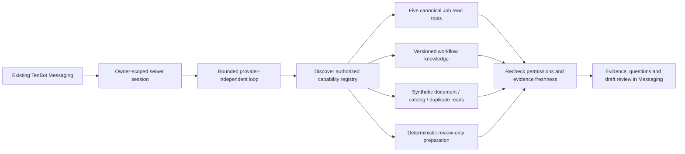

# TenBot optional OpenAI agent proof of concept — October 28, 2026

**Latest follow-up:** [Combined new-material and pending-receival simulation](#combined-new-material-and-pending-receival-review--october-29-2026) supersedes the incomplete proposal-only behavior in `cfff0af`: a complete proposal clears the catalog-ID blocker and joins the exact simulated approval. The employee experiment dropdown is removed; diagnostics require explicit developer opt-in. The [authenticated receival service](#product-accepted-demonstration-and-authenticated-receival-candidate--october-29-2026) remains disabled with its migration unapplied. Terra stays experimental, Sol optional, Qwen Production. No new inference was used for this correction. Earlier receipts retain their original boundaries.

**Status: implemented locally; awaiting Product acceptance.** Chris's explicit **TENBOT — OPENAI AGENTIC PROOF OF CONCEPT** request accepts the October 28 benchmark recommendation and authorizes this focused local implementation and local commit. It does not authorize paid calls, hosted changes, a push or deployment. The separate Advisory & Implementation conversation was unavailable; the current explicit request governs. Base: `dev` at `d3f42a7`; candidate: the commit containing this record. No branch/worktree was created.

The candidate provides a provider-independent investigation loop and an optional OpenAI Responses transport within existing TenBot Messaging. It demonstrates authorized multi-tool reads and synthetic invoice drafts. **It does not establish OpenAI reasoning quality:** neither a server API credential nor explicit paid-call authorization was available. All new model transport tests use mocks; the browser demonstration uses an explicitly selected scripted transport. Production remains on Qwen3, with its hosted constructor unchanged.

## Review the local demonstration

Open [localhost:3000/my-work?tenbotExperiment=1](http://localhost:3000/my-work?tenbotExperiment=1), then **Messaging → TenBot → Local agent experiment**. The existing safe `.local` review session is required. No new chatbot or Messaging system was added.

1. Select **Job investigation** and ask: “Investigate Job TB-2801: summarize its recorded status, saved schedule and labor, and explain what remains unknown.” Inspect the summary, planning and deterministic labor evidence.
2. Clear the assistant conversation. Select **Invoice preparation**, attach the supplied synthetic text invoice, and ask: “Here's the synthetic invoice. Create pending receivals for the materials listed.” Inspect the missing order details and held entries.
3. Enter **Synthetic Employee**, order date **2026-10-26**, destination **Denton** in the experiment controls. Ask to prepare the same invoice again for review. The invoice date remains distinct from the employee-supplied order date.
4. Inspect **Experiment evidence and measurements**. Every response is labeled scripted, review-only, with completed database actions **none**. There is no approve/execute action. Scenario selection controls the test double; it is not evidence that a model understood those questions.

The reviewed result is two material drafts: **Alaska White #1: 2 × 50 LB Bag** from 100 LB; **Clear Resin Part A: 1 × 5 GAL Pail** from 5 GAL. Blue Coal is held for a potential existing receival, CC Green for two catalog offers, and Unlisted Violet for no match. Freight is excluded. An order count such as “3 Bag” does not assert a three-pound package size. Real measured package conflicts remain held.

The original app process on port 3000 and existing adapters on 55593/55594 were preserved. The task owns the loopback adapter on **55595**, started with `npx tsx scripts/start-tenbot-agent-review.mts`. Its current PID/mode/source hashes are in `/private/tmp/tenops-tenbot-agent-poc/server.json`. The app uses the existing optimized review export and existing disposable Job database. The synthetic catalog/invoice are fixed local fixtures. The adapter is intentionally unsigned fixture Auth, not hosted authentication.

## Implementation and reusable boundaries

| Component | Candidate behavior / reuse |
| --- | --- |
| Existing interface and handler | Retains Messaging, account-scoped controller and input/privacy checks. A small optional handler dependency selects the experiment; default handler behavior is preserved. The hosted Edge entrypoint never constructs it. |
| `tenbot-agent.ts` | Provider-independent strict tool definitions, discover/load registry, bounded model/tool loop, evidence IDs and host-owned proposals. No framework dependency. |
| `tenbot-openai.ts` | Server-only Responses API for allowlisted `gpt-6.1-sol` / `gpt-6.1-terra`; strict function/final schemas, low reasoning, encrypted continuation replay, `store:false`, bounded requests, timeout, reservation/usage accounting. No browser key. Actual account entitlement remains unverified. |
| `tenbot-agent-operations.ts` | Reuses all five existing caller-authorized Job tools: `find_jobs`, `get_job_summary`, `get_job_planning`, `get_job_labor_summary`, `get_production_overview`. Reuses deterministic calculations, projections, RLS and unknown/truncation contracts. Adds permission-filtered search of existing versioned workflow knowledge. |
| `tenbot-agent-session.ts` | Owner-bound, concurrent-request lock, one-hour expiry, maximum 100 in-memory sessions. Retains only the last three employee questions, canonical lookup seeds and explicit attachment/order metadata. Previous operational answers, tool results and native provider history do not cross turns. Rereads evidence and permissions before publication. |
| `tenbot-invoice.ts` | Read/prepare registry for synthetic document reading, catalog search, duplicate checks and draft preparation. Reuses purchasing catalog combination, supplier matching and package parsing contracts. Decimal package conversion is deterministic. No mutation tool. |
| Review adapter and fixtures | Explicit scripted provider for infrastructure verification; optional real provider only after server key, spending opt-in and separately authorized budget. No business setup/reseed/migrations at startup. |



Registry discovery loads only selected schemas; tool results and schemas still consume inference tokens. The runtime permits at most 16 rounds, 14 tool attempts, four calls per round, three tool errors, 24 KB per result, 160 KB session context, 90 seconds, 3,000 output tokens per step and $0.25 accounted per request. OpenAI requests disable parallel tool calls; tools execute sequentially. One retryable provider retry is allowed and accounted. Conservative byte-based reservations can stop a task before its measured token cost would reach the cap; live testing must assess completion under these limits.

Caller identity, read/prepare grants, argument validation and final publication decisions remain outside the model. Preparation requires existing `writeBusinessData` plus `adjustInventory`; unauthorized callers cannot discover that capability. Every Job operation still uses its original caller tools. Repeated reads retain the first baseline and latch inconsistencies, preventing a later read from blessing an earlier stale fact/draft. Changes, revocation, failed refresh, limits and provider failure suppress the candidate evidence/proposals and model candidate prose. Freshness is best effort across reads, not an atomic database snapshot.

No arbitrary SQL, shell, filesystem, web request, private Messaging, personal Task or financial-data capability is registered. No credentials or privileged client enter model context. The local invoice caller adapter fixes tables/projections and fails on incomplete reads; it has contract tests but was not exercised against hosted Inventory RLS. Local real-PostgreSQL authorization testing covers the existing Job tools separately.

## Actual comparison and architectural findings

| Dimension | Existing Qwen path | Optional OpenAI path |
| --- | --- | --- |
| Actual model evidence | Recent released Qwen results preserved in the [QA reconciliation](2026-10-28-tenbot-qa-reconciliation.md). No fresh Qwen request was made in this task. | **Zero live Sol/Terra requests.** Mocked Responses transport and scripted orchestration only. No measured model win, latency or task cost. |
| Compound Job investigation | Current deterministic router chooses one detail tool by lexical precedence. A current pure-code probe sends schedule + labor + material questions to labor alone. This is an architecture constraint, not proof of Qwen inability. | Registry and loop can combine the same authorized tools. Browser script exercised summary + planning + labor after lookup. Autonomous selection remains untested. |
| Multi-turn context | Existing released owner-scoped Job context and conservative response path remain unchanged. | Tested owner-bound question/ID seeds, explicit order metadata and fresh rereads; scripted provider uses these contracts. Novel natural-language follow-ups still need live evaluation. |
| Qualitative answers | Current validator requires complete fact vocabulary, numeric order, anchors and semantic modifiers, and restricts connective/risk/recommendation prose. | Experimental structured observations/inferences/recommendations/questions replace the lexical prose gate. Host validates schemas, evidence IDs and proposals. Semantic entailment of free prose remains unproved. |
| Invoice / cross-module work | Existing release has no attachment-to-receival preparation capability. This is a missing tool/workflow boundary, not a measured model defect. | Synthetic text → catalog → duplicates → preparation exercised. Photo/PDF interpretation, general upload handling and live Inventory access are absent. |
| Error recovery | Existing deterministic fallback remains intact. | Offline invalid-tool-argument recovery and provider timeout/retry/refusal/malformed output/cost-limit paths tested. No live model recovery result. |

[Current routing/prose probe](evidence/2026-10-28-tenbot-agent-poc/routing-comparison.json) also demonstrates that “Total labor: 18 hours.” passes the current validator while the equivalent synthetic “Recorded labor totals 18 hours.” fails. A null live route can still lead to verified workflow guidance; it must not be counted as a model failure. Existing deterministic fallback remains valuable for provider unavailability and known facts. Specialized one-tool routing and lexical prose equivalence are reasonable candidates for simplification only after live evidence supports it.

Recent **actual Qwen**, for context only: the QA reconciliation recorded 18 dispatches, 16,426 input / 1,975 output tokens and 136.169 token-estimated Neurons, including superseded attempts. The later accepted release window recorded 13 actor requests, 11 completed / two failed attempts, 9,737 input / 1,500 output tokens and 90.754 estimated Neurons, with $0 incremental Workers Free cost. Those workloads, provider windows and failures differ from this experiment; they are not a head-to-head score. [Recorded Qwen answers](evidence/2026-10-28-tenbot-qa-reconciliation/actual-answers.json) preserve the actual outputs.

The browser's local scripted elapsed times were 4.281 s for the Job investigation and 3.137 / 3.026 s for invoice preparation/follow-up. They measure registry, capability, fixture-query, freshness and UI overhead, **not inference latency**. The Job used four scripted provider steps/five tool attempts; each invoice request used seven steps/nine attempts. All inference token counters and paid spend were zero. Exact outputs and tool arguments are in the [browser trace](evidence/2026-10-28-tenbot-agent-poc/browser-report.json).

## Official capability and cost basis

Official OpenAI documentation checked October 28 lists [Sol](https://developers.openai.com/api/docs/models/gpt-6.1-sol) and [Terra](https://developers.openai.com/api/docs/models/gpt-6.1-terra), image input, structured outputs and function calling. Their tool calls require Responses. [Function calling](https://developers.openai.com/api/docs/guides/function-calling) supports this controlled application-run loop; no hosted agent framework or Production shell is required. Public documentation does not establish this account's model availability or access. ChatGPT subscription access is not an API credential/spending grant.

| USD / million tokens, Standard short context | Input | Cached read | Default 30-minute cache write | Output, including billed reasoning |
| --- | ---: | ---: | ---: | ---: |
| GPT-6.1 Sol | 2.00 | 0.10 | 2.50 | 10.00 |
| GPT-6.1 Terra | 1.00 | 0.05 | 1.25 | 5.00 |

Cache writes use their total write rate, not an additional full input charge; see [prompt caching](https://developers.openai.com/api/docs/guides/prompt-caching). Estimates below conservatively price all input as default cache writes, assume no cache hits, sum repeated context/tool data over **every** step and include reasoning/tool arguments in output. They supersede the earlier research estimate's ordinary-input-only assumption. No paid hosted tools, storage, tax or TenOps infrastructure are included. These are forecasts, not observed consumption.

| Assumed completed task profile | Total input / billed output across steps | Sol | Terra |
| --- | --- | ---: | ---: |
| Read investigation, roughly three steps | 9,000 / 1,500 | $0.0375 | $0.01875 |
| Document draft, roughly six steps | 45,000 / 6,000 | $0.1725 | $0.08625 |
| Complex document, roughly ten steps | 100,000 / 15,000 | $0.4000 | $0.20000 |

The complex Sol example exceeds this PoC's $0.25 request cap and would stop rather than guarantee completion. Real invoice tasks may require more steps than these examples. For a 70% read / 30% draft mix and 30% contingency: **300 tasks/month ≈ $30.42 Sol / $15.21 Terra; 500 ≈ $50.70 / $25.35**. Doubling billed output raises Sol to about **$41.54 / $69.23**. Employee demand, live tokenization, retries, document complexity and cache reuse are unknown. **Actual OpenAI cost per completed operational task is unavailable.**

Paid mode defaults off. Future local activation requires a server-only key, `TENBOT_OPENAI_SPEND_AUTHORIZED=true`, `--openai`, an allowlisted `--model=...` and `--authorized-budget-usd=...` (maximum $5). These flags are mechanisms, not authorization to set them. The server reserves before network access; unknown/timeout attempts retain their reservation. A local durable journal survives restarts and cannot be reset casually. It is atomic only within the one adapter process and is **not** a distributed Production budget ledger. Production would require shared atomic task/account/month quotas, usage reconciliation, reviewed pricing and per-task completion metrics.

## Receival execution and document boundaries

The prototype deliberately has no database execution service. Its review schema contains source references, catalog IDs and decimal strings and is **not** a `pending_receivals` insert payload. Supplier is distinct from manufacturer; invoice date is not order date; missing order details remain unknown. A catalog result never licenses guessing between ambiguous offers. Existing receivals do not have a general invoice-reference uniqueness contract; duplicate detection is conservative supplier/material/size matching, not proven invoice idempotency. Unclassified document source lines and extraction limitations remain visible in evidence; employee comparison with the original is required.

Canonical source inspection found two different existing paths:

- Ordinary manual creation is still `handleCreatePendingReceival` in [Inventory](../../src/app/inventory/page.tsx), with permission checks, validation, row mapping and sequential inserts (current lines 1766–1924). There is **no general transactional invoice creation service** to call safely today.
- Genuine PO-backed creation uses [createPendingReceivalsFromPurchaseOrder](../../src/modules/purchasing/mutations.ts) and the allocation-aware [canonical RPC](../../supabase/migrations/20260923160100_po_reservation_allocations.sql). It requires real immutable issuance/source-line IDs and preserves allocation/retry behavior. A future PO tool must reuse it; never fabricate an issuance. Partial receiving RPCs mutate existing receivals and are not creation services.

A future ordinary invoice executor needs a separately approved server contract that reuses the manual business rules and Inventory identity/package conventions, with a transaction, idempotency, duplicate reconciliation, audit and approval binding. Approval must bind owner, exact immutable draft hash, canonical identities/quantities, source evidence and expiry; execute must reauthorize and revalidate current records. An “approved” sentence cannot grant authority. None of that execution work is implemented or implied accepted here.

Only synthetic **text** attachment intake is implemented. No real photo/PDF upload, malware/type/size/storage policy, vision/OCR, retention or scanned-document extraction is claimed. Future approved attachment intake should be owner-authorized and bounded, preserve page/line evidence, and send only the necessary document to a multimodal provider. Treat attachment instructions as untrusted content. Structured extraction still needs deterministic units, catalog checks and human review; model confidence is not a permission or completeness check.

## General operational-agent direction

The loop does not choose tools with per-question patterns. The scripted test double does, intentionally, use explicit demonstration scenarios; real OpenAI mode ignores that scenario when reasoning. Whether Sol or Terra can handle novel requests through this registry remains the central live acceptance question.

Keep three context sources separate: (1) release-pinned, role-appropriate application/workflow knowledge; (2) current caller-authorized operational tools; (3) explicit reviewed Tenarten operating decisions. The PoC exposes the existing knowledge export, not arbitrary repository access. Its corpus remains pinned to the prior verified release and retains the known Bid Preparation help-breadcrumb follow-up; no corpus or Product Canon was silently rewritten. Repository source inspection by developers is separate from employee record access.

Externalize useful institutional knowledge through selected, reviewed decision/workflow documents with owner, effective date, source pin, verification date and supersession links in the existing repository documentation. Include only approved role-appropriate excerpts in the release export. Do not ingest private Product history indiscriminately or depend on a personal ChatGPT session. No conversation import was performed. Capability descriptions should state permissions, input/output schema, scope, source freshness, completeness and side effects. Additional cross-module work should add real authorized capabilities, not a new question router. Missing purchasing issues, private Tasks or absent invoice execution remain unavailable until deliberately approved tools exist.

## Validation and evidence

Risk: **Tier 3 / focused Testing Level 3**, because the delta adds external-provider and multi-module preparation boundaries. No migration, grants, hosted Auth/configuration or business database writes were introduced. Disposable test infrastructure setup by existing verifiers is distinct from operational writes.

| Command / check | Actual result |
| --- | --- |
| `npx tsx scripts/verify-tenbot-agent.mts` | Initial 28 offline runtime/transport groups pass; [receipt](evidence/2026-10-28-tenbot-agent-poc/runtime-validation.json). After the cache-write pricing correction, `--cache-accounting-only` passes nine focused groups (five new, four adjacent); [receipt](evidence/2026-10-28-tenbot-agent-poc/cache-accounting-validation.json). Unaffected groups were not repeated. Native API responses are mocked. |
| `npx tsx scripts/verify-tenbot-invoice.mts` | 20 deterministic groups pass, including raw package-count regression, real package conflicts, fractional conversions, ambiguous/duplicate/unmatched holds, source-span/argument and read-projection guards. [Receipt](evidence/2026-10-28-tenbot-agent-poc/invoice-validation.json). |
| `npx tsx scripts/verify-tenbot-agent-session.mts` | 16 groups pass: owner/expiry/concurrency, forged history, no execution, revocation, stale and repeated-key evidence, final-read revocation and output redaction. [Receipt](evidence/2026-10-28-tenbot-agent-poc/session.json). |
| `npx tsx scripts/verify-tenbot-agent-database.mts` | Nine groups / **93 actual authenticated PostgreSQL SELECT queries**, all five existing tools, hidden-Job RLS, inactive/read-only roles, strict args and freshness. Zero mutations/external calls; protected records unchanged. [Receipt](evidence/2026-10-28-tenbot-agent-poc/database.json). |
| `node scripts/verify-tenbot-agent-browser.mjs --scripted-local` | Six groups / three scripted questions pass in actual localhost Messaging; desktop/mobile, quantities/holds, follow-up, route persistence, blur invalidation. No Auth injection or interception; zero Qwen/OpenAI calls. [Trace](evidence/2026-10-28-tenbot-agent-poc/browser-report.json), [desktop](evidence/2026-10-28-tenbot-agent-poc/desktop-invoice-reviewed.png), [mobile](evidence/2026-10-28-tenbot-agent-poc/mobile-invoice.png). |
| `node scripts/verify-tenbot-agent-http.mjs --scripted-local` | 11 failure-only groups pass: identity/origin, invalid body/action, browser provider opt-in, forged history/conversation, body/method bounds. [Receipt](evidence/2026-10-28-tenbot-agent-poc/http.json). |
| Existing `npx tsx scripts/verify-tenbot.mts` | Pass: 16 chunks / 113 retrieval examples and existing local core/handler/meter/feedback checks. |
| Existing `npx tsx scripts/verify-tenbot-privacy.mts --policy-only` | Six groups / three exact QA cases pass, no model/database calls. |
| Existing full `verify-tenbot-privacy.mts` | **Stops at line 164:** old verifier expects an exception for an invalid model source ID; both base HEAD and candidate reject it and return the identical safe guide fallback. Independent exact-source and isolated mocked reproduction confirm pre-existing expectation drift. Original verifier not changed. No full-suite pass claimed. [Evidence](evidence/2026-10-28-tenbot-agent-poc/baseline-privacy-fallback.json). |
| TypeScript, targeted ESLint including shared modules with `--no-ignore`, `git diff --check`, optimized review export | Pass. Production build mode was used locally; no deployment. |
| Independent EM/security review + parent desktop/mobile visual review | Local prepare-only boundary passes, no outstanding blocker. [Review and exact source hashes](evidence/2026-10-28-tenbot-agent-poc/security-review.json). Not a hosted Auth or live model certification. |

The previously failing/stopped browser checkpoints remain in task scratch; selected final synthetic evidence is checked in. No credential, bearer token, encrypted reasoning continuation or private history is included. Unrelated dirty `CURRENT_STATE.md`, historical QA/untracked receipts and existing worktrees were preserved.

## Product acceptance and next experiment

Accept or refine this **local architecture/prepare-only candidate** first. Retain Qwen as Production provider; do not choose a primary model from mock success. The smallest next experiment is explicit API spending authorization and a server project key for a **maximum $5 total**, with the same fixtures, schemas and scorecard on Sol and Terra. This candidate supplies the transport and measured tool/result/usage trace; it does not authorize running it.

Use the same evidence for: natural Job investigation; multi-Job comparison; a novel Job + catalog question whose missing linkage must remain explicit; multi-turn follow-up; invoice extraction/draft; ambiguous SKU/package and duplicate variants; tool error and provider failure. Include a small regression subset from the existing QA. Score observed-vs-inferred separation, missing information, valid selected tools/args, exact host quantities/holds, completion, all-step latency/tokens/cache writes/cost, and absence of unauthorized access/execution. Preserve raw returned structured outputs, not hidden reasoning. Current offline results do not substitute for those live cases.

Recommend a small Production **read/prepare pilot only after** live results justify the model, real caller-JWT/Inventory RLS and signed-in browser privacy gates pass, attachment policies are approved, shared accounting exists and Chris explicitly authorizes deployment/participants. Keep writes unavailable. No primary migration, broad agent framework, unrestricted source/SQL access or hypothetical business workflow is required to evaluate that step.

**Stop: Product acceptance.** No push, deployment, hosted configuration, paid inference, migrations, Production data, credentials or permissions changed.

## API project configuration — October 29, 2026

Chris authorizes project configuration/documentation and one minimal authentication request within the previously approved **$5 total experiment budget**. The full benchmark and receivals implementation remain stopped until configuration is confirmed. Current checkout: `dev` at `f5b1ce8`, preserving candidate `0bb928e` and unrelated dirty Manpower/Current State/execution-standard work. Separate Advisory context remains unavailable. Tier 3 credential/spending boundary; source and TenOps hosted state are unchanged. No commit/push/deployment or database action performed in this configuration pass.

### Verified Platform settings and remaining controls

Read/saved through the authenticated Chrome accessibility interface after browser automation reported no available browser. No screenshots were taken; UI bindings were reset before any secret was generated. No data-sharing, payment-method, recharge or credit-purchase action was taken.

| Setting | Actual October 29 state |
| --- | --- |
| Project | **TenBot**, `proj_e3Qoebc2IckUzl282v3ys6Yl`; project-scoped settings and key form verified. |
| Billing organization | `org-VLsIrIEaVXJmdUSMqpWRQktO`, identified by its billing link; billing explicitly reports the ChatGPT **Personal account** subscription linked. Organization General separately denies `organization.read`; no role was changed. |
| Credits | Billing shows **$7.00 available**. Credit Grants: received October 29, **$7.00 / $7.00**, Available, expires **October 31, 2026** (no exact expiration time shown). Usage dashboard: zero requests/tokens and $0.00 October spend for TenBot at inspection. |
| Processing tier | Standard was already default. Saved and revisited: **Standard only**; Flex/Fast/Ultrafast disabled for this project. The existing server adapter inherits the project tier; no adapter/source change needed. |
| Model policy | Saved **Allow only selected models**: `gpt-6.1-sol`, `gpt-6.1-terra`. All other current/future models blocked. This verifies settings, not successful API entitlement. |
| Per-model rate overrides | Saved/revisited for each model: **30 RPM, 100,000 TPM, 10 IPM**, reduced from inherited 5,000 RPM / 1,000,000 TPM / 50,000 IPM. Rate limits are not a dollar cap. |
| Key lifetime | Existing project maximum **one day** retained and verified in the creation form. No key was created. |
| Platform spend cap / alerts | **Not configured.** Accessible project Limits exposes only model/rate controls; organization Limits exposes tier/rate controls with no Spend/alert section. General settings deny `organization.read`. No permission expansion or Admin key was attempted. |
| Authentication / inference | **Not run; $0.00 usage in this pass.** Neither supported API-key environment variable is configured; `.env.tenbot.local` does not exist. No secure key-entry tool is connected. |

An API-organization owner should open TenBot **Project settings → Limits → Spend → Edit spend limit**, if that control is available to their role, set **$5 monthly** and **Enforce a hard limit**, then add notifications at **$2.50, $4 and $5**. If Spend remains absent, resolve its availability with OpenAI Support; do not buy credits or add a payment method to solve a missing control. Keep changes project-scoped. Do not alter other projects or organization-wide spend. [Official spend-limit guidance](https://developers.openai.com/api/docs/guides/spend-limits) distinguishes alerts from enforcement and warns that propagation can permit slight overshoot. A monthly reset also does not reset Chris's lifetime $5 authorization for this experiment.

The existing local adapter's durable reservation journal remains the experiment control: one process, maximum authorized total $5, reservations before fetch, failed/unknown attempts retained, per-request $0.25 cap. Never delete/reset `/private/tmp/tenops-tenbot-agent-poc/openai-budget.json` to gain headroom. It does not control requests made outside that adapter, and is not a distributed Production ledger. A minimal authentication request must also be charged against the same $5 total. See the earlier cost table: roughly $0.0375 Sol / $0.01875 Terra per assumed investigation and $0.1725 / $0.08625 per assumed document draft, including conservative cache writes. Actual completed-task costs remain unmeasured.

### Secure credential handoff

The **unsubmitted** API Keys form is prepared in Chrome: owner **You**, name **TenBot local evaluation 2026-10-29**, project **TenBot**, expiration **1 day**, **Restricted → Model capabilities → Responses (/v1/responses): Write**, all other resources None. The UI reports two selected permissions with that setting. No List models, Files, hosted Agents, administration or other model-endpoint access is needed by the existing adapter. Verify this selection before submitting. The official [scoped-response example](https://developers.openai.com/api/docs/guides/terraform/service-accounts) uses `api.responses.write`; key restrictions cannot grant authority beyond the owner's project role.

The official **OpenAI Developers** plugin was offered as a secure alternative, but remains unconnected; no secure provisioning tool was available in this session. Either enable that connection and verify its secure local destination, or perform the following steps yourself. **Never paste the key into chat.**

1. At [API Keys](https://platform.openai.com/api-keys), verify the prepared project/permissions/expiration and click **Create secret key** yourself. Copy the one-time secret privately. Do not share a screenshot or create an Admin API key.
2. In your own local **zsh Terminal**, run this from the repository. Paste the secret only at the hidden prompt. The script refuses an existing file/symlink and creates an owner-only dedicated server environment file without touching `.env.local`.

```zsh
cd /Users/chrisngo/source/repos/tenarten-inventory-ui
(
  set +x
  if [[ -e .env.tenbot.local || -L .env.tenbot.local ]]; then
    printf 'File already exists; use the rotation procedure.\n' >&2
    exit 1
  fi
  tenbot_local_key=''
  read -rs 'tenbot_local_key?Paste the TenBot project key (hidden): ' || exit 1
  printf '\n'
  [[ -n "$tenbot_local_key" && "$tenbot_local_key" != *[[:space:]]* ]] || exit 1
  umask 077
  set -o noclobber
  printf 'TENBOT_OPENAI_API_KEY=%s\nTENBOT_OPENAI_SPEND_AUTHORIZED=false\n' "$tenbot_local_key" > .env.tenbot.local
  unset tenbot_local_key
)
```

3. Verify only metadata/presence. `.gitignore:40` excludes `.env*`; `git check-ignore -v .env.local .env.tenbot.local` was verified for both paths. Do not `cat` the environment file or put a secret in a command argument, shell history, source, `NEXT_PUBLIC_*`, `next.config`'s `env`, browser storage or a client bundle. Clear the copied secret from your clipboard after entry.

```sh
git check-ignore -v .env.local .env.tenbot.local
env -u TENBOT_OPENAI_API_KEY -u OPENAI_API_KEY -u TENBOT_OPENAI_SPEND_AUTHORIZED node --env-file=.env.tenbot.local -e 'const k=process.env.TENBOT_OPENAI_API_KEY; console.log({keyConfigured:typeof k==="string"&&k.length>=16&&!/\s/.test(k),spendingAuthorized:process.env.TENBOT_OPENAI_SPEND_AUTHORIZED==="true"})'
```

Expected booleans: `keyConfigured:true`, `spendingAuthorized:false`. This check does not authenticate, start a server or make a network request. The standalone runner reads `process.env` at startup; Next's automatic `.env.local` loading does **not** load credentials into it. Future approved runner startup must explicitly use Node `--env-file=.env.tenbot.local --import tsx`, after checking port 55595 ownership. Do not start it with a spending flag during entry/configuration.

4. Report only that local entry is complete. The agent can then perform the already authorized single minimal **Responses** request, with Standard processing, no tools/files/business data, a small output cap and a conservative reservation within the remaining $5. Record model, result, returned token/cache usage, cost and latency; retain failed attempts. A successful boolean presence check or Playground session is not API authentication. A GET-models request would require an extra permission and is unnecessary. Stop after that request for Product review; no full benchmark yet.

### Rotation, monitoring, revocation and Production

- **Rotate/expire:** this experimental key expires after at most one day. Create a new equally restricted project key privately, stop only the task-owned adapter, replace the dedicated file through a local editor with mode `600`, restart with explicit environment loading and the same preserved spending journal, authenticate minimally, then revoke the prior key. Do not retain backup copies containing the secret or force-overwrite unrelated `.env.local`.
- **Monitor:** [Billing overview](https://platform.openai.com/settings/organization/billing/overview) and **Credit grants** show balance/expiration; [Usage](https://platform.openai.com/usage) filtered to TenBot/key shows token/request/cost records and can be grouped by service tier. Reconcile delayed Platform telemetry with local reservations. The [subscription-credit guide](https://developers.openai.com/api/docs/guides/chatgpt-api-credits) confirms linked promotional credits can fund API usage without adding a payment method; expired/exhausted credits do not authorize purchasing or recharge.
- **Revoke:** select the named key in API Keys and revoke it; stop the local adapter and remove its dedicated local secret file securely. Revocation should be verified with one controlled request if separately authorized; merely deleting a local file does not revoke the remote key. Never add management permissions to the application key for revocation.
- **Production remains Qwen.** Any eventual OpenAI deployment requires separate Product acceptance/release authorization, a reviewed dedicated Production project/service identity and server secret store, required privacy/retention and attachment policies, caller-JWT/RBAC/RLS validation, shared atomic spending controls and measured live model results. This key, local unsigned fixture Auth and single-process journal are not Production configuration.

Validation in this pass: actual Platform settings save/revisit; billing/grant/usage inspection; Git-ignore/presence-only local checks; documentation/link/diff review. No application build or broad suite is needed for documentation-only repository changes. **Remaining blockers:** secure project-key entry and actual API authentication; Platform spend/alert controls unavailable in this UI. No claim that the live benchmark or receivals workflow succeeded.

## Authorized live evaluation — October 29, 2026

**Status: partially evaluated live; operational benchmark blocked; stopped for Product review.** Chris's explicit **TENBOT — AUTHORIZE LIVE OPENAI EVALUATION** authorizes inference within the existing **$5 cumulative** experiment cap. This supersedes the earlier credential/authentication blockers and prohibition on live calls, without accepting the candidate for Production. Separate Advisory context remains unavailable. Source: shared `dev` at `f5b1ce8`, containing accepted experimental `0bb928e`; no application source was changed. Risk is Tier 3 for credentials, spending and authorization; focused Level 3 evidence below is partial, not a completed operational/security certification.

### Actual model results

All four calls used the existing server-only `createOpenAIProvider` Responses integration, real API responses and Standard (`service_tier: default`). First Sol authenticated successfully, then Terra. Each returned the requested strict structured output. There were no retries, cached/cache-write tokens or reported reasoning tokens. Costs use **actual returned token usage** and the verified Standard prices above; these are not a reconciled Platform billing statement.

| Model | Actual test | Input / output tokens | Wall time | Token-based cost |
| --- | --- | ---: | ---: | ---: |
| Sol | Minimal authenticated structured response | 61 / 16 | 2.971 s | $0.000282 |
| Terra | Minimal authenticated structured response | 61 / 16 | 1.802 s | $0.000141 |
| Sol | Synthetic invoice PNG transcription | 989 / 213 | 3.696 s | $0.004108 |
| Terra | Same invoice PNG transcription | 990 / 213 | 4.186 s | $0.002055 |

Both models transcribed **18/18 lines exactly**, including all five material rows, supplier, invoice reference/date and separate $85 freight. The unfamiliar locally generated image is 768 × 920 pixels, 66,968 bytes, SHA-256 `98ee71810a8df51640c0105f09c8690f9bcb5c8946ff9a15733bf379c7e8f4f2`. The extraction prompt received the actual `input_image` and output schema, **no offline OCR, gold transcription or scripted response**. Independent evidence review recomputed both scores and costs. This is one clean synthetic PNG per model; no PDF, real phone photo, handwriting, adversarial document or robustness distribution was tested.

The image harness adds bounded image input to the existing transport for this isolated experiment. It does not implement attachment upload/vision in TenBot Messaging. The models only transcribed visible information; they were not asked to infer catalog matches or order metadata in this call.

### Operational benchmark blocker and root cause

The first Sol Job investigation stopped in the **existing local fixture permission preflight**, before provider import, any inference reservation or tool-directed model step. `docker exec` did not return; an independent `docker ps` also exceeded a ten-second wall-clock timeout. The fixture helper's synchronous subprocess has no wall-clock timeout ([source](../../scripts/support/sample-batch-database.mjs:7)); PostgreSQL's statement timeout cannot bound an unresponsive Docker transport. This is an infrastructure failure, not evidence of a model, argument-selection or RLS failure.

Only the identified stalled benchmark and its Docker child/probe were terminated. Docker was not restarted, the existing database was not recreated/reseeded, no authorization was mocked, and no tool result was replayed as live evidence. Original review servers were preserved. Terra's database-independent image call then completed normally.

**Not tested live:** autonomous Job tool selection/sequencing, multi-step Job investigation, multi-turn contextual reasoning, novel Job/catalog questions, catalog matching, ambiguity/duplicate handling, missing-information questions, pending-receival preparation and tool/provider failure recovery. There are **zero live model-directed tool calls** and no completed operational task. No new Qwen inference was performed; historical Qwen QA remains contextual evidence, not a comparable head-to-head run. Neither model can yet be selected as TenBot's primary provider on this evidence.

### Spending, privacy and evidence

The shared reservation ledger records **4 attempts, 4 settled, $0.006586 total**; **$4.993414** remains within the original authorization. It was never reset. Sequential server-side reservations occur before fetch, with a single-writer lock, atomic durable updates, a hard cumulative $5 check, unknown attempts retained and actual-usage settlement. The image path additionally reserves a conservative 100,000 input tokens; the agent runtime's separate $0.25 turn limit was not exercised by these standalone image calls. HTTP authorization/model-access and accounting failures stop further calls. Platform alerts are not the enforcement mechanism.

Focused harness review corrected an empty-existing-ledger reset edge case to fail closed and latched HTTP failures before response parsing. No application provider or runtime source correction was made. These local controls are not a distributed Production budget ledger.

At stop, `TENBOT_OPENAI_SPEND_AUTHORIZED` was returned to **false**. `.env.tenbot.local` remains an owned, regular mode-`600`, Git-ignored/untracked file; only metadata/presence was reported. The existing provider loaded the credential and [rejected a disabled-spending step before reservation or fetch](evidence/2026-10-29-tenbot-live-openai/stop-gate-check.json), with zero network attempts. No credential or encrypted continuation is in the evidence. All submitted document data was synthetic; no employee/customer operational content was sent, no operational writes occurred, and existing JWT/RBAC/RLS, hosted Qwen and confidentiality boundaries were unchanged. Actual hosted authorization was not re-certified by this partial run.

[Measured summary](evidence/2026-10-29-tenbot-live-openai/summary.json), [final ledger snapshot](evidence/2026-10-29-tenbot-live-openai/budget-ledger-final.json), [artifact hashes](evidence/2026-10-29-tenbot-live-openai/manifest.json), [synthetic image](evidence/2026-10-29-tenbot-live-openai/invoice-fixture.png), [Sol actual output](evidence/2026-10-29-tenbot-live-openai/gpt-6.1-sol-image-extraction.json) and [Terra actual output](evidence/2026-10-29-tenbot-live-openai/gpt-6.1-terra-image-extraction.json) preserve the receipts, scores and exact structured responses. The same directory archives the isolated harnesses and scoring-only gold. Original task scratch is `/private/tmp/tenops-tenbot-live-2026-10-29`; the authoritative cumulative ledger remains `/private/tmp/tenops-tenbot-agent-poc/openai-budget.json`. Archived harnesses retain explicit scratch paths and are not application entrypoints. Do not run them without checking authorization, credential expiry, fixture health and the preserved ledger.

Focused validation: actual HTTP 200/model identity/usage receipts, image SHA and exact field comparisons, independent spending/evidence review, narrow strict harness type checks, secret-safe file metadata, ledger reconciliation and documentation/link/diff inspection. No application build, mobile/UI validation or full lifecycle suite was run because application source/UI did not change. Operational gates remain incomplete.

### Recommendation and next review boundary

**Retain Qwen as Production provider.** Terra achieved the same narrow extraction at half Sol's token cost; Sol was about half a second faster on this one image. Neither observation establishes agentic superiority. Restore Docker/the existing isolated fixture and add a wall-clock bound to the local fixture subprocess before resuming the same cases. Preserve the ledger and recheck the one-day key/credit expiry. Full cost per completed operational task remains unknown; do not extrapolate the $0.002055–$0.004108 transcription cost into a receivals-task price.

The first proposed approved-write workflow remains **invoice → extract → catalog/duplicate checks → editable pending-receival draft → explicit approval → authorized server execution**. Approval must bind the caller, immutable draft hash, source, canonical catalog/Job identities, quantities and expiry; execution must reauthorize/revalidate, transact, enforce idempotency and audit. Hold ambiguous/unmatched/duplicate lines for review. Create pending entries only, with no on-hand increase or silent catalog creation. Reuse the existing Inventory rules; ordinary invoice creation still needs the separately reviewed transactional service described above. Use the existing PO creation service only for genuine PO issuance/source lines. No executor or approval UI was implemented, and partial extraction success does not authorize it.

**Stop: Product/Architecture review.** No commit, push, deployment, hosted configuration, migration, Production mutation, billing/recharge or personal-context integration was performed in this evaluation.

## Docker timeout investigation and bounded preflight — October 29, 2026

Chris explicitly requests diagnosis before any operational benchmark resumes, distinguishing Codex approval/review, Docker availability and fixture startup. This is a **Tier 2 local tooling correction** with focused script validation; the application, hosted systems and inference policy are unchanged. Separate Advisory context remains unavailable. Shared `dev` remains at `f5b1ce8`; prior dirty work and historical receipts are preserved.

| Boundary | Actual evidence | Conclusion |
| --- | --- | --- |
| Codex approval/review | Approved commands executed and produced measured child-process results. Approval wait precedes process execution; no approval rejection or timeout occurred in this investigation. | The measured Docker timeout was not a Codex approval timeout. A future approval timeout before execution would provide no Docker-health result. |
| Sandbox socket access | Client 27.4.0 and `desktop-linux` context were readable. Initial sandboxed `docker info` printed socket `operation not permitted`, despite exit status zero. | Access restriction is separate from daemon health. A successful exit code alone is insufficient. The read-only health probe was then approved outside the sandbox. |
| Docker daemon/API | Approved `docker info` timed out after **5.008 s**. The existing Unix socket accepted a connection immediately; `/_ping` returned no response within **3.001 s**. Docker Desktop/backend processes are present. | Docker is installed and listening but its API is **unresponsive**. The underlying internal Docker/VM cause is unverified. |
| Fixture startup/readiness | Daemon preflight failed first. No container startup, recreation, reseed or migration was attempted. | Fixture state remains unknown; this is not an established PostgreSQL startup timeout. |

The corrected read-only command, **`node scripts/check-tenbot-fixture.mjs`**, exited **2** after **5.009 s** with code **`docker-unresponsive`**, phase **`daemon-info`**, zero inference calls and zero database mutations. It stopped before fixture inspection, PostgreSQL or caller authorization. [Diagnostic receipt](evidence/2026-10-29-tenbot-live-openai/docker-timeout-investigation.json) and [correction validation](evidence/2026-10-29-tenbot-live-openai/docker-timeout-fix-validation.json) retain the exact boundaries.

The small [TenBot-only helper](../../scripts/support/tenbot-fixture-health.mjs) gives every invoked Docker CLI a **five-second OS subprocess timeout**, using `SIGKILL` only on its own spawned CLI. Preflight checks daemon version, existing container state and `pg_isready -t 3`, sequentially; only after success does the checker run a read-only authenticated `readOperationalData` check. No automatic fixture creation/start/reseed fallback exists. Stable redacted error codes distinguish missing CLI, denied Docker access, unavailable daemon connection, unresponsive command, missing/stopped fixture, PostgreSQL not-ready/startup timeout and SQL failures. PostgreSQL permission errors remain SQL failures, not Docker-access errors. Approval decisions occur outside this subprocess helper and are not inferred from its timeouts.

The Job caller, future agent-review startup and the two isolated benchmark harnesses now use the bounded helper; benchmark health checks run before provider import. Existing shared Sample/Blend/Intake helper defaults are unchanged. Already running review servers were not replaced. These are per-subprocess bounds; synchronous execution still does not establish a strict aggregate agent deadline. No application or Production runtime source changed.

Validation: **22 offline process-error/readiness groups pass**, syntax and targeted ESLint pass, narrow strict TypeScript over the agent adapter and both benchmark harnesses passes, independent review passes, and `git diff --check` passes. The actual approved CLI's bounded failure was observed. Full fixture authorization/five-tool/RLS validation remains blocked; no browser, build or operational benchmark success is claimed for this tooling-only change.

**Remaining blocker:** restore Docker Desktop API responsiveness, then rerun the same read-only checker with permitted socket access. A controlled Docker Desktop restart may be needed, but none was performed against the shared fixtures. Once readiness and caller permission pass, use the existing read-only agent database verifier before considering live model calls. Do not run fixture initialization to compensate for a failed health check.

The credential file was untouched and remains owned/mode `600`/Git-ignored, spending remains **false**, and the preserved $5 ledger remains **four settled attempts / $0.006586**. No additional paid inference, global Codex permission/configuration edit, Docker configuration change, commit, push, deployment or database mutation occurred. **Stop: fixture recovery and Product review.**

### Recheck after reported Docker Desktop restart — October 29, 2026

Chris reports restarting Docker Desktop and authorizes benchmark resumption **only if the existing bounded fixture preflight passes**, without repeating successful image tests. Two approved executions of `node scripts/check-tenbot-fixture.mjs`, separated by read-only diagnostics, both exit **2** at **`daemon-info` / `docker-unresponsive`**, after **5.007 s** and **5.006 s**. These are completed subprocess timeouts, not Codex approval/review timeouts.

The selected context remains `desktop-linux` at `unix:///Users/chrisngo/.docker/run/docker.sock`; there is no `DOCKER_HOST` or `DOCKER_CONTEXT` override and the socket exists. The read-only **`docker desktop status`** command also exceeds its three-second bound. The same Desktop/backend processes remain present with October 20 start dates; that observation does not establish whether the internal engine/VM restarted. Limited log inspection found backend/dockerd log modification times of 14:46/14:51 UTC; no raw logs or operational records were copied. [Actual recheck receipt](evidence/2026-10-29-tenbot-live-openai/docker-restart-recheck.json) preserves the diagnostics.

**Specific blocker:** Docker's engine API and Desktop engine-status path remain unresponsive from this session. The check cannot retrieve a server version, so container inspection, PostgreSQL startup/readiness, caller authorization and the read-only agent database verifier are **not reached**. No fixture-level or RLS failure is established. Internal Docker recovery is still required; no destructive cleanup, restart by the agent, configuration change, initialization or reseeding was attempted.

No operational benchmark or image test was run. Spending remains **false**, the credential remains untouched/owner-only/Git-ignored, and the existing $5 ledger is unchanged at **four settled calls / $0.006586**. No additional inference, Production change or deployment occurred. Before a future invoice run, also verify the existing caller's Inventory grants and ensure an authorization/freshness denial creates a fatal benchmark stop latch; those review findings remain unexercised and no permissions were altered. **Stopped before inference: fixture preflight has not passed.**

## Docker-independent live agent and database validation — October 29, 2026

**Implemented locally; awaiting Product review. Not accepted or deployed.** Chris's explicit **UNBLOCK AGENTIC DEVELOPMENT WITHOUT DOCKER** and **UNBLOCK DATABASE VALIDATION** authorize genuine Sol/Terra inference against clearly labeled synthetic records, the real attachment/review UI and investigation of existing isolated infrastructure. They supersede the preceding requirement to wait for Docker. Separate Advisory context remains unavailable; current explicit Product instructions govern. Shared `dev` remains at `f5b1ce8`, including experimental `0bb928e`. Unrelated Manpower/Current State changes are preserved. Risk: **Tier 3 / focused Level 3**, with actual database gates explicitly incomplete.

### Actual inference versus simulated records

| Layer | Evidence and boundary |
| --- | --- |
| Model responses | Actual authenticated Sol and Terra Responses API calls, strict outputs and model-directed tool calls. No scripted response substitutes. |
| First comparison document | Reuses each model's previously successful actual PNG transcription; those successful image calls were not repeated. |
| New UI document | Unfamiliar raster-only one-page PDF is rendered locally by existing PDF.js to a bounded JPEG, then submitted as actual OpenAI `input_image`. No offline OCR, supplied gold text or native PDF API claim. |
| Catalog, duplicate records, Job records and permissions | Explicit, synthetic in-memory fixtures. No live business records are read. Existing five Job capability schemas remain available; this run establishes invoice-tool sequencing, not a live Job investigation. |
| Review and approval | Real localhost UI and server validation against simulated records. Changes bind owner, source, revision/hash and expiry. Approval creates simulated pending rows only. |
| Auth/RLS and persistence | Unsigned local fixture sessions are not real authentication. No database-backed permission, RLS, durable audit or transaction claim. |

### Side-by-side live comparison

Each model completed two real turns: investigate an invoice missing order metadata, then reconsider it after employee clarification. Each independently selected nine tools per turn: discovery, invoice reading, five catalog searches, duplicate checking and deterministic receival preparation. Ten inference steps per turn include the final synthesis. Inputs, schemas, synthetic records and scoring criteria were identical, except each model used its own actual image transcription.

| Model | Two-turn outcome | Turn latency | Actual API steps | Input / cached / output tokens, both turns | Measured reasoning cost |
| --- | --- | --- | ---: | ---: | ---: |
| Sol | All structured checks pass | 37.055 s / 30.504 s | 20 | 87,400 / 74,522 / 2,288 | $0.06249720 |
| Terra | All structured checks pass | 31.304 s / 28.873 s | 20 | 87,499 / 74,594 / 1,966 | $0.02967595 |

Both prepared **150 LB Alaska White → 3 × 50 LB Bag** and **10 GAL resin → 2 × 5 GAL Pail** through deterministic host calculations. Both held Blue Coal as a potential duplicate, CC Green for ambiguous package offers and Violet for no catalog match, excluded freight, asked for missing order details and kept invoice date separate from order date. Both accepted supplied order metadata on the next turn. Neither claimed completed writes. Sol's prose was more detailed; Terra asked an unnecessary confirmation of a known supplier alias. One invoice/two turns per model is insufficient to establish broad reasoning superiority or a Production primary-provider migration.

The narrower existing image comparison remains 18/18 exact lines for each model. No new Qwen inference was run, so historical QA is not presented as a controlled head-to-head. Multi-step live Job/database reasoning and recovery from real hosted tool failures remain untested.

### Real PDF → editable draft → explicit simulated approval

The new [synthetic PDF fixture](../../scripts/fixtures/tenbot-invoice-live-demo.pdf) contains different invoice metadata, quantities and freight from the earlier image. Its SHA-256 is `e1cf5a9c958e61923fa30fb45afa19eeac525d2adeca7ad46f4aabcb3e7845b4`; it contains a raster image, no selectable invoice text. The actual browser-rendered JPEG was 83,910 bytes / 1,024 × 960, SHA-256 `228e6b29e03168fe05b6278ef46396d2ded476d4a13c740f05c810b4fd736515`.

Terra correctly transcribed supplier, reference/date, five material lines and $55 freight in **4.514 s**, using **1,278 input / 183 output tokens**, costing **$0.00251175**. Its subsequent autonomous investigation took **32.541 s**, ten API steps, **46,399 input / 37,947 cached / 1,103 output tokens**, costing **$0.01796985**. The complete extraction-and-draft task used **11 actual calls / $0.02048160**. These are usage-derived Standard costs, including reported cache-write charges, rather than a reconciled Platform invoice. Cache warmth and small synthetic records limit extrapolation.

The model proposed **250 LB → 5 Bag** and **15 GAL → 3 Pail**, held the same three uncertain lines and excluded freight. Through existing Messaging, the employee supplied order details, excluded held lines, deliberately changed Alaska White to **6 Bag** and associated synthetic canonical Job TB-2801. That six-bag quantity is a human correction, not a model conversion result. An incompatible resin-unit edit was rejected server-side and prevented approval. Saving the corrected units produced a current review hash; another edit cleared the checkbox. Explicit approval of the reviewed revision created exactly two **simulated** pending rows, each with received quantity zero. Replaying the same approval returned the same rows and created zero more. No on-hand balance changed.

Actual desktop and 390 × 844 browser checks passed, including PDF worker loading at the exact localhost origin, draft editing, approval invalidation and idempotent replay. Two earlier pre-inference fixture-wiring failures are retained: `.local-only` versus `.local` test-token mismatch, then a malformed UUID regex. Both failed before model calls. Corrections apply only to the explicitly enabled local fixture. Four subsequent HTTP checks verify missing/malformed fixture sessions and a wrong origin are denied; these are not RLS tests.

### Small reusable implementation

- Existing TenBot Messaging gains local PNG/JPEG/one-page PDF upload, preview and editable receival review. A local-only flag, exact origin and fixture session gate the adapter. The hosted Qwen constructor and Production provider remain unchanged.
- The provider-independent bounded runtime discovers capabilities and sequences tools. The document preprocessor provides provenance-labeled actual vision transcription; the model then selects catalog and duplicate tools. There is no new invoice-format intent router or agent framework.
- Existing catalog normalization, supplier/package matching and deterministic conversion remain authoritative. Employees can choose existing materials, quantities, units, exclusions and canonical Job associations. No unmatched catalog item is silently created.
- `src/modules/inventory/pending-receival-contract.ts` extracts the existing manual Inventory row construction/defaults for shared use. Both existing Inventory creation and the simulator use it. The manual Inventory insertion path remains unchanged; this extraction is **not** a new transactional Production execution service. The existing PO-specific creation service applies only to genuine PO source lines.
- Local approval rechecks grants, source/catalog/duplicate conditions and expiry, binds owner/revision/hash, prevents unreviewed changes and provides in-memory idempotent receipts/audit. The model has no execution tool, SQL, shell, credentials or unrestricted network authority. The host handles explicit simulated approval separately.
- All real calls use a shared single-writer server reservation ledger, reserve before fetch, retain unknown reservations, fail closed on access/accounting failures and honor the local spend flag again before each step/fetch. A persistent failure latch stops subsequent inference. This remains a single-process experiment control, not distributed Production accounting.

### Existing isolated database: exact blocker

The existing `tenops-permission-review` configuration and eight complete synthetic-role credential records were found; the credential file is mode `600` and no values were printed. Loopback listeners accept connections at **127.0.0.1:55481** (API) and **55482** (PostgreSQL), but actual Auth health timed out after **4.006 s**, REST/schema after **4.003 s**, and the PostgreSQL protocol handshake after **4.004 s**, before credentials or SQL. This confirms an unresponsive existing service, not a missing-password or model failure. No Docker commands, restart, cleanup, provisioning, migrations, grants or writes were attempted in this workstream.

Alternative existing Auth-QA ports refused connections. The configured shared hosted Supabase project is the released Production/TenDev target and was excluded. No usable existing isolated hosted target was discoverable through configured credentials/tools; that does not establish that no other project exists in the organization. No browser screen access, personal ChatGPT history, new services or billing arrangements were used.

**Mandatory release gates:** restore a responsive existing isolated environment (or Product explicitly designates an existing test project), verify current pending-receival schema and canonical execution contract, then run real caller JWT/RBAC/RLS and cross-account/revocation checks. Before any Production executor, validate a durable approval record bound to exact payload/source/caller/expiry; all-or-none canonical writes; concurrency-safe duplicate prevention and idempotency; durable audit; rollback/failure recovery; received quantity zero and unchanged on-hand inventory. Hosted attachment privacy/retention, cost controls and signed-in mobile validation also require review. Local simulated checks do not satisfy these gates.

### Spending, evidence and manual review

The preserved authoritative journal `/private/tmp/tenops-tenbot-agent-poc/openai-budget.json` records **55 attempts / 55 settled / $0.11924075**; **$4.88075925** remains of the original $5 authorization. This is four earlier smoke/image calls, twenty Sol reasoning calls, twenty Terra reasoning calls and eleven new PDF/demo calls. It was never reset. No unknown holds or fatal stop receipt remain. `.env.tenbot.local` stays owner-owned/mode `600`, Git-ignored/untracked and server-only. Spending is **true** solely for the authorized local experiment; no new billing or hosted settings were enabled. Stop or revoke local spending before unrelated work; preserve the same ledger for any continuation.

Review at [http://localhost:3000/my-work?tenbotExperiment=1](http://localhost:3000/my-work?tenbotExperiment=1), **Messaging → TenBot**, using the existing synthetic review session. The adapter on loopback **55595** explicitly displays **actual OpenAI reasoning / simulated local records / no Production writes**. Attach `scripts/fixtures/tenbot-invoice-live-demo.pdf` and ask “Create pending receivals for the materials listed.” Review held lines, supply employee/order date/location, correct or exclude lines, save the review, then explicitly approve only the simulated entries. Further manual inference consumes the same remaining cap; key/credit expiry can stop it. Current task-owned process metadata is `/private/tmp/tenops-tenbot-agent-poc/server.json`.

The completed browser receipts and two simulated rows were archived before replacing only the task-owned adapter with fresh in-memory state for manual review. Spending was disabled during that transition; all 55 attempts were settled, the journal hash stayed identical and only the old empty owned writer-lock directory was retired after its process stopped. The fresh adapter and app return HTTP 200, simulated pending count is zero, and readiness checks used no inference. No real database was reset. The restarted adapter also closes its budget lock after current requests drain on SIGTERM/SIGINT.

[Docker-independent evidence](evidence/2026-10-29-tenbot-live-openai/docker-independent/manifest.json) preserves actual responses, usage/tool traces, latency, browser/security receipts, screenshots, infrastructure diagnosis, source hashes and the final ledger snapshot. Offline backend (18 groups) and UI lifecycle (eight groups), four actual simulated HTTP checks, six actual browser groups, whole-app TypeScript, targeted ESLint, diff checks and optimized Production-mode local export passed. Focused independent security/evidence review passed. No real database end-to-end authorization or transactional test passed; none is claimed.

**Recommendation:** retain Qwen Production. Use Terra as the optional local receival-preparation candidate: it matched Sol on these limited structured cases for about half the inference cost. Keep Sol available for further difficult-document/reasoning comparison. The smallest next approved-write experiment is this same UI/runtime against a responsive disposable database through reviewed canonical, transactional services, with the mandatory gates above. Do not migrate primary inference or connect this simulator to Production based on these results. No push, deployment, hosted mutation, migration or Production data write occurred. **Stop for Product review.**

## Product-accepted demonstration and authenticated receival candidate — October 29, 2026

Chris's **TENBOT — PRODUCT ACCEPTANCE & REAL RECEIVAL EXECUTION** accepts the preceding demonstration as proof of agentic capability. **Terra is the preferred experimental model, Sol remains the optional challenger, and Qwen remains Production.** This authorization covers the focused local authenticated receival integration and local commit; it does not accept the new database candidate, authorize migration application, activation, hosted operational writes, push or deployment. Separate Advisory context remains unavailable. Base shared dev `f5b1ce8`; unrelated work is preserved. Risk remains **Tier 3 / focused Level 3**, with actual database gates incomplete.

### Infrastructure finding, without retrying stalled services

The existing isolated environment is Docker-backed, not an independent native Supabase installation. PID 3105, `/Applications/Docker.app/Contents/MacOS/com.docker.backend`, owns its API/PostgreSQL forwarding listeners on **55481/55482**. This explains why TCP can connect while Auth, REST and PostgreSQL protocol responses time out. The earlier measured four-second timeouts remain the actual service evidence; no new Docker commands or Supabase endpoint probes were run in this phase. This is a backend service/protocol failure, not an observed credential rejection or Codex approval timeout. The exact internal Docker/VM defect is unverified and maintenance remains deferred.

No native `postgres`, `pg_ctl` or `psql` was found in PATH or standard installed locations, and no usable alternative existing isolated target was discovered. No new service, installation, cost, credential or environment was provisioned. The released shared hosted project remains excluded. A configured listener and eight synthetic credential records do not establish working authentication or RLS.

### Local integration and durable database contract

- `scripts/support/tenbot-receival-agent.mts` uses the existing bounded agent/session runtime, five canonical Job tools and `createCallerInvoiceReader`. Catalog and duplicate reads use fixed, price-free projections through the current employee's client. Request clients/JWTs are not retained between requests. Capabilities `readOperationalData`, `writeBusinessData` and `adjustInventory` are checked before preparation and again before publication.
- `scripts/start-tenbot-receival-review.mts` accepts only the existing reviewed loopback Supabase target and its public anon key. It verifies `getUser` on every request with a four-second network deadline. Unsigned simulation sessions are rejected before any database request. No service-role or Chris-specific client is constructed. It is a local adapter; the hosted Qwen entrypoint is unchanged.
- Existing Messaging supports a separate authenticated review path, with no fallback to the accepted simulation or ordinary Qwen. PDF/photo handling remains the accepted one-page PDF/PNG/JPEG path. Content is untrusted evidence and never approval. The persisted SHA identifies the **submitted bounded/rendered image**, not the original PDF byte stream. Source bytes remain ephemeral; attachment retention/privacy policy is still a release gate.
- `src/modules/inventory/invoice-receival-service.ts` exposes fixed caller-scoped **prepare / get / approve / execute** RPCs. Saving a reviewed edit creates a new immutable database draft. The UI binds both its exact current revision/hash and the normalized durable draft ID/hash; edits clear the approval checkbox. Approval is a separate explicit host action with a fixed confirmation value, not model-generated text or a model capability.
- The narrow, forward-only **unapplied** migration `20261029210000_invoice_pending_receival_approval.sql` defines immutable owner-scoped drafts, approvals, execution receipts, document claims and audit records. Drafts expire after 30 minutes and approvals after at most ten minutes. Preparation and commit revalidate canonical catalog identity/supplier/unit/quantity/Job links and potential pending duplicates. Canonical supplier/reference plus image identity prevent document reuse across callers; another caller's conflicting claim yields a generic failure without exposing their draft/record IDs.
- Execution rechecks current employee permissions after waiting, locks relevant resources, validates all lines before insertion, inserts all pending rows in one transaction, and records actual IDs/provenance. Received quantity is zero; no receiving RPC, on-hand table or Inventory transaction is written. Concurrent retries serialize; exact completed receipts reconcile idempotently, even after expiry, while new expired approvals/executions are rejected. Completed reconciliation does not create records, extend expiry or skip current permission checks.
- A dedicated `NOLOGIN` / `NOBYPASSRLS` role inherits existing authenticated policy membership and owns only the fixed RPCs. Source reads/writes remain subject to existing RLS. Two private no-argument helpers provide bounded membership/resource locks; they cannot return records, accept identities or execute arbitrary SQL. Employee roles are not granted the executor role. New approval/audit tables are not raw client-writable. This role/grant design has static review, **not real database certification**.
- Canonical manual Inventory row construction/defaults, Purchasing catalog/package/vendor rules and pending-only semantics are reused. There is no existing generic atomic invoice creator to call: the ordinary form inserts sequentially, while the PO creator requires issued PO lineage. The new narrow invoice transaction is necessary; no PO identity is fabricated and no parallel Inventory/on-hand engine is introduced. Bare Bag/Bags and quote/call package fallback were corrected to match Purchasing. Unknown units and measured packages without a container fail closed.

**Execution is off at two boundaries:** the local controller has a literal disabled gate before any approval/execution RPC, and the new database control defaults false with no application mutator. The future result branch rereads returned IDs through the caller and compares every line's expected quantity, received zero, status, vendor, material, size, unit and Job before displaying a verified result. This branch is implemented but unexecuted; no real created IDs are claimed. The SQL has not been applied or parsed by a real database in this session.

### Local review and actual validation

Open [authenticated candidate](http://localhost:3000/my-work?tenbotExperiment=1&tenbotReceivals=1) → **Messaging → TenBot**. Port **55596** is the authenticated adapter; the current synthetic browser session is deliberately rejected, and the interface displays **Authenticated database unavailable; writes disabled**. This state is expected until the existing isolated database and real session are available. It cannot be made writable with a query parameter, model response or request field. The accepted [simulated demonstration](http://localhost:3000/my-work?tenbotExperiment=1) remains separately labeled on **55595**. Port **3000** remains the actual app review origin; only its confirmed task-owned preview was restarted to load the candidate/CSP.

Focused evidence: 13 offline/static canonical-service groups; 11 offline controller/attachment wiring groups; 11 offline UI lifecycle groups; 20 existing invoice and 16 session/privacy regressions; six actual localhost HTTP/browser groups including desktop/390 × 844 containment, rejected unsigned sessions, disabled attachment actions after consent and no provider/simulation fallback. Scripted extraction/database replies in unit tests are labeled test doubles. They are not model or database-security results. Whole-app types, targeted lint, optimized Production-mode local export and diff checks pass; independent static security review found no outstanding blocker after focused corrections. A first browser assertion looked in the wrong region and was corrected without an application change; a transient build type error in the new verifier was corrected before the final successful build.

**Mandatory gates before real execution:** responsive existing disposable Supabase; separately approved migration application; actual role/grant/trigger/RLS compatibility; real JWT identity and owner/cross-account isolation; permission revocation during waits/commit; catalog/Job changes and expiry; multi-line rollback and on-hand invariants; concurrent/repeated/manual insert and hidden-owner document conflicts; approval/receipt replay including expired completed requests; actual returned-ID reconciliation. Current general receivals lack historical invoice identity, so legacy duplicate coverage and conservative material holds require fixture-backed review. Hosted retention, signed-in/mobile behavior and environment activation require separate acceptance. Neither static SQL inspection nor mocked RPC success satisfies these gates.

### Measured latency and spending

The offline profiler reads the prior actual five agent turns without repeating inference. Each turn made ten serial provider calls: discovery, invoice read, five separate catalog searches, duplicate read, preparation and final synthesis. Provider wall time is **99.91–99.97%** of agent runtime; simulated tool execution totals **6–23 ms**. The Terra PDF reasoning turn is **32.541 s**, including **32.524 s** in provider calls and **10 ms** in simulated tools. These measurements do not establish real database latency.

The existing 2.5-second request-start spacing creates a **22.5-second minimum before the tenth request**; it does not add 2.5 seconds to every call. Final structured-answer steps measured **5.768–11.141 s** for 347–700 output tokens. Repeated schema/history input totals about 43k–46k tokens per turn, with 81.8–88.5% cached. Existing receipts combine pacing, transport/API, body parsing and accounting, so exact API processing time cannot be recovered. New non-secret timing counters separately record pacing wait, fetch-to-headers and metadata parsing for a later authorized run. No rate controls, model behavior or tool orchestration were optimized; batch lookup remains a possible later focused change, not an implemented speedup. The existing Responses tool loop remains consistent with [official function-calling guidance](https://developers.openai.com/api/docs/guides/function-calling).

**No new paid calls:** cumulative journal remains **55 settled / $0.11924075 / $5 cap**, with **$4.88075925** remaining. Credential values and the journal are preserved; server-side reservations, failure latch and explicit spend flag remain in force. No credentials, personal ChatGPT context or unrelated private records were exposed. [Authenticated-candidate evidence](evidence/2026-10-29-tenbot-live-openai/authenticated-receivals/manifest.json) contains the diagnosis, latency profile, focused validation, browser screenshots, source pins and unchanged ledger snapshot.

**Implemented locally, real writes disabled; stop for Product review.** No migration application, hosted operational write/configuration change, provisioned service, push or deployment occurred. The prior demonstration is accepted; this new service/SQL candidate still needs acceptance and the database gates above.

## Conversational assistant acceptance follow-up — October 29, 2026

Chris's additional **TENBOT — CONVERSATIONAL ASSISTANT REQUIREMENT** applies to the same local candidate. Ordinary employee help remains the primary Messaging interaction; invoice upload and review are optional controls. Terra remains experimental, Sol optional and Qwen Production. Separate Advisory context is unavailable; the current explicit Product instruction governs. Tier 3 / focused Level 3 continues because the candidate contains the gated persistence contract; this follow-up does not complete its database gates.

### Grounding and contextual conversation

The experimental knowledge capability previously searched only sixteen broad generated module summaries. It now searches those summaries together with the existing precise, published workflow registry, deduplicated and bounded to four permission-filtered results. This exposes already verified UI labels, routes and save/confirmation details without adding new knowledge, an intent router or a broad knowledge audit. The model may synthesize a direct answer or, when requested, provide the next walkthrough step and adapt to employee-reported progress. Guidance is explicitly separate from performed actions.

Server-owned context retains up to three knowledge-only assistant answers, each at most 2,400 characters, within the existing owner-bound one-hour session. It retains no operational answer/tool payload or native provider history across turns. Current permissions and knowledge fingerprints are rechecked before each model step and publication. Transitive source proofs invalidate dependent context after a source change or revocation; the twelve-source bound clears context rather than silently dropping dependencies. Attachments, operational tool attempts, failures and non-knowledge evidence clear retained guidance prose. Caller-replayed history remains rejected. These are deterministic checks; grounding validation was not disabled.

The shared runtime prompt distinguishes direct questions from requested walkthroughs, preserves explicit confirmation steps and forbids claims of unperformed actions. Ordinary help is available to read-authorized employees without requiring Inventory mutation permissions. The main answer stays prominent; repeated structured claims are collapsed under **Sources and evidence**. No attachment is required for help, and the interface does not claim image interpretation when none occurred. Clear removes both visible conversation and underlying server session.

### Actual Terra help evaluation

Seven actual Terra turns used the same bounded runtime and existing published knowledge, with synthetic employee grants and no operational database access. Independent semantic review found **6 PASS / 1 PARTIAL / 0 FAIL**. Structured checks all passed; semantic review caught a detail they did not establish.

| Conversation / turn | Observed result | Wall time | Usage-derived cost |
| --- | --- | ---: | ---: |
| Direct pending-versus-on-hand question | Immediate No, concise verified stock navigation; no forced walkthrough | 11.811 s | $0.00750440 |
| Begin manual Pending Receival walkthrough | One step: expand Pending Receivals | 9.913 s | $0.00444060 |
| Employee has expanded it | Advances to + Pending Receival | 7.172 s | $0.00307575 |
| Employee asks about the open form | Contextual required-field answer and pending/on-hand distinction | 8.931 s | $0.00397025 |
| Begin Production rescheduling walkthrough | Switches workflow; opens the Job as next step | 7.007 s | $0.00311660 |
| Employee asks whether dragging saved | Direct No; staged dates and Review changes | 7.798 s | $0.00344550 |
| Employee has reviewed changes | Correct Save all changes label, but omits remaining employee confirmation: **PARTIAL** | 7.568 s | $0.00351590 |

The seven turns made **23 actual API calls / $0.02906900**. The model selected knowledge discovery/search tools itself; no scripted answers were supplied. It did not attempt operational tools, propose a write, invent UI labels, claim completed actions or unnecessarily request clarification. This small allowed-role set does not establish general missing-information/error recovery, denied-role conversational behavior or whole-helpdesk quality.

A focused generic prompt correction preserves documented confirmation when explaining a final save step. Actual Messaging then answered: “Choose Save all changes. You’ll still need to confirm the save when prompted; opening the confirmation does not save the dates. I haven’t saved anything for you.” The first correction used three real calls / **$0.00595020** and rendered correctly at desktop/mobile sizes, but its browser-side cleanup transport stalled. That whole-test failure is preserved, not relabeled a pass. After replacing that verifier transport with bounded requests, the separate retry passed: three real calls / **$0.00101660**, **7.540 s** agent time, Clear HTTP 200 and cleared-session replay HTTP 403 before further inference. The original seven-turn partial remains unchanged.

The retry's provider measurements separate pacing waits (0 / 731 / 635 ms), fetch-to-headers (1,764 / 1,853 / 2,527 ms) and metadata parsing (2 / 3 / 2 ms). This one warm-cache turn does not justify general latency estimates. Final evidence-collapse/optional-upload presentation was checked at desktop and 390 × 844 using the recorded actual response: **five UI checks, zero new inference**. This validates rendering, not another model run.

### Qualified comparison with Qwen

No fresh Qwen head-to-head was run. The archived comparison preserves both older October 28 failures and the later reconciled runtime. Older pending/on-hand uncertainty and immediate-drag-save claims are historical defects, not claims about current Production. In reconciled evidence, Q07's actual Qwen answer is largely a whole-guide excerpt; Q08 is already a correct deterministic No in **365 ms**, faster than these Terra turns. Q32's raw Qwen reply omits necessary receiving labels/bounds, so the verified-guide fallback is protective even though its granularity is broad. It was not freshly retested here.

Terra demonstrates adaptive direct answers and next-step conversation in this limited set. Retrieval coverage, specialized routing and validator granularity also explain prior behavior; these results do not isolate model limitations, justify removing grounding/fallback globally or establish a Production primary-provider change. Keep the experimental natural synthesis path and focused evidence checks; retain current Qwen Production behavior.

### Validation, cost and review boundary

Session/privacy verification passes **25 groups**, bounded runtime/provider checks **33**, controller wiring **12**, canonical contract **13**, UI lifecycle **11** and existing invoice regression **20**, with the previously accepted simulation checks reused. Actual localhost blocked-state HTTP/browser checks pass six groups without inference or database calls. Whole-app types, targeted ESLint, diff checks, optimized Production-mode local export, desktop/mobile presentation and independent static security/evidence review pass. These checks do not establish real authentication, RLS, role compatibility, SQL execution or transaction integrity.

The final preserved cumulative journal is **84 attempts / 84 settled / $0.15527655 of $5**, leaving **$4.84472345**. This conversation phase adds 29 calls / $0.03603580 to the earlier 55-call phase. No successful invoice image/PDF test was repeated. Costs are derived from returned usage and configured Standard pricing, not a reconciled Platform invoice. Server-side reservations and fail-closed accounting remain active; credentials remain owner-only, Git-ignored and server-only. No journal reset, new billing, hosted settings or private ChatGPT context integration occurred.

[Conversation evidence](evidence/2026-10-29-tenbot-live-openai/conversational-help/manifest.json) preserves actual answers/tool traces/usage, independent semantic assessment, the qualified Qwen subset, both correction receipts, desktop/mobile images, source pins and the final ledger. Original execution pins and later presentation-source pins are deliberately separate. Review conversational help at [localhost:3000/my-work?tenbotExperiment=1](http://localhost:3000/my-work?tenbotExperiment=1), **Messaging → TenBot**. Port 55595 uses real Terra with simulated records; additional manual questions consume the same cap. The authenticated path adds `&tenbotReceivals=1`, uses port 55596 and deliberately rejects the synthetic session with its database blocker. Both adapters and the app are retained for review.

**Implemented locally; pending Product acceptance.** The authenticated receival migration remains unapplied and real execution disabled. The mandatory database-backed JWT/RLS, revocation, transaction/rollback, duplicate/concurrency, replay, audit/actual-ID and on-hand gates above remain open. No Docker/Supabase retries, hosted writes/configuration changes, push or deployment occurred. Stop for Product review.

## Composer attachment and presentation correction — October 29, 2026

Chris's **MISSING ATTACHMENT CONTROL**, **MINIMAL AI PRIVACY DISCLOSURE** and **EXPERIMENT UI POLISH** requests refine local candidate `d4e3132`. The upload existed inside collapsed experimental settings, while the Messaging composer excluded its ordinary attachment control for TenBot. This is a bounded **Tier 2 / focused Level 2** UI correction; separate Advisory context is unavailable.

The composer now has a compact paperclip with a native single-file PDF/JPG/PNG picker, selected filename and removal. Selection stays local until Send; the existing approved-synthetic-data confirmation and preparation permission still gate upload. Send uses the returned attachment ID for the existing invoice path. Browser decoding, one-page PDF rendering, size limits, caller checks and failure handling are preserved. Text-only conversation requires no attachment or confirmation. Removing an already submitted attachment uses the existing clear-conversation operation.

A small **About TenBot AI** info icon in the conversation header opens Product's exact disclosure, with additional privacy details in the same popup. It supports keyboard operation, Escape, outside dismissal and mobile containment. Persistent composer privacy text is removed. Local settings and answer diagnostics remain collapsed on neutral surfaces; a quiet **Local experiment** label distinguishes the candidate. Attachment preview, relevant editable drafts, loading, errors and approval controls remain available without expanding advanced settings. No inference configuration, backend, permission, approval or business-rule changes were made.

Focused localhost checks pass **14 groups**, covering desktop/mobile presentation, the privacy popup, native selection and browser preparation of all three formats, text-only chat and guarded upload wiring. Agent transport uses intercepted/saved responses: **zero new inference, database calls or operational writes**, with the cumulative ledger unchanged. Six actual localhost blocked-state checks also pass before any database access. Types, targeted lint, diff check, optimized local export and independent diff/evidence review pass. The initial browser assertion exposed duplicate accessible names for the hidden input and paperclip; the hidden input now has a distinct name and is removed from the tab order. The sandbox browser-launch restriction was handled through the normal scoped tool approval.

[Focused UI evidence](evidence/2026-10-29-tenbot-live-openai/composer-ui/manifest.json) records the boundary, source hashes, screenshots and checks. Refresh [localhost:3000/my-work?tenbotExperiment=1](http://localhost:3000/my-work?tenbotExperiment=1), then **Messaging → TenBot**. Existing app/adapter processes are preserved. Real receival execution remains disabled and all preceding database release gates remain open. **Implemented locally; pending Product review. No push, hosted changes or deployment.**

## Receival review and header refinement — October 29, 2026

Chris's **RECEIVAL REVIEW UX CORRECTIONS** and **HEADER DISCLOSURE REFINEMENT** requests extend local candidate `ee222c7`. Separate Advisory context remains unavailable. **Tier 2 / focused Level 2:** only local proposed details, review presentation/validation and the display subtitle change; no new operational write scope.

Unmatched lines offer **Request new catalog material**. The local proposal captures supplier, material name/type, SKU, size, order unit, package amount/measure/container and notes using the existing Purchasing catalog input field contract. Preparation requires both `writeBusinessData` and `manageVendorsCatalog`, distinct from Inventory adjustment permission. No catalog record, invented material ID, request RPC or model tool is created. The line remains **Needs catalog match** until an actual authorized catalog record exists or the employee explicitly excludes it. Prepared details remain in owner-scoped browser state across receival-review revisions, clear on access/owner/source changes and are never part of the receival payload. A future write still needs configured Vendor resolution, server authorization, separate explicit approval and the existing canonical catalog creator; it is not implemented here.

Each line shows **Ready**, **Needs catalog match**, **Invalid quantity/unit**, **Excluded**, or **Needs review** for server concerns. Current material identity, positive finite quantity, compatible catalog unit, Job and order details drive immediate inline feedback and an exact line/field blocker summary. Correcting a field removes its stale error; valid edits remain visibly unsaved and cannot approve an old hash. Duplicate, supplier/document/package and unknown server holds survive unrelated edits until authoritative review or exclusion. Excluded rows suppress irrelevant errors. Preparing catalog details does not clear a catalog hold. Transient old form-request messages clear on edits, while current server-review and approval restrictions remain. Quantity/unit calculation and server validation contracts are unchanged.

The header subtitle is now **AI-assisted TenOps helper**, retaining existing small muted styling. The info icon keeps the fuller disclosure and processing details on demand. Repeated AI-processing upload copy is removed; there are no new banners, modals or confirmation flows. Relevant errors, draft edits, Job associations and explicit receival approval remain available.

Validation: **15 focused offline review/lifecycle groups** and **10 actual localhost browser groups** pass, including proposed-only persistence/payload boundaries, missing catalog permission, current field correction, duplicate holds, exclusion, approval invalidation, exact header/disclosure and desktop/390 px mobile presentation. Browser transport is intercepted/replayed from existing receipts: **zero new inference, database calls or operational writes**, with the budget journal unchanged. Types, targeted lint, diff checks, optimized local export and independent source/evidence review pass. [Focused evidence](evidence/2026-10-29-tenbot-live-openai/receival-review-ux/manifest.json) preserves screenshots, exact source pins and the UI-only boundary; it does not certify database authorization or transactions.

Review at the same [localhost TenBot](http://localhost:3000/my-work?tenbotExperiment=1). Existing processes and unrelated work are preserved. The new proposal is not submitted or durable, real receival writes stay disabled, and the preceding database release gates remain mandatory. **Implemented locally; pending Product review. No push, hosted changes or deployment.**

## Combined new-material and pending-receival review — October 29, 2026

Chris's **FIX NEW-MATERIAL RECEIVAL BLOCKER / ADDITIONAL UI CLEANUP** authorizes this focused local implementation and dev commit on `cfff0af`. It supersedes the preceding proposal-only limitation: a completed new-material request now participates in the same simulated review and approval as its dependent pending receival. Separate Advisory context is unavailable. **Tier 3, focused approval/permission validation**, with application-behavior/browser checks; actual database gates remain incomplete.

The review collects existing Purchasing catalog input fields, keeps the original invoice text, supplier, reference and attachment SHA-256, and validates the material and pending quantity/unit/Job together. A prepared valid request is **Ready** with `materialId: null`; no exclusion or fabricated catalog ID is needed. Server review hashes both operations and provenance. Editing either operation clears confirmation and requires a new revision/hash. Existing catalog matches, duplicate holds, order edits and exclusions remain intact. Supplier/name/size and SKU conflicts, including duplicate new-material requests across Jobs, prevent approval.

**Approve simulated catalog and receivals** explicitly confirms both operations. The response contains separate simulated catalog-addition and pending-receival receipts linked by the original invoice line; the catalog ID remains null. No catalog item is inserted into even the simulator's searchable catalog. Pending receipt quantities are received-zero, with unchanged on-hand stock. Replays return the same receipts without creating another simulated operation. Catalog creation requires `writeBusinessData` plus `manageVendorsCatalog`, independently of receival permissions; permission checks repeat before approval/replay. An employee lacking catalog-management access may save a reviewable request for an authorized employee, but cannot approve the combined operation. This does not implement request delivery or cross-employee delegation.

The **Local Agent Experiment** employee dropdown is removed. Existing local feature flags, ordinary text chat, paperclip/PDF/photo upload, disclosure and contextual review controls remain. Developer diagnostics are opt-in at exact localhost with `&tenbotDiagnostics=1`; provider, model, usage and timing diagnostics are hidden by default. No new inference behavior or Production provider change.

### Future real-execution contract — proposed, disabled

The canonical catalog entry point is [`savePurchasingCatalogItem`](../../src/modules/purchasing/mutations.ts), calling `save_purchasing_catalog_item_v2`; pending-row defaults reuse [`buildPendingReceivalRow`](../../src/modules/inventory/pending-receival-contract.ts). Existing authenticated invoice execution accepts existing catalog IDs only. It does not support this combined operation. The real controller refuses included new-material proposals and strips local proposal metadata from existing-only requests; real execution remains off.

Future execution must resolve/revalidate a configured Vendor and independently enforce catalog-create and receival-create permissions under the caller JWT. One narrowly reviewed database transaction must create the catalog item through canonical rules, obtain its actual ID, then create the dependent pending receival. Separate client RPC calls are insufficient for atomicity. Bind the full immutable proposal and invoice provenance to durable approval; lock/revalidate identities, quantities, units, Jobs and duplicate document/material/SKU identities; provide retry/concurrency idempotency, rollback, audit provenance and actual-ID reconciliation. Never accept model SQL or invented IDs. Historical catalog RPC definitions/grants are not evidence of current hosted authorization: actual direct-RPC permission enforcement and grants require verification before reuse. No new migration or real combined executor was added here.

### Local evidence and review

[Focused evidence](evidence/2026-10-29-tenbot-live-openai/combined-receival/manifest.json): **25 offline simulator groups**, **18 UI/lifecycle groups**, **12 adjacent authenticated-controller regression groups**, and **7 localhost browser groups** pass, plus TypeScript, targeted ESLint, diff check, optimized Production-mode review build and independent diff/security/visual review. Desktop and 390 px mobile show Violet included/Ready, combined approval, edited-detail invalidation, permission denial and removed dropdown. Browser review/approval replies are intercepted fixtures using a previously recorded real-model invoice; simulator provider replies are test doubles. These establish local behavior, not fresh model quality or JWT/RLS/database transaction certification.

The confirmed task-owned simulator on 55595 was gracefully refreshed; its synthetic caller now advertises the separate catalog capability. Actual loopback status confirms the new mode/permission. The existing app on 3000 and disabled authenticated adapter on 55596 remain. Refresh [localhost TenBot](http://localhost:3000/my-work?tenbotExperiment=1) → Messaging → TenBot, attach the synthetic invoice, prepare the unmatched line's details, save review and explicitly simulate approval. Existing ephemeral server drafts expire/reset on adapter restart; reattach if an old browser draft is unavailable. No new inference was needed: the cumulative ledger remains **112 attempts / 112 settled / $0.19893055 of $5** before and after this correction. Credentials, reservations and failure controls are preserved.

**Implemented locally; pending Product acceptance.** Mandatory real JWT/RLS, direct-RPC permission/revocation, durable approval, rollback, duplicate/concurrency, replay/audit, actual-ID and on-hand database tests remain open. No Docker/Supabase retries, actual catalog/receival records, hosted mutations, migration application, push or deployment. Stop for Product review.
