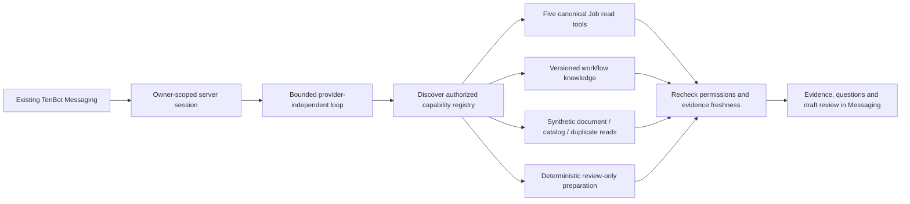

# TenBot optional OpenAI agent proof of concept — October 28, 2026

**Status: implemented locally; awaiting Product acceptance.** Chris's explicit **TENBOT — OPENAI AGENTIC PROOF OF CONCEPT** request accepts the October 28 benchmark recommendation and authorizes this focused local implementation and local commit. It does not authorize paid calls, hosted changes, a push or deployment. The separate Advisory & Implementation conversation was unavailable; the current explicit request governs. Base: `dev` at `d3f42a7`; candidate: the commit containing this record. No branch/worktree was created.

The candidate provides a provider-independent investigation loop and an optional OpenAI Responses transport within existing TenBot Messaging. It demonstrates authorized multi-tool reads and synthetic invoice drafts. **It does not establish OpenAI reasoning quality:** neither a server API credential nor explicit paid-call authorization was available. All new model transport tests use mocks; the browser demonstration uses an explicitly selected scripted transport. Production remains on Qwen3, with its hosted constructor unchanged.

## Review the local demonstration

Open [localhost:3000/my-work?tenbotExperiment=1](http://localhost:3000/my-work?tenbotExperiment=1), then **Messaging → TenBot → Local agent experiment**. The existing safe `.local` review session is required. No new chatbot or Messaging system was added.

1. Select **Job investigation** and ask: “Investigate Job TB-2801: summarize its recorded status, saved schedule and labor, and explain what remains unknown.” Inspect the summary, planning and deterministic labor evidence.
2. Clear the assistant conversation. Select **Invoice preparation**, attach the supplied synthetic text invoice, and ask: “Here's the synthetic invoice. Create pending receivals for the materials listed.” Inspect the missing order details and held entries.
3. Enter **Synthetic Employee**, order date **2026-10-26**, destination **Denton** in the experiment controls. Ask to prepare the same invoice again for review. The invoice date remains distinct from the employee-supplied order date.
4. Inspect **Experiment evidence and measurements**. Every response is labeled scripted, review-only, with completed database actions **none**. There is no approve/execute action. Scenario selection controls the test double; it is not evidence that a model understood those questions.

The reviewed result is two material drafts: **Alaska White #1: 2 × 50 LB Bag** from 100 LB; **Clear Resin Part A: 1 × 5 GAL Pail** from 5 GAL. Blue Coal is held for a potential existing receival, CC Green for two catalog offers, and Unlisted Violet for no match. Freight is excluded. An order count such as “3 Bag” does not assert a three-pound package size. Real measured package conflicts remain held.

The original app process on port 3000 and existing adapters on 55593/55594 were preserved. The task owns the loopback adapter on **55595**, started with `npx tsx scripts/start-tenbot-agent-review.mts`. Its current PID/mode/source hashes are in `/private/tmp/tenops-tenbot-agent-poc/server.json`. The app uses the existing optimized review export and existing disposable Job database. The synthetic catalog/invoice are fixed local fixtures. The adapter is intentionally unsigned fixture Auth, not hosted authentication.

## Implementation and reusable boundaries

| Component | Candidate behavior / reuse |
| --- | --- |
| Existing interface and handler | Retains Messaging, account-scoped controller and input/privacy checks. A small optional handler dependency selects the experiment; default handler behavior is preserved. The hosted Edge entrypoint never constructs it. |
| `tenbot-agent.ts` | Provider-independent strict tool definitions, discover/load registry, bounded model/tool loop, evidence IDs and host-owned proposals. No framework dependency. |
| `tenbot-openai.ts` | Server-only Responses API for allowlisted `gpt-6.1-sol` / `gpt-6.1-terra`; strict function/final schemas, low reasoning, encrypted continuation replay, `store:false`, bounded requests, timeout, reservation/usage accounting. No browser key. Actual account entitlement remains unverified. |
| `tenbot-agent-operations.ts` | Reuses all five existing caller-authorized Job tools: `find_jobs`, `get_job_summary`, `get_job_planning`, `get_job_labor_summary`, `get_production_overview`. Reuses deterministic calculations, projections, RLS and unknown/truncation contracts. Adds permission-filtered search of existing versioned workflow knowledge. |
| `tenbot-agent-session.ts` | Owner-bound, concurrent-request lock, one-hour expiry, maximum 100 in-memory sessions. Retains only the last three employee questions, canonical lookup seeds and explicit attachment/order metadata. Previous operational answers, tool results and native provider history do not cross turns. Rereads evidence and permissions before publication. |
| `tenbot-invoice.ts` | Read/prepare registry for synthetic document reading, catalog search, duplicate checks and draft preparation. Reuses purchasing catalog combination, supplier matching and package parsing contracts. Decimal package conversion is deterministic. No mutation tool. |
| Review adapter and fixtures | Explicit scripted provider for infrastructure verification; optional real provider only after server key, spending opt-in and separately authorized budget. No business setup/reseed/migrations at startup. |

Registry discovery loads only selected schemas; tool results and schemas still consume inference tokens. The runtime permits at most 16 rounds, 14 tool attempts, four calls per round, three tool errors, 24 KB per result, 160 KB session context, 90 seconds, 3,000 output tokens per step and $0.25 accounted per request. OpenAI requests disable parallel tool calls; tools execute sequentially. One retryable provider retry is allowed and accounted. Conservative byte-based reservations can stop a task before its measured token cost would reach the cap; live testing must assess completion under these limits.

Caller identity, read/prepare grants, argument validation and final publication decisions remain outside the model. Preparation requires existing `writeBusinessData` plus `adjustInventory`; unauthorized callers cannot discover that capability. Every Job operation still uses its original caller tools. Repeated reads retain the first baseline and latch inconsistencies, preventing a later read from blessing an earlier stale fact/draft. Changes, revocation, failed refresh, limits and provider failure suppress the candidate evidence/proposals and model candidate prose. Freshness is best effort across reads, not an atomic database snapshot.

No arbitrary SQL, shell, filesystem, web request, private Messaging, personal Task or financial-data capability is registered. No credentials or privileged client enter model context. The local invoice caller adapter fixes tables/projections and fails on incomplete reads; it has contract tests but was not exercised against hosted Inventory RLS. Local real-PostgreSQL authorization testing covers the existing Job tools separately.

## Actual comparison and architectural findings

| Dimension | Existing Qwen path | Optional OpenAI path |
| --- | --- | --- |
| Actual model evidence | Recent released Qwen results preserved in the [QA reconciliation](2026-10-28-tenbot-qa-reconciliation.md). No fresh Qwen request was made in this task. | **Zero live Sol/Terra requests.** Mocked Responses transport and scripted orchestration only. No measured model win, latency or task cost. |
| Compound Job investigation | Current deterministic router chooses one detail tool by lexical precedence. A current pure-code probe sends schedule + labor + material questions to labor alone. This is an architecture constraint, not proof of Qwen inability. | Registry and loop can combine the same authorized tools. Browser script exercised summary + planning + labor after lookup. Autonomous selection remains untested. |
| Multi-turn context | Existing released owner-scoped Job context and conservative response path remain unchanged. | Tested owner-bound question/ID seeds, explicit order metadata and fresh rereads; scripted provider uses these contracts. Novel natural-language follow-ups still need live evaluation. |
| Qualitative answers | Current validator requires complete fact vocabulary, numeric order, anchors and semantic modifiers, and restricts connective/risk/recommendation prose. | Experimental structured observations/inferences/recommendations/questions replace the lexical prose gate. Host validates schemas, evidence IDs and proposals. Semantic entailment of free prose remains unproved. |
| Invoice / cross-module work | Existing release has no attachment-to-receival preparation capability. This is a missing tool/workflow boundary, not a measured model defect. | Synthetic text → catalog → duplicates → preparation exercised. Photo/PDF interpretation, general upload handling and live Inventory access are absent. |
| Error recovery | Existing deterministic fallback remains intact. | Offline invalid-tool-argument recovery and provider timeout/retry/refusal/malformed output/cost-limit paths tested. No live model recovery result. |

[Current routing/prose probe](evidence/2026-10-28-tenbot-agent-poc/routing-comparison.json) also demonstrates that “Total labor: 18 hours.” passes the current validator while the equivalent synthetic “Recorded labor totals 18 hours.” fails. A null live route can still lead to verified workflow guidance; it must not be counted as a model failure. Existing deterministic fallback remains valuable for provider unavailability and known facts. Specialized one-tool routing and lexical prose equivalence are reasonable candidates for simplification only after live evidence supports it.

Recent **actual Qwen**, for context only: the QA reconciliation recorded 18 dispatches, 16,426 input / 1,975 output tokens and 136.169 token-estimated Neurons, including superseded attempts. The later accepted release window recorded 13 actor requests, 11 completed / two failed attempts, 9,737 input / 1,500 output tokens and 90.754 estimated Neurons, with $0 incremental Workers Free cost. Those workloads, provider windows and failures differ from this experiment; they are not a head-to-head score. [Recorded Qwen answers](evidence/2026-10-28-tenbot-qa-reconciliation/actual-answers.json) preserve the actual outputs.

The browser's local scripted elapsed times were 4.281 s for the Job investigation and 3.137 / 3.026 s for invoice preparation/follow-up. They measure registry, capability, fixture-query, freshness and UI overhead, **not inference latency**. The Job used four scripted provider steps/five tool attempts; each invoice request used seven steps/nine attempts. All inference token counters and paid spend were zero. Exact outputs and tool arguments are in the [browser trace](evidence/2026-10-28-tenbot-agent-poc/browser-report.json).

## Official capability and cost basis

Official OpenAI documentation checked October 28 lists [Sol](https://developers.openai.com/api/docs/models/gpt-6.1-sol) and [Terra](https://developers.openai.com/api/docs/models/gpt-6.1-terra), image input, structured outputs and function calling. Their tool calls require Responses. [Function calling](https://developers.openai.com/api/docs/guides/function-calling) supports this controlled application-run loop; no hosted agent framework or Production shell is required. Public documentation does not establish this account's model availability or access. ChatGPT subscription access is not an API credential/spending grant.

| USD / million tokens, Standard short context | Input | Cached read | Default 30-minute cache write | Output, including billed reasoning |
| --- | ---: | ---: | ---: | ---: |
| GPT-6.1 Sol | 2.00 | 0.10 | 2.50 | 10.00 |
| GPT-6.1 Terra | 1.00 | 0.05 | 1.25 | 5.00 |

Cache writes use their total write rate, not an additional full input charge; see [prompt caching](https://developers.openai.com/api/docs/guides/prompt-caching). Estimates below conservatively price all input as default cache writes, assume no cache hits, sum repeated context/tool data over **every** step and include reasoning/tool arguments in output. They supersede the earlier research estimate's ordinary-input-only assumption. No paid hosted tools, storage, tax or TenOps infrastructure are included. These are forecasts, not observed consumption.

| Assumed completed task profile | Total input / billed output across steps | Sol | Terra |
| --- | --- | ---: | ---: |
| Read investigation, roughly three steps | 9,000 / 1,500 | $0.0375 | $0.01875 |
| Document draft, roughly six steps | 45,000 / 6,000 | $0.1725 | $0.08625 |
| Complex document, roughly ten steps | 100,000 / 15,000 | $0.4000 | $0.20000 |

The complex Sol example exceeds this PoC's $0.25 request cap and would stop rather than guarantee completion. Real invoice tasks may require more steps than these examples. For a 70% read / 30% draft mix and 30% contingency: **300 tasks/month ≈ $30.42 Sol / $15.21 Terra; 500 ≈ $50.70 / $25.35**. Doubling billed output raises Sol to about **$41.54 / $69.23**. Employee demand, live tokenization, retries, document complexity and cache reuse are unknown. **Actual OpenAI cost per completed operational task is unavailable.**

Paid mode defaults off. Future local activation requires a server-only key, `TENBOT_OPENAI_SPEND_AUTHORIZED=true`, `--openai`, an allowlisted `--model=...` and `--authorized-budget-usd=...` (maximum $5). These flags are mechanisms, not authorization to set them. The server reserves before network access; unknown/timeout attempts retain their reservation. A local durable journal survives restarts and cannot be reset casually. It is atomic only within the one adapter process and is **not** a distributed Production budget ledger. Production would require shared atomic task/account/month quotas, usage reconciliation, reviewed pricing and per-task completion metrics.

## Receival execution and document boundaries

The prototype deliberately has no database execution service. Its review schema contains source references, catalog IDs and decimal strings and is **not** a `pending_receivals` insert payload. Supplier is distinct from manufacturer; invoice date is not order date; missing order details remain unknown. A catalog result never licenses guessing between ambiguous offers. Existing receivals do not have a general invoice-reference uniqueness contract; duplicate detection is conservative supplier/material/size matching, not proven invoice idempotency. Unclassified document source lines and extraction limitations remain visible in evidence; employee comparison with the original is required.

Canonical source inspection found two different existing paths:

- Ordinary manual creation is still `handleCreatePendingReceival` in [Inventory](../../src/app/inventory/page.tsx), with permission checks, validation, row mapping and sequential inserts (current lines 1766–1924). There is **no general transactional invoice creation service** to call safely today.
- Genuine PO-backed creation uses [createPendingReceivalsFromPurchaseOrder](../../src/modules/purchasing/mutations.ts) and the allocation-aware [canonical RPC](../../supabase/migrations/20260923160100_po_reservation_allocations.sql). It requires real immutable issuance/source-line IDs and preserves allocation/retry behavior. A future PO tool must reuse it; never fabricate an issuance. Partial receiving RPCs mutate existing receivals and are not creation services.

A future ordinary invoice executor needs a separately approved server contract that reuses the manual business rules and Inventory identity/package conventions, with a transaction, idempotency, duplicate reconciliation, audit and approval binding. Approval must bind owner, exact immutable draft hash, canonical identities/quantities, source evidence and expiry; execute must reauthorize and revalidate current records. An “approved” sentence cannot grant authority. None of that execution work is implemented or implied accepted here.

Only synthetic **text** attachment intake is implemented. No real photo/PDF upload, malware/type/size/storage policy, vision/OCR, retention or scanned-document extraction is claimed. Future approved attachment intake should be owner-authorized and bounded, preserve page/line evidence, and send only the necessary document to a multimodal provider. Treat attachment instructions as untrusted content. Structured extraction still needs deterministic units, catalog checks and human review; model confidence is not a permission or completeness check.

## General operational-agent direction

The loop does not choose tools with per-question patterns. The scripted test double does, intentionally, use explicit demonstration scenarios; real OpenAI mode ignores that scenario when reasoning. Whether Sol or Terra can handle novel requests through this registry remains the central live acceptance question.

Keep three context sources separate: (1) release-pinned, role-appropriate application/workflow knowledge; (2) current caller-authorized operational tools; (3) explicit reviewed Tenarten operating decisions. The PoC exposes the existing knowledge export, not arbitrary repository access. Its corpus remains pinned to the prior verified release and retains the known Bid Preparation help-breadcrumb follow-up; no corpus or Product Canon was silently rewritten. Repository source inspection by developers is separate from employee record access.

Externalize useful institutional knowledge through selected, reviewed decision/workflow documents with owner, effective date, source pin, verification date and supersession links in the existing repository documentation. Include only approved role-appropriate excerpts in the release export. Do not ingest private Product history indiscriminately or depend on a personal ChatGPT session. No conversation import was performed. Capability descriptions should state permissions, input/output schema, scope, source freshness, completeness and side effects. Additional cross-module work should add real authorized capabilities, not a new question router. Missing purchasing issues, private Tasks or absent invoice execution remain unavailable until deliberately approved tools exist.

## Validation and evidence

Risk: **Tier 3 / focused Testing Level 3**, because the delta adds external-provider and multi-module preparation boundaries. No migration, grants, hosted Auth/configuration or business database writes were introduced. Disposable test infrastructure setup by existing verifiers is distinct from operational writes.

| Command / check | Actual result |
| --- | --- |
| `npx tsx scripts/verify-tenbot-agent.mts` | Initial 28 offline runtime/transport groups pass; [receipt](evidence/2026-10-28-tenbot-agent-poc/runtime-validation.json). After the cache-write pricing correction, `--cache-accounting-only` passes nine focused groups (five new, four adjacent); [receipt](evidence/2026-10-28-tenbot-agent-poc/cache-accounting-validation.json). Unaffected groups were not repeated. Native API responses are mocked. |
| `npx tsx scripts/verify-tenbot-invoice.mts` | 20 deterministic groups pass, including raw package-count regression, real package conflicts, fractional conversions, ambiguous/duplicate/unmatched holds, source-span/argument and read-projection guards. [Receipt](evidence/2026-10-28-tenbot-agent-poc/invoice-validation.json). |
| `npx tsx scripts/verify-tenbot-agent-session.mts` | 16 groups pass: owner/expiry/concurrency, forged history, no execution, revocation, stale and repeated-key evidence, final-read revocation and output redaction. [Receipt](evidence/2026-10-28-tenbot-agent-poc/session.json). |
| `npx tsx scripts/verify-tenbot-agent-database.mts` | Nine groups / **93 actual authenticated PostgreSQL SELECT queries**, all five existing tools, hidden-Job RLS, inactive/read-only roles, strict args and freshness. Zero mutations/external calls; protected records unchanged. [Receipt](evidence/2026-10-28-tenbot-agent-poc/database.json). |
| `node scripts/verify-tenbot-agent-browser.mjs --scripted-local` | Six groups / three scripted questions pass in actual localhost Messaging; desktop/mobile, quantities/holds, follow-up, route persistence, blur invalidation. No Auth injection or interception; zero Qwen/OpenAI calls. [Trace](evidence/2026-10-28-tenbot-agent-poc/browser-report.json), [desktop](evidence/2026-10-28-tenbot-agent-poc/desktop-invoice-reviewed.png), [mobile](evidence/2026-10-28-tenbot-agent-poc/mobile-invoice.png). |
| `node scripts/verify-tenbot-agent-http.mjs --scripted-local` | 11 failure-only groups pass: identity/origin, invalid body/action, browser provider opt-in, forged history/conversation, body/method bounds. [Receipt](evidence/2026-10-28-tenbot-agent-poc/http.json). |
| Existing `npx tsx scripts/verify-tenbot.mts` | Pass: 16 chunks / 113 retrieval examples and existing local core/handler/meter/feedback checks. |
| Existing `npx tsx scripts/verify-tenbot-privacy.mts --policy-only` | Six groups / three exact QA cases pass, no model/database calls. |
| Existing full `verify-tenbot-privacy.mts` | **Stops at line 164:** old verifier expects an exception for an invalid model source ID; both base HEAD and candidate reject it and return the identical safe guide fallback. Independent exact-source and isolated mocked reproduction confirm pre-existing expectation drift. Original verifier not changed. No full-suite pass claimed. [Evidence](evidence/2026-10-28-tenbot-agent-poc/baseline-privacy-fallback.json). |
| TypeScript, targeted ESLint including shared modules with `--no-ignore`, `git diff --check`, optimized review export | Pass. Production build mode was used locally; no deployment. |
| Independent EM/security review + parent desktop/mobile visual review | Local prepare-only boundary passes, no outstanding blocker. [Review and exact source hashes](evidence/2026-10-28-tenbot-agent-poc/security-review.json). Not a hosted Auth or live model certification. |

The previously failing/stopped browser checkpoints remain in task scratch; selected final synthetic evidence is checked in. No credential, bearer token, encrypted reasoning continuation or private history is included. Unrelated dirty `CURRENT_STATE.md`, historical QA/untracked receipts and existing worktrees were preserved.

## Product acceptance and next experiment

Accept or refine this **local architecture/prepare-only candidate** first. Retain Qwen as Production provider; do not choose a primary model from mock success. The smallest next experiment is explicit API spending authorization and a server project key for a **maximum $5 total**, with the same fixtures, schemas and scorecard on Sol and Terra. This candidate supplies the transport and measured tool/result/usage trace; it does not authorize running it.

Use the same evidence for: natural Job investigation; multi-Job comparison; a novel Job + catalog question whose missing linkage must remain explicit; multi-turn follow-up; invoice extraction/draft; ambiguous SKU/package and duplicate variants; tool error and provider failure. Include a small regression subset from the existing QA. Score observed-vs-inferred separation, missing information, valid selected tools/args, exact host quantities/holds, completion, all-step latency/tokens/cache writes/cost, and absence of unauthorized access/execution. Preserve raw returned structured outputs, not hidden reasoning. Current offline results do not substitute for those live cases.

Recommend a small Production **read/prepare pilot only after** live results justify the model, real caller-JWT/Inventory RLS and signed-in browser privacy gates pass, attachment policies are approved, shared accounting exists and Chris explicitly authorizes deployment/participants. Keep writes unavailable. No primary migration, broad agent framework, unrestricted source/SQL access or hypothetical business workflow is required to evaluate that step.

**Stop: Product acceptance.** No push, deployment, hosted configuration, paid inference, migrations, Production data, credentials or permissions changed.
